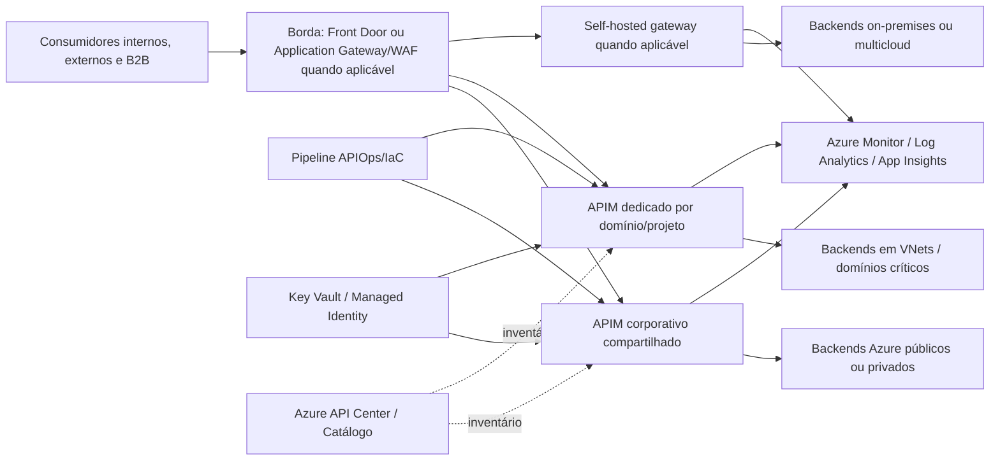

# Azure API Management Service — modelo corporativo de uso

> **Nota inicial:** esta é uma **primeira versão** do artigo técnico-executivo, preparada para revisão. O conteúdo consolida as contribuições especializadas recebidas, elimina redundâncias e mantém as referências técnicas. As decisões de SKU, região e arquitetura devem ser revalidadas com o cliente, no Azure Portal, na documentação oficial e com o time Microsoft antes da implantação.

## 1. Sumário executivo

O Azure API Management Service (APIM) deve ser tratado como uma **capacidade corporativa de plataforma para gestão do ciclo de vida de APIs**, e não apenas como um proxy HTTP. Em um ambiente corporativo com integrações cloud/cloud, cloud/on-premises, APIs internas, APIs B2B, APIs sensíveis e múltiplos times de produto, o APIM concentra controles de publicação, segurança, consumo, observabilidade, versionamento, catálogo e governança.

A recomendação consolidada para o cliente é adotar um **modelo híbrido/federado governado**:

- **APIM corporativo compartilhado** para APIs internas comuns, reutilizáveis, de baixa/média criticidade e com padrões homogêneos.
- **APIM por domínio, subscrição, projeto ou workload crítico** quando houver requisitos objetivos de isolamento, exposição externa, dados sensíveis, autonomia operacional, custo, rede, compliance, SLO próprio ou alto volume.
- **Governança centralizada com autonomia controlada**: padrões, guardrails, MPAS/MAP, API as Code, APIOps/IaC, observabilidade, catálogo e segurança são corporativos; a operação de APIs pode ser federada por domínio dentro de escopos aprovados.

A decisão não deve ser orientada por preferência organizacional (“um APIM para tudo” ou “um APIM por aplicação”), mas por matriz objetiva de risco, domínio, exposição, criticidade, rede, custo, operação e disponibilidade regional.

**Ponto crítico para o Brasil:** as contribuições e a validação realizada em 25/05/2026 indicam que, na documentação oficial de disponibilidade regional de tiers v2, **Brazil South lista Basic v2 e Standard v2**, mas **não lista Premium v2 nem Workspace gateway Premium**. Brazil Southeast não deve ser assumida como disponível para APIM v2 sem nova validação. Portanto, disponibilidade regional/SKU deve ser um **critério eliminatório** no desenho, especialmente quando a arquitetura depender de Premium v2, workspaces, VNet injection completa, availability zones, multi-região, self-hosted gateway ou outros recursos avançados.

## 2. Contexto e problema

O cliente corporativo precisa definir um modelo de uso do Azure API Management Service para sistemas desenvolvidos na plataforma, cobrindo:

- padrão de utilização do APIM;
- relação com MPAS/MAP como processo de arquitetura, classificação e aprovação;
- pipeline de publicação de APIs;
- integração entre sistemas cloud/on-premises e cloud/cloud;
- governança de APIs como ativos corporativos;
- políticas de segurança, autenticação, autorização e consumo;
- decisão entre APIM corporativo compartilhado, APIM por subscrição/projeto/domínio ou modelo híbrido.

O problema central é equilibrar **padronização corporativa** e **autonomia dos domínios** sem criar riscos opostos:

- **centralização excessiva**, que aumenta blast radius, gargalo operacional, disputa de capacidade e mistura de APIs com perfis de risco diferentes;
- **proliferação sem critério**, que aumenta custo, fragmenta governança, duplica policies, dificulta observabilidade e cria catálogos paralelos;
- **uso superficial do APIM como proxy**, sem segurança forte, ownership, versionamento, catálogo, consumo governado ou observabilidade.

O modelo deve permitir que APIs sejam publicadas de forma rápida, segura, rastreável e observável, com critérios claros para exceções. O caminho correto precisa ser mais simples que o bypass; caso contrário, os times tenderão a publicar APIs fora do APIM, alterar produção manualmente ou expor backends diretamente.

## 3. Azure API Management Service: visão geral, v1 vs v2, SKUs e disponibilidade regional

### 3.1 Visão geral

O Azure API Management é uma plataforma gerenciada para gerenciamento de APIs em ambientes Azure, híbridos e multicloud. Seus componentes principais são:

- **API Gateway / runtime / data plane:** recebe chamadas, aplica policies, valida credenciais, controla quotas/rate limits, roteia para backends, transforma mensagens de forma controlada, pode aplicar cache e emite telemetria.
- **Management plane:** permite configurar APIs, produtos, policies, backends, subscriptions, usuários, grupos, certificados, diagnósticos e integrações.
- **Developer Portal:** canal de descoberta, documentação, solicitação de acesso, teste controlado e onboarding de consumidores.

No modelo corporativo, o APIM deve ser posicionado como:

- fachada governada para APIs síncronas HTTP/REST, GraphQL, SOAP/WSDL e WebSocket quando suportado;
- ponto de controle de autenticação, autorização grossa, consumo e observabilidade;
- camada de abstração para backends Azure, on-premises, SaaS e multicloud;
- runtime de políticas transversais, não de lógica de negócio complexa;
- parte do ciclo de vida de API-first, catalogação, versionamento, publicação e descontinuação.

### 3.2 Terminologia: clássico/v1, stv1/stv2, Consumption e tiers v2

As contribuições usam “v1” como referência aos **tiers clássicos** do APIM. Para evitar ambiguidade, recomenda-se adotar a seguinte terminologia no programa:

| Termo | Significado prático |
|---|---|
| **Clássico / “v1” interno** | Tiers Developer, Basic, Standard e Premium. Não confundir com a plataforma computacional stv1/stv2. |
| **stv1/stv2** | Plataforma de computação dos tiers clássicos. stv2 não é o mesmo que tier v2. Instâncias legadas devem ser verificadas quanto à dependência de stv1. |
| **Consumption** | Modelo serverless/por consumo, útil para cargas específicas, mas com limitações relevantes para governança enterprise, rede, portal e observabilidade. |
| **Tiers v2** | Basic v2, Standard v2 e Premium v2. Usam plataforma nova, com provisionamento/escala mais rápidos e diferenças funcionais em relação aos tiers clássicos. |

### 3.3 Orientação por SKU/tier

| SKU/tier | Uso recomendado | Pontos de atenção |
|---|---|---|
| **Developer clássico** | Desenvolvimento, testes e avaliação. | Não usar em produção; não oferece SLA. |
| **Basic/Standard clássicos** | Cenários simples ou legados quando recursos atendem. | Limitações de rede, escala e isolamento devem ser avaliadas. |
| **Premium clássico** | Workloads enterprise que exigem VNet injection, multi-região, self-hosted gateway, backup/restore, múltiplos domínios customizados ou recursos ainda indisponíveis em v2. | Validar disponibilidade regional, custo, zonas, unidades e estratégia operacional. |
| **Consumption** | Workloads serverless/variáveis e casos específicos. | Avaliar limitações de portal, rede, observabilidade, governança e resiliência. |
| **Basic v2** | Desenvolvimento/testes e cenários simples com SLA. | Não deve ser padrão para produção crítica ou APIs sensíveis. |
| **Standard v2** | Produção single-region em muitos cenários, incluindo acesso a backends privados por outbound VNet integration e inbound Private Endpoint para o gateway. | Não equivale a isolamento completo do gateway dentro da VNet; validar recursos, limites e exposição. |
| **Premium v2** | Workloads enterprise que precisam de full VNet isolation, maior escala, availability zones e workspaces, quando disponível. | Atualmente não possui paridade total com Premium clássico: multi-região, self-hosted gateway, backup/restore e múltiplos custom domains estão entre recursos indisponíveis em v2 segundo a documentação consultada. |

Para recursos mais recentes de tiers v2, os pipelines/IaC devem usar API version **2024-05-01 ou posterior**, conforme indicado na documentação consultada.

### 3.4 Disponibilidade regional e nota específica sobre Brasil

A disponibilidade regional deve ser validada no início do desenho, no sizing e novamente antes do provisionamento. Na documentação Microsoft consultada em 25/05/2026:

| Região | Basic v2 | Standard v2 | Premium v2 | Workspace gateway Premium |
|---|---:|---:|---:|---:|
| **Brazil South** | Disponível | Disponível | Não listado como disponível | Não listado como disponível |
| **Brazil Southeast** | Não assumir disponibilidade para v2 sem nova validação | Não assumir disponibilidade para v2 sem nova validação | Não assumir disponibilidade | Não assumir disponibilidade |

**Implicações arquiteturais:**

1. Se a residência/região Brasil for mandatória e o requisito depender de Premium v2 ou workspace gateway, o desenho deve avaliar **Premium clássico**, Standard v2 com controles compensatórios, região alternativa aprovada, instância dedicada ou ajuste de requisito.
2. Se o requisito for **multi-região no APIM**, a documentação indica suporte no **Premium clássico**, enquanto Premium v2 ainda não oferece multi-region deployment.
3. Se o requisito for **self-hosted gateway**, a documentação consultada lista suporte nos tiers Developer e Premium clássicos; não assumir suporte nos tiers v2.
4. Se o requisito for backend privado em Azure e produção single-region, **Standard v2 em Brazil South** pode ser candidato, desde que seus limites de rede, escala, observabilidade e exposição atendam ao risco.
5. Se o requisito for gateway totalmente privado ou isolamento forte, comparar **Premium clássico**, **Premium v2 onde disponível** e alternativas de segmentação, sempre com validação regional.
6. A disponibilidade de capacidade pode mudar; a decisão deve ser registrada no MPAS/MAP e revalidada no pipeline.

## 4. Modelos de adoção (corporativo, por subscrição/domínio, híbrido) com matriz de decisão

### 4.1 Modelo A — APIM corporativo compartilhado

**Descrição:** uma ou poucas instâncias APIM corporativas concentram APIs de múltiplos sistemas, domínios e times. A plataforma central define policies globais, segurança mínima, catálogo, observabilidade, produtos, naming, pipelines e guardrails.

**Quando usar:**

- APIs internas comuns e reutilizáveis.
- Baixa/média criticidade e requisitos homogêneos.
- Consumidores internos conhecidos.
- Necessidade de acelerar padronização, onboarding e visibilidade executiva.
- Times ainda amadurecendo em APIOps, versionamento e segurança.

**Benefícios:** menor custo inicial, operação centralizada, catálogo unificado, policies consistentes e menor duplicação.

**Riscos:** blast radius maior, gargalo operacional, noisy neighbor, disputa por capacidade, mistura de APIs com riscos diferentes e risco de centralização sem segmentação.

### 4.2 Modelo B — APIM por subscrição, projeto ou domínio

**Descrição:** cada domínio de negócio, produto, programa ou subscrição Azure possui instância APIM própria, seguindo baseline corporativo obrigatório.

**Quando usar:**

- Domínios com alta autonomia e ciclo de mudança independente.
- APIs externas, B2B, sensíveis, reguladas ou administrativas.
- Requisitos específicos de rede, DNS, certificados, latência, SLO, DR ou auditoria.
- Necessidade de segregação de custos, quotas, capacidade e operação.
- Alto volume ou risco de impacto em APIs de outros domínios.

**Benefícios:** isolamento, autonomia, blast radius menor, chargeback/showback mais claro e melhor alinhamento com requisitos específicos.

**Riscos:** sprawl de instâncias, custo maior, duplicação de policies, padrões divergentes e observabilidade fragmentada se não houver catálogo e automação central.

### 4.3 Modelo C — Híbrido/federado governado (recomendado)

**Descrição:** combina APIM corporativo compartilhado para APIs comuns com instâncias, workspaces, gateways ou subscrições dedicadas quando critérios objetivos justificarem segmentação.

**Recomendação:** usar este modelo como baseline. Ele evita os extremos “um APIM para tudo” e “um APIM por aplicação”. A plataforma central fornece guardrails, templates, pipelines, policy fragments, catálogo, observabilidade e governança; os domínios operam APIs dentro de escopos aprovados.

### 4.4 Self-hosted gateway para cenários híbridos

O self-hosted gateway pode executar o gateway próximo a backends on-premises, Kubernetes, Azure Arc ou ambientes multicloud, mantendo o plano de gestão no APIM Azure. Ele é indicado quando há necessidade real de reduzir latência, evitar hairpinning, atender compliance local ou manter tráfego próximo ao backend.

Antes de adotá-lo, validar:

- SKU suportada: contribuições indicam suporte em Developer e Premium clássicos, não nos tiers v2.
- Conectividade outbound com Azure.
- Alta disponibilidade do cluster local.
- Atualização da imagem e operação do runtime.
- Observabilidade local e centralizada.
- Comportamento em perda temporária de conexão com o management plane.

### 4.5 Matriz de decisão

| Critério | APIM corporativo compartilhado | APIM por domínio/subscrição/projeto | Modelo híbrido governado |
|---|---|---|---|
| APIs internas comuns | Recomendado | Normalmente excessivo | Recomendado com produtos e owners claros |
| APIs externas/B2B | Possível com segmentação forte | Frequentemente recomendado | Recomendado quando houver classes distintas de exposição |
| APIs sensíveis/reguladas | Apenas com segregação efetiva | Recomendado | Recomendado com instância/gateway/subscrição dedicada quando necessário |
| Alta criticidade/SLO próprio | Possível, mas exige isolamento interno | Recomendado | Recomendado para reduzir blast radius |
| Backends on-premises | Possível via ER/VPN | Recomendado quando há rede/latência específica | Recomendado, inclusive com self-hosted gateway se suportado |
| Autonomia de times | Moderada via RBAC/workspaces/pipeline | Alta | Alta com guardrails centrais |
| Custo inicial | Menor | Maior | Balanceado |
| Observabilidade corporativa | Mais simples | Exige padronização | Exige catálogo e dashboards consolidados |
| Segurança e compliance | Boa para padrões comuns | Melhor para requisitos específicos | Melhor equilíbrio |
| Risco de sprawl | Baixo | Alto se sem governança | Controlável por processo de exceção |
| Risco de centralização | Alto se sem segmentação | Baixo | Controlável por matriz e segmentação |
| Disponibilidade regional/SKU | Critério obrigatório | Critério obrigatório | Critério obrigatório, especialmente no Brasil |

## 5. Arquitetura de referência

A arquitetura de referência deve separar **governança**, **runtime**, **rede**, **segurança**, **publicação** e **operação**.

### 5.1 Componentes recomendados

- **APIM corporativo compartilhado** em tier produtivo compatível com requisitos de SLA, rede, escala e região.
- **APIMs dedicados por domínio/projeto/workload** quando aprovados pela matriz de decisão.
- **Azure API Center** como inventário corporativo e governança de design-time, complementando o APIM no runtime.
- **Developer Portal do APIM** como experiência de consumo das APIs publicadas.
- **Azure Front Door Premium ou Application Gateway WAF** para APIs públicas/B2B quando houver necessidade de proteção L7, roteamento global, WAF, TLS e inspeção na borda.
- **Private Endpoint, VNet integration, VNet injection, hub-spoke, Virtual WAN, ExpressRoute ou VPN** conforme exposição e localização dos backends.
- **Key Vault e Managed Identity** para certificados, segredos, named values e autenticação APIM → backend.
- **Azure Monitor, Log Analytics, Application Insights, Workbooks e Event Hub/SIEM** para telemetria, alertas, auditoria e correlação.
- **Bicep/Terraform + Azure APIOps Toolkit + Azure DevOps/GitHub Actions** para infraestrutura e publicação de APIs como código.

### 5.2 Padrões de integração

**Cloud/cloud na Azure ou multicloud:**

- Usar APIM como ponto padronizado para APIs síncronas.
- Preferir caminho privado para backends sensíveis ou críticos.
- Segmentar APIs internas, externas, B2B e administrativas por DNS, produto, policy, rede, workspace/gateway ou instância.
- Exigir autenticação forte, rate limit, quota, logs e correlação.

**Cloud/on-premises:**

- Usar ExpressRoute ou VPN site-to-site quando APIM gerenciado na Azure acessar backends on-premises.
- Avaliar APIM em VNet/internal, Private Endpoint ou outbound VNet integration conforme SKU.
- Avaliar self-hosted gateway apenas quando latência, compliance ou desenho de tráfego justificarem e a SKU suportar.
- Impedir que consumidores acessem endpoints on-premises diretamente, contornando APIM.

**Integração assíncrona:**

APIM não deve substituir broker, event streaming, workflow ou iPaaS. Para filas, tópicos, eventos, fan-out, reprocessamento, compensação e coreografia, usar serviços apropriados como Service Bus, Event Grid, Event Hubs, Logic Apps ou Functions. O APIM pode expor APIs de controle, consulta ou administração relacionadas.

## 6. Padrões de API, lifecycle, versionamento, catálogo e consumo

### 6.1 Princípios de desenho de API

- **API-first / contract-first:** toda API deve ter contrato OpenAPI, GraphQL ou WSDL versionado antes da publicação.
- **Recursos de negócio, não tabelas internas:** URIs e operações devem representar capacidades de negócio, evitando expor detalhes de banco, sistemas legados ou implementação.
- **Backward compatibility por padrão:** mudanças compatíveis preservam consumidores; breaking changes exigem nova versão e plano de migração.
- **Payloads previsíveis:** JSON como padrão para REST, schemas claros, campos obrigatórios explícitos, paginação, filtros, ordenação e correlation ID.
- **Erros padronizados:** código HTTP adequado, código funcional, mensagem segura, correlation ID e link de documentação quando aplicável.
- **Idempotência quando necessário:** operações críticas devem ter chave de idempotência ou estratégia equivalente.
- **Classificação obrigatória:** interna, externa, parceira/B2B, pública, sensível, regulada, administrativa ou experimental.
- **Policies sem lógica de negócio complexa:** o APIM deve tratar preocupações transversais; regra de negócio pertence ao backend ou camada de integração adequada.

### 6.2 MPAS/MAP como intake obrigatório

Os artefatos MPAS/MAP devem funcionar como porta de entrada para publicação de APIs. Cada API candidata deve registrar:

- domínio, jornada, sistema provedor, consumidores e owners;
- classificação de exposição e sensibilidade;
- tipo de integração: cloud/cloud, cloud/on-premises, B2B, interna, administrativa ou pública;
- topologia APIM: compartilhado, domínio, dedicado, workspace, self-hosted gateway ou combinação;
- SKU/tier previsto e validação regional, incluindo tiers v2 no Brasil;
- contrato OpenAPI/GraphQL/WSDL, versionamento, breaking changes e depreciação;
- produto APIM, grupos consumidores, quotas, rate limits e termos de uso;
- autenticação/autorização: OAuth2/OIDC, Entra ID, JWT, mTLS, certificados, IP allowlist ou combinação;
- observabilidade: logs, métricas, tracing, SLO, alertas e retenção;
- pipeline de publicação, aprovações e rollback.

### 6.3 Lifecycle recomendado

1. **Ideação e registro** no catálogo/API Center ou ferramenta equivalente.
2. **Design** do contrato, segurança, erros, paginação, versionamento e consumo.
3. **Revisão de governança** com validações automáticas e análise humana para riscos relevantes.
4. **Implementação** do backend conforme contrato.
5. **Publicação não produtiva** por pipeline.
6. **Homologação de consumidores** com testes funcionais, segurança, carga, observabilidade e documentação.
7. **Publicação produtiva** com aprovação, changelog, smoke tests e rollback.
8. **Operação** com monitoramento, alertas, gestão de credenciais, quotas e incidentes.
9. **Evolução** por revisions ou novas versions.
10. **Depreciação e retirada** com comunicação, prazo, métricas de consumidores remanescentes e bloqueio controlado.

### 6.4 Versionamento e revisions

O APIM diferencia **versions** e **revisions**:

- **Versions:** para breaking changes ou mudanças que exigem escolha explícita do consumidor. O padrão inicial recomendado é path versioning (`/v1`, `/v2`), salvo restrição arquitetural.
- **Revisions:** para mudanças compatíveis, testes controlados, ajustes de policy, documentação ou evolução não disruptiva.

Regras propostas:

| Mudança | Tratamento recomendado |
|---|---|
| Adição de campo opcional, endpoint novo, melhoria de documentação, ajuste não disruptivo | Revision |
| Remoção/renomeação de campo, alteração de tipo, novo campo obrigatório, mudança de semântica, alteração incompatível de autenticação, remoção de endpoint | Nova version |
| API sem versão explícita | Exceção temporária; migrar para version set |
| Depreciação | Changelog, guia de migração, prazo de convivência e monitoramento de consumidores remanescentes |

### 6.5 Produtos, catálogo e consumo

No APIM, **products** agrupam APIs, termos de uso, subscriptions, quotas, visibilidade e políticas. O desenho de produtos deve refletir consumo e domínio, não a estrutura técnica do backend.

Modelos úteis:

- produto por jornada de negócio;
- produto por domínio;
- produto por perfil de consumidor;
- produto por criticidade/sensibilidade.

Evitar produtos genéricos como “All APIs” ou “Unlimited” para uso real. Subscriptions amplas reduzem rastreabilidade, dificultam quotas e podem contornar policies no escopo de produto.

O catálogo/portal deve apresentar, no mínimo:

- finalidade da API e casos de uso;
- contrato para download;
- autenticação e exemplos de chamada;
- SLA/SLO, quotas, rate limits e suporte;
- versões, changelog e depreciação;
- processo de solicitação de acesso;
- owner e canal de incidentes.

## 7. Segurança, identidade e políticas

### 7.1 Plano de gestão

O management plane deve usar **Microsoft Entra ID + Azure RBAC**, com menor privilégio, grupos em vez de usuários nominais, PIM/JIT para papéis privilegiados e break-glass controlado.

A permissão para editar policies deve ser tratada como crítica: uma policy pode encaminhar tokens, incluir headers sensíveis ou usar managed identity para obter tokens de backend. Por isso, alterações em policy devem passar por Git, PR, validação, aprovação e auditoria.

### 7.2 Cliente → APIM

O padrão para APIs corporativas protegidas deve ser **OAuth 2.0/OIDC**, com validação de token no APIM e/ou backend. A validação mínima inclui issuer, audience, assinatura, expiração, scopes, roles e claims.

Fluxos recomendados:

- **Aplicações web e SPA:** Authorization Code Flow com PKCE; evitar implicit flow em novos desenhos.
- **Server-to-server:** Client Credentials com certificado ou credencial gerenciada; evitar secrets long-lived.
- **B2B/parceiros:** OAuth2/OIDC com tenants/app registrations controlados e mTLS para cenários de maior criticidade.
- **Usuário delegado:** validar scopes/claims no APIM e manter autorização fina no backend.

### 7.3 APIM → backend

A autenticação do APIM para o backend deve ser explícita:

- **Managed Identity** para backends integrados ao Entra ID ou serviços Azure compatíveis.
- **mTLS/certificado cliente** para backends legados, on-premises, B2B ou cenários de alta criticidade.
- **Token exchange/on-behalf-of** quando a identidade do usuário precisar chegar ao backend, com audiência e escopo claros.
- **Segredos em Key Vault** quando ainda houver API key/basic auth, com rotação e plano de modernização.

O APIM pode fazer autorização grossa por produto, operação, scope, role, tenant, IP e certificado, mas não substitui autorização de negócio do backend. Controles como autorização por objeto, propriedade e função devem permanecer no serviço responsável pelo dado.

### 7.4 Subscription keys

Subscription keys são úteis para identificação de consumidor, medição, quota, produto, revogação operacional e showback/chargeback. Elas **não são segurança principal** para APIs sensíveis, transacionais, B2B, administrativas, financeiras, com dados pessoais ou backends não restritos por rede.

Boa prática: usar subscription keys como controle complementar a OAuth2/OIDC, JWT, mTLS, rede privada, autorização no backend e rotação de credenciais.

### 7.5 Policies recomendadas

Policies devem ser padronizadas em fragments/templates e aplicadas por escopo:

- `validate-jwt` ou validação equivalente de tokens;
- rate limit por subscription, produto, IP, tenant, client ID, claim ou certificado;
- quota por janela de tempo;
- validação de payload, schema, tamanho, headers e content type;
- CORS explícito para origens aprovadas;
- IP filtering apenas como camada complementar;
- cache controlado somente para dados apropriados;
- sanitização de logs e remoção de tokens/headers sensíveis;
- mensagens de erro seguras;
- retry/circuit breaker quando aplicável e com critério.

Policies que implementam preço, elegibilidade, autorização por objeto, cálculo transacional ou orquestração complexa devem ficar no backend ou em camada de integração apropriada.

### 7.6 Proteção contra bypass

Backends devem rejeitar chamadas diretas que contornem o APIM. Controles combináveis:

- Private Endpoint, VNet privada, NSG, firewall e access restrictions;
- App Service/Functions restritos à subnet, private endpoint ou origem do APIM;
- AKS/VMs atrás de Internal Load Balancer;
- validação de token com audience/issuer esperados;
- mTLS APIM → backend;
- remoção de endpoints públicos legados;
- monitoramento comparando logs do backend e do APIM.

## 8. Plataforma, landing zone, rede e guardrails

### 8.1 Aderência à Azure Landing Zone

O APIM deve aderir à organização corporativa da landing zone:

- **Platform landing zone:** capacidades compartilhadas, automação, observabilidade, políticas corporativas e APIM compartilhado quando aplicável.
- **Connectivity subscription:** hub, Azure Firewall, DNS privado, ExpressRoute/VPN, Virtual WAN e conectividade comum. O APIM não deve “morar” automaticamente aqui; deve consumir conectividade de forma governada.
- **Application landing zones:** APIMs dedicados quando aprovados por domínio/projeto, entregues por subscription vending.
- **Corp vs Online:** APIs internas e públicas devem seguir fronteiras de rede, WAF, DNS e exposição coerentes.

Produção e não produção devem ser separados por subscription para workloads críticos. Quando não for possível, separar por resource group, RBAC, segredos, produtos, backends, DNS e telemetria ainda é obrigatório.

### 8.2 Naming, tagging e ownership

Sugestão ajustável ao padrão corporativo:

- Resource group: `rg-apim-{corp|dominio}-{ambiente}-{regiao}-{nn}`.
- APIM: `apim-{corp|dominio}-{ambiente}-{regiao}-{nn}`.
- Workspace: `ws-{dominio}-{ambiente}`.
- Produto APIM: `prd-{dominio}-{publico|interno|b2b}-{criticidade}`.
- Private endpoint: `pe-apim-{nome}-{ambiente}-{regiao}`.

Tags mínimas:

- `ownerTecnico`
- `ownerNegocio`
- `apiProductOwner`
- `centroCusto`
- `ambiente`
- `dominio`
- `dataClassification`
- `exposure`
- `criticality`
- `slaTier`
- `mpasMapId`
- `costAllocation`
- `retentionClass`

### 8.3 RBAC

Modelo recomendado:

- **Time de plataforma:** administra instância, rede, observabilidade, policies globais, SKUs, escala, certificados e guardrails.
- **Times de domínio/produto:** gerenciam APIs, produtos, versões, documentação e policies específicas no escopo autorizado.
- **Segurança/IAM:** define padrões de OAuth/OIDC, mTLS, Key Vault, WAF, Defender, exceções e threat model.
- **Operações/SRE:** leitura operacional, alertas, incidentes, capacidade e continuidade.

Usar papéis built-in do APIM e, quando workspaces forem usados, papéis específicos de workspace. Aplicar menor privilégio, PIM/JIT e trilha de auditoria.

### 8.4 Azure Policy e guardrails

Criar iniciativa corporativa para APIM, começando em `Audit/AuditIfNotExists` e migrando para `Deny/DeployIfNotExists/Modify` após remediação. Guardrails mínimos:

- regiões e SKUs permitidos por ambiente;
- bloqueio de SKU não produtiva em produção;
- diagnósticos obrigatórios;
- HTTPS/WSS obrigatório;
- Key Vault para named values sensíveis;
- policies herdando escopo pai com `<base />`;
- proibição de subscriptions “all APIs” para uso rotineiro;
- controle de endpoint público de gestão quando não necessário;
- VNet/Private Endpoint/controle de exposição para APIs internas ou sensíveis;
- tags obrigatórias e cost allocation;
- bloqueio de criação de APIM fora do processo de vending/MPAS/MAP.

### 8.5 Rede, DNS e exposição

Para cada API, documentar origem dos consumidores, localização dos backends, caminho de rede e requisitos de inspeção. Padrões:

- **APIs externas/B2B:** Front Door Premium ou Application Gateway WAF, TLS, OWASP, proteção contra abuso e APIM aplicando identidade, policies e quota.
- **APIs internas:** Private Endpoint, DNS privado, ExpressRoute/VPN e public network access desabilitado quando suportado.
- **Backends privados Azure:** VNet integration/injection conforme SKU, peering/hub-spoke, Private Link, NSGs/UDRs e Azure Firewall.
- **Backends on-premises:** ExpressRoute/VPN, DNS híbrido, firewall, mTLS/token de serviço e testes de latência.
- **Multicloud/SaaS:** conectividade privada quando possível; se público, exigir WAF, OAuth/mTLS, allowlists e observabilidade.

Padronizar DNS por exposição e ambiente, por exemplo: `api.empresa.com.br`, `api-int.empresa.com.br`, `api-b2b.empresa.com.br`, `api-dev.empresa.com.br`.

## 9. Pipeline de publicação, IaC e APIOps

### 9.1 Princípios

Tudo que afeta publicação, segurança, consumo, observabilidade e runtime deve estar em Git e ser implantado por pipeline. Isso inclui:

- instâncias APIM, SKU, região, escala, zonas, rede e private endpoints;
- APIs, operações, schemas, version sets, revisions e products;
- policies globais, por produto, API e operação;
- policy fragments;
- named values sem segredos em texto claro;
- backends, loggers, diagnostics, alertas e dashboards;
- grupos, subscriptions e produtos;
- Azure Policy, RBAC, locks, tags, budgets e naming.

Ferramentas recomendadas: **Bicep ou Terraform**, **Azure APIOps Toolkit**, **Azure DevOps Pipelines ou GitHub Actions**, OIDC/federated credentials, `what-if`/`plan` e policy-as-code.

### 9.2 Fluxo alvo

1. Time de produto altera contrato, metadata, policies e configuração em repositório.
2. Pull request executa validações automáticas.
3. Code owners revisam contrato, policies, segurança e impacto.
4. Deploy automatizado para desenvolvimento.
5. Testes pós-deploy: smoke, contrato, autenticação, autorização, quotas, rate limit, erros e observabilidade.
6. Promoção do mesmo artefato para homologação/UAT com parâmetros por ambiente.
7. Aprovação formal para produção em mudanças de risco.
8. Deploy produtivo rastreável e reversível.
9. Monitoramento pós-release e rollback por Git revert quando necessário.
10. Detecção contínua de drift.

### 9.3 Validações obrigatórias em PR/pipeline

- OpenAPI lint com Spectral ou equivalente.
- Validação estrutural do contrato.
- Detecção de breaking changes com openapi-diff ou equivalente.
- Validação de versions/revisions.
- Segurança: OAuth/OIDC/JWT, scopes, claims, mTLS, CORS restritivo, ausência de secrets.
- Policies: XML válido, `<base />`, fragments reutilizáveis, proibição de lógica de negócio excessiva.
- Consumo: quotas, rate limits, produtos e subscriptions.
- Observabilidade: Diagnostic Settings, logs, correlation ID, alertas.
- IaC: Bicep build/what-if ou Terraform fmt/validate/plan.
- SKU/região: validação explícita de disponibilidade e feature set, especialmente v2 no Brasil.
- Teste pós-deploy automatizado.

### 9.4 Drift, exceções e rollback

- Acesso de escrita ao APIM em produção deve ser restrito à identidade do pipeline e break-glass controlado.
- Mudança manual emergencial deve gerar registro de exceção, prazo e PR de reconciliação.
- Drift em produção deve abrir alerta/incidente.
- Rollback preferencial por Git revert e nova execução do pipeline.
- Versões anteriores devem coexistir durante janelas de migração.
- Nem toda alteração de rede/SKU é reversível automaticamente; plano de rollback deve ser validado.

## 10. Operação, observabilidade e SLO/SLA

### 10.1 Sinais obrigatórios

| Categoria | Sinais mínimos | Objetivo |
|---|---|---|
| Disponibilidade | sucesso, 5xx, health checks sintéticos | Medir experiência real do consumidor |
| Latência | `Duration`, `BackendDuration`, p50/p95/p99 | Separar gateway, policy, rede e backend |
| Erros | 4xx/5xx, `LastErrorReason`, `LastErrorSource` | Diagnóstico e responsabilização |
| Consumo | chamadas, top APIs, subscriptions, produtos, quotas | Capacidade, chargeback/showback e governança |
| Segurança | 401/403, falhas JWT/OAuth/mTLS, origem anômala | Detectar abuso, falha de configuração e bypass |
| Capacidade | `Capacity` nos clássicos; CPU/memória no v2 | Escala e saturação |
| Rede | conectividade, DNS, Private Endpoint, ER/VPN | Diagnosticar cloud/on-premises e cloud/cloud |
| Mudança | Activity Log, policy/API/backend/certificado | Auditoria e correlação com incidentes |
| Observabilidade | ingestão, atraso, exportação, custo | Garantir saúde da própria telemetria |

Cada API produtiva deve ter owner técnico, owner de negócio, criticidade, domínio, ambiente, SLO, canal de suporte, on-call/escalation, classificação de dados, consumidores autorizados e dependências.

### 10.2 Logs, métricas e alertas

Configurar Diagnostic Settings para Log Analytics, Application Insights, Event Hub/SIEM ou Storage conforme requisito. Logs relevantes:

- `ApiManagementGatewayLogs`;
- `ApiManagementWebSocketConnectionLogs` quando aplicável;
- `APIMDevPortalAuditDiagnosticLog` quando o portal for usado;
- logs específicos para APIs de IA/LLM quando aplicável;
- `AzureActivity` para mudanças administrativas.

Diretrizes:

- Evitar payload logging em produção por padrão.
- Mascarar headers, query params, tokens, PII e dados sensíveis.
- Registrar erros sempre; amostrar sucessos conforme volume e criticidade.
- Usar connection string e managed identity para Application Insights quando possível.
- Enviar auditoria longa para Storage quando houver requisito.

Alertas mínimos: aumento de 5xx gateway/backend, p95/p99 acima do SLO, saturação, CPU/memória alta no v2, 401/403, 429, falhas de conectividade, mudanças manuais, remoção de Diagnostic Settings, ausência de logs e certificados próximos do vencimento.

### 10.3 Dashboards

Separar quatro níveis:

1. **Executivo:** disponibilidade, SLO, volume, crescimento, incidentes, MTTR, custo.
2. **SRE/operação:** erros, latência, capacidade, conectividade, releases e mudanças.
3. **Domínio/produto/API:** owner, criticidade, SLO, consumidores, quotas, top operações e aderência a padrões.
4. **Custo/capacidade:** Log Analytics, retenção, unidades APIM, autoscale e showback/chargeback.

Usar Azure Monitor Workbooks como canvas principal. Evitar dependência estratégica de analytics clássicos, pois as contribuições indicam aposentadoria anunciada dos analytics clássicos dos tiers clássicos para março de 2027.

### 10.4 SLO, SLA e capacidade

SLA do serviço Azure e SLO do cliente não são a mesma coisa. O SLO deve refletir experiência ponta a ponta: APIM, backend, identidade, rede, DNS, certificados, dependências on-premises e processo de publicação.

SLIs recomendados:

- disponibilidade por API/operação crítica;
- taxa de erro separando gateway, backend, consumidor e policy;
- p95/p99 de `TotalTime` e `BackendTime`;
- confiabilidade de publicação;
- MTTD, MTTA e MTTR;
- error budget por API/domínio.

Capacidade não é apenas RPS: payload, TLS, conexões, policies, transformação, cache, backend e padrão de consumo influenciam. Para tiers clássicos, acompanhar `Capacity`; para v2/workspace gateways, acompanhar CPU e memória. Considerar escala com utilização sustentada de 60–70%, sempre correlacionando latência e erros.

## 11. Governança corporativa, ownership e experiência do desenvolvedor

### 11.1 Princípios de governança

1. APIs são ativos corporativos, com dono, contrato, ciclo de vida, segurança, consumo, observabilidade e política de depreciação.
2. Governança deve ser guardrail, não gargalo: controles automatizados e exceções claras.
3. Segmentação deve seguir risco, domínio, audiência, criticidade e região.
4. APIM não é ESB: policies não substituem orquestração complexa nem regra de negócio.
5. Segurança em profundidade: identidade forte, rede, WAF, mTLS, Key Vault e backend protegido.
6. Automação e rastreabilidade por padrão.
7. Developer experience é requisito de governança: se o processo for lento, os times farão bypass.
8. Observabilidade e separação de ambientes são obrigatórias.
9. Decisões devem ser revisáveis quando mudarem volume, criticidade, região, SKU ou requisitos regulatórios.

### 11.2 Ownership mínimo

Cada API deve ter:

- **Business owner:** valor de negócio, consumidores e priorização.
- **Technical owner:** contrato, implementação, qualidade, versionamento e incidentes.
- **Security/data owner:** classificação, privacidade, autenticação/autorização e risco.
- **Platform owner:** capacidade APIM, guardrails, templates, pipelines e observabilidade comum.
- **Consumer owner:** uso correto, credenciais, limites contratados e feedback.

### 11.3 RACI resumido

| Atividade | Arquitetura/Governança | Plataforma APIM | Segurança | Time produtor | Consumidor | SRE/FinOps |
|---|---|---|---|---|---|---|
| Padrões de API, segurança e publicação | A/R | C | C | C | I | C |
| Matriz APIM compartilhado/dedicado/híbrido | A/R | C | C | C | I | C |
| Provisionar instâncias/gateways/produtos-base | C | A/R | C | I | I | C |
| Definir contrato e documentação funcional | C | C | C | A/R | C | I |
| Classificar dados e exposição | A | C | A/R | R | C | C |
| Proteger backend contra bypass | C | C | C | A/R | I | C |
| Publicar API via pipeline | I | C/R | C | A/R | I | I |
| Monitorar SLO, incidentes, custo e consumo | C | R | C | R | I | A/R |
| Gerenciar versões e depreciação | A/C | C | C | A/R | C/I | C |

### 11.4 Experiência do produtor e consumidor

A plataforma deve oferecer templates de repositório, pipelines, exemplos de policies, policy fragments, padrões de autenticação, guia de versionamento, naming/tags, dashboards e processo de exceção.

O consumidor deve encontrar catálogo pesquisável, documentação clara, exemplos, autenticação, quotas, SLA/SLO, ambiente de teste, processo objetivo de acesso, suporte e visibilidade do próprio consumo.

API Center e Developer Portal são complementares: o API Center ajuda inventário e governança de design-time; o Developer Portal apoia consumo das APIs publicadas no APIM.

## 12. Anti-patterns e boas práticas

### 12.1 Lista detalhada

#### 1) APIM por aplicação sem critério

**Risco:** sprawl de instâncias, custo alto, duplicação de policies, observabilidade fragmentada, catálogos paralelos e governança inconsistente.

**Boa prática:** usar matriz MPAS/MAP para decidir entre APIM compartilhado, por domínio ou dedicado, com critérios de criticidade, exposição, dados, rede, SLO, volume, autonomia e compliance.

#### 2) APIM apenas como proxy

**Risco:** baixo valor de plataforma; segurança, consumo, versionamento, documentação e observabilidade continuam dispersos.

**Boa prática:** usar APIM como camada de gestão de lifecycle: policies, products, quotas, versionamento, catálogo, developer portal, analytics e pipeline.

#### 3) Centralização sem segmentação

**Risco:** blast radius elevado, gargalo operacional, noisy neighbor, conflito de mudanças e mistura de APIs com riscos diferentes.

**Boa prática:** centralizar guardrails e catálogo, mas segmentar runtime por ambiente, domínio, produto, workspace/gateway, instância, exposição e criticidade.

#### 4) Misturar APIs internas/externas/sensíveis sem estratégia

**Risco:** exposição indevida, policies inadequadas, retenção/logging incompatíveis, risco regulatório e erro de roteamento/DNS/certificado.

**Boa prática:** classificar APIs antes da publicação e separar por superfície de exposição, hostnames, produtos, rede, WAF, autenticação e auditoria.

#### 5) Sem ownership

**Risco:** APIs órfãs, documentação obsoleta, incidentes sem responsável, chaves sem rotação e versões sem depreciação.

**Boa prática:** exigir business owner, technical owner, security/data owner, canal de suporte, SLO e validade de publicação no catálogo, tags e MPAS/MAP.

#### 6) Publicação manual em produção

**Risco:** drift, erro humano, ausência de auditoria, rollback incerto e segredos em policies.

**Boa prática:** APIOps/GitOps/IaC com PR, validações, approvals, promoção por ambientes e trilha de commit/pipeline.

#### 7) Sem versionamento

**Risco:** breaking changes silenciosos, consumidores quebrados, rollback difícil e perda de confiança no catálogo.

**Boa prática:** usar version sets para breaking changes, revisions para mudanças compatíveis, política de depreciação, coexistência e comunicação.

#### 8) Lógica de negócio demais nas policies

**Risco:** gateway difícil de testar, debugar, versionar e escalar; aumento de latência e acoplamento.

**Boa prática:** limitar policies a segurança, roteamento, transformação leve, validação, cache, quotas e observabilidade. Regra de negócio deve ficar no backend ou camada de integração adequada.

#### 9) Sem observabilidade

**Risco:** incidentes detectados pelo usuário, troubleshooting especulativo, SLO impossível, abuso não detectado e chargeback inviável.

**Boa prática:** Diagnostic Settings, Log Analytics, Application Insights, métricas, traces, dashboards, alertas, runbooks e correlation ID como requisito de go-live.

#### 10) Subscription keys como segurança principal

**Risco:** chaves vazam, são compartilháveis, não provam identidade forte e não resolvem autorização por usuário/objeto.

**Boa prática:** usar OAuth2/OIDC/JWT, Entra ID, mTLS, certificados, Managed Identity, claims/scopes e autorização no backend; subscription keys apenas como controle complementar de consumo.

#### 11) Expor backends diretamente, contornando o APIM

**Risco:** consumidores bypassam autenticação, WAF, quotas, logging, auditoria e contratos de API.

**Boa prática:** restringir backends por rede privada, Private Link, NSG/firewall, access restrictions, validação de origem, mTLS, Managed Identity ou token com audience esperada.

#### 12) Não separar ambientes

**Risco:** testes afetando produção, dados produtivos em não produção, chaves reutilizadas, métricas contaminadas e configurações divergentes.

**Boa prática:** separar dev/hml/prod por instância, subscription, resource group, workspace, produto, hostname, secrets, backends, telemetria e gates de pipeline conforme criticidade.

### 12.2 Matriz resumida

| Anti-pattern | Risco resumido | Boa prática correspondente |
|---|---|---|
| APIM por aplicação sem critério | Sprawl, custo e governança fragmentada | Matriz MPAS/MAP por domínio, risco, rede, volume e ownership |
| APIM apenas como proxy | Perda de valor de segurança, consumo e lifecycle | APIM como plataforma de policies, produtos, catálogo, quotas e observabilidade |
| Centralização sem segmentação | Blast radius e gargalo operacional | Modelo híbrido com segmentação por ambiente, domínio, exposição e criticidade |
| Misturar APIs internas/externas/sensíveis | Exposição indevida e controles incompatíveis | Classificação obrigatória e separação por superfície, rede, produto e policy |
| Sem ownership | APIs órfãs e incidentes sem responsável | Owners, RACI, SLO, suporte e metadados obrigatórios |
| Publicação manual em produção | Drift, erro humano e rollback difícil | Git + PR + APIOps/IaC + validações + aprovação |
| Sem versionamento | Breaking changes e perda de confiança | Versions/revisions, depreciação e comunicação de consumidores |
| Lógica de negócio demais nas policies | Gateway frágil e difícil de manter | Policies para cross-cutting; regra de negócio no backend |
| Sem observabilidade | Incidentes longos e SLO sem evidência | Logs, métricas, traces, dashboards, alertas e runbooks |
| Subscription keys como segurança principal | Identidade fraca e chaves compartilháveis | OAuth/OIDC/JWT, mTLS, Entra ID, claims/scopes e backend authorization |
| Expor backends diretamente | Bypass de segurança, quota e auditoria | Backends privados/restritos e validação de origem/identidade |
| Não separar ambientes | Testes impactam produção e credenciais/dados se misturam | Dev/hml/prod separados, parâmetros por ambiente e promoção controlada |

## 13. Recomendações finais e roadmap sugerido

### 13.1 Recomendações finais

1. **Adotar modelo híbrido/federado governado como baseline.** APIM compartilhado para APIs comuns; instâncias/gateways/subscrições dedicadas para APIs sensíveis, externas, reguladas, críticas ou com rede/SLO próprios.
2. **Formalizar a matriz de decisão no MPAS/MAP.** Nenhuma API produtiva deve ser publicada sem classificação, owner, contrato, segurança, consumo, observabilidade, região/SKU e topologia APIM definidos.
3. **Tratar SKU/região como decisão arquitetural.** Para Brazil South, considerar Basic v2 e Standard v2 como disponíveis na fonte consultada, mas não assumir Premium v2 ou workspace gateway Premium sem nova validação.
4. **Padronizar API as Code e APIOps.** OpenAPI, policies, products, diagnostics, backends, named values e infraestrutura devem estar em Git e pipeline.
5. **Proteger backends contra bypass.** Nenhum backend crítico deve permanecer diretamente acessível sem exceção aprovada, controles compensatórios e prazo.
6. **Não aceitar subscription key como autenticação principal.** Usá-la para consumo, quota e identificação complementar.
7. **Separar ambientes e fronteiras de confiança.** Produção não deve compartilhar credenciais, backends, dados ou pipeline sem isolamento aprovado.
8. **Implantar observabilidade como requisito de publicação.** Logs, métricas, SLO, alertas, dashboards, runbooks e correlation ID devem ser parte da definição de pronto.
9. **Criar produto de plataforma APIM.** Templates, policy fragments, pipelines, guias, catálogo, dashboards, suporte e processo de exceção.
10. **Revisar periodicamente exceções e catálogo.** APIs sem tráfego, versões antigas, owners ausentes, endpoints diretos e publicações fora do pipeline devem ser tratados como risco.

### 13.2 Roadmap sugerido

| Horizonte | Entregas sugeridas |
|---|---|
| **0–30 dias** | Confirmar regiões/SKUs permitidos; aprovar matriz de decisão; definir taxonomia de APIs; definir ownership mínimo; inventariar APIs existentes; escolher padrão de catálogo/API Center/Developer Portal; estabelecer guardrails iniciais. |
| **30–60 dias** | Criar landing zone APIM; módulos IaC; baseline de policies; Diagnostic Settings; Key Vault/Managed Identity; naming/tags; RBAC; Azure Policy em modo Audit; templates de repositório e pipeline. |
| **60–90 dias** | Implementar APIOps para dev/hml/prod; validar lint, breaking changes, security checks e smoke tests; publicar primeiras APIs piloto; criar dashboards e runbooks; medir lead time e incidentes. |
| **90–180 dias** | Expandir catálogo corporativo; migrar APIs legadas prioritárias; bloquear bypass de backends; revisar consumo e custos; ativar Azure Policy mais restritiva; formalizar processos de exceção; avaliar APIMs dedicados onde dados reais justificarem. |
| **Após 180 dias** | Otimizar SLO/error budget, FinOps, autoscale, DR, revisão de SKUs v2 no Brasil, workspaces/gateways quando disponíveis e evolução do modelo federado. |

## 14. Decisões pendentes que dependem do cliente

1. Brazil South será região obrigatória para todos os ambientes? Há restrição para DR fora do Brasil?
2. Quais SKUs serão permitidos por ambiente, criticidade e tipo de exposição?
3. O cliente aceita Standard v2 para produção single-region quando seus recursos atenderem ao requisito?
4. Em quais casos Premium clássico será permitido ou preferido frente a Premium v2?
5. Quais critérios tornam uma API elegível para APIM dedicado por domínio/projeto/subscrição?
6. Quais APIs serão internas, externas, B2B, sensíveis, reguladas, administrativas ou públicas?
7. MPAS/MAP será bloqueante para publicação ou apenas recomendação?
8. Qual ferramenta será o catálogo corporativo: Azure API Center, Developer Portal, ferramenta interna ou combinação?
9. O pipeline padrão será Azure DevOps, GitHub Actions ou ambos?
10. O Azure APIOps Toolkit será adotado ou haverá implementação própria com Bicep/Terraform/CLI?
11. Quais gates exigirão aprovação humana: produção, breaking changes, policies globais, segurança, rede, quotas críticas?
12. Qual nível mínimo de observabilidade, retenção e integração SIEM será obrigatório?
13. Quem aprova exceções de APIM dedicado, Premium v2 fora da região, publicação manual ou exposição temporária de backend?
14. Qual será a estratégia de WAF/Front Door/Application Gateway para APIs externas?
15. Como custos serão alocados: showback/chargeback por domínio, produto, subscription ou instância?
16. Quais times terão autonomia para publicar APIs e quais mudanças permanecerão restritas à plataforma?
17. Qual política de depreciação, comunicação e coexistência de versões será mandatória?
18. Qual estratégia de self-hosted gateway será permitida para on-premises/multicloud, considerando suporte de SKU?
19. Quais controles compensatórios serão aceitos quando a SKU/região desejada não estiver disponível no Brasil?
20. Qual será a cadência de revisão de exceções, catálogo, owners, versões antigas, APIs sem tráfego e endpoints com risco de bypass?

## 15. Referências consolidadas

> Data de acesso consolidada das referências técnicas: **25/05/2026**. As referências abaixo foram consolidadas e deduplicadas quando possível. A disponibilidade regional e de capacidade deve ser revalidada no momento da decisão e do provisionamento.

### Azure API Management — conceitos, tiers, regiões e recursos

- Microsoft Learn — Azure API Management key concepts: https://learn.microsoft.com/en-us/azure/api-management/api-management-key-concepts
- Microsoft Learn — Feature-based comparison of Azure API Management tiers: https://learn.microsoft.com/en-us/azure/api-management/api-management-features
- Microsoft Learn — Azure API Management v2 service tiers overview: https://learn.microsoft.com/en-us/azure/api-management/v2-service-tiers-overview
- Microsoft Learn — Availability of v2 tiers and workspace gateways: https://learn.microsoft.com/en-us/azure/api-management/api-management-region-availability
- Azure global infrastructure — Products available by region: https://azure.microsoft.com/en-us/explore/global-infrastructure/products-by-region/?products=api-management&regions=brazil-south
- Microsoft Learn — Migrate API Management instances from stv1 to stv2: https://learn.microsoft.com/en-us/azure/api-management/migrate-stv1-to-stv2
- Microsoft Azure — SLA for API Management: https://azure.microsoft.com/en-us/support/legal/sla/api-management/v1_5/

### Rede, conectividade, resiliência e arquitetura

- Microsoft Learn — Virtual network concepts for Azure API Management: https://learn.microsoft.com/en-us/azure/api-management/virtual-network-concepts
- Microsoft Learn — Private Endpoint no APIM: https://learn.microsoft.com/en-us/azure/api-management/private-endpoint
- Microsoft Learn — Self-hosted gateway overview: https://learn.microsoft.com/en-us/azure/api-management/self-hosted-gateway-overview
- Microsoft Learn — Reliability in Azure API Management: https://learn.microsoft.com/en-us/azure/reliability/reliability-api-management
- Microsoft Learn — Well-Architected service guide for Azure API Management: https://learn.microsoft.com/en-us/azure/well-architected/service-guides/azure-api-management
- Azure Architecture Center — Protect APIs with Application Gateway and API Management: https://learn.microsoft.com/en-us/azure/architecture/reference-architectures/apis/protect-apis
- Azure Architecture Center — Protect APIs with Application Gateway and API Management: https://learn.microsoft.com/en-us/azure/architecture/web-apps/api-management/architectures/protect-apis
- Azure Architecture Center — Gateway Routing pattern: https://learn.microsoft.com/en-us/azure/architecture/patterns/gateway-routing
- Azure Architecture Center — Multitenancy with APIM: https://learn.microsoft.com/en-us/azure/architecture/guide/multitenant/service/api-management

### Policies, segurança, identidade e padrões externos

- Microsoft Learn — Policies in Azure API Management: https://learn.microsoft.com/en-us/azure/api-management/api-management-howto-policies
- Microsoft Learn — API Management policy reference: https://learn.microsoft.com/en-us/azure/api-management/api-management-policies
- Microsoft Learn — Policy reference: https://learn.microsoft.com/en-us/azure/api-management/policy-reference
- Microsoft Learn — API Management access restriction and security policies: https://learn.microsoft.com/en-us/azure/api-management/api-management-access-restriction-policies
- Microsoft Learn — Authentication and authorization to APIs in API Management: https://learn.microsoft.com/en-us/azure/api-management/authentication-authorization-overview
- Microsoft Learn — Protect an API using OAuth 2.0 authorization with Microsoft Entra ID: https://learn.microsoft.com/en-us/azure/api-management/api-management-howto-protect-backend-with-aad
- Microsoft Learn — `validate-jwt` policy: https://learn.microsoft.com/en-us/azure/api-management/validate-jwt-policy
- Microsoft Learn — `authentication-managed-identity` policy: https://learn.microsoft.com/en-us/azure/api-management/authentication-managed-identity-policy
- Microsoft Learn — Managed identities in Azure API Management: https://learn.microsoft.com/en-us/azure/api-management/api-management-howto-use-managed-service-identity
- Microsoft Learn — Named values and Key Vault secrets in APIM: https://learn.microsoft.com/en-us/azure/api-management/api-management-howto-properties
- Microsoft Learn — Mutual TLS/client certificates in APIM: https://learn.microsoft.com/en-us/azure/api-management/api-management-howto-mutual-certificates-for-clients
- Microsoft Learn — APIM recommendations to mitigate OWASP API Security Top 10 threats: https://learn.microsoft.com/en-us/azure/api-management/mitigate-owasp-api-threats
- Microsoft Security — Zero Trust overview: https://learn.microsoft.com/en-us/security/zero-trust/zero-trust-overview
- Microsoft Learn — Microsoft identity platform and OpenID Connect: https://learn.microsoft.com/en-us/entra/identity-platform/v2-protocols-oidc
- Microsoft Learn — OAuth 2.0 authorization code flow with PKCE guidance: https://learn.microsoft.com/en-us/entra/identity-platform/v2-oauth2-auth-code-flow
- OWASP — API Security Top 10 2023: https://owasp.org/API-Security/editions/2023/en/0x11-t10/
- IETF RFC 6749 — OAuth 2.0 Authorization Framework: https://datatracker.ietf.org/doc/html/rfc6749
- IETF RFC 6750 — OAuth 2.0 Bearer Token Usage: https://datatracker.ietf.org/doc/html/rfc6750
- IETF RFC 7636 — Proof Key for Code Exchange (PKCE): https://datatracker.ietf.org/doc/html/rfc7636
- OpenID Foundation — OpenID Connect Core 1.0: https://openid.net/specs/openid-connect-core-1_0.html

### API design, catálogo, produtos e developer experience

- Microsoft Learn — Publish multiple versions of your API: https://learn.microsoft.com/en-us/azure/api-management/api-management-versions
- Microsoft Learn — API Management revisions: https://learn.microsoft.com/en-us/azure/api-management/api-management-revisions
- Microsoft Learn — Create and publish a product in Azure API Management: https://learn.microsoft.com/en-us/azure/api-management/api-management-howto-add-products
- Microsoft Learn — API Management subscriptions: https://learn.microsoft.com/en-us/azure/api-management/api-management-subscriptions
- Microsoft Learn — Developer portal overview: https://learn.microsoft.com/en-us/azure/api-management/api-management-howto-developer-portal
- Microsoft Learn — Import and publish an OpenAPI specification: https://learn.microsoft.com/en-us/azure/api-management/import-and-publish
- Microsoft Learn / Azure Architecture Center — RESTful web API design: https://learn.microsoft.com/en-us/azure/architecture/best-practices/api-design
- Microsoft Learn — Azure API Center overview: https://learn.microsoft.com/en-us/azure/api-center/overview
- Microsoft Learn — Workspaces in Azure API Management: https://learn.microsoft.com/en-us/azure/api-management/workspaces-overview
- OpenAPI Initiative — OpenAPI Specification: https://spec.openapis.org/oas/latest.html
- Microsoft Learn — Platform engineering: https://learn.microsoft.com/en-us/platform-engineering/

### DevOps, APIOps, IaC e qualidade

- Microsoft Learn — Use DevOps and CI/CD to publish APIs: https://learn.microsoft.com/en-us/azure/api-management/devops-api-development-templates
- Microsoft Azure Architecture Center — Automate API deployments by using APIOps: https://learn.microsoft.com/en-us/azure/architecture/example-scenario/devops/automated-api-deployments-apiops
- Azure APIOps Toolkit — documentação oficial: https://azure.github.io/apiops/
- Azure APIOps Toolkit — repositório GitHub: https://github.com/Azure/apiops
- Microsoft Learn — Bicep resource reference, `Microsoft.ApiManagement/service/apis`: https://learn.microsoft.com/en-us/azure/templates/microsoft.apimanagement/service/apis?pivots=deployment-language-bicep
- HashiCorp Terraform Registry — `azurerm_api_management_api`: https://registry.terraform.io/providers/hashicorp/azurerm/latest/docs/resources/api_management_api
- Microsoft Learn — Connect from GitHub Actions to Azure by using OpenID Connect: https://learn.microsoft.com/en-us/azure/developer/github/connect-from-azure-openid-connect
- Microsoft Learn — Release deployment control using approvals and gates: https://learn.microsoft.com/en-us/azure/devops/pipelines/release/approvals/?view=azure-devops
- Stoplight Spectral — OpenAPI linting and style guide validation: https://stoplight.io/open-source/spectral
- Azure/openapi-diff — breaking change detector for OpenAPI: https://github.com/Azure/openapi-diff

### Operações, observabilidade e monitoramento

- Microsoft Learn — Observability in Azure API Management: https://learn.microsoft.com/en-us/azure/api-management/observability
- Microsoft Learn — Monitor Azure API Management: https://learn.microsoft.com/en-us/azure/api-management/monitor-api-management
- Microsoft Learn — Tutorial: Monitor published APIs in Azure API Management: https://learn.microsoft.com/en-us/azure/api-management/api-management-howto-use-azure-monitor
- Microsoft Learn — Azure API Management monitoring data reference: https://learn.microsoft.com/en-us/azure/api-management/monitor-api-management-reference
- Microsoft Learn — ApiManagementGatewayLogs table schema: https://learn.microsoft.com/en-us/azure/azure-monitor/reference/tables/apimanagementgatewaylogs
- Microsoft Learn — Integrate Azure API Management with Application Insights: https://learn.microsoft.com/en-us/azure/api-management/api-management-howto-app-insights
- Microsoft Learn — API Management diagnostic resource reference: https://learn.microsoft.com/en-us/azure/api-management/diagnostic-logs-reference
- Microsoft Learn — Azure Monitor overview: https://learn.microsoft.com/en-us/azure/azure-monitor/overview
- Microsoft Learn — Diagnostic settings in Azure Monitor: https://learn.microsoft.com/en-us/azure/azure-monitor/essentials/diagnostic-settings
- Microsoft Learn — Log Analytics overview: https://learn.microsoft.com/en-us/azure/azure-monitor/logs/log-analytics-overview
- Microsoft Learn — Azure Monitor alerts overview: https://learn.microsoft.com/en-us/azure/azure-monitor/alerts/alerts-overview
- Microsoft Learn — Azure Workbooks overview: https://learn.microsoft.com/en-us/azure/azure-monitor/visualize/workbooks-overview
- Microsoft Learn — Application Insights overview: https://learn.microsoft.com/en-us/azure/azure-monitor/app/app-insights-overview
- Microsoft Learn — Capacity of an Azure API Management instance: https://learn.microsoft.com/en-us/azure/api-management/api-management-capacity
- Microsoft Learn — Upgrade and scale an Azure API Management instance: https://learn.microsoft.com/en-us/azure/api-management/upgrade-and-scale
- Microsoft Learn — Autoscale an Azure API Management instance: https://learn.microsoft.com/en-us/azure/api-management/api-management-howto-autoscale
- Microsoft Learn — Azure Well-Architected Framework: Observability: https://learn.microsoft.com/en-us/azure/well-architected/operational-excellence/observability
- Microsoft Learn — Azure Well-Architected Framework: Define reliability targets and metrics: https://learn.microsoft.com/en-us/azure/well-architected/reliability/metrics
- Microsoft Learn — Azure Well-Architected Framework: Design guide for monitoring: https://learn.microsoft.com/en-us/azure/well-architected/design-guides/monitoring

### Landing zone, governança e Azure Policy

- Microsoft Learn — Cloud Adoption Framework: Govern cloud adoption: https://learn.microsoft.com/en-us/azure/cloud-adoption-framework/govern/
- Microsoft Learn — Cloud Adoption Framework and Azure Landing Zones: https://learn.microsoft.com/en-us/azure/cloud-adoption-framework/ready/landing-zone/
- Microsoft Learn — Design areas da Azure Landing Zone: https://learn.microsoft.com/en-us/azure/cloud-adoption-framework/ready/landing-zone/design-areas
- Microsoft Learn — Resource organization na Landing Zone: https://learn.microsoft.com/en-us/azure/cloud-adoption-framework/ready/landing-zone/design-area/resource-org
- Microsoft Learn — Network topology and connectivity: https://learn.microsoft.com/en-us/azure/cloud-adoption-framework/ready/landing-zone/design-area/network-topology-and-connectivity
- Microsoft Learn — Subscription vending: https://learn.microsoft.com/en-us/azure/cloud-adoption-framework/ready/landing-zone/design-area/subscription-vending
- Microsoft Learn — Azure Policy overview: https://learn.microsoft.com/en-us/azure/governance/policy/overview
- Microsoft Learn — RBAC no APIM: https://learn.microsoft.com/en-us/azure/api-management/api-management-role-based-access-control
