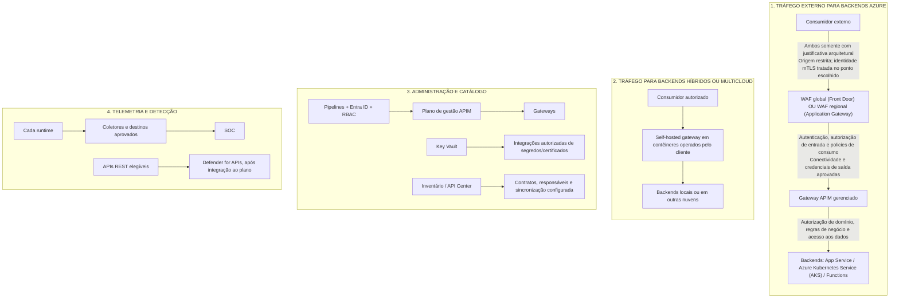
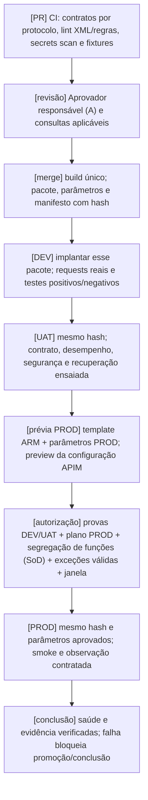
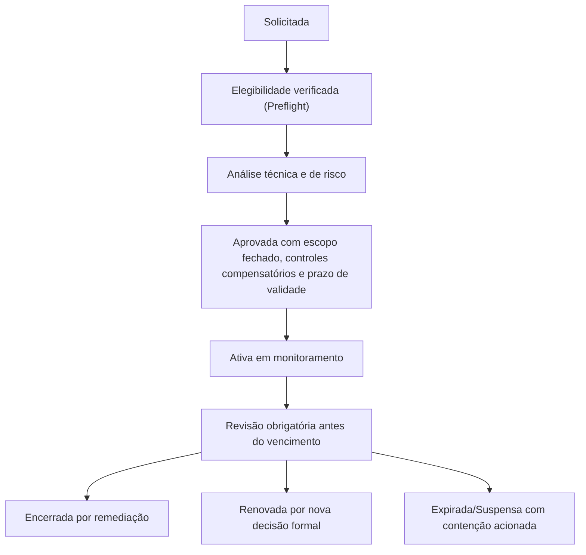

# Azure API Management (APIM) corporativo: guia técnico de decisão e implantação

<!-- apim-navigation:start -->
## Seções do playbook

- [1. Sumário executivo](#1-sumário-executivo)
- [2. Contexto e problema](#2-contexto-e-problema)
- [3. Azure API Management: planos, tiers clássicos, Consumption, v2 e regiões](#3-azure-api-management-planos-tiers-clássicos-consumption-v2-e-regiões)
- [4. Modelos de adoção (corporativo, por subscrição/domínio, híbrido) com matriz de decisão](#4-modelos-de-adoção-corporativo-por-subscriçãodomínio-híbrido-com-matriz-de-decisão)
- [5. Arquitetura de referência](#5-arquitetura-de-referência)
- [6. Padrões de API, ciclo de vida, versionamento, catálogo e consumo](#6-padrões-de-api-ciclo-de-vida-versionamento-catálogo-e-consumo)
- [7. Segurança, identidade e políticas](#7-segurança-identidade-e-políticas)
- [8. Plataforma, landing zone, rede e guardrails](#8-plataforma-landing-zone-rede-e-guardrails)
- [9. Pipeline de publicação com infraestrutura como código e APIOps](#9-pipeline-de-publicação-com-infraestrutura-como-código-e-apiops)
- [10. Operação, observabilidade e níveis de serviço (SLO e SLA)](#10-operação-observabilidade-e-níveis-de-serviço-slo-e-sla)
- [11. Governança corporativa, responsabilidades e experiência do desenvolvedor](#11-governança-corporativa-responsabilidades-e-experiência-do-desenvolvedor)
- [12. Práticas inadequadas e boas práticas](#12-práticas-inadequadas-e-boas-práticas)
- [13. Recomendações finais e plano de implantação sugerido](#13-recomendações-finais-e-plano-de-implantação-sugerido)
- [14. Decisões pendentes do cliente](#14-decisões-pendentes-do-cliente)
- [15. Referências consolidadas](#15-referências-consolidadas)
- [Apêndice A: exemplos de policies XML por perfil de consumidor (§7.7)](#apêndice-a-exemplos-de-policies-xml-por-perfil-de-consumidor-77)
- [Apêndice B: modelo OpenAPI para contrato HTTP/REST e metadados de governança](#apêndice-b-modelo-openapi-para-contrato-httprest-e-metadados-de-governança)
- [Apêndice C: modelo de registro de decisão arquitetural (ADR)](#apêndice-c-modelo-de-registro-de-decisão-arquitetural-adr)
- [Apêndice D: fragmento de promoção e verificação de drift (GitHub Actions)](#apêndice-d-fragmento-de-promoção-e-verificação-de-drift-github-actions)
- [Apêndice E: glossário](#apêndice-e-glossário)
- [Apêndice F: resultados NIST CSF 2.0, práticas APIM e evidências de controle](#apêndice-f-resultados-nist-csf-20-práticas-apim-e-evidências-de-controle)
- [Apêndice G: síntese executiva de adoção, controles e prontidão](#apêndice-g-síntese-executiva-de-adoção-controles-e-prontidão)
<!-- apim-navigation:end -->

---

## 1. Sumário executivo

**Leitura executiva.** Quem precisa decidir o que autorizar agora deve ler, nesta ordem, o [Apêndice G](#apêndice-g-síntese-executiva-de-adoção-controles-e-prontidão) (mandato de decisão, prontidão e riscos), a [matriz de decisão do §4.5](#45-matriz-de-decisão-pontuada-com-critérios-eliminatórios) e as [decisões pendentes do §14](#14-decisões-pendentes-do-cliente). Este sumário orienta a leitura e organiza as perguntas de decisão; os controles completos e suas condições permanecem nas seções referenciadas. Os percursos por perfil, com trilhas opcionais por protocolo e por regime, estão em [§2.2](#22-quem-este-documento-orienta).

O Azure API Management (APIM) concentra em um único ponto os controles de exposição de interfaces de programação de aplicações (APIs): autenticação, autorização de perímetro, limitação de tráfego, observabilidade, catálogo e contratos com consumidores. A engenharia das APIs e a autorização de objetos e de regras de negócio continuam no backend, sob responsabilidade das equipes produtoras, porque o APIM governa a exposição e o backend responde pela regra de negócio.

A decisão se organiza em quatro eixos independentes: o **modelo de adoção** (compartilhado, por domínio ou híbrido), o **tier/SKU** (plano de recursos e capacidade), o **runtime** (gateway gerenciado, gateway de workspace ou self-hosted gateway) e a **região e rede**. SKU (Stock Keeping Unit) identifica a oferta comercial; a governança, o isolamento e a residência de dados resultam do modelo de adoção, do runtime e da região. Workspaces delegam responsabilidades e acesso a recursos dentro da mesma instância: o isolamento de execução existe quando o workspace usa um gateway de workspace próprio, enquanto o gateway padrão é compartilhado.

O **modelo híbrido/federado governado** é a hipótese inicial para uma empresa cuja plataforma central já demonstra maturidade: controles centrais aplicados, caminho de autosserviço em operação, limites de isolamento claros e equipes capazes de operar as exceções. A existência de uma equipe central não comprova essa maturidade. Nesse modelo, a plataforma compartilha controles, padrões e catálogo e admite instâncias dedicadas quando o limite necessário de falha, operação, região ou capacidade justificar a separação. A autonomia de uma equipe ou um objetivo de nível de serviço (SLO, Service Level Objective) próprio entram como fatores de avaliação; a criação de uma instância independente também exige um requisito de isolamento demonstrado e a capacidade de operá-la. A preferência final depende da matriz calibrada com os dados da organização, na qual outro modelo pode prevalecer ([§4.5](#45-matriz-de-decisão-pontuada-com-critérios-eliminatórios)).

### 1.1 Cinco perguntas para a decisão (quadro executivo)

As respostas às cinco perguntas a seguir determinam o que a organização pode comprometer: região e tier, controles de identidade e de rede, grau de isolamento operacional e necessidade de recursos que somente o Premium clássico oferece. O resultado esperado é um **Registro de Decisão Arquitetural (ADR, Architecture Decision Record)** com requisitos, alternativas e escolha, elaborado antes de comprometer SKU e topologia; o modelo do registro está no [Apêndice C](#apêndice-c-modelo-de-registro-de-decisão-arquitetural-adr). As siglas usadas no quadro são definidas na primeira ocorrência, e as demais constam do [Apêndice E](#apêndice-e-glossário).

| # | Pergunta | Se a resposta é… | Decisão indicada |
|---|----------|------------------|------------------|
| 1 | Existe restrição aprovada de localização de dados, metadados ou processamento? | Sim | Selecione a região e os recursos permitidos. Na consulta de 09/10/2026, reconfirmada em 23/10/2026, Brazil South lista Basic v2 e Standard v2 e não lista Premium v2 nem workspace gateway <a id="cite-3"></a>[[3]](#ref-3). A escolha entre Standard v2 e Premium clássico decorre dos recursos de rede e de continuidade exigidos, e a residência no Brasil delimita a região elegível. Brazil Southeast e a capacidade de contratação exigem confirmação específica. |
| 2 | Quais dados, regimes setoriais e tipos de consumidor estão presentes? | Há requisitos adicionais | Componha exposição, dado pessoal comum, sensível legal ou restrito corporativo, setor, consumidor e criticidade ([§7.7](#77-composição-de-perfis-de-api-e-controles-aplicáveis)). O OAuth client credentials atende cenários máquina a máquina pertinentes, e o Authorization Code com PKCE atende ao acesso delegado por usuário; PKCE (Proof Key for Code Exchange) protege a troca do código de autorização. Aplique FAPI (Financial-grade API, perfil de segurança para APIs financeiras) e mTLS (autenticação mútua por certificados sobre TLS, Transport Layer Security) quando o requisito setorial ou contratual identificado os exigir, e identifique o perfil FAPI aplicável em cada caso. A retenção segue a política aprovada para cada conjunto de registros e finalidade <a id="cite-65"></a>[[65]](#ref-65) <a id="cite-66"></a>[[66]](#ref-66). |
| 3 | A API será acessível pela internet? | Sim | A política corporativa deste guia exige WAF (firewall de aplicações web) no caminho de entrada e proteção contra acesso direto à origem. Escolha o Front Door para entrada global ou o Application Gateway para entrada regional. Quando houver mTLS, declare a terminação TLS, a identidade do consumidor e a relação de confiança no trecho entre o proxy e o APIM ([§8.5](#85-rede-dns-e-exposição)) <a id="cite-15"></a>[[15]](#ref-15) <a id="cite-19"></a>[[19]](#ref-19) <a id="cite-69"></a>[[69]](#ref-69). |
| 4 | A operação exige separar equipe, manutenção, falhas ou SLO? | Separação demonstrada | Compare delegação por workspace, runtime dedicado e instância independente. A instância dedicada é candidata quando o isolamento exigido e a capacidade de operar equipe, runbook e plantão próprios a justificam; a autonomia da equipe entra como fator de avaliação na matriz de [§4.5](#45-matriz-de-decisão-pontuada-com-critérios-eliminatórios). |
| 5 | O volume excede a capacidade testada, ou há necessidade explícita de multirregião nativa ou de self-hosted gateway? | Sim | Para volume, teste escala, policies, backend e alternativas de tier antes de escolher. Para multirregião nativa ou self-hosted gateway em produção, o Premium clássico é a opção documentada, pois os tiers v2 não oferecem esses recursos; o Developer atende apenas a avaliação. A recuperação de desastre também pode usar instâncias independentes, desde que a recuperação da solução seja comprovada por ensaio ([§10.5](#105-alta-disponibilidade-recuperação-de-desastre-e-estado-recuperado)) <a id="cite-1"></a>[[1]](#ref-1) <a id="cite-2"></a>[[2]](#ref-2) <a id="cite-7"></a>[[7]](#ref-7) <a id="cite-54"></a>[[54]](#ref-54). |

### 1.2 Disponibilidade no Brasil

A consulta documental de **09/10/2026**, reconfirmada em **23/10/2026**, lista Basic v2 e Standard v2 em Brazil South e não lista Premium v2 nem workspace gateway nessa região [[3]](#ref-3). Workspaces lógicos existem em Basic v2, Standard v2, Premium clássico e Premium v2 [[1]](#ref-1) <a id="cite-5"></a>[[5]](#ref-5). Nos tiers v2, o gateway padrão pode atender workspaces; no Premium clássico, o workspace exige um workspace gateway, com região e cobrança próprias. Por isso, os workspaces do Premium clássico não oferecem, no Brasil, o runtime compartilhado que os tiers v2 oferecem.

**O tier resulta dos recursos exigidos (rede, multirregião e runtime), enquanto a residência no Brasil delimita a região elegível.** O Standard v2 oferece integração de saída à rede virtual (VNet) e private endpoint de entrada. O Premium v2 oferece VNet injection, mas depende de oferta regional. O Premium clássico permanece a alternativa documentada quando o projeto exige multirregião nativa, self-hosted gateway em produção ou injection em uma região brasileira na qual o Premium v2 não esteja listado [[1]](#ref-1) [[2]](#ref-2) [[3]](#ref-3) [[15]](#ref-15). A migração entre tiers exige cobertura funcional, rede, continuidade, capacidade e custo validados, além de disponibilidade regional; a documentação não prevê migração automatizada de uma instância clássica para um tier v2, que está disponível apenas para instâncias novas [[2]](#ref-2). Revise a decisão trimestralmente e antes de qualquer contratação ou mudança material.

---

## 2. Contexto e problema

Grandes empresas operam, em geral, dezenas a centenas de APIs em múltiplos domínios (produto, plataforma, dados, parceiros, mobile e integrações entre empresas, ou B2B), com regimes distintos de regulação, criticidade, exposição (interna, parceira ou pública) e governança (centralizada, federada ou autônoma).

A adoção de Azure exige definir como as APIs serão expostas e consumidas dentro e fora da nuvem, com segurança, controle e governança, e o APIM implementa grande parte dos controles decorrentes dessas decisões. Este capítulo delimita o problema, as premissas e os leitores do guia e reúne os requisitos regulatórios que condicionam as escolhas de modelo, tier, região e controles. O detalhamento normativo de [§2.3](#23-requisitos-regulatórios-brasil-e-setores-específicos) é uma trilha de consulta para segurança, privacidade, regulatório e auditoria; as demais funções encontram a síntese no [Apêndice G](#apêndice-g-síntese-executiva-de-adoção-controles-e-prontidão) e retornam a §2.3 quando um regime se aplicar à sua API.

Este documento busca prevenir cinco erros recorrentes:

- Escolher o modelo centralizado ou distribuído por preferência cultural, sem considerar regulação, escala e responsabilidades.
- Padronizar o tier comercial (SKU) sem distinguir modelo de adoção, geração do serviço, gateway, capacidades necessárias e disponibilidade regional.
- Tratar o APIM como proxy ou equipamento de rede, e não como produto com governança, ciclo de vida, catálogo e experiência do desenvolvedor.
- Substituir controles técnicos por aprovações manuais, ou dispensar registros de decisão e de evidência porque existem policies no gateway.
- Esquecer a integração entre APIM, Microsoft Entra ID, Azure Policy, Defender for Cloud, observabilidade e pipelines.

### 2.1 Premissas e escopo

- O guia considera uma empresa de grande porte, com múltiplos domínios e equipes distribuídas. A aplicabilidade da Lei Geral de Proteção de Dados Pessoais (LGPD), das regras do Banco Central do Brasil (BCB), do Open Finance e do padrão de segurança de dados de cartões PCI DSS deve ser confirmada por atividade e por entidade, independentemente do porte da empresa.
- O guia pressupõe uma Azure Landing Zone (a base de governança e conectividade da nuvem) ou equivalente, com rede hub/spoke, Azure Policy, Log Analytics, Sentinel e Microsoft Entra ID. A existência e a configuração efetiva desses controles precisam ser verificadas antes do aceite.
- O foco é a publicação de APIs e de transportes suportados pelo gateway escolhido: HTTP/REST, GraphQL, WebSocket e gRPC quando confirmado ([§6.6](#66-protocolos-e-gateway-para-inteligência-artificial)). Cada protocolo exige contrato e testes apropriados ([§9.3](#93-validações-obrigatórias-em-pr-e-pipeline)). A mensageria pura (Event Hubs e Service Bus) está fora do escopo do APIM, e os controles do sistema de mensageria permanecem nele, atrás de qualquer fachada HTTP.
- Exposição, dados pessoais e sensíveis conforme a LGPD, classificação corporativa de dados, setor, tipo de consumidor e criticidade são dimensões independentes da ficha de avaliação inicial (*intake*, [§2.3.4](#234-mapeamento-operacional) e [§6.2](#62-avaliação-inicial-corporativa-de-arquitetura-e-publicação)). Os controles resultam da combinação aplicável, e a participação em um perfil Financial-grade API (FAPI) decorre de requisito setorial ou contratual identificado para a API.

### 2.2 Quem este documento orienta

Cada perfil tem um percurso principal, que atende ao papel na ordem indicada, e trilhas opcionais, que só se aplicam quando a API, o ambiente ou o regime exigir o assunto. A sigla FinOps designa a gestão financeira da nuvem, e a ficha de avaliação inicial (*intake*) é o cadastro de cada API descrito em [§6.2](#62-avaliação-inicial-corporativa-de-arquitetura-e-publicação). Nas trilhas, FAPI (Financial-grade API) é o perfil de segurança de APIs financeiras, mTLS é a autenticação mútua por certificados sobre TLS (Transport Layer Security), MCP é o Model Context Protocol, SOAP é o protocolo de serviços web baseado em XML e ADR é o registro de decisão arquitetural.

| Perfil | Percurso principal | Trilhas opcionais por regime, protocolo ou tarefa |
|--------|--------------------|---------------------------------------------------|
| Liderança de tecnologia e engenharia | [Apêndice G](#apêndice-g-síntese-executiva-de-adoção-controles-e-prontidão): mandato, prontidão e riscos; [§4.5](#45-matriz-de-decisão-pontuada-com-critérios-eliminatórios): matriz de decisão; [§14](#14-decisões-pendentes-do-cliente): decisões pendentes. Depois, [§1](#1-sumário-executivo) para o enquadramento e [§11](#11-governança-corporativa-responsabilidades-e-experiência-do-desenvolvedor) a [§13](#13-recomendações-finais-e-plano-de-implantação-sugerido) para responsabilidades e implantação | [§8.6](#86-finops-de-apim-dimensionamento-custo-e-alocação): custos; [§10.5](#105-alta-disponibilidade-recuperação-de-desastre-e-estado-recuperado): continuidade; [§11.6](#116-autoatendimento-e-mudanças-sujeitas-a-aprovação): autoridade de mudança |
| Arquitetura Azure | [§3](#3-azure-api-management-planos-tiers-clássicos-consumption-v2-e-regiões): tiers e regiões; [§5](#5-arquitetura-de-referência): arquitetura; [§8](#8-plataforma-landing-zone-rede-e-guardrails): landing zone; [§9](#9-pipeline-de-publicação-com-infraestrutura-como-código-e-apiops): entrega | [§6.6](#66-protocolos-e-gateway-para-inteligência-artificial): GraphQL, WebSocket, gRPC, SOAP, IA e MCP; [§8.5](#85-rede-dns-e-exposição): rede e mTLS; [Apêndice C](#apêndice-c-modelo-de-registro-de-decisão-arquitetural-adr): modelo de ADR |
| Segurança, gestão de identidade e regulatório | [§1.1](#11-cinco-perguntas-para-a-decisão-quadro-executivo): requisitos; [§2.3](#23-requisitos-regulatórios-brasil-e-setores-específicos): normas; [§7](#7-segurança-identidade-e-políticas): controles; [§11](#11-governança-corporativa-responsabilidades-e-experiência-do-desenvolvedor): autoridade e aprovação | Dados pessoais: [§2.3.1](#231-lgpd-lei-nº-137092018-classificação-e-responsabilidade-pelo-tratamento), [§7.8](#78-evidências-de-privacidade-e-requisitos-bcbcmn-aplicáveis) e [§10.7](#107-retenção-finalidade-e-imutabilidade-de-auditoria). Open Finance, FAPI e mTLS: [§2.3.2](#232-segurança-cibernética-contratação-de-nuvem-e-open-finance-brasil), [§8.5](#85-rede-dns-e-exposição) e o exemplo A.4 do [Apêndice A](#apêndice-a-exemplos-de-policies-xml-por-perfil-de-consumidor-77). Cartões: [§2.3.3](#233-setoriais-adicionais). Frameworks: [Apêndice F](#apêndice-f-resultados-nist-csf-20-práticas-apim-e-evidências-de-controle) |
| Plataforma e landing zone | [§5](#5-arquitetura-de-referência) e [§8](#8-plataforma-landing-zone-rede-e-guardrails) a [§10](#10-operação-observabilidade-e-níveis-de-serviço-slo-e-sla): desenho, guardrails, entrega e operação | [§9.3](#93-validações-obrigatórias-em-pr-e-pipeline): validação por protocolo; [Apêndice D](#apêndice-d-fragmento-de-promoção-e-verificação-de-drift-github-actions): fragmento de pipeline |
| Produtor da API (squad) | [§4](#4-modelos-de-adoção-corporativo-por-subscriçãodomínio-híbrido-com-matriz-de-decisão), [§6](#6-padrões-de-api-ciclo-de-vida-versionamento-catálogo-e-consumo), [§7](#7-segurança-identidade-e-políticas) e [§9](#9-pipeline-de-publicação-com-infraestrutura-como-código-e-apiops) a [§11](#11-governança-corporativa-responsabilidades-e-experiência-do-desenvolvedor): adoção, contrato, segurança, publicação e operação | [Apêndice A](#apêndice-a-exemplos-de-policies-xml-por-perfil-de-consumidor-77): policies por perfil; [Apêndice B](#apêndice-b-modelo-openapi-para-contrato-httprest-e-metadados-de-governança): contrato OpenAPI; [§6.6](#66-protocolos-e-gateway-para-inteligência-artificial): protocolos e IA |
| Consumidor da API (mobile, web ou parceiro) | [§6.5](#65-produtos-catálogo-e-consumo): consumo; [§10](#10-operação-observabilidade-e-níveis-de-serviço-slo-e-sla): operação; [§11.4](#114-experiência-do-produtor-e-consumidor): acesso, suporte e migração | [Apêndice B](#apêndice-b-modelo-openapi-para-contrato-httprest-e-metadados-de-governança): estrutura do contrato publicado |
| Gestão financeira da nuvem (FinOps) e compras | [§3.3](#33-orientação-por-skutier): escolha de tier; [§8.6](#86-finops-de-apim-dimensionamento-custo-e-alocação): custos e alocação | [Apêndice G](#apêndice-g-síntese-executiva-de-adoção-controles-e-prontidão): custos e riscos da decisão |
| Auditoria e risco | [§2.3](#23-requisitos-regulatórios-brasil-e-setores-específicos): aplicabilidade; [§7.7](#77-composição-de-perfis-de-api-e-controles-aplicáveis) e [§7.8](#78-evidências-de-privacidade-e-requisitos-bcbcmn-aplicáveis): controles; [§11.5](#115-modelo-de-exceção-ciclo-de-vida-formal): exceções e evidência | [§11.6.1](#1161-segregação-de-funções-sod-para-produção-crítica-financeira-ou-regulada): segregação de funções; [Apêndice F](#apêndice-f-resultados-nist-csf-20-práticas-apim-e-evidências-de-controle): mapeamento de frameworks |

### 2.3 Requisitos regulatórios (Brasil e setores específicos)

A escolha de modelo, SKU, região e controles parte de requisitos identificados por entidade, atividade e conjunto de dados, com a versão e a data da fonte. O inventário abaixo distingue obrigação aplicável, orientação da autoridade e política corporativa, e cada categoria deve ser analisada em conjunto com as demais.

#### 2.3.1 LGPD (Lei nº 13.709/2018): classificação e responsabilidade pelo tratamento

- **Classificação e bases legais:** identifique a finalidade de cada operação de tratamento e a hipótese legal correspondente, com o inciso do art. 7º para dados pessoais comuns ou do art. 11 para dados pessoais sensíveis. O art. 5º, II define a categoria sensível, que abrange, por exemplo, saúde e biometria vinculada a pessoa natural. O dado financeiro nominal não é sensível por definição legal, embora possa revelar uma categoria sensível pelo contexto e justificar proteção elevada. A classificação corporativa de dado restrito é uma dimensão adicional. A execução contratual e o interesse legítimo, que são hipóteses do art. 7º, não se transferem por analogia ao art. 11. Uma API sem o mapeamento do tratamento aplicável não deve ser publicada [[66]](#ref-66).
- **Direitos do titular** (art. 18): mantenha procedimentos de acesso, retificação, eliminação, portabilidade e informação sobre compartilhamento, respeitadas as condições legais e as hipóteses de conservação do art. 16. Quando APIs forem usadas para atender a esses direitos, identifique, teste e audite a integração com o sistema-fonte: o APIM pode expor a fachada, mas a decisão jurídica e a eliminação nos sistemas de domínio ocorrem fora dele [[66]](#ref-66).
- **Encarregado/DPO** (Data Protection Officer): identifique o encarregado e seus meios de contato, conforme o enquadramento aplicável. O controlador mantém o inventário do tratamento e a responsabilidade pelas decisões; o encarregado orienta e apoia, inclusive quanto a logs, incidentes e transferências [[66]](#ref-66).
- **Relatório de Impacto à Proteção de Dados Pessoais (RIPD):** distinga a determinação da Agência Nacional de Proteção de Dados (ANPD), fundamentada no art. 38, da recomendação de elaborar o relatório para operações de alto risco. Uma exigência adicional da empresa constitui política interna aprovada e deve ser identificada como tal. Vincule a API à operação ou ao projeto de tratamento coberto; operações semelhantes em natureza, finalidade e riscos podem compartilhar um relatório, conforme a orientação da ANPD [[66]](#ref-66) <a id="cite-76"></a>[[76]](#ref-76).
- **Incidente de segurança** (art. 48 e Resolução CD/ANPD nº 15/2024): o controlador deve comunicar à ANPD e aos titulares quando houver potencial de risco ou dano relevante. O gatilho do art. 5º combina impacto significativo nos interesses e direitos com pelo menos um destes critérios: dados sensíveis; dados de crianças, adolescentes ou idosos; dados financeiros; dados de autenticação; dados protegidos por sigilo; ou tratamento em larga escala <a id="cite-27"></a>[[27]](#ref-27). O runbook ([§10.6](#106-runbooks-e-procedimentos-operacionais-mínimos)) precisa operacionalizar quatro frentes:
  1. **Relógio e responsáveis:** registre o momento em que o controlador soube que dados pessoais foram afetados. A comunicação à ANPD tem prazo de três dias úteis, ressalvado prazo previsto em legislação específica, e a comunicação aos titulares também tem prazo de três dias úteis, conforme o art. 9º. A contagem inicia sem aguardar a conclusão da investigação. O prazo da comunicação inicial à ANPD e da complementação, assim como o prazo do caput do art. 9º, conta em dobro apenas para agentes efetivamente enquadrados na Resolução CD/ANPD nº 2/2022. A empresa deve confirmar a própria elegibilidade e não estender a exceção a outros prazos do regulamento.
  2. **Comunicação à ANPD:** use o formulário eletrônico disponibilizado pela autoridade, por meio do encarregado ou de representante constituído, e apresente no prazo a prova do vínculo ou dos poderes de representação. Inclua as informações do art. 6º, §2º, entre elas a identificação do controlador e do operador, as datas, os dados e titulares afetados, os riscos e as medidas adotadas. A comunicação pode ser complementada, de forma fundamentada, em vinte dias úteis a partir do envio, observado o regime de prazo em dobro quando efetivamente aplicável. Justifique eventual atraso, observe os segredos comercial e industrial e requeira sigilo das informações protegidas na forma do art. 7º; o pedido de sigilo não suspende o dever de comunicar.
  3. **Comunicação aos titulares:** use linguagem simples e contato direto individualizado sempre que possível. Se o contato individual for inviável ou não for possível identificar todos os afetados, divulgue o incidente de modo amplo e facilmente visível pelos meios disponíveis, no mesmo prazo e com o conteúdo exigido, e mantenha a divulgação por pelo menos três meses. Junte ao processo a declaração dos meios utilizados em até três dias úteis após o término do prazo de comunicação aos titulares, conforme o art. 9º, §4º.
  4. **Registro:** conserve o registro do incidente, inclusive do incidente não comunicado, por pelo menos cinco anos a partir da data do registro, ou por prazo maior decorrente de obrigação adicional. Registre a avaliação de risco e os motivos da não comunicação. Para entidades do art. 23 da LGPD, observe a ressalva do art. 10, §2º, relativa às regras de guarda permanente e à tabela de temporalidade aplicável; a documentação de forma geral permanece exigida.
- **Transferências internacionais:** avalie dados pessoais comuns e sensíveis, incluindo metadados, logs e disponibilização de acesso no exterior. Comprove a base dos arts. 7º ou 11 e o mecanismo válido do art. 33, operacionalizado pela Resolução CD/ANPD nº 19/2024. Se o mecanismo for contratual, identifique o instrumento e as cláusulas efetivamente aplicáveis, tanto para dados pessoais comuns quanto para sensíveis [[66]](#ref-66) <a id="cite-67"></a>[[67]](#ref-67).

#### 2.3.2 Segurança cibernética, contratação de nuvem e Open Finance Brasil

O Banco Central do Brasil (BCB) e o Conselho Monetário Nacional (CMN) editam atos com alcances diferentes. Classifique a pessoa jurídica regulada e o serviço relevante antes de escolher o ato aplicável; a participação no Open Finance é uma condição de aplicabilidade separada.

- **Resolução CMN nº 4.893/2021, versão consolidada 3:** abrange as instituições autorizadas a funcionar pelo BCB, com as exclusões de seu art. 1º: administradoras de consórcio, instituições de pagamento, corretoras e distribuidoras de títulos e valores mobiliários e corretoras de câmbio. Seu art. 27 revoga integralmente as Resoluções CMN nº 4.658/2018 e nº 4.752/2019 <a id="cite-28c"></a>[[28c]](#ref-28c).
- **Resolução BCB nº 85/2021, versão consolidada 4:** seu art. 1º, na redação da Resolução BCB nº 552/2026, abrange instituições de pagamento, corretoras e distribuidoras de títulos e valores mobiliários, corretoras de câmbio e sociedades prestadoras de serviços de ativos virtuais autorizadas a funcionar pelo BCB. A exclusão de uma entidade da CMN nº 4.893 não a inclui automaticamente na BCB nº 85; outras entidades devem recorrer ao ato de seu próprio enquadramento <a id="cite-28b"></a>[[28b]](#ref-28b).
- **Serviços relevantes de processamento, armazenamento e nuvem:** quando abrangidos por um desses atos, mapeie os arts. 12 a 17: avaliação prévia do fornecedor, requisitos e cláusulas contratuais, segurança, acesso da instituição e do BCB, subcontratação, continuidade e saída. O art. 15 exige comunicar a contratação e as alterações pertinentes em até dez dias. Para serviços prestados no exterior, o art. 16 exige condições documentadas, países e regiões previamente definidos e continuidade; na ausência do convênio previsto, a instituição deve solicitar autorização ao BCB com antecedência mínima de sessenta dias. Esse artigo não estabelece proibição genérica de serviços fora do Brasil. Testes, resposta a incidentes e guarda dos documentos enumerados nos arts. 22-A e 23 também integram o controle aplicável [[28b]](#ref-28b) [[28c]](#ref-28c).
- **Open Finance:** a Resolução Conjunta nº 1/2020, versão 9, estabelece o regime de implementação, e a Resolução BCB nº 32/2020, versão 6, dispõe sobre requisitos técnicos e procedimentos operacionais e remete aos manuais <a id="cite-28"></a>[[28]](#ref-28) <a id="cite-78"></a>[[78]](#ref-78). Registre a versão efetivamente aplicável dos manuais, do perfil de segurança, dos certificados e das jornadas <a id="cite-29"></a>[[29]](#ref-29) <a id="cite-29b"></a>[[29b]](#ref-29b). Os fundamentos gerais do perfil Financial-grade API (FAPI) e do vínculo entre token e certificado estão em <a id="cite-79"></a>[[79]](#ref-79) <a id="cite-64"></a>[[64]](#ref-64); verifique o perfil brasileiro vigente além desses fundamentos gerais.

Para o APIM, a implicação é compor os controles de [§7.7](#77-composição-de-perfis-de-api-e-controles-aplicáveis) com a exposição, os dados, o consumidor e a criticidade. Em fluxos que exigem token vinculado a certificado por TLS mútuo (mTLS), declare o ponto de terminação TLS e verifique o certificado original do consumidor; o exemplo direto A.4 do [Apêndice A](#apêndice-a-exemplos-de-policies-xml-por-perfil-de-consumidor-77) e a rota por proxy de camada 7 exigem configurações distintas ([§8.5](#85-rede-dns-e-exposição)). O consentimento e a autorização de negócio permanecem no sistema de domínio. Retenha os conjuntos de registros enumerados na norma, com seus marcos ([§10.7](#107-retenção-finalidade-e-imutabilidade-de-auditoria)), em vez de presumir cinco anos para todo log do gateway. A conformidade do ecossistema e a certificação FAPI exigem avaliação formal pelos responsáveis do cliente.

#### 2.3.3 Setoriais adicionais

- **PCI DSS** (Payment Card Industry Data Security Standard): havendo dados de cartão, identifique o ambiente de dados do portador (CDE), os fornecedores e os componentes que podem acessá-los ou afetar sua segurança, com a avaliação do assessor aplicável. Distinga duas abordagens: o TLS por salto, com terminação e nova conexão nos proxies de camada 7, e a cifragem do payload ou a tokenização que mantém o número do cartão (PAN) opaco ao APIM. A segunda abordagem limita a inspeção e a validação do conteúdo e exige gestão de chaves e desenho próprio. Confirme com o assessor se a cifragem, inclusive de payload, retira o componente ou os dados do escopo PCI; a cifragem de dado em memória não persistente é uma decisão de desenho, e o PCI SSC não a define como regra universal <a id="cite-81"></a>[[81]](#ref-81) <a id="cite-82"></a>[[82]](#ref-82). Mantenha PAN e dados de autenticação de cartão fora dos logs. Valide o desenho com o assessor, com evidência do TLS e das policies aplicados.
- **Saúde** (Lei nº 13.787/2018 sobre prontuário eletrônico, e LGPD para dado sensível): exige retenção, auditoria e DPO específicos.
- **Telecom (Anatel), seguros (Susep) e mercado de capitais (CVM):** cada setor tem requisitos próprios. A ficha da API deve registrar a classificação setorial aplicável.

#### 2.3.4 Mapeamento operacional

Toda API publicada no APIM corporativo deve indicar, na ficha de avaliação inicial (*intake*):

1. As dimensões compostas ([§7.7](#77-composição-de-perfis-de-api-e-controles-aplicáveis)): exposição, dados pessoais comuns, sensíveis legais e financeiros, classificação corporativa, regimes setoriais, tipo de consumidor e criticidade. Registre também a pessoa jurídica e a atividade que fundamentam a incidência de cada regime.
2. As finalidades do tratamento e as bases da LGPD, com artigo, inciso e evidência: art. 7º ou, quando aplicável, art. 11. Vincule a avaliação de risco e o RIPD exigido ou recomendado, distinguindo o que decorre de política interna.
3. Os conjuntos de registros, os campos necessários, a finalidade, a obrigação ou política aprovada, o responsável, o prazo e o evento inicial da retenção ([§10.7](#107-retenção-finalidade-e-imutabilidade-de-auditoria)). Separe a evidência de negócio ou regulatória da telemetria de diagnóstico.
4. Os destinos de armazenamento, processamento e acesso, as restrições setoriais e contratuais e, quando houver transferência internacional de dados pessoais, o mecanismo do art. 33 e da Resolução CD/ANPD nº 19, com o instrumento que o comprova. Aprove o destino sempre que os dados forem pessoais comuns, sensíveis ou sujeitos a restrição contratual.
5. Os responsáveis pelas decisões do controlador e pelos controles, com as aprovações de segurança, jurídico/privacidade e compliance setorial conforme as dimensões aplicáveis. A responsabilidade permanece com o controlador, com o apoio do encarregado.
6. O gatilho, o relógio, os responsáveis e substitutos, os canais, a comunicação à ANPD e aos titulares, a complementação e a guarda do registro de incidente, com as ressalvas de [§2.3.1](#231-lgpd-lei-nº-137092018-classificação-e-responsabilidade-pelo-tratamento) efetivamente aplicáveis.

Sem esse mapeamento e sem as evidências dos controles aplicáveis, o ponto de verificação da publicação (*gate*) impede a liberação da API. A ficha e as extensões do contrato documentam decisões; a implementação e o teste das policies completam a evidência.

---

## 3. Azure API Management: planos, tiers clássicos, Consumption, v2 e regiões

A escolha de tier, runtime e região precede qualquer contratação e parte dos recursos exigidos: o tier decorre dos requisitos de rede, multirregião e execução, e a região decorre da localização aprovada, com a disponibilidade confirmada na data da decisão. Este capítulo apresenta os planos do serviço, a terminologia de tiers e runtimes, a orientação por SKU e a situação documental do Brasil.

### 3.1 Visão geral

O Azure API Management oferece um gateway gerenciado e recursos de administração e consumo. Conceitualmente, ele separa três planos:

- **Plano de gestão (control plane):** Azure Resource Manager (ARM), Bicep/Terraform, portal e API administrativa, protegidos por controle de acesso baseado em papéis (RBAC, Role-Based Access Control).
- **Plano de execução (data plane/gateway):** recebe requisições, aplica policies, autenticação, limitação de tráfego e transformação e encaminha o tráfego ao backend.
- **Plano de desenvolvedor:** Developer Portal, documentação, integração de consumidores e subscriptions de consumo do APIM, que não são as subscrições Azure de faturamento. A disponibilidade do portal depende do tier [[1]](#ref-1).

As capacidades centrais incluem policies XML (Extensible Markup Language), produtos, APIs, operações, named values, certificados, identidades gerenciadas, Azure Monitor e Azure Policy. Rede, multirregião, self-hosted gateway, workspaces e gateway de workspace dependem de tier, tipo de execução e região [[1]](#ref-1) [[5]](#ref-5) [[54]](#ref-54). O Defender for APIs é uma integração com onboarding e cobertura específicos e, por isso, não está presente em todo gateway (§5.1). O API Center é um serviço separado de inventário e governança de projeto e não executa o tráfego das APIs <a id="cite-10"></a>[[10]](#ref-10).

### 3.2 Terminologia: clássico/v1, stv1/stv2, Consumption e tiers v2

Os termos abaixo separam oferta comercial, compute e execução. Na seleção de workspaces, observe que o workspace não suporta certificados de autoridades certificadoras (`CA certificates`); a configuração de confiança necessária a mTLS deve ser confirmada no gateway e no caminho escolhidos, separadamente dos recursos do serviço [[5]](#ref-5).

- **Tiers clássicos de compute dedicado:** Developer, Basic, Standard e Premium, na plataforma stv2. A plataforma stv1 foi aposentada em 2024; essa identificação histórica de compute não inclui o Consumption nem os tiers v2 [[2]](#ref-2) <a id="cite-4"></a>[[4]](#ref-4).
- **Tiers v2:** Basic v2, Standard v2 e Premium v2, uma geração distinta, com unidades de capacidade, escala e recursos próprios (Basic v2 e Standard v2 escalam até 10 unidades; Premium v2, até 30) [[1]](#ref-1) [[2]](#ref-2). O uso de infraestrutura gerenciada não torna a cobrança ou a escala iguais às do Consumption, e o Premium v2 usa um App Service Environment dedicado [[2]](#ref-2). Os tiers v2 não oferecem multirregião, self-hosted gateway, backup/restore, IP estático nem migração automatizada a partir dos tiers clássicos, e existem apenas como instâncias novas [[1]](#ref-1) [[2]](#ref-2).
- **Consumption:** oferta serverless com escala automática e cobrança por chamadas. Não é uma instância de máquina virtual (VM) na plataforma stv2. Não oferece VNet injection, self-hosted gateway nem WebSocket, e as policies `rate-limit-by-key`, `quota-by-key` e `llm-token-limit` não estão disponíveis nesse tier; o suporte aos demais recursos de policies e logs deve ser avaliado caso a caso [[1]](#ref-1) [[54]](#ref-54).
- **Workspaces:** limite lógico de delegação e RBAC para APIs, produtos, subscriptions e recursos relacionados. Existem em Basic v2, Standard v2, Premium clássico e Premium v2. O uso do **gateway gerenciado padrão** pelo workspace está documentado somente nos tiers v2 e, atualmente, essa associação é feita pela API REST de criação ou atualização de workspace [[1]](#ref-1) [[5]](#ref-5).
- **Workspace gateway:** recurso de execução separado, associado ao workspace. No Premium clássico, ele é necessário para executar as APIs do workspace e não pode ser substituído pelo gateway padrão. Tem escala, custo e requisitos de rede próprios, mas não oferece custom hostnames nem private endpoints de entrada, e sua configuração de VNet só pode ser definida na criação. Pode atender até 30 workspaces, e a associação de vários workspaces ao mesmo gateway só existe para gateways criados depois de 15/04/2025; quanto mais workspaces um gateway concentra, maior o risco de que uma API degrade as demais. A região e a subscrição devem ser as da região primária e da subscrição do serviço APIM. Sua disponibilidade deve ser confirmada, pois ele não está listado em Brazil South nas consultas de 09/10/2026 e 23/10/2026 [[3]](#ref-3) [[5]](#ref-5).

> **Produtos, workspaces, gateways e instâncias oferecem limites diferentes.** Produtos agrupam consumo e policies, e a execução permanece compartilhada. Workspaces delegam recursos e administração; ao compartilhar o gateway, eles compartilham também a capacidade e as falhas de execução. O workspace gateway separa a execução e mantém o plano de gestão do serviço. Instâncias independentes permitem escolhas distintas de região, tier e operação, e ainda assim mantêm dependências externas compartilhadas. Justifique o Premium clássico pelos recursos necessários: multirregião nativa, self-hosted gateway de produção, injection ou backup/restore elegível. O backup/restore não é suportado em uma instância com workspace gateways associados (§10.5) [[1]](#ref-1) [[5]](#ref-5) <a id="cite-9"></a>[[9]](#ref-9).

### 3.3 Orientação por SKU/tier

| Tier | Quando faz sentido | Quando não se aplica |
|------|--------------------|----------------------|
| Developer | Sandbox, testes, treinamento e self-hosted gateway de avaliação | Produção, porque o tier não oferece acordo de nível de serviço (SLA, Service Level Agreement) [[1]](#ref-1) |
| Basic v2 | Carga cuja capacidade e cujos controles sejam comprovados por teste; workspaces no gateway padrão | Requisitos obrigatórios de injection, private endpoint de entrada, multirregião nativa, self-hosted gateway ou backup/restore [[1]](#ref-1) [[2]](#ref-2) [[54]](#ref-54) |
| Standard v2 | Gateway com integração de saída à VNet, private endpoint de entrada, autoscale e workspaces no gateway padrão | Multirregião nativa, self-hosted gateway ou backup/restore. A redundância zonal exige fechar a divergência documental registrada em §10.5: as páginas de confiabilidade <a id="cite-56"></a>[[56]](#ref-56) <a id="cite-57"></a>[[57]](#ref-57) a descrevem para o Standard v2, enquanto a comparação por recursos [[1]](#ref-1) a lista apenas para o Premium v2 [[1]](#ref-1) [[2]](#ref-2) [[15]](#ref-15) [[56]](#ref-56) [[57]](#ref-57) |
| Premium v2 | Capacidade e isolamento de rede que justifiquem injection, onde houver oferta regional; zonas de disponibilidade; workspaces e múltiplos domínios no gateway | Multirregião nativa, self-hosted gateway e backup/restore, indisponíveis nas consultas de 09/10/2026 e 23/10/2026 [[1]](#ref-1) [[2]](#ref-2) |
| Premium clássico | Multirregião nativa, injection, self-hosted gateway de produção e backup/restore quando elegível | Workspaces no gateway padrão, que não são suportados: os workspaces exigem gateway separado e região elegível, e o backup/restore não está disponível com workspace gateways associados [[5]](#ref-5) [[9]](#ref-9) |
| Consumption | Carga HTTP esporádica cujo conjunto de policies, logs, rede e latência seja compatível | Necessidade de VNet injection, WebSocket, self-hosted gateway ou funcionalidades ausentes no gateway Consumption [[1]](#ref-1) [[54]](#ref-54) |

**Seleção de tier e runtime, com data-base documental de 09/10/2026 (reconfirmada em 23/10/2026):**

- **Self-hosted gateway necessário em produção:** Premium clássico; o Developer serve apenas à avaliação [[1]](#ref-1) <a id="cite-8"></a>[[8]](#ref-8).
- **Multirregião nativa necessária:** Premium clássico. Duas instâncias independentes formam outra arquitetura de recuperação, distinta do recurso nativo [[1]](#ref-1) [[7]](#ref-7).
- **Federação com gateway compartilhado:** workspaces no gateway padrão de Basic v2, Standard v2 ou Premium v2, com região e limites confirmados. O Premium clássico não oferece essa associação [[5]](#ref-5).
- **Federação com execução separada:** avalie um workspace gateway elegível ou instâncias independentes. No Premium clássico o workspace gateway é necessário e não está listado em Brazil South. APIs e produtos no nível do serviço são uma alternativa de segmentação de consumo, sem a mesma delegação nem o mesmo isolamento [[3]](#ref-3) [[5]](#ref-5).
- **Carga sem necessidade dos recursos exclusivos acima:** compare Basic v2, Standard v2, Premium v2 ou outra oferta elegível, segundo rede, policies, carga testada e custo. O Premium se justifica pelos recursos exclusivos; o volume elevado aciona teste de escala e comparação de tiers.
- **Brasil com injection obrigatório:** se o Premium v2 não estiver listado na região exigida, avalie o Premium clássico. **Brasil com rede privada de entrada e saída, sem injection obrigatório:** o Standard v2 pode atender, conforme os requisitos de private endpoint e de integração de saída. A residência no Brasil delimita a região elegível, e o Premium é exigido pelos recursos de rede e de continuidade [[2]](#ref-2) [[3]](#ref-3) [[15]](#ref-15).

### 3.4 Disponibilidade regional e nota específica sobre Brasil

A disponibilidade documental e a capacidade de contratação são verificações diferentes. A matriz de tiers v2 e workspace gateways foi consultada em **09/10/2026**, com atualização indicada em 28/09/2026, e reconfirmada em **23/10/2026**; ela registra limitações temporárias de criação em algumas regiões. Anexe à ADR a oferta, a região, o runtime e a capacidade confirmados antes da contratação [[3]](#ref-3) [[5]](#ref-5).

- **Brazil South:** Basic v2 e Standard v2 estão listados; Premium v2 e workspace gateway não estão. A federação lógica por workspaces nos tiers v2 não depende da existência de workspace gateway no Brasil [[3]](#ref-3) [[5]](#ref-5).
- **Brazil Southeast:** a região não aparece na matriz consultada de v2 e workspace gateways. Verifique especificamente a oferta clássica, a capacidade, as permissões de acesso à região e a viabilidade de uma topologia brasileira com duas regiões; o nome "Southeast" não é critério: consulte a oferta específica da região.

Dessas disponibilidades decorrem quatro implicações:

1. **Restrição brasileira identificada:** quando existir uma restrição legal, setorial, contratual ou corporativa efetivamente identificada, avalie cada conjunto de dados, metadados e processamento. Trate o dado financeiro conforme sua classificação legal (§2.3.1), sem assumir residência universal no Brasil. Selecione o tier que atenda aos requisitos na região permitida [[66]](#ref-66).
2. **Multirregião com destino no exterior:** exige a aprovação dos países e regiões, dos acessos, dos dados e das salvaguardas aplicáveis. O Premium clássico oferece o recurso nativo e o Premium v2 não o oferece. Na multirregião nativa, somente o gateway é replicado: o plano de gestão e o portal do desenvolvedor permanecem na região primária, e as policies `rate-limit`, `rate-limit-by-key`, `azure-openai-token-limit` e `llm-token-limit` contam o consumo separadamente em cada gateway regional [[7]](#ref-7). A transferência internacional exige o mecanismo legal aplicável e as condições setoriais e contratuais, além do aceite interno [[7]](#ref-7) [[66]](#ref-66) [[67]](#ref-67).
3. **API Center:** o serviço não lista regiões brasileiras na consulta de 09/10/2026 [[10]](#ref-10). Aprove o destino do API Center no ponto de verificação (*gate*) de [§10.2.3](#1023-gate-de-residência-regional-da-observabilidade) sempre que os metadados contiverem dados pessoais comuns, sensíveis ou restrição contratual de localização, e considere também metadados, documentos, exemplos e acessos. Sem destino permitido, mantenha o inventário em solução autorizada e faseie o API Center mediante decisão registrada <a id="cite-41"></a>[[41]](#ref-41) [[66]](#ref-66) [[67]](#ref-67).
4. **Workspaces e residência:** os workspaces delimitam administração e recursos, e a residência resulta da região e das decisões próprias de localização. O gateway padrão, o workspace gateway, o plano de gestão, o catálogo, os backends e os destinos de telemetria precisam dessas decisões e do controle de acesso. A execução dedicada mantém o serviço APIM compartilhado [[5]](#ref-5).

A tabela seguinte resume a disponibilidade documental de **09/10/2026** para v2 e workspace gateways [[3]](#ref-3) e para o API Center [[10]](#ref-10). "Listado" indica presença na documentação e pede confirmação da capacidade comercial de criação; "não listado" indica ausência na consulta e pede nova consulta antes da decisão.

| Recurso | Brazil South | Brazil Southeast | East US | West Europe |
|---|---|---|---|---|
| Basic v2 | Listado | Não listado | Listado | Listado |
| Standard v2 | Listado | Não listado | Listado | Listado |
| Premium v2 | Não listado | Não listado | Não listado | Não listado |
| Workspaces no gateway padrão v2 | Recurso lógico em Basic v2/Standard v2 | Depende de oferta v2 confirmada | Recurso lógico nos tiers v2 listados | Recurso lógico nos tiers v2 listados |
| Workspace gateway separado | Não listado | Não listado | Não listado | Listado; validar oferta/capacidade |
| Premium clássico¹ | Disponível na referência histórica; revalidar | Verificação específica necessária | Disponível na referência histórica; revalidar | Disponível na referência histórica; revalidar |
| API Center | Não listado | Não listado | Listado | Listado |

¹ A linha clássica preserva a referência histórica de 18/06/2026 e exige nova confirmação comercial. A oferta, a capacidade e a topologia em Brazil Southeast devem ser confirmadas antes da contratação. A matriz [[3]](#ref-3) cobre v2 e workspace gateways; consulte a oferta clássica separadamente. Um workspace no Premium clássico exige o gateway separado, e o gateway padrão não o atende [[5]](#ref-5).

Na reconfirmação de 23/10/2026, o Premium v2 aparece como disponível em poucas regiões (por exemplo Canada Central, Korea Central e Norway East), e outras o indicam com limitação temporária de criação; nenhuma delas é brasileira [[3]](#ref-3).

O líder de arquitetura Azure registra na ADR a data, a URL, o tier, o runtime, a região, as limitações de capacidade e a confirmação comercial pertinente. Essa revisão ocorre trimestralmente e antes de qualquer contratação, alteração de região ou adoção de novo recurso. Verifique a presença dessas evidências na ADR-APIM-001 em cada revisão.

---

## 4. Modelos de adoção (corporativo, por subscrição/domínio, híbrido) com matriz de decisão

Grandes empresas adotam três modelos principais, e a adequação de cada um depende de regulação, escala, autonomia, governança e maturidade. A escolha do modelo define quem opera as instâncias, quem responde por falhas e quanto custa a autonomia das equipes. Este capítulo descreve os modelos, o gateway local para cenários híbridos e a matriz de decisão de [§4.5](#45-matriz-de-decisão-pontuada-com-critérios-eliminatórios), que elimina as configurações inviáveis antes de pontuar. O modelo C permanece uma hipótese condicionada à maturidade da plataforma central e à calibração da matriz.

### 4.1 Modelo A: APIM corporativo compartilhado

Uma ou poucas instâncias APIM, operadas pela equipe de plataforma, expõem APIs de múltiplos domínios. **Produtos** segmentam consumo e policies, e a execução permanece compartilhada; **workspaces** segmentam recursos e RBAC. Basic v2, Standard v2 e Premium v2 podem associar workspaces ao gateway padrão, enquanto o Premium clássico exige workspace gateway, que não está listado em Brazil South na consulta de 09/10/2026. O gateway dedicado separa a execução, mas mantém as dependências do serviço APIM; quando a separação exigida incluir região, plano de gestão, manutenção ou operação, avalie instâncias independentes [[1]](#ref-1) [[3]](#ref-3) [[5]](#ref-5).

- **Vantagens:** padronização forte, custo unitário menor, um único ponto de auditoria, catálogo e SLOs, e superfície reduzida de exposição pública.
- **Riscos:** gargalo organizacional na plataforma, mistura de cargas com criticidades distintas, janelas de manutenção compartilhadas e policies aplicadas sem considerar o impacto nos recursos compartilhados.
- **Sinais favoráveis:** maturidade central forte, regulação homogênea entre domínios e volume médio.
- **Sinais desfavoráveis:** domínios com SLO ou regulação heterogêneos, parceiros B2B que exigem isolamento e on-call distribuído sem suporte da plataforma.

### 4.2 Modelo B: APIM por subscrição, projeto ou domínio

Cada domínio ou squad opera sua própria instância APIM, dentro dos guardrails corporativos. A governança vem do Azure Policy e de modelos de infraestrutura como código (IaC) versionados; "modelos" designa os artefatos de IaC, independentes do produto Azure Blueprints.

- **Vantagens:** autonomia sobre a instância, menor alcance de falhas de execução entre domínios, flexibilidade de tier e região quando permitida e policies por domínio. Identidade, rede, backend ou telemetria compartilhados ainda podem propagar incidentes.
- **Riscos:** custo agregado alto, padronização inconsistente, catálogo e observabilidade fragmentados, superfície de exposição ampliada e dificuldade de aplicar uma política regulatória uniforme.
- **Sinais favoráveis:** domínios autônomos com plataforma própria, regulação muito heterogênea (por exemplo, parte da empresa no Open Finance e parte fora dele) e fusões e aquisições (M&A) com integração ainda em curso.
- **Sinais desfavoráveis:** corporação com governança centralizada, equipe de plataforma pequena e requisitos regulatórios uniformes.

### 4.3 Modelo C: híbrido/federado governado, candidato para plataforma central madura

A equipe de plataforma opera instâncias compartilhadas (modelo A) e habilita instâncias dedicadas quando requisitos demonstrados de região, operação, alcance de falhas, rede ou capacidade justificarem o custo e a responsabilidade adicionais. A governança por Azure Policy e modelos IaC versionados vale para ambos os formatos. O catálogo e a observabilidade têm gestão unificada, mas podem usar destinos segregados conforme a localização, a retenção e as responsabilidades aprovadas ([§10.2.3](#1023-gate-de-residência-regional-da-observabilidade)).

O catálogo corporativo aprovado é obrigatório. O API Center é a opção de inventário quando existir uma região permitida e disponível; em 09/10/2026 ele não lista região brasileira, e a transferência internacional de metadados, anexos e acessos precisa de aprovação própria. Sem destino permitido, use um inventário autorizado, registre a alternativa em ADR e faseie o serviço [[10]](#ref-10) [[41]](#ref-41) [[66]](#ref-66) [[67]](#ref-67).

- **Vantagens:** padrões compartilhados com autonomia justificada e consolidação de inventário e operação. A relação entre custo e risco do modelo C precisa ser demonstrada na ADR para o contexto da organização.
- **Riscos:** governança mais complexa, capacidade central insuficiente e proliferação de instâncias sem critério. Cada criação de instância passa pelo ponto de verificação (*gate*) de requisitos e de operação.
- **Sinais favoráveis:** controles centrais maduros, caminho de autosserviço, limites de isolamento claros e equipes capazes de operar as exceções.

**Condição de adoção.** Adote o modelo C como preferência somente quando a plataforma central demonstrar maturidade e capacidade de operar as exceções, e quando a matriz calibrada de [§4.5](#45-matriz-de-decisão-pontuada-com-critérios-eliminatórios) confirmar a escolha. A existência de uma equipe central de plataforma não basta para essa conclusão.

### 4.4 Self-hosted gateway para cenários híbridos

Quando os backends estão no datacenter próprio, em outra nuvem ou perto de uma operação com exigência de baixa latência, o **self-hosted gateway** leva a execução ao ambiente do cliente e mantém a gestão no Azure. Ele é suportado no Premium clássico para produção e no Developer para avaliação, e não está disponível nos tiers v2 nem no Consumption na consulta documental de 09/10/2026, reconfirmada em 23/10/2026 [[1]](#ref-1) [[8]](#ref-8) [[54]](#ref-54).

Os casos típicos são a conectividade híbrida, o processamento próximo ao backend e a operação multicloud. A localização do runtime define onde a execução ocorre; a residência da solução também depende da configuração, da identidade, do catálogo, da sincronização e da telemetria, todas sujeitas ao ponto de verificação (*gate*) regional.

O gateway é distribuído como imagem de contêiner Linux e exige conectividade de saída com o Azure na porta TCP 443 para receber configuração (verificada a cada 10 segundos) e enviar status, métricas e eventos. Sem conectividade, ele continua operando com a última configuração em memória ("fail static"); se estiver parado, só reinicia quando o backup de configuração em volume persistente estiver habilitado. Em produção, fixe a versão da imagem (`{major}.{minor}.{patch}`) em vez de usar tags móveis como `v2` ou `latest`, para evitar atualizações não planejadas e versões divergentes após operações de escala [[8]](#ref-8).

O cliente opera os contêineres, a disponibilidade, a capacidade, a atualização, a sincronização e a coleta de telemetria, com custos próprios além da oferta APIM contratada. O Defender for APIs não cobre APIs expostas pelo self-hosted gateway, e esse gateway também não envia logs de recurso (diagnostic logs) ao Azure Monitor. Exija, portanto, logs locais e detecção alternativa integrados ao centro de operações de segurança (SOC), conforme §8.4 e §10.1. As contagens de rate limit do self-hosted gateway sincronizam entre as réplicas do próprio cluster, mas não com os demais gateways da instância [[8]](#ref-8) <a id="cite-18"></a>[[18]](#ref-18) [[54]](#ref-54) <a id="cite-58"></a>[[58]](#ref-58).

### 4.5 Matriz de decisão pontuada (com critérios eliminatórios)

A **matriz pontuada com critérios eliminatórios** compara os modelos por critérios explícitos e reduz a subjetividade da escolha.

#### 4.5.1 Critérios eliminatórios

Primeiro caracterize as configurações factíveis de cada modelo: tier, região, tipo de gateway, rede, limites compartilhados, equipe e operação. Descarte uma **configuração** que não atenda a um requisito obrigatório aplicável, e descarte um modelo somente se nenhuma configuração permitida o atender. Um recurso dispensável é classificado como "não aplicável" e não reprova a configuração. Se nenhuma alternativa atender, escale a restrição antes de pontuar.

| Requisito eliminatório | Pergunta aplicada à configuração | Condição de descarte |
|---|---|---|
| Localização e oferta | Região, recursos, dados, metadados e acessos são permitidos, disponíveis e com capacidade confirmada? | Não existe configuração contratável que atenda à localização aprovada. |
| Controles aplicáveis | A composição de dados, setor, exposição e consumidor, e o perfil exigido, podem ser atendidos e operados? | Falta um controle obrigatório, inclusive a cobertura ou a detecção alternativa aceita. A evidência de cobertura é exigida, e a habilitação do plano é apenas um de seus itens. |
| Continuidade e capacidade | O desenho e os ensaios atendem ao SLO, aos modos de falha, à capacidade e aos objetivos de recuperação acordados? | A topologia ou a operação não atende a um requisito necessário. A multirregião nativa se justifica pelo requisito de continuidade e pelo ensaio de recuperação, com o percentual de SLO como um dos insumos. |
| Gateway local | Quando o self-hosted gateway for necessário, o tier e a operação o suportam? | O gateway necessário não é suportado ou não tem operação adequada. Se for dispensável, classifique o requisito como não aplicável. |

#### 4.5.2 Comparação ponderada e calibração com o cliente

A escala local de notas é 0 = ruim, 1 = aceitável, 2 = bom e 3 = ótimo, e em todos os critérios a nota mais alta indica a situação mais favorável. No critério de custo, portanto, a nota alta corresponde ao menor custo agregado; no de operação, à operação mais simples de sustentar. As notas e os pesos abaixo são **hipóteses ilustrativas** para calibração com o cliente, que as recalibra com os dados da organização. A comparação se aplica apenas às configurações que passaram pelos requisitos eliminatórios.

Os oito critérios, na ordem das colunas, são padronização técnica, autonomia de squads, custo agregado, alcance de falhas e isolamento, velocidade de entrega, governança dos controles aplicáveis, catálogo unificado e capacidade operacional e de plantão. Os pesos correspondentes são 3, 3, 3, 3, 2, 3, 2 e 2.

A tabela a seguir apresenta, para cada modelo, a nota de 0 a 3 em cada critério e o total ponderado (soma de peso × nota).

<!-- check: weighted weights=3,3,3,3,2,3,2,2 -->
| Modelo | Padronização | Autonomia | Custo | Isolamento | Entrega | Governança | Catálogo | Operação | Total |
|---|---:|---:|---:|---:|---:|---:|---:|---:|---:|
| A: corporativo compartilhado | 3 | 1 | 3 | 1 | 1 | 3 | 3 | 3 | 47 |
| B: por domínio | 1 | 3 | 1 | 3 | 3 | 1 | 1 | 1 | 37 |
| C: híbrido governado | 3 | 2 | 2 | 2 | 2 | 3 | 3 | 2 | 50 |

O total de cada modelo é a soma de peso × nota. O máximo é 3 × (3+3+3+3+2+3+2+2) = **63**. As faixas ilustrativas para esse máximo são 0–30 (desfavorável), 31–44 (aceitável com ressalvas) e 45–63 (favorável). Qualquer mudança de pesos ou de escala exige recalcular o máximo, recalibrar as faixas e revisar o corte de 45 pontos.

Arquitetura, FinOps, segurança e responsáveis pela operação registram na ADR a evidência e o motivo de cada nota e peso: custo estimado, limites compartilhados, maturidade, equipe e plantão. Revise a correlação entre os critérios para não contar duas vezes o mesmo benefício. A nota operacional do modelo B pode subir se o domínio comprovar plataforma e plantão próprios.

**Sensibilidade:** a vantagem inicial de C sobre A é de três pontos. Mantidas as notas, elevar o peso de custo de 3 para 5 e o de operação de 2 para 4 leva A a 59, B a 41 e C a 58, com máximo de 75. Esse cenário hipotético inverte a ordem entre A e C; use-o como exemplo de sensibilidade e compare prioridades plausíveis e a incerteza antes da escolha.

O modelo C permanece uma hipótese para plataforma central madura com exceções operáveis. Após a calibração, os modelos A ou B podem ser preferíveis. Registre na ADR ([Apêndice C](#apêndice-c-modelo-de-registro-de-decisão-arquitetural-adr)) a decisão, as alternativas comparadas, incluindo a manutenção da solução atual quando ela for uma opção viável, e as condições que levariam à revisão da escolha.

---

## 5. Arquitetura de referência

O Azure API Management (APIM) deve concentrar os controles de publicação e consumo das APIs, enquanto os backends preservam as regras de negócio e a autorização sobre os dados. A arquitetura separa o tráfego de execução, a administração da plataforma e a coleta de telemetria. Essa separação permite escolher conectividade, identidades e destinos de dados para cada fluxo, sem atribuir ao gateway garantias que dependem de outros componentes.

### 5.1 Componentes recomendados

Para a entrada externa, este guia adota um firewall de aplicações web (WAF) como controle corporativo. A escolha entre perímetro global e regional acompanha o alcance da jornada e a conectividade da origem.

| Componente | Responsabilidade na arquitetura | Condição de adoção |
|---|---|---|
| **Azure API Management** | Publicar contratos, aplicar policies, controlar consumo e encaminhar chamadas aos backends. | Escolher tier, gateway, rede e região conforme §3.3/§3.4 e os requisitos de disponibilidade, isolamento e operação. |
| **Azure Front Door com WAF** | Proteger a entrada global, distribuir tráfego entre origens saudáveis e, quando pertinente, oferecer cache de borda e distribuição de conteúdo. | Aplicável quando a jornada exige entrada global; os destinos e o conteúdo em cache precisam estar aprovados [[69]](#ref-69). |
| **Application Gateway WAF v2** | Proteger a entrada regional e rotear tráfego HTTP por host e caminho. | Aplicável quando o perímetro regional e o acesso ao APIM privado atendem ao desenho; a conectividade depende do tier [[15]](#ref-15). |
| **Microsoft Entra ID** | Autenticar administradores, publicadores e desenvolvedores, além das cargas de trabalho integradas ao provedor de identidade. | Separar as permissões de administração das permissões de consumo das APIs. |
| **Azure Key Vault** | Armazenar segredos, certificados e chaves de assinatura ou criptografia. | Configurar identidades, permissões, conectividade e rotação para cada integração; conceda à identidade gerenciada do gateway permissão de leitura no cofre e valide a recuperação do segredo. |
| **Azure Monitor, Log Analytics e Application Insights** | Coletar métricas, logs e rastreamentos nos destinos aprovados. | Selecionar fontes, campos, retenção e coletores conforme o runtime e §10.1. |
| **Microsoft Sentinel** | Correlacionar eventos de segurança e apoiar a resposta do centro de operações de segurança (SOC). | Integrar as fontes aprovadas, normalmente por Log Analytics, com regras e responsáveis definidos. |
| **Microsoft Defender for APIs** | Analisar e detectar ameaças nas APIs REST elegíveis integradas ao plano <a id="cite-17"></a>[[17]](#ref-17). | Comprovar a integração de cada API e considerar as exclusões e a coleta própria do serviço <a id="cite-25"></a>[[25]](#ref-25) [[58]](#ref-58) <a id="cite-72"></a>[[72]](#ref-72). |
| **Azure API Center, quando elegível** | Manter inventário, contratos, responsáveis e metadados de projeto, fora do caminho da requisição. | Usar o serviço no catálogo corporativo somente com região, metadados, anexos e acessos aprovados; caso contrário, adotar o inventário alternativo registrado em decisão arquitetural [[10]](#ref-10) [[41]](#ref-41) [[66]](#ref-66) [[67]](#ref-67). |
| **Azure Policy e pipelines Bicep/Terraform** | Aplicar regras corporativas disponíveis e promover infraestrutura e configuração por código. | Combinar controles efetivamente suportados, revisão de mudanças e pipelines GitHub Actions ou Azure DevOps, conforme §8 e §9. |

**Perímetro externo.** A origem APIM deve aceitar apenas os caminhos autorizados, impedindo acesso que contorne o WAF. Front Door e Application Gateway podem ser combinados quando houver requisitos globais e regionais distintos que justifiquem o custo e a operação de ambos.

Cada proxy de camada de aplicação termina uma sessão Transport Layer Security (TLS) e estabelece outra até a origem. Na autenticação TLS mútua (mTLS), a arquitetura precisa definir onde validar o certificado do consumidor e, quando aplicável, o vínculo entre certificado e token. Recriptografar o tráfego não preserva automaticamente essa identidade até o APIM. O Application Gateway não encaminha automaticamente o certificado original; qualquer metadado usado para representá-lo exige origem restrita e proteção contra falsificação [[19]](#ref-19) [[64]](#ref-64).

**Cobertura do Defender for APIs.** A habilitação do plano deve ser acompanhada da integração das APIs REST elegíveis [[17]](#ref-17). Workspaces e self-hosted gateway não têm essa cobertura, e a FAQ também exclui Consumption. Esses escopos precisam de inventário, detecção e telemetria alternativos. O serviço pode receber cópias parciais dos corpos de requisição e resposta mesmo quando o registro de corpos está desativado no gateway; a aprovação de privacidade deve considerar essa coleta separadamente [[25]](#ref-25) [[58]](#ref-58) [[72]](#ref-72).

**Localização do catálogo.** A documentação do API Center consultada em 23/10/2026 não lista região brasileira. Os metadados e anexos também passam pela [avaliação de destinos e acessos (§10.2.3)](#1023-gate-de-residência-regional-da-observabilidade), inclusive quando contêm dados pessoais comuns ou informações sujeitas a restrição contratual. Se nenhum destino disponível for autorizado, a organização mantém um inventário em ambiente aprovado e registra a adoção posterior do API Center em um registro de decisão arquitetural (ADR, *Architecture Decision Record*), conforme [§3.4](#34-disponibilidade-regional-e-nota-específica-sobre-brasil) [[10]](#ref-10) [[41]](#ref-41) [[66]](#ref-66) [[67]](#ref-67).

### 5.2 Padrões de integração

As integrações abaixo têm controles próprios. Um endpoint privado de entrada, por exemplo, protege o acesso ao gateway, mas não cria conectividade privada de saída até o backend.

| Integração | Desenho recomendado | Evidência necessária para publicação |
|---|---|---|
| **APIM → backend** | Priorizar conectividade privada para backends Azure quando suportada. Distinguir injeção em rede virtual, integração de saída e private endpoint de entrada. Para backends externos, usar HTTPS e controles proporcionais ao risco, incluindo mTLS quando exigido [[15]](#ref-15). | Resolução de nomes, rotas, regras de acesso, validação TLS e autenticação do gateway no backend testadas. |
| **APIM ↔ Microsoft Entra ID** | Validar emissor, audiência, aplicação cliente e permissões dos tokens OAuth 2.0. JSON Web Token (JWT) é um formato de token; OpenID Connect (OIDC) acrescenta autenticação de usuário aos fluxos pertinentes <a id="cite-16"></a>[[16]](#ref-16) <a id="cite-55"></a>[[55]](#ref-55) [[65]](#ref-65). | Testes de tokens ausentes, inválidos, destinados a outra audiência e sem as permissões necessárias. A importação do contrato não instala essas policies. |
| **APIM ↔ Defender for APIs** | Integrar somente APIs e gateways elegíveis, mantendo controles alternativos nos escopos excluídos [[25]](#ref-25) [[58]](#ref-58). | Inventário de cobertura por API, comprovação da integração e aprovação da coleta própria do serviço. |
| **APIM → observabilidade** | Separar requisições, atividade administrativa e evidências de segurança. Selecionar categorias e coletores disponíveis em cada runtime [[18]](#ref-18) <a id="cite-31"></a>[[31]](#ref-31) <a id="cite-36"></a>[[36]](#ref-36). | Destino autorizado, campos minimizados, retenção aprovada e consulta de teste. Workspaces, Consumption e self-hosted não devem depender de uma tabela de logs indisponível no seu runtime (§10.1). |
| **APIM ↔ catálogo corporativo aprovado** | Sincronizar inventário e contratos por integração configurada, preservando o registro de origem. Usar API Center quando elegível ou a alternativa aprovada em ADR [[10]](#ref-10) <a id="cite-24"></a>[[24]](#ref-24). | Escopo da sincronização, identidade, acesso ao catálogo, região e ausência de segredos ou exemplos com dados pessoais reais. |
| **Log Analytics → Sentinel** | Encaminhar as fontes aprovadas para a plataforma de gestão de informações e eventos de segurança (SIEM). | Regras de correlação, alertas e acionamento do SOC exercitados. |

### 5.3 Diagrama lógico e fronteiras de responsabilidade

O consumidor utiliza o gateway adequado à localização dos backends e aos controles exigidos. O self-hosted gateway executa perto dos backends híbridos ou multicloud; ele não é um backend do gateway gerenciado [[8]](#ref-8) [[54]](#ref-54).



**Legenda e limites.** RBAC é o controle de acesso baseado em papéis. Rede virtual (VNet) e Private Link dependem do tier e do gateway escolhido. O inventário representa o catálogo corporativo aprovado; o API Center é adotado quando seus destinos, dados e acessos são elegíveis. Catálogo e observabilidade representam integrações configuradas, não descoberta ou exportação universais. O API Center permanece fora do caminho de execução. Workspaces e self-hosted gateway exigem detecção alternativa ao Defender for APIs [[58]](#ref-58).

As conexões de entrada e saída têm autenticação e TLS próprios. A autorização concedida ao consumidor no APIM não dispensa a autorização de objetos e operações no backend. Os fluxos de administração, catálogo e telemetria também precisam de destinos, identidades e acessos aprovados.

---

## 6. Padrões de API, ciclo de vida, versionamento, catálogo e consumo

A publicação de uma API exige contrato verificável, responsável definido e controles compatíveis com o consumidor e os dados tratados. O protocolo determina o artefato de contrato e os testes necessários; o ciclo de vida determina quem aprova a entrada em produção, as mudanças e a retirada do serviço.

### 6.1 Princípios de desenho de API

- **Contrato aprovado antes da publicação.** Para HTTP/REST, o padrão corporativo é OpenAPI 3.0.3. O APIM aceita a importação de OpenAPI 3.1, mas não processa nem preserva integralmente seus recursos. A exceção exige comparar operações, schemas e campos após a importação, além de testar o comportamento efetivo. Definições `security` não instalam autenticação ou autorização no gateway [[55]](#ref-55) <a id="cite-62"></a>[[62]](#ref-62).
- **REST como padrão corporativo.** Representational State Transfer (REST) orienta o desenho de recursos HTTP. GraphQL, WebSocket, SOAP, OData e gRPC exigem contrato próprio e comprovação de suporte do gateway, tier e região ([§6.6](#66-protocolos-e-gateway-para-inteligência-artificial)). O [Apêndice B](#apêndice-b-modelo-openapi-para-contrato-httprest-e-metadados-de-governança) atende HTTP/REST, não todos os protocolos.
- **Erros padronizados.** Utilizar `application/problem+json`, com identificador de correlação e sem detalhes que exponham dados pessoais, credenciais ou a implementação interna. Contratos novos devem adotar a RFC 9457 (2023) <a id="cite-75"></a>[[75]](#ref-75), que sucede a RFC 7807 e atualiza o formato *Problem Details for HTTP APIs* com compatibilidade para `application/problem+json`. A RFC 7807 permanece apenas onde houver contrato legado a preservar.
- **Versão pública explícita.** Adotar caminhos como `/v1` e `/v2` para mudanças incompatíveis, conforme §6.4.
- **Idempotência documentada.** PUT é idempotente; POST pode oferecer uma chave de idempotência quando o backend implementar o controle de duplicidade e seu período de validade. O contrato deve descrever o resultado de retentativas.
- **Nomenclatura consistente.** Utilizar `kebab-case` nos caminhos e `camelCase` nos payloads JSON, preservando nomes oficiais quando a integração exigir outra convenção.

<a id="avaliacao-inicial-api"></a>

### 6.2 Avaliação inicial corporativa de arquitetura e publicação

Toda API nova deve ter uma ficha de avaliação inicial (*intake*) de arquitetura e publicação. A organização define o responsável, os campos e as aprovações do formulário. O campo `avaliacaoInicialId` vincula a ficha à ADR e aos metadados do contrato.

A decisão compara as alternativas viáveis, incluindo **manter a solução atual** quando ela atender aos requisitos. A comparação registra custos, riscos, consequências da migração e condições de reversão ou revalidação, sem presumir que a adoção de APIM seja a única resposta. O [modelo de ADR do Apêndice C](#apêndice-c-modelo-de-registro-de-decisão-arquitetural-adr) orienta esse registro, e a [matriz de §4.5](#45-matriz-de-decisão-pontuada-com-critérios-eliminatórios) apoia a comparação das configurações de APIM elegíveis.

O registro reúne as informações que alteram a arquitetura ou os controles:

| Área da avaliação | Informação necessária |
|---|---|
| **Responsabilidade** | Responsável pela API e pelo produto, equipe, suporte, plantão, responsáveis pelos dados e autoridades dos controles aplicáveis. |
| **Exposição e classificação** | Exposição `internal`, `partner`, `public` ou `admin`; dados pessoais comuns, dados sensíveis legais, classificação corporativa, regimes setoriais, consumidor e criticidade. Dados financeiros não são automaticamente sensíveis pelo art. 5º, II, da Lei Geral de Proteção de Dados Pessoais (LGPD) [[66]](#ref-66). |
| **Tratamento de dados** | Finalidades, conjuntos de dados, hipótese legal do art. 7º ou do art. 11 quando aplicável, restrições contratuais, retenção e avaliação de transferências e acessos internacionais [[66]](#ref-66) [[67]](#ref-67). |
| **Serviço e continuidade** | Objetivo de nível de serviço (SLO), acordo de nível de serviço (SLA), escopo de disponibilidade e latência, objetos de recuperação e metas aprovadas (§10.4/§10.5). |
| **Carga** | Pico, concorrência, transações por segundo (TPS), requisições por segundo, tamanho dos payloads e latência do backend. Usuários ativos mensais podem complementar o perfil quando forem relevantes. |
| **Identidade** | `client_credentials` para acesso máquina a máquina pertinente; Authorization Code com Proof Key for Code Exchange (PKCE) para acesso delegado por usuário. Subscription key identifica o contrato de consumo; autenticação e autorização exigem mecanismos próprios, como a validação de tokens e permissões. Financial-grade API (FAPI) e mTLS seguem o perfil aplicável ou a política corporativa aprovada [[65]](#ref-65). |
| **Arquitetura e operação** | Protocolo, contrato principal, gateway, tier, região, rede, backends, dependências, cobertura de segurança e fontes de telemetria. |
| **Retirada** | Plano de deprecação, migração dos consumidores e encerramento do serviço, com prazos e responsáveis. |

O ponto de verificação (*gate*) de publicação exige a ficha de avaliação inicial aprovada.

### 6.3 Ciclo de vida recomendado

Cada transição requer uma evidência observável. Os estados abaixo podem ser mapeados para o catálogo e as ferramentas corporativas, mantendo o mesmo significado ao longo da esteira.

| Estado | Condição de entrada | Condição para avançar ou encerrar |
|---|---|---|
| **Desenho (Design)** | A avaliação inicial foi aprovada. | O responsável aprova o contrato principal do protocolo e o registro de decisão arquitetural (ADR); HTTP/REST utiliza OpenAPI 3.0.3. |
| **Desenvolvimento (Develop)** | O contrato principal está aprovado. | Build, testes unitários, lint e verificações do protocolo e gateway são concluídos; autenticação e autorização estão configuradas separadamente. |
| **Homologação (UAT)** | O pipeline promoveu o artefato para os testes de aceitação do usuário, ou User Acceptance Testing. | Consumidores e responsáveis aprovam evidências de segurança, compatibilidade e desempenho no gateway escolhido. |
| **Produção** | A autorização de release e os controles de publicação foram concluídos. | A API atende os consumidores sob monitoramento; mudanças seguem o processo de publicação e a retirada segue a deprecação. |
| **Descontinuada para novos usos (Deprecated)** | A versão substituta está publicada e o responsável aprovou o plano de retirada. | Os consumidores recebem a comunicação e a janela de migração contratada é cumprida. A API continua operante até a data de retirada. |
| **Retirada (Sunset)** | A janela de deprecação terminou e as obrigações de comunicação e migração foram atendidas. | A exposição é removida do APIM e o catálogo deixa de oferecer a API para consumo; o histórico e as evidências seguem a retenção aprovada. |

### 6.4 Versionamento e revisions

**Versão pública** identifica uma mudança incompatível para os consumidores. **Revision** permite preparar e publicar alterações compatíveis dentro da mesma versão. Cada versão pode ter várias revisions; a organização mantém o versionamento por caminho como padrão.

| Mecanismo | Aplicação | Cuidado operacional |
|---|---|---|
| **Nova versão**, como `/v2` | Mudança de contrato, autenticação ou comportamento que quebra consumidores existentes. | Manter coexistência e migração compatíveis com os compromissos de retirada. |
| **Nova revision** | Alteração compatível de definição ou policy, preparada e testada antes de se tornar corrente. | Restringir o acesso às revisions de teste e retirar de operação as que não estiverem em uso. Uma revision não corrente pode ser acessível por URL específica. |
| **Retorno à revision anterior** | Recuperação de uma alteração de gateway quando a revision anterior ainda atende ao backend e às dependências. | A troca da revision corrente não reverte banco de dados, regras de negócio nem mudanças externas ao APIM. |

A política corporativa inicial exige comunicação com pelo menos **90 dias de antecedência da retirada**, salvo prazo normativo ou contratual maior, ou tratamento emergencial autorizado que preserve as obrigações externas. O registro distingue a data de deprecação da data de retirada, inclui avisos no portal e identifica os consumidores comunicados. O cabeçalho `Deprecation` segue a RFC 9745 e `Sunset` segue a RFC 8594 <a id="cite-70"></a>[[70]](#ref-70) <a id="cite-71"></a>[[71]](#ref-71).

A atualização compatível de uma versão principal interna mantém a versão pública da API. Se a mudança de componente quebrar autenticação ou comportamento consumido, a publicação exige coexistência e migração; a retirada segue os compromissos com os consumidores e as obrigações aplicáveis, qualquer que seja a idade da versão interna (§9.5.3).

Quando o padrão de caminho `/v{n}` não for usado, a ADR registra a alternativa e seus custos:

| Estratégia | Benefício | Risco e custo operacional | Condição de adoção |
|---|---|---|---|
| **Caminho**, como `/v1/pagamentos` | A versão é visível e facilita roteamento, documentação, cache, análise de consumo e coexistência. | Acrescenta a versão à URL e exige evitar mudanças de versão desnecessárias. | Padrão para APIs públicas, entre empresas, mobile e reguladas. |
| **Query**, como `?api-version=1` | Preserva caminhos impostos por sistemas legados e permite testes paralelos. | Cache e proxies precisam considerar o parâmetro; o gateway deve validar sua presença ou o valor padrão contratado. | APIs internas ou legadas com contrato estabelecido e comportamento de cache comprovado. |
| **Header**, como `api-version: 1` | Preserva a URL e permite negociação por cabeçalho. | Requer configuração explícita de cache, borda e telemetria; torna a versão menos visível no suporte. | Integrações internas com clientes ou kits de desenvolvimento de software (SDKs) controlados e observabilidade preparada. |

Qualquer uma dessas estratégias deve tornar a mudança incompatível identificável para o consumidor. Query e header não dispensam nova versão nem comunicação.

<a id="catalogo-consumo-api"></a>

### 6.5 Produtos, catálogo e consumo

Produtos e catálogo organizam a descoberta e o consumo; o isolamento de execução provém de gateway dedicado e a autorização sobre objetos permanece no backend.

| Elemento | Uso corporativo | Limite ou controle obrigatório |
|---|---|---|
| **Produtos APIM** | Agrupar APIs, termos, quotas e limites de tráfego para públicos definidos. | Validar explicitamente escopos e permissões nas policies e no backend; adotar gateway dedicado quando houver requisito de isolamento de execução [[5]](#ref-5) [[55]](#ref-55). |
| **Portal do desenvolvedor** | Oferecer documentação, exemplos, adesão por autoatendimento e gestão de subscriptions. | Configurar identidade e aprovações conforme o público; a disponibilidade do portal depende do tier. |
| **Catálogo corporativo aprovado** | Inventariar APIs, versões, contratos, responsáveis, classificações e servidores Model Context Protocol (MCP), inclusive ativos fora do APIM [[10]](#ref-10) [[24]](#ref-24). | Usar API Center quando região, dados e acessos estiverem aprovados, conforme [§10.2.3](#1023-gate-de-residência-regional-da-observabilidade). Caso contrário, usar o inventário alternativo aprovado e registrado em ADR, conforme [§3.4](#34-disponibilidade-regional-e-nota-específica-sobre-brasil) [[41]](#ref-41) [[66]](#ref-66) [[67]](#ref-67). |
| **Sandbox segregado** | Permitir testes de parceiros e desenvolvedores externos. | Utilizar credenciais próprias, dados sintéticos ou autorizados e separação do ambiente de produção. |

Produtos genéricos como **“All APIs”** ou **“Unlimited”** são proibidos em produção por política corporativa: dificultam delimitar responsabilidades, alcance de falhas, quotas e cobrança interna. A exceção se limita a sandbox temporário com data de expiração.

Os metadados abaixo pertencem ao contrato-fonte, ao catálogo ou à avaliação inicial. O [mapa de cadastro do Apêndice B](#mapa-cadastro-api) identifica a origem aprovada de cada campo e sua correspondência nesses registros, inclusive os campos que não precisam ser copiados para o OpenAPI. A pipeline confere a presença dos campos e a consistência das referências e projeções; campos de extensão OpenAPI não são preservados automaticamente na importação e exportação do APIM [[55]](#ref-55).

| Campo obrigatório por API | Finalidade |
|---|---|
| `owner` / `apiProductOwner` | Identificar o responsável técnico e o decisor sobre a evolução do produto. |
| `supportContact` / `oncall` | Acionar suporte e comunicar incidentes aos consumidores. |
| `slaTier` e SLO | Vincular classe de serviço, alertas e compromisso de consumo. |
| `dataClassification` / `personalDataCategory` / `regulatoryClass` | Separar classificação corporativa, dados pessoais comuns ou sensíveis legais e regimes aplicáveis; vincular finalidade e hipótese legal quando houver tratamento pessoal. |
| `exposure` / `consumerType` / `criticality` | Combinar exposição, consumidor máquina ou usuário e criticidade para selecionar os controles. |
| `retentionPolicyId` / `dataResidencyDecisionId` | Referenciar retenção por conjunto e finalidade e a decisão de destinos e acessos, com fonte, responsável, prazo, marco inicial e versão. |
| `lifecycleState` | Registrar o estado do ciclo de vida e seu mapeamento para os estados de §6.3. |
| `costAllocation` / `costcenter` | Associar o consumo ao centro de custo, ao conjunto de custos alocados e ao período de apuração. |
| `avaliacaoInicialId` | Vincular a ficha de avaliação inicial (*intake*) aprovada à ADR. |

Cada **produto** registra responsável, APIs incluídas, consumidores-alvo, termos, quotas, SLA/SLO, suporte, dados e regimes permitidos, retenção e localização pertinentes, conjunto de custos alocados e data de revisão. Credenciais e payloads com dados pessoais reais ficam fora do catálogo. O inventário alternativo mantém os mesmos campos obrigatórios e referências às aprovações; seu uso não depende da adoção prévia do API Center. A disponibilidade e a aprovação do API Center são revistas trimestralmente e antes de mudança material.

As quotas consideram a jornada e o consumidor, além da capacidade técnica. Como exemplo de parametrização, uma consulta de saldo pode admitir 100 requisições por minuto e um milhão por mês, enquanto a iniciação de pagamento pode admitir 20 por minuto e uma quota diária menor. Esses números são ilustrativos, não referência de mercado ou capacidade garantida. A publicação exige limite explícito, chave e escopo do contador, suporte no gateway e testes; para chamadas anônimas, uma quota por subscription key não controla requisições que não apresentam essa chave. Aprovação manual e mTLS seguem os requisitos do perfil aplicável.

### 6.6 Protocolos e gateway para inteligência artificial

O protocolo deve ser escolhido pelo comportamento que a jornada exige e pelos controles disponíveis no gateway. O **AI Gateway** reúne capacidades do próprio APIM para modelos de linguagem, agentes e ferramentas; não é um serviço nem um tipo de gateway separado. O mesmo vale para as capacidades de **MCP Gateway**, destinadas ao Model Context Protocol (MCP). A disponibilidade depende da capacidade específica, do tier, do runtime e da região <a id="cite-12"></a>[[12]](#ref-12) [[54]](#ref-54).

A equipe consulta os [limites do protocolo (§6.6.1)](#661-protocolos-e-limites-de-execução) e o [contrato e aceite correspondente (§6.6.5)](#665-contrato-e-aceite-por-protocolo). Para cargas de IA, aplicam-se também os controles de [consumo e proteção (§6.6.2)](#662-ai-gateway-consumo-cache-proteção-e-métricas) e [recuperação dos backends (§6.6.3)](#663-balanceamento-e-recuperação-dos-backends-de-ia); ferramentas MCP seguem ainda [§6.6.4](#664-mcp-gateway-publicação-e-autorização-de-ferramentas). Jornadas assíncronas seguem a separação de responsabilidades de [§6.6.6](#666-apim-e-integração-assíncrona).

#### 6.6.1 Protocolos e limites de execução

| Protocolo ou modelo | Suporte documentado | Limites que afetam a decisão |
|---|---|---|
| **GraphQL pass-through** | Disponível nos tiers do APIM, inclusive em workspace, conforme a matriz de gateways [[54]](#ref-54) <a id="cite-73"></a>[[73]](#ref-73). | Preserva o backend GraphQL. O suporte a validação e resolvers deve ser verificado separadamente; autorização de objetos e campos continua no backend. |
| **GraphQL synthetic** | Disponível nos tiers, com restrições por runtime; não está disponível em workspaces [[73]](#ref-73). | Resolvers HTTP, Cosmos DB ou Azure SQL têm matrizes próprias. Subscriptions synthetic estão em preview e não são oferecidas em Consumption. Queries e mutations não são suportadas sobre WebSocket nesse modelo de integração GraphQL. |
| **WebSocket pass-through** | Developer, Basic, Basic v2, Standard, Standard v2, Premium e Premium v2; não Consumption [[1]](#ref-1) [[54]](#ref-54). | Policies atuam no `onHandshake`, com exclusões como Cross-Origin Resource Sharing (CORS) e `validate-content`. Cada conexão mantém relação 1:1 com o backend; mensagens da mesma sessão não são distribuídas entre vários backends. |
| **OData** | Gateways clássico, v2, Consumption, self-hosted e workspace na matriz consultada [[54]](#ref-54). | O encaminhamento HTTP não valida automaticamente OData. Para APIs importadas como OData, avaliar a policy específica `validate-odata-request`; autorização, paginação e custo das consultas permanecem sob controle do backend. |
| **gRPC pass-through** | Self-hosted; gateway clássico em preview. V2, Consumption e workspace não estão assinalados como suportados [[54]](#ref-54). | No clássico, o suporte documentado se aplica a instâncias criadas a partir de janeiro de 2026; instâncias anteriores dependem de habilitação pelo suporte. Exige HTTP/2, backend HTTPS e importação de um único arquivo `.proto`; o console dos portais não testa gRPC. |

Para GraphQL público ou entre empresas, aplicar `validate-graphql-request`, onde suportada, com limites de tamanho e profundidade e regras por caminho de consulta. O bloqueio de introspecção deve refletir a decisão de exposição do schema. Testes negativos e autorização de domínio permanecem necessários; logs devem registrar apenas a identificação ou o hash aprovado da consulta, sem credenciais ou consultas completas contendo dados pessoais <a id="cite-74"></a>[[74]](#ref-74).

O modelo pass-through reduz a transformação no APIM; o synthetic acrescenta resolvers e dependências operadas na plataforma. Quando o conjunto de consultas for conhecido, preferir consultas previamente registradas, ou persisted queries, com lista de permissões por hash para APIs públicas ou reguladas.

Subscriptions GraphQL e conexões WebSocket precisam de timeout, limites de conexões e mensagens, reconexão e procedimento de desconexão. Cada controle deve ser implementado no componente que o suporta: uma quota aplicada ao handshake não limita automaticamente as mensagens da conexão estabelecida [[54]](#ref-54) [[73]](#ref-73).

#### 6.6.2 AI Gateway: consumo, cache, proteção e métricas

As policies genéricas `llm-*` atendem APIs de modelos de linguagem, ou large language models (LLMs), com os schemas documentados de OpenAI Chat Completions/Responses, Anthropic Messages e Google Vertex AI. Na documentação consultada, Anthropic Messages está restrito aos tiers v2. Confirme a compatibilidade da policy pelo schema efetivo do endpoint, além do provedor, do modelo e do gateway utilizado [[12]](#ref-12).

| Policy | Capacidade | Condição de uso e limite |
|---|---|---|
| **`llm-token-limit`** | Limitar tokens por minuto, quota por período ou ambos, usando uma chave calculada. | Suportada nos gateways clássico, v2, self-hosted e workspace, não em Consumption. Exceder a taxa resulta em `429`; exceder a quota resulta em `403`. Contadores são independentes por gateway, inclusive regional ou de workspace. |
| **`llm-semantic-cache-lookup`** | Buscar respostas de prompts semanticamente semelhantes em cache externo. | Requer backend de embeddings e Azure Managed Redis ou cache compatível com RediSearch. O gateway de workspace não é suportado. Aplique o cache semântico somente quando a chave de partição segregar usuário, modelo e contexto de segurança e a operação tolerar respostas equivalentes sem dados voláteis <a id="cite-61"></a>[[61]](#ref-61). |
| **`llm-semantic-cache-store`** | Armazenar a resposta para reutilização, com duração em segundos. | Atua na saída, em conjunto com a lookup na entrada; não é suportada em workspace. Definir validade, invalidação e critérios para admitir a resposta no cache. |
| **`llm-content-safety`** | Enviar conteúdo ao Azure AI Content Safety para verificar categorias de dano, listas de bloqueio e padrões de ataque a prompts. | Pode verificar requisições e respostas, inclusive de ferramentas MCP. Configurar explicitamente a validação de completions e combinar moderação com prevenção de vazamento, autorização e revisão de ações críticas. |
| **`llm-emit-token-metric`** | Emitir métricas de consumo para Application Insights com dimensões aprovadas. | Exige integração e métricas personalizadas habilitadas. Controlar cardinalidade e dados pessoais; contagem pode ficar imprecisa se o streaming for interrompido. |

As referências específicas das policies são acessíveis pela documentação do AI Gateway [[12]](#ref-12). A disponibilidade de Content Safety e métricas em Consumption exige confirmação antes de qualquer compromisso: os cabeçalhos, as seções de uso e a matriz geral consultados apresentam diferenças. Essa pendência não altera a exclusão explícita de `llm-token-limit` em Consumption nem a exclusão de cache semântico em workspace [[54]](#ref-54) [[61]](#ref-61).

As policies equivalentes da família **`azure-openai-*`** continuam pertinentes a APIs Azure OpenAI existentes. Para implementações novas que abrangem provedores distintos, preferir a família `llm-*` quando o schema e o gateway forem suportados. A troca exige testes de contagem, streaming e cache; aplicar as duas famílias ao mesmo fluxo sem avaliar sua interação pode duplicar controles ou métricas [[12]](#ref-12).

**Contagem e orçamento.** A chave do contador deve derivar de identidade validada ou contrato de consumo confiável. A estimativa antecipada reduz chamadas desnecessárias, mas concorrência e streaming afetam a precisão. Use o limite local para controlar o consumo de cada gateway e configure separadamente a quota do deployment do modelo. O orçamento financeiro global exige consolidação por domínio, considerando gateway, região, provedor, modelo e período, e reconciliação das métricas de tokens com o faturamento, conforme §8.6.

**Cache e privacidade.** Autenticar e autorizar o consumidor antes de permitir a reutilização de respostas. A partição `vary-by` deve incorporar as fronteiras pertinentes, como organização, usuário ou grupo autorizado, modelo e contexto de dados. Uma subscription compartilhada por vários usuários pode ser insuficiente. Definir um limiar de similaridade testado, validade e invalidação; respostas transacionais, personalizadas ou dependentes de permissões variáveis podem exigir cache desabilitado. Prever limitação de tráfego após a lookup para proteger o backend quando o cache estiver indisponível [[61]](#ref-61).

**Moderação e streaming.** A `llm-content-safety` envia conteúdo a outro serviço e pode acrescentar latência e custo. A configuração deve considerar tanto a entrada quanto a saída. Em respostas transmitidas progressivamente, a verificação usa janelas de conteúdo e pode interromper eventos futuros; o cliente pode já ter recebido parte da resposta, sem um novo status HTTP `403`. O contrato do consumidor e os testes devem contemplar esse encerramento.

**Autorização dos backends auxiliares.** Escrita de policies é um privilégio sensível: as referências a backends de embeddings e Content Safety podem usar a identidade ou as credenciais configuradas no APIM sem verificar o acesso do autor da policy ao recurso referenciado. Restringir quem pode editar policies, revisar os backends permitidos na pipeline e conceder à identidade do gateway apenas as permissões necessárias [[12]](#ref-12) [[61]](#ref-61).

**Residência e coleta.** A decisão de dados inclui prompts, completions, embeddings, cache, Content Safety, telemetria e acessos administrativos, com regiões, finalidades, retenção e transferências aprovadas. Evitar registro de prompts e respostas como padrão corporativo; habilitá-lo somente para finalidade e escopo autorizados. Métricas com dimensões também podem revelar dados pessoais. Aprovar a localização de cada tratamento e serviço auxiliar, além da região do APIM [[12]](#ref-12) [[66]](#ref-66) [[67]](#ref-67).

#### 6.6.3 Balanceamento e recuperação dos backends de IA

Pools de backends permitem distribuir chamadas entre deployments compatíveis do Microsoft Foundry, anteriormente Azure AI Foundry, incluindo Azure OpenAI. As estratégias documentadas incluem round-robin, pesos, prioridade e afinidade de sessão. A prioridade pode favorecer capacidade provisionada e utilizar outro deployment autorizado quando necessário; ela não cria capacidade no provedor [[12]](#ref-12).

O circuit breaker interrompe temporariamente o envio a um backend que atingiu a condição de falha configurada. Para Azure OpenAI, considerar respostas `429` e o período informado em `Retry-After`. A funcionalidade não é suportada em Consumption; em gateways distribuídos, as decisões são locais e aproximadas [[54]](#ref-54).

O aceite do pool exige equivalência de modelo, versão, contrato, autorização, dados e restrições regionais. Uma falha não autoriza enviar prompts para região ou provedor fora da decisão aprovada. Retentativas precisam respeitar prazo, custo e idempotência; chamadas de ferramentas com efeito de negócio exigem controle de duplicidade no backend. Configure a afinidade no balanceador e, separadamente, a gestão da sessão MCP no backend e no cliente.

#### 6.6.4 MCP Gateway: publicação e autorização de ferramentas

O APIM oferece duas formas de publicar servidores MCP remotos: transformar operações REST gerenciadas em ferramentas ou intermediar um servidor MCP existente. Ambas utilizam a governança do APIM, com seleção de ferramentas e policies aplicadas ao servidor [[12]](#ref-12) [[54]](#ref-54).

| Forma de publicação | Aplicação | Limite relevante |
|---|---|---|
| **Operações REST como ferramentas MCP** | Reutilizar operações HTTP aprovadas, com nome, descrição e schemas adequados ao consumo por agentes. | O recurso expõe tools; não oferece MCP resources ou prompts nessa modalidade. Publicar apenas as operações necessárias. |
| **Servidor MCP existente** | Governar ferramentas de um servidor remoto hospedado no Azure, em outra nuvem ou em infraestrutura própria. | A documentação exige MCP `2025-06-18` ou posterior e transporte Streamable HTTP ou SSE (*Server-Sent Events*, eventos enviados pelo servidor sobre HTTP). Preferir Streamable HTTP em projetos novos; comprovar qualquer uso de resources, pois as páginas oficiais divergem quanto a essa capacidade. Prompts não são suportados. |

As capacidades MCP estão documentadas para os tiers clássicos Developer, Basic, Standard e Premium, os tiers Basic v2, Standard v2 e Premium v2 e o self-hosted gateway. Consumption e workspaces ficam fora desse suporte [[54]](#ref-54). O transporte local por entrada e saída padrão, ou `stdio`, não é a modalidade remota oferecida pelo APIM.

A publicação de ferramentas exige os seguintes controles:

1. **Autorizar o cliente na entrada.** Validar tokens OAuth e JWT com emissor, audiência, aplicação e permissões esperadas. Conferir a interoperabilidade do cliente MCP com o perfil OAuth exigido, inclusive descoberta de metadados e PKCE quando aplicável. Uma subscription key pode complementar o contrato de consumo; nas jornadas que exigem identidade, autenticá-la por token ou outro mecanismo aprovado.
2. **Autorizar o acesso ao backend separadamente.** Definir se o backend usa identidade de aplicação ou acesso delegado. O credential manager pode obter e injetar tokens OAuth 2.0 nos gateways compatíveis; esse recurso não está disponível no self-hosted gateway. Um token recebido na entrada só pode ser encaminhado se audiência, permissões e modelo de confiança atenderem ao backend. A identidade do gateway não deve ampliar silenciosamente o acesso do usuário [[12]](#ref-12) [[54]](#ref-54).
3. **Revisar e testar cada ferramenta.** Conferir o inventário exposto por `tools/list`, os nomes, descrições, schemas e chamadas `tools/call`. Validar argumentos, objetos acessíveis e permissões também no backend. As policies do servidor alcançam as ferramentas publicadas, mas não estabelecem automaticamente autorização de domínio por objeto. Ferramentas de escrita ou ações críticas exigem aprovação e idempotência conforme o risco.
4. **Controlar sessões e transporte.** Quando houver sessão, testar inicialização, validade, encerramento e reconexão. O identificador `Mcp-Session-Id` não é credencial; o servidor deve vinculá-lo ao contexto autorizado e impedir sua reutilização por outro consumidor. Timeout e estado da sessão permanecem responsabilidades do desenho do backend e do cliente, salvo capacidade específica comprovada no gateway.
5. **Preservar streaming e minimizar coleta.** Nas policies MCP, evitar `context.Response.Body`, que pode induzir buffering e prejudicar o transporte. Na configuração global de diagnóstico, manter o registro de bytes do corpo da resposta de frontend em zero, conforme a orientação do produto. Inspeção e auditoria de ferramentas devem usar mecanismos compatíveis com streaming, sem registrar argumentos ou respostas pessoais por padrão.

Quando elegível como catálogo corporativo aprovado, o API Center pode registrar e permitir a descoberta de servidores MCP expostos pelo APIM ou hospedados fora dele. O inventário organiza a descoberta; a autenticação e a autorização em execução controlam o acesso às ferramentas. Localização, metadados e acessos ao catálogo continuam sujeitos à decisão de dados e à alternativa aprovada de [§6.5](#catalogo-consumo-api) [[10]](#ref-10) [[12]](#ref-12).

#### 6.6.5 Contrato e aceite por protocolo

| Protocolo ou carga | Contrato principal | Evidência mínima de aceite |
|---|---|---|
| **HTTP/REST** | OpenAPI 3.0.3; 3.1 somente como exceção testada. | Lint, operações e schemas importados, compatibilidade e testes das policies de autenticação e autorização [[55]](#ref-55) [[62]](#ref-62). |
| **GraphQL** | Schema em Schema Definition Language (SDL), operações e resolvers. | Limites de consulta, autorização de campos e objetos, resolvers e transporte de subscriptions. O schema SDL rege o contrato GraphQL, inclusive quando existe uma fachada HTTP documentada em OpenAPI. |
| **WebSocket** | Contrato de handshake, mensagens, eventos e fechamento, com schemas pertinentes. | Autenticação no handshake, conexões, mensagens, expiração, reconexão e limites implementados no componente responsável. |
| **SOAP** | Web Services Description Language (WSDL) e schemas associados. | Importação, binding suportado, transformação quando utilizada e testes das operações no gateway escolhido. |
| **OData** | Modelo, metadados e contrato HTTP do serviço. | Opções de consulta admitidas, validação configurada quando aplicável, autorização, paginação e custo no backend. |
| **gRPC** | Arquivo `.proto`, serviços, métodos e contrato de transporte. | Suporte do gateway e condição de preview, HTTP/2 e testes com cliente apropriado, inclusive streaming quando utilizado. |
| **Modelos de IA** | Contrato HTTP e schema da API do modelo, versão e deployments permitidos. | Policies elegíveis, contagem, streaming, falha do pool, isolamento de cache, segurança e destinos aprovados. |
| **MCP** | Versão do protocolo, transporte, ferramentas e schemas de argumentos e resultados. | Descoberta e chamada de ferramentas, identidade na entrada, autorização no backend, isolamento de sessão e comportamento de streaming. |

O responsável pela API registra na ADR as evidências por tier, gateway e região, com data de verificação. A revisão desta seção utiliza documentação consultada em **23/10/2026**. Revalidar trimestralmente e antes de contratar ou publicar uma nova capacidade; itens em preview, divergências documentais e compatibilidade do cliente exigem confirmação específica antes do compromisso.

#### 6.6.6 APIM e integração assíncrona

O APIM pode proteger a fachada HTTP de uma jornada assíncrona, mas a persistência de mensagens, o processamento e as retentativas pertencem à plataforma de integração.

| Necessidade | Papel do APIM | Componente responsável pelo processamento |
|---|---|---|
| **Requisição e resposta síncronas** | Autenticar, limitar consumo, aplicar o contrato e encaminhar a chamada cuja resposta o consumidor aguarda. | O backend executa a operação e retorna o resultado. |
| **Comando assíncrono** | Expor a entrada HTTP que aceita o comando e retorna `202 Accepted` com identificador de correlação. | Avaliar Service Bus para fila, retentativas, fila de mensagens não processáveis (DLQ), ordenação e controle da pressão de entrada conforme a capacidade do consumidor. |
| **Evento de domínio** | Expor consultas ou status quando houver necessidade de fachada HTTP. | Avaliar Event Grid para distribuição reativa e roteamento de eventos a múltiplos assinantes. |
| **Telemetria ou fluxo de eventos** | Proteger um endpoint de ingestão HTTP quando adequado à carga. | Avaliar Event Hubs para alto volume, particionamento, retenção e processamento contínuo. |
| **Integração entre empresas e aplicações de software como serviço (SaaS)** | Publicar o contrato externo e os controles de acesso. | Avaliar Logic Apps ou plataforma de integração como serviço (iPaaS) quando conectores, transformações e processos longos forem centrais. |

Contratos de eventos e mensagens, como AsyncAPI quando adotado, complementam a fachada HTTP. O APIM não deve assumir a função de fila durável, barramento de eventos ou orquestrador de processos longos.

---

## 7. Segurança, identidade e políticas

O APIM valida identidade, emissor, destinatário do token, permissões, produto e cotas no perímetro, mas a autorização de negócio sobre objetos e campos permanece no backend. O perfil de segurança de cada API resulta da composição de cinco dimensões (exposição, dados, regime setorial, consumidor e criticidade, detalhadas em [§7.7](#77-composição-de-perfis-de-api-e-controles-aplicáveis)), e esse perfil determina o fluxo OAuth, o uso de TLS mútuo, as policies, a telemetria e a retenção. As evidências de privacidade, da Lei Geral de Proteção de Dados Pessoais (LGPD), e de regulação financeira, do Banco Central do Brasil (BCB) e do Conselho Monetário Nacional (CMN), que sustentam a aprovação de cada perfil estão em [§7.8](#78-evidências-de-privacidade-e-requisitos-bcbcmn-aplicáveis).

### 7.1 Plano de gestão

O plano de gestão abrange o portal e as APIs do Azure Resource Manager (ARM) que administram o serviço APIM. Quatro controles protegem esse plano:

- **Microsoft Entra ID** autentica o acesso ao plano de gestão. As identidades de carga de trabalho usam credenciais protegidas ou federação de identidade adequada ao processo que as utiliza.
- **RBAC** (controle de acesso baseado em papéis) concede permissões no menor escopo necessário e sustenta a segregação de funções (SoD, Segregation of Duties) entre quem opera, quem aprova e quem publica. O papel é escolhido pelas ações que permite: Service Reader apenas lê; Service Operator administra o serviço, mas não publica entidades como APIs e policies; a publicação exige permissão específica, conforme §8.3.
- **PIM** (Privileged Identity Management) torna o acesso humano privilegiado elegível, com ativação temporária e aprovação. O papel de aplicação presente em um token de API e o papel ARM são permissões distintas; a ativação no PIM é confirmada pelo registro do próprio PIM.
- A **trilha de gestão** registra o evento de mudança, o responsável, a aprovação e o artefato implantado, correlacionados aos registros do AzureActivity e do Log Analytics e ao Microsoft Sentinel. A retenção e a integridade seguem §10.7. A correlação no Sentinel organiza os registros; a assinatura criptográfica dos logs usa o mecanismo de integridade de §10.7.

### 7.2 Cliente → APIM

O perfil de identidade é escolhido pelo tipo de consumidor e pela jornada, combinado com os requisitos de §7.7:

- **OAuth 2.0 e OpenID Connect (OIDC).** O OAuth 2.0 governa a autorização e a emissão de tokens de acesso; o OIDC acrescenta a identidade do usuário no login. A API valida o token de acesso emitido para ela, e o ID token serve ao login do usuário. A validação usa `validate-jwt` para o emissor aprovado ou `validate-azure-ad-token` para o Microsoft Entra ID, e confere emissor ou tenant, audience (destinatário do token), aplicações clientes permitidas, prazo de validade e permissões [[16]](#ref-16) <a id="cite-84"></a>[[84]](#ref-84).
- **Máquina a máquina (M2M).** O fluxo é client credentials, com autenticação de cliente proporcional ao risco. No Entra ID, a policy confere as permissões de aplicação na claim `roles`, concedidas exclusivamente às aplicações consumidoras do perfil. Um token app-only pode ser emitido sem roles, e a policy rejeita esse token. O fluxo M2M permanece client credentials mesmo quando o dado é pessoal ou sensível <a id="cite-93"></a>[[93]](#ref-93).
- **Acesso delegado de usuário.** O fluxo é Authorization Code. Clientes públicos, como aplicações de página única e aplicativos móveis, usam **PKCE** (Proof Key for Code Exchange) para proteger a troca do código <a id="cite-21"></a>[[21]](#ref-21). A policy confere os escopos delegados. Login, consentimento e troca do código ocorrem no provedor de identidade e no cliente.
- **TLS mútuo (mTLS) e tokens vinculados ao certificado.** Esses mecanismos se aplicam quando o perfil setorial, o contrato ou a decisão de risco os exigem. O desenho declara onde o TLS termina e como o certificado do consumidor chega ao ponto de verificação. A exigência da FAPI (Financial-grade API, perfil de segurança do OpenID para APIs financeiras) vem do perfil setorial ou do contrato [[79]](#ref-79) [[64]](#ref-64).
- **Subscription keys.** A chave identifica o consumo por produto e sustenta as quotas; a autenticação do consumidor usa token ou certificado. APIs deliberadamente anônimas não dependem dessas chaves para limitar tráfego (ver A.6).
- **Versão do token Entra.** Nos exemplos A.1 a A.3 e A.5, a policy fixa o access token v2.0, a audience igual ao client ID da API e a aplicação cliente na claim `azp`. Em tokens v1.0, revise a audience do recurso, a claim `appid`, a versão e a emissão do token. A claim `scp` é uma lista de escopos delegados separados por espaço. A claim `roles` representa papéis ou permissões conforme a emissão; confirme o fluxo M2M também pelo tipo de concessão e pela aplicação cliente. Após a validação, a auditoria usa o objeto emitido por `output-token-variable-name`, sem reanalisar o header [[16]](#ref-16) <a id="cite-85"></a>[[85]](#ref-85) <a id="cite-87"></a>[[87]](#ref-87) [[93]](#ref-93).
- **RFC 9700.** A RFC 9700, publicada pela IETF em janeiro de 2025 como Best Current Practice for OAuth 2.0 Security, orienta os fluxos acima [[21]](#ref-21). Nessa norma, Best Current Practice é a categoria de documentos da IETF que registra a prática técnica recomendada; o termo não se refere a plano de continuidade de negócios.

### 7.3 APIM → backend

O APIM faz **autorização de escopo amplo** no perímetro: valida identidade, emissor, audience, escopos, roles e claims, produto e subscription, quota e as políticas de acesso por API e operação. Esse conjunto reduz a superfície de exposição e bloqueia chamadas inválidas segundo esses critérios, e a **autorização de negócio permanece no backend**. Três riscos do OWASP API Security Top 10 2023 permanecem sob responsabilidade do backend ou do sistema de domínio:

- **BOLA (Broken Object Level Authorization, OWASP API1).** Verificar se o sujeito pode acessar o objeto específico (`accountId`, `customerId`, `consentId`) cabe ao backend.
- **BFLA (Broken Function Level Authorization, OWASP API5).** O APIM pode bloquear funções por scope ou role, mas a decisão final sobre a função ou a ação do domínio é do backend.
- **Autorização por campo ou propriedade (OWASP API3).** Mascaramento, allowlist de campos e validação de propriedades sensíveis pertencem ao backend. O APIM complementa esses controles com validação de schema e remoção de headers, sem decidir regras de negócio específicas.

A comunicação APIM → backend usa os controles abaixo, escolhidos conforme o perfil, o contrato e a avaliação de risco:

- **mTLS**, quando o perfil, o contrato ou a avaliação de risco da comunicação com o backend o exigirem. Cadeia, renovação e revogação de certificados são verificadas nesse segmento.
- **Managed Identity**, quando o serviço de destino aceita autenticação Microsoft Entra. A audience e a autorização precisam estar configuradas no serviço de destino para a identidade do APIM, mesmo quando esse serviço executa em Azure.
- **Private Link ou integração com rede virtual (VNet)**, quando o SKU, o runtime e o destino os suportam; o projeto comprova DNS, rotas, regras de rede e o bloqueio do acesso público de bypass, e deriva o caminho efetivo dessas evidências.
- **Allowlist por IP**, como controle complementar. A equipe identifica o endereço observado no salto entre o APIM e o backend e mantém a identidade e a autorização de objeto como controles próprios, que a faixa de rede apenas complementa.

### 7.4 Subscription keys

As subscription keys servem a rastreio, cobrança e quotas, e o consumidor é autenticado por token ou certificado. A rotação pode ser automatizada por pipeline. Aplicações públicas de navegador ou mobile não são cofres de segredos: quando uma chave for necessária, ela permanece em um componente confidencial do consumidor, protegida em vault, e não é registrada em logs nem incluída em código distribuído.

### 7.5 Policies recomendadas

A ficha de avaliação inicial (*intake*) determina as policies aplicáveis a cada API e operação e o gateway em que elas executam. O ponto de verificação (*gate*) da publicação verifica essa composição, e cada API recebe a autenticação do seu perfil. As policies recomendadas são:

- **`validate-jwt` ou `validate-azure-ad-token`**, para fluxos com token JWT. A policy fixa emissor ou tenant, audience, clientes, permissões e versão do token, e separa os valores de escopo quando a claim é multivalorada. O consumo posterior do token usa a variável de saída da validação [[16]](#ref-16) [[84]](#ref-84) [[87]](#ref-87).
- **`rate-limit-by-key` e `quota-by-key`**, onde o gateway as suporta, com uma chave que explicita a API, a finalidade do contador e o consumidor. Os rate limits são aproximados e independentes por gateway, e as quotas também têm ressalvas de comportamento em reinícios; a contabilização global exata exige medição própria. As policies `rate-limit` e `quota` por subscription dependem da chave; para consumo realmente anônimo, use `rate-limit-by-key` e `quota-by-key` <a id="cite-88"></a>[[88]](#ref-88) <a id="cite-89"></a>[[89]](#ref-89).
- **`ip-filter`**, quando existe uma faixa de origem aprovada e identificada no salto observado pelo gateway. Atrás de um proxy, o endereço ou o header recebido não representa necessariamente a identidade original do consumidor.
- **Remoção de headers e proteção de logs.** A policy remove headers de identificação técnica desnecessários, como `Server` e `X-Powered-By`; tokens e segredos têm tratamento próprio. Diagnostics, traces e eventos não registram Authorization, cookies, subscription keys, segredos nem corpos com dados pessoais.
- **`cors`**, para consumidores de navegador, com origins explícitos em produção e credenciais somente quando necessárias. O curinga `*` fica restrito ao sandbox pela política corporativa deste guia, e o CORS não autentica a API <a id="cite-91"></a>[[91]](#ref-91).
- **`validate-content`**, quando há corpo e schema contratados. A equipe cadastra e verifica o schema por operação (ou seu `schema-id`), os tipos de conteúdo, o tamanho e o tratamento de falhas. A equipe instala a validação em cada operação, com o apêndice B como referência; contratos de outros protocolos exigem verificações próprias <a id="cite-90"></a>[[90]](#ref-90) [[55]](#ref-55).
- **Correlação de requisições**, por identificador gerado ou validado pelo gateway. A identidade do consumidor vem do token, e o valor de correlação enviado pelo cliente serve ao rastreio. Os eventos de auditoria têm campos minimizados, além de finalidade e retenção aprovadas (§10.7).
- **Policy Fragments e named values protegidos**, reutilizados quando apropriado, com verificação da ordem de execução e das policies herdadas por `<base />`. Parse XML, validação de schema pelo APIM e testes de runtime são verificações distintas, e os exemplos do apêndice A não constituem evidência de execução [[85]](#ref-85).

### 7.6 Modelo de ameaças por perfil composto e OWASP API Top 10

O modelo de ameaças é produzido para a composição de exposição, dados, setor, consumidor e criticidade (§7.7) e revisado anualmente ou a cada mudança material. O STRIDE reúne seis categorias: Spoofing (falsificação de identidade), Tampering (alteração), Repudiation (repúdio), Information Disclosure (divulgação), Denial of Service (negação de serviço) e Elevation of Privilege (elevação de privilégio). A tabela relaciona cada cenário aos riscos do OWASP API Security Top 10 2023, projeto da fundação OWASP para segurança de aplicações; o teste da autorização permanece no backend.

Siglas da tabela: TLS (Transport Layer Security) protege o transporte; HMAC (Hash-based Message Authentication Code) é a autenticação de mensagem baseada em hash com chave; JWS (JSON Web Signature) representa assinatura de conteúdo JSON; WAF (Web Application Firewall) é o firewall de aplicações web; PII (Personally Identifiable Information) designa informação pessoal identificável. A validação de schema verifica o corpo contratado, e a autorização de acesso ao objeto fica no backend. Cada mecanismo exige escopo e configuração próprios.

| Categoria STRIDE | Risco típico em APIM | Controles APIM | OWASP API Top 10 2023 <a id="cite-20"></a>[[20]](#ref-20) |
|---|---|---|---|
| Spoofing | Um cliente forja a identidade de outro consumidor. | OAuth 2.0 e OIDC, mTLS, PKCE e validação de emissor (issuer) e destinatário (audience) do token. | API2 Broken Authentication |
| Tampering | O payload é manipulado em trânsito ou explorado por mass assignment (atribuição em massa de propriedades). | TLS obrigatório, validação de payload, HMAC ou JWS quando aplicável e schema com negação por padrão (deny-by-default). | API3 Broken Object Property Level Authorization; API8 Security Misconfiguration |
| Repudiation | Falta evidência correlacionável da chamada e da mudança de configuração. | Eventos minimizados, identificador de correlação, trilha de gestão e integridade ou imutabilidade conforme §10.7. O Sentinel correlaciona os registros; a assinatura dos logs usa o mecanismo de integridade de §10.7. | API9 Improper Inventory Management, usada aqui para inventário e rastreabilidade, sem equivalência entre as categorias. |
| Information Disclosure | Erros, headers, logs ou campos não autorizados vazam informação. | Respostas de erro padronizadas, remoção de headers, políticas de log sem PII e validação de resposta quando aplicável. | API3 Broken Object Property Level Authorization |
| Denial of Service | Sobrecarga, abuso de consumo e consultas GraphQL excessivas. | Limites e quotas por chave pertinente, onde suportados; proteção de borda conforme o caminho TLS aprovado; `validate-graphql-request` quando aplicável; limites e circuit breaker no backend. | API4 Unrestricted Resource Consumption |
| Elevation of Privilege | Token validado de forma incorreta, claim aceita sem verificação ou função administrativa exposta. | Validação rígida de emissor, audience, scope e claims; negação por padrão; produtos separados por função. | API5 Broken Function Level Authorization |
| Adicional ao STRIDE | Acesso direto ao backend, sem passar pelo APIM. | Restrição de rede, allowlist de IPs do APIM no backend e mTLS entre APIM e backend. | API8 Security Misconfiguration |
| Adicional ao STRIDE | API fora do inventário ou sem controle conhecido. | Inventário do Azure API Center [[10]](#ref-10) reconciliado com deployments e backends. O Defender for APIs [[17]](#ref-17) [[25]](#ref-25) cobre as APIs REST incluídas em gateways suportados; as exclusões e a detecção alternativa seguem a nota abaixo da tabela. | API9 Improper Inventory Management |
| Adicional ao STRIDE | Consumo inseguro de uma API externa. | Timeout, validação de schema, allowlist de hosts e retry com limite. | API10 Unsafe Consumption of APIs |

> **Cobertura do Defender for APIs.** O Defender for APIs, recurso do Microsoft Defender for Cloud, descobre e analisa somente APIs REST e não inclui APIs expostas por gateways self-hosted nem gerenciadas em workspaces [[17]](#ref-17) [[25]](#ref-25). Para workspaces, gateways self-hosted e APIs que não sejam REST, a equipe registra a exclusão e comprova a detecção alternativa aprovada, com responsável e evidência de funcionamento. A descoberta de APIs só é atribuída ao Defender dentro do escopo coberto.

> No OWASP API Top 10 2023, **API3 é "Broken Object Property Level Authorization"**. O risco que o Top 10 de 2019 chamava de exposição excessiva de dados foi consolidado, em 2023, no risco de autorização no nível de propriedade do objeto. O APIM aplica controles no perímetro, e a autorização de objeto e de campo permanece no backend (§7.3).

O entregável é o modelo de ameaças do produto ou do cenário, com as dimensões de §7.7, as fronteiras de confiança, o caminho TLS, os controles, os riscos residuais e os testes vinculados ao backlog. O arquivo pode ter o nome descritivo do produto. Quando o cenário já está coberto, uma mudança de marcador regulatório não exige um documento separado.

### 7.7 Composição de perfis de API e controles aplicáveis

A ficha de intake registra cinco dimensões independentes:

- **Exposição:** interna ou externa.
- **Dados:** categorias legais e classificação corporativa.
- **Setor ou regime:** regulação aplicável ao negócio.
- **Consumidor ou jornada:** M2M, usuário delegado ou anônimo autorizado.
- **Criticidade:** impacto da indisponibilidade ou do uso indevido.

Os marcadores se acumulam e formam classes combináveis. A criticidade acrescenta requisitos de disponibilidade, operação e autorização; a categoria legal do dado e o fluxo OAuth seguem as próprias regras.

Aplicam-se os requisitos de todas as dimensões pertinentes: o consumidor determina o fluxo; a exposição e o caminho aprovado determinam a rede; a operação determina as permissões; os conjuntos de dados e suas finalidades determinam a retenção. Uma API interna M2M com dado pessoal continua interna e M2M, com os controles de privacidade acrescentados. Dados pessoais comuns, dados pessoais sensíveis, dados financeiros e dados restritos corporativos têm significados distintos. A participação no Open Finance e a exigência da FAPI decorrem do regime e do perfil setorial aplicáveis, e a LGPD e o PCI DSS (Payment Card Industry Data Security Standard, padrão de segurança de dados do setor de cartões) regem as categorias de dados e os controles próprios [[66]](#ref-66) [[79]](#ref-79) [[81]](#ref-81).

Os perfis a seguir são exemplos de composição, apresentados em duas partes: a primeira tabela reúne a decisão (fluxo, TLS mútuo e aprovação adicional) e a lista seguinte registra as condições de cada perfil (rede, corpo contratado, telemetria e retenção). As referências a mTLS, rede e retenção são valores de exemplo; cada organização define os mínimos conforme a norma aplicável. O TLS mútuo (mTLS) autentica as duas pontas do segmento, o schema descreve o corpo contratado e a telemetria é evidência técnica minimizada, distinta do registro de negócio. B2B (*business to business*) designa a integração entre empresas, e Data Owner é o responsável pelo domínio de dados.

**Decisão por perfil composto (exemplos).** A tabela indica o fluxo de identidade, a posição sobre o mTLS e as aprovações adicionais de cada perfil. As condições de cada perfil estão na lista subsequente.

| Perfil composto (exemplo) | Consumidor e permissão | mTLS | Aprovação adicional |
|---|---|---|---|
| **Interna M2M**; o regime setorial é identificado em separado | Aplicação consumidora com client credentials e application role concedida à operação (exemplo A.1). | Aplicado quando o contrato, o perfil ou a avaliação de risco o exigirem. | Responsável pelo domínio de dados (Data Owner) e Segurança, conforme o risco. |
| **Externa B2B M2M** | Client credentials e permissão de aplicação. A subscription key apenas complementa (exemplo A.2). | Aplicado quando o perfil ou o contrato o exigirem. | Segurança e Jurídico; Compliance, quando houver regime setorial. |
| **Dados pessoais comuns ou sensíveis legais**, em API interna ou externa | M2M com `roles` ou usuário delegado com `scp`, conforme a jornada. O exemplo A.3 ilustra apenas o acesso delegado. | Resulta de decisão de risco ou de requisito aplicável. | Controlador ou Data Owner, Privacidade e Encarregado pelo tratamento de dados pessoais (DPO), Jurídico e Segurança. |
| **Participante do Open Finance**, com jornada e dados definidos | Perfil brasileiro vigente, com emissor, destinatário, cliente, permissões e consentimento pertinentes à jornada. | Vínculo do token ao certificado original (RFC 8705) quando o perfil o exigir. O exemplo A.4 cobre o caminho direto. | Compliance do regime, Segurança e Privacidade. |
| **Fachada administrativa de aplicação**, distinta da API ARM | Aplicação permitida e application role, no exemplo M2M A.5. Um console de usuário exige perfil delegado próprio. | Conforme o caminho e o risco. | Plataforma, Segurança e Auditoria, conforme o privilégio. |
| **Pública anônima autorizada**, somente leitura | Sem token nem subscription key, por decisão explícita (exemplo A.6). | Não exigido no exemplo. | Plataforma ou Data Owner e Segurança. |

**Condições por perfil composto (exemplos).** Cada perfil da tabela anterior mantém as condições abaixo.

- **Interna M2M**; o regime setorial é identificado em separado:
  - Exposição e rede: caminho interno aprovado, com conectividade privada conforme SKU e runtime.
  - Corpo contratado: schema por operação, quando a requisição tem corpo.
  - Telemetria: correlação e metadados operacionais estritamente necessários.
  - Retenção: política definida por conjunto de dados e finalidade (§10.7).
- **Externa B2B M2M**:
  - Exposição e rede: borda aprovada e origem restrita. O IP filtrado é o observado no salto, e não deriva da cadeia de certificados.
  - Corpo contratado: schema e limites contratados.
  - Telemetria: campos aprovados de chamada e de consumidor.
  - Retenção: obrigação contratual ou normativa aplicável e política aprovada.
- **Dados pessoais comuns ou sensíveis legais**, em API interna ou externa:
  - Exposição e rede: segue a exposição aprovada, sem forçar ingress externo.
  - Corpo contratado: schema quando aplicável, com minimização de campos.
  - Telemetria: sem tokens, segredos, headers de credencial nem corpo pessoal. Pseudônimos ainda exigem análise à luz da LGPD.
  - Retenção: o prazo segue a base legal (arts. 7º e 11 da LGPD), a finalidade e os conjuntos de dados.
- **Participante do Open Finance**, com jornada e dados definidos:
  - Exposição e rede: ponto de terminação TLS e controles de borda aprovados. Com proxy L7 (camada de aplicação), a confiança no certificado exige outro mecanismo, com comprovação própria.
  - Corpo contratado: contrato da jornada e assinaturas exigidas pelo perfil.
  - Telemetria: evidência de controle no gateway e evidência de negócio nos sistemas de domínio, sem cópia integral do payload.
  - Retenção: conjuntos de dados do art. 49 da Resolução Conjunta nº 1/2020 e demais obrigações (§10.7). A retenção do log de gateway segue a política aprovada por conjunto de dados, sem prazo uniforme de cinco anos.
- **Fachada administrativa de aplicação**, distinta da API ARM (Azure Resource Manager):
  - Exposição e rede: interna por padrão corporativo. A gestão via ARM é protegida em separado (§7.1).
  - Corpo contratado: schema da operação.
  - Telemetria: ação, decisão e mudança correlacionadas, sem credenciais.
  - Retenção: política de governança, riscos e conformidade (GRC) por conjunto de dados, sem prazo universal de sete anos.
- **Pública anônima autorizada**, somente leitura:
  - Exposição e rede: borda aprovada. O limite por IP observado é uma aproximação e não identifica o consumidor.
  - Corpo contratado: sem dados de negócio pessoais nem segredos.
  - Telemetria: diagnóstico mínimo, com análise também de IP e metadados.
  - Retenção: política operacional aprovada, sem piso legal genérico de noventa dias.

A criticidade alta ou crítica acrescenta a esses perfis o ensaio antes da produção ([§10.5](#105-alta-disponibilidade-recuperação-de-desastre-e-estado-recuperado)) e, para APIs críticas, financeiras ou reguladas, a segregação de funções de [§11.6.1](#1161-segregação-de-funções-sod-para-prod-críticaregulada). O dado pessoal, o dado financeiro e a participação no Open Finance não alteram, por si, o fluxo do consumidor: uma API de dado pessoal consumida por aplicação continua M2M, e uma API financeira de baixa criticidade mantém os controles do regime sem herdar os requisitos de criticidade.

> A composição é **vinculante** para o *gate* (§9.3): a ficha, o perfil de identidade, as policies, o suporte do gateway, a retenção aprovada e os testes precisam concordar entre si. Cumpra as obrigações legais e contratuais aplicáveis além da aprovação interna. Padrões corporativos adicionais e suas exceções têm responsável, justificativa, prazo e controle compensatório; esse registro substitui qualquer prazo ilustrativo da tabela ou da lista de condições.

### 7.8 Evidências de privacidade e requisitos BCB/CMN aplicáveis

O APIM contribui para os controles; a responsabilidade do controlador, os processos do domínio e a análise de enquadramento regulatório permanecem com a organização. A ficha liga cada obrigação a um responsável, a um procedimento e a uma evidência verificável:

| Requisito e alcance | Controle ou processo | Evidência necessária |
|---|---|---|
| LGPD arts. 5º, 7º e 11: categoria do dado, finalidade e base legal | Intake por operação de tratamento e por perfil composto (§2.3.4 e §7.7). | Categoria legal registrada separadamente da classificação corporativa, com artigo e inciso, finalidade e decisão do controlador. Anexe a decisão do controlador ao preenchimento do campo [[66]](#ref-66). |
| LGPD art. 18: atendimento aos direitos dos titulares | Procedimento no sistema de origem dos dados; fachada APIM, se for o canal escolhido. | Inventário, encaminhamento, decisão e teste de atendimento. O objetivo de serviço da integração é definido pela empresa; a empresa escolhe o canal de atendimento, sem endpoint específico exigido por lei [[66]](#ref-66). |
| LGPD arts. 46 e 47: medidas de segurança adequadas | Identidade, transporte, autorização no backend e coleta mínima. | Configuração efetiva e testes positivos e negativos, com inventário de dados e destinos de diagnostics e integradores. Anexe a evidência de cobertura de cada plano habilitado. |
| LGPD art. 38: Relatório de Impacto à Proteção de Dados Pessoais (RIPD) | Determinação legal ou da Autoridade Nacional de Proteção de Dados (ANPD), avaliação de alto risco e política interna, analisadas separadamente. | Relatório vinculado à operação ou ao projeto, com gatilho e responsável. Um relatório só é compartilhado quando cobre tratamentos similares [[66]](#ref-66) [[76]](#ref-76). |
| LGPD art. 48 e Res. CD/ANPD nº 15/2024: incidente de segurança | Runbook obrigatório quando aplicável (§2.3.1 e §10.6), com controlador, ANPD e titulares. | Registro do momento do conhecimento do incidente, canais e representação, comunicação inicial em três dias úteis e complementação em vinte dias úteis, com as ressalvas aplicáveis. Inclui a declaração da comunicação aos titulares e o registro de incidentes não comunicados (§10.7) [[27]](#ref-27). |
| LGPD art. 33 e Res. CD/ANPD nº 19/2024: transferência internacional | Mapeamento de exportador, importador, dados, destinos e acessos internacionais. | Hipótese de tratamento, mecanismo válido, instrumento ou cláusulas pertinentes e restrições setoriais e contratuais. Analise também o metadado sem dado sensível, pois ele pode exigir mecanismo de transferência [[66]](#ref-66) [[67]](#ref-67). |
| Resolução Conjunta nº 1/2020 e Resolução BCB nº 32/2020: participante do Open Finance | Perfil e jornada vigentes, contratos e controles dos sistemas envolvidos. | Versões aprovadas dos manuais, certificados e emissor, testes do caminho TLS completo, autorização e consentimento no domínio e identificação dos conjuntos de dados do art. 49 [[28]](#ref-28) [[78]](#ref-78). |
| Res. CMN nº 4.893/2021 ou Res. BCB nº 85/2021: entidade abrangida e serviço relevante | Due diligence, contratos, comunicação de contratação, condições de contratação no exterior, continuidade, testes e resposta a incidentes. | Enquadramento e relevância documentados; requisitos dos arts. 12 a 17, comunicação do art. 15 e autorização do art. 16, quando cabível; registros e testes dos arts. 22-A e 23. A Resolução BCB nº 198/2022 não é a norma aplicável à contratação de nuvem [[28b]](#ref-28b) [[28c]](#ref-28c). |

A ficha registra links reais para as evidências, como aprovação, contrato, configuração, relatório de teste e runbook ensaiado. Alertas e correlação em um SIEM (sistema de gestão de eventos de segurança), como o Microsoft Sentinel, apoiam a operação; a comunicação do incidente, a integridade criptográfica dos registros e a conformidade têm evidência própria.

---

## 8. Plataforma, landing zone, rede e guardrails

A implantação do APIM deve definir quem opera o serviço, quais caminhos de rede são permitidos e como cada domínio participa do custo. Essas decisões orientam a escolha da subscrição, do tier e dos controles de publicação. A equipe de plataforma mantém a infraestrutura compartilhada; os domínios respondem pelos contratos, pelo comportamento e pelo consumo das APIs que produzem.

### 8.1 Aderência à Azure Landing Zone

O APIM corporativo deve ocupar uma subscrição de plataforma de aplicação, como `Platform-APIM`. Instâncias dedicadas a um domínio podem ficar nas subscrições de workloads desse domínio. Em ambos os casos, o provisionamento segue o processo corporativo de criação governada de subscrições, ou *subscription vending*, com herança de Azure Policy, tags e controle de acesso por papel (RBAC, Role-Based Access Control) <a id="cite-33"></a>[[33]](#ref-33).

A subscrição `Connectivity` concentra os serviços de conectividade compartilhada: hub de rede, Azure Firewall ou Azure Virtual WAN, resolução de nomes (DNS, Domain Name System), ExpressRoute e rede privada virtual (VPN, Virtual Private Network). Hospedar APIM nessa subscrição exige uma decisão arquitetural registrada (ADR, Architecture Decision Record), aprovada por plataforma, segurança e rede. A justificativa deve considerar o alcance de uma falha ou de uma alteração administrativa sobre a conectividade corporativa.

A organização das subscrições distingue conectividade, identidade, serviços de plataforma e workloads. Na topologia hub-spoke, o hub oferece conectividade híbrida, firewall e DNS; o APIM ocupa um spoke dedicado ou o spoke da workload, conforme o modelo de adoção. A nomenclatura e os metadados seguem o padrão de §8.2.

### 8.2 Nomenclatura, tags e responsabilidades

Uma convenção local possível é `apim-{corp}-{env}-{regiao}-{seq}`. No nome `apim-acme-prd-bs-01`, `prd` identifica produção, `bs` identifica Brazil South e `01` é o sequencial da instância. Esses códigos pertencem ao padrão corporativo e precisam de um dicionário mantido pela plataforma; não são uma nomenclatura universal do Azure.

Recursos Azure que aceitem tags devem receber os campos aplicáveis: `owner`, `costcenter`, `costAllocation`, `domain`, `apiProductOwner`, `data-classification`, `regulatory-class`, `slaTier`, `slo`, `exposure` (`internal|partner|public|admin`), `retentionClass`, `oncall`, `criticality`, `avaliacao-inicial-id` e `env`. Classificação corporativa, categoria legal dos dados, regime regulatório, exposição e criticidade descrevem dimensões diferentes. A ficha de avaliação inicial (*intake*) combina essas dimensões e identifica os controles necessários; as tags permitem localizar a decisão, mas a conformidade depende da implementação e de sua evidência.

Para APIs e produtos, o catálogo corporativo aprovado ([§9.5.4](#954-catálogo-unificado)), o contrato e a ficha de avaliação inicial mantêm os metadados `owner`, `apiProductOwner`, `supportContact`, `costAllocation`, `slaTier`, `exposure`, `consumerType`, `criticality`, `dataClassification`, `personalDataCategory`, `regulatoryClass`, `retentionPolicyId`, `dataResidencyDecisionId` e `avaliacaoInicialId`. O campo `avaliacaoInicialId` corresponde à tag `avaliacao-inicial-id` e vincula a ficha à ADR (§6.2 e Apêndice B). O modelo não pressupõe que cada entidade APIM aceite tags de recurso do Azure Resource Manager (ARM). O catálogo deve relacionar APIs e produtos aos recursos que os executam e aos agrupamentos de custo usados no rateio ([§6.5](#65-produtos-catálogo-e-consumo)).

A equipe de plataforma responde pelo recurso APIM corporativo. O domínio produtor responde pela API e por seu produto. O responsável pelo produto aprova quotas, adesão de consumidores, deprecação e custo alocado.

### 8.3 RBAC e identidades de publicação

A concessão de acesso deve corresponder à operação necessária e ao menor escopo que a permita. As funções nativas de serviço atendem a finalidades distintas:

| Função nativa | Uso e limite |
|---|---|
| **API Management Service Contributor** | Permite administrar o serviço e suas entidades. Deve ficar restrita às identidades de automação ou plataforma que realmente necessitem dessa abrangência. |
| **API Management Service Reader** | Permite consultar o serviço e suas entidades no escopo autorizado, sem conceder escrita. |
| **API Management Service Operator** | Permite administrar o serviço, incluindo operações de infraestrutura, mas não escrever entidades de API ou policy. Portanto, não atende à publicação de APIs <a id="cite-59"></a>[[59]](#ref-59). |

A publicação usa uma identidade própria do pipeline, com função de workspace ou função personalizada que autorize as ações de API e policy necessárias. Para colaboradores de workspace, a documentação prevê a combinação de uma função no escopo do workspace com outra no escopo do serviço. O desenho de permissões precisa considerar essa combinação e, quando aplicável, o recurso workspace gateway. Uma falha de autorização deve levar à revisão das ações e dos escopos, em vez da concessão automática de Contributor.

A função nativa **API Management Developer Portal Content Editor** permite editar e publicar conteúdo do Developer Portal. Necessidades mais restritas, como editar somente determinadas policies, podem exigir funções personalizadas; a leitura de logs também depende das permissões do destino de observabilidade. Cada função personalizada deve ter ações, escopo e testes documentados. O plano ARM, o Developer Portal e as APIs publicadas mantêm controles de acesso distintos [[59]](#ref-59).

Ao proteger credenciais, revise tanto a ação `listSecrets` quanto as permissões de escrita nas entidades que as armazenam. Os testes de sigilo devem cobrir também as tentativas de acesso às credenciais por alteração dessas entidades.

### 8.4 Azure Policy e guardrails corporativos

Os guardrails combinam prevenção na configuração, validação no pipeline e testes do tráfego implantado. Cada exigência precisa indicar o recurso avaliado, a definição ou regra usada, o responsável e a evidência de funcionamento.

O conjunto mínimo deve:

- Restringir tiers e regiões às combinações aprovadas para a configuração.
- Exigir tags de recurso e metadados aplicáveis, vinculados aos responsáveis e às decisões do intake.
- Exigir telemetria e diagnostic settings suportados pelo runtime. Quando a categoria ou o destino pretendido não estiver disponível, a solução deve apresentar uma alternativa operável e testada (§10.1).
- Manter uma matriz de cobertura de detecção por API e gateway. APIs REST elegíveis ao Defender exigem comprovação do plano e do onboarding. Para workspaces e self-hosted gateway, sem essa cobertura, a matriz deve indicar logging, detecção de abuso e anomalias, integração ao centro de operações de segurança (SOC), responsáveis e testes alternativos. O aceite interno de risco não dispensa uma obrigação externa [[25]](#ref-25) [[58]](#ref-58).
- Bloquear versões antigas de TLS (Transport Layer Security) e exigir a proteção de dados aplicável ao recurso. As definições e os aliases precisam existir e ter sido testados; os serviços não oferecem uma opção genérica e uniforme para desabilitar criptografia.
- Exigir conectividade de backend compatível com exposição, dados e regimes aplicáveis. Private Link atende aos cenários suportados; injeção ou integração de saída em rede virtual e conectividade híbrida podem ser necessárias. Uma incompatibilidade técnica exige outra arquitetura aprovada, em vez da liberação automática de um backend público [[15]](#ref-15).

O [catálogo oficial de definições built-in para APIM](https://learn.microsoft.com/en-us/azure/api-management/policy-reference) oferece controles para protocolos criptografados, autenticação de backend, validação do certificado do backend, named values secretos no Key Vault, escopo de subscriptions, herança de policies com `<base/>` e encaminhamento de logs, entre outros. A equipe deve registrar o identificador, a versão, os efeitos permitidos e os tipos de recurso cobertos pela definição escolhida. Antes de aplicar uma definição de VNet ou redundância de zona, confirme e teste sua compatibilidade com o tier e a configuração v2 escolhidos.

As responsabilidades de cada camada são complementares:

| Camada | Controles e evidência esperada | Verificações complementares |
|---|---|---|
| **Azure Policy** | Avalia propriedades e recursos cobertos pela definição: tier, região, tags, TLS, rede, identidade e diagnostics. Pode negar uma configuração proibida ou provisionar um recurso auxiliar com `DeployIfNotExists`, quando suportado. A definição exige teste de conformidade e remediação. | Confirmar a cobertura efetiva do Defender nos registros de onboarding e verificar autorização de negócio, quotas e expressões de policy com testes de tráfego. |
| **Pipeline e IaC** | Validam contratos, recursos, policies, loggers, RBAC, budgets, destinos e a matriz de cobertura. A prévia da configuração e os testes positivos e negativos ficam vinculados ao artefato de release. | Complementar parse, lint e what-if com execução das policies no gateway implantado e detectar drift nas alterações fora do pipeline. |
| **Runtime APIM e WAF** | Aplicam autenticação no ponto de terminação definido, limites de tráfego, proteção de entrada e validação de schema quando suportada. Os testes verificam credenciais inválidas, origem restrita, vínculo mTLS e limites no caminho completo. | Registrar a base legal aplicável e verificar a autorização de objeto e campo no backend. Confirmar a cobertura do gateway e da policy utilizados. |

WAF significa firewall de aplicação web; IaC significa infraestrutura como código. As policies XML de tráfego do APIM e as definições de governança do Azure Policy pertencem a camadas diferentes, mesmo quando colaboram para o mesmo controle.

A implantação dos efeitos de Azure Policy segue uma progressão controlada:

1. **Audit:** observar por 2 a 4 semanas, como janela inicial recomendada, para medir impacto e falsos positivos.
2. **Modify:** aplicar somente a tags ou propriedades com alias modificável e valor seguro, com identidade e permissões de remediação adequadas. Esse efeito não provisiona diagnostic settings de forma genérica <a id="cite-60"></a>[[60]](#ref-60).
3. **DeployIfNotExists:** criar recursos auxiliares previstos na definição, como diagnostic settings ou vínculo DNS aplicável, utilizando tarefas e permissões de remediação do Azure Policy <a id="cite-35"></a>[[35]](#ref-35). Para o Defender, registrar o plano habilitado, o onboarding e a cobertura efetiva de cada API e gateway [[25]](#ref-25) [[58]](#ref-58).
4. **Deny:** bloquear configurações proibidas com critérios testados, como região ou tier não aprovado, exposição pública incompatível com os requisitos ou TLS antigo.

Toda transição de Audit para Deny, Modify ou DeployIfNotExists exige registro de mudança, responsável, comunicação prévia e tratamento formal de exceções (§11.5). O controle deve identificar a superfície afetada: gateway, endpoints de configuração do serviço, plano de gestão ARM ou backend.

### 8.5 Rede, DNS e exposição

A escolha de rede começa pela direção do tráfego que precisa ser privado. A entrada do consumidor e a saída para o backend exigem controles próprios. Os modelos abaixo têm escopos distintos [[15]](#ref-15):

| Modelo de rede | Tiers e escopo | Consequência para a arquitetura |
|---|---|---|
| **VNet External, com injeção clássica** | Developer e Premium clássico. Os endpoints do APIM permanecem acessíveis pela internet, enquanto a instância participa da rede virtual. | Permite alcançar backends privados ou locais, mas exige proteção dos endpoints públicos e restrição da origem quando houver WAF. |
| **VNet Internal, com injeção clássica** | Developer e Premium clássico. Gateway, Developer Portal e endpoints de serviço abrangidos pela injeção são acessados pela rede privada. | Atende a consumo interno e permite exposição externa controlada por um componente de borda. A gestão Azure/ARM continua sujeita aos seus próprios controles. |
| **Injeção de VNet no Premium v2** | Isola entrada e saída do gateway em uma sub-rede delegada, em região elegível. A documentação consultada permite configurar a injeção na criação da instância. | O gateway recebe endereço privado e alcança backends privados com conectividade adequada. O escopo é o gateway; não se deve transpor o comportamento de todos os endpoints clássicos para v2. |
| **VNet Integration nos tiers v2** | Standard v2 e Premium v2. Integra o tráfego de saída do gateway à rede virtual e a redes alcançáveis por ela. | Permite acesso a backends privados; a entrada do gateway permanece pública e exige um mecanismo de entrada privada compatível quando esse for o requisito. |
| **Private Endpoint de entrada** | Developer, Basic, Standard, Standard v2, Premium e Premium v2, nas configurações suportadas. Abrange somente o gateway gerenciado. | Oferece entrada privada via Private Link; não fornece saída privada para backends, nem cobre Developer Portal, gestão ARM, self-hosted gateway ou workspace gateway. |

Standard v2 pode combinar Private Endpoint de entrada com VNet Integration de saída. Nos tiers clássicos, Private Endpoint não é compatível com instâncias já injetadas em VNet Internal ou External. O [guia de Private Endpoint do APIM](https://learn.microsoft.com/en-us/azure/api-management/private-endpoint) detalha as combinações suportadas e exige configurar o endpoint privado antes de desabilitar o acesso público. A escolha final combina modalidade de rede, região, capacidade e disponibilidade do recurso dentro do modelo de adoção aprovado.

#### Borda, certificados e resolução de nomes

A política corporativa deste guia exige WAF antes da entrada externa e proteção contra acesso direto à origem. A escolha da borda depende da abrangência do serviço:

- **Front Door com WAF** atende à entrada global, à distribuição e ao cache de conteúdo elegível e ao roteamento conforme a saúde das origens. A decisão deve considerar onde a borda processa os dados [[69]](#ref-69).
- **Application Gateway WAF v2** atende à entrada regional, ao roteamento HTTP e ao acesso privado ao APIM, quando compatível com a rede escolhida [[15]](#ref-15).
- **Front Door e Application Gateway em conjunto** cabem quando controles globais e regionais forem necessários. A ADR deve identificar cada conexão TLS, health probe, cabeçalho e dependência. A recriptografia entre proxies mantém conexões TLS distintas.

As zonas privadas e o domínio corporativo de borda precisam resolver para os destinos corretos. O teste de rede inclui rotas, conectividade híbrida e acesso às dependências específicas do tier. Certificados devem usar Key Vault quando a integração for suportada, com renovação, rotação e atualização de bindings testadas em cada segmento entre proxy, APIM e backend.

#### Preservação da identidade do consumidor em mTLS

A ADR deve fixar onde o certificado do consumidor será solicitado e validado na autenticação TLS mútua (mTLS). Com um listener HTTP(S) de Application Gateway, a conexão TLS do consumidor termina no gateway e outra conexão chega ao APIM. O certificado original não é encaminhado automaticamente: `context.Request.Certificate` representa o certificado apresentado na conexão recebida pelo APIM, e não a identidade do consumidor por herança [[19]](#ref-19).

O [Application Gateway oferece modos mTLS strict e passthrough](https://learn.microsoft.com/en-us/azure/application-gateway/mutual-authentication-overview). No modo strict, ele exige e valida o certificado do cliente. No modo denominado passthrough, solicita o certificado, mas permite prosseguir mesmo se ele estiver ausente ou inválido; a validação cabe ao backend. Nesse contexto, passthrough não significa preservar uma sessão TLS transparente até o APIM. O encaminhamento de certificado ou atributos depende de configuração explícita de variáveis de servidor e de um contrato de confiança.

Quando a borda autenticar o consumidor, o próximo componente deve aceitar somente metadados verificados, recebidos por um canal autenticado e de origem restrita. A borda remove ou substitui os cabeçalhos que o cliente possa fornecer com o mesmo nome. Se a validação ficar no backend, o contrato também deve definir como ele valida o certificado encaminhado e autentica sua procedência; a mera presença do cabeçalho não autentica o consumidor.

O [Front Door não oferece autenticação mTLS do cliente](https://learn.microsoft.com/en-us/azure/frontdoor/end-to-end-tls), segundo a documentação consultada. Inserir Application Gateway ou APIM atrás dele não recupera o certificado original de uma sessão terminada no Front Door. Um fluxo que exija esse certificado precisa de uma entrada compatível com mTLS, em vez de assumir equivalência entre os produtos de borda.

Quando o perfil exigir token vinculado a certificado, a validação deve usar o certificado original autenticado do consumidor, conforme o contrato aplicável [[64]](#ref-64). Os testes cobrem a cadeia inteira e rejeitam acesso direto à origem, token vinculado a outro certificado e metadado ausente ou forjado. O aceite exige evidência dessa validação do vínculo, além dos controles de WAF e criptografia entre saltos.

#### Exposição e controles complementares

Os requisitos da tabela se combinam. Uma API interna máquina a máquina pode tratar dados pessoais ou integrar um setor regulado sem se tornar, por isso, uma API externa ou um fluxo de usuário.

**Legenda:** NSG é Network Security Group, filtro de tráfego; UDR é User-Defined Route, rota definida pelo cliente; L7 é a camada de aplicação; PIM é Privileged Identity Management; JIT é acesso temporário *just-in-time*. Azure Virtual WAN oferece conectividade e roteamento. DNS resolve nomes, enquanto a autenticação identifica o consumidor.

| Exposição ou requisito adicional | Entrada e identidade | DNS | Tráfego e rotas | Acesso público do gateway |
|---|---|---|---|---|
| **Interna** | Usa injeção interna ou Private Endpoint elegível, com identidade adequada ao consumidor. | Usa zonas privadas compatíveis com o endpoint e com o domínio interno. | Restringe origens corporativas e valida rotas, dependências e DNS. Inspeciona a saída quando exigido. | Deve ser desabilitado quando a configuração suportar. Se a ausência de internet for obrigatória, uma configuração que a descumpra deve ser rejeitada; allowlist não é equivalente. |
| **Externa entre empresas (B2B)** | Usa WAF regional ou global, autenticação e eventual mTLS conforme o contrato. A origem permanece protegida. | Publica o domínio da borda e usa resolução privada para backends quando aplicável. | Aplica allowlist quando pertinente, conectividade aprovada ao backend e bloqueio de bypass do WAF. | O caminho público autorizado passa pela borda; o endpoint de origem precisa de restrição própria. |
| **Perfil adicional que exija mTLS ou FAPI** | Acrescenta ao cenário de exposição a terminação mTLS e a verificação do vínculo entre token e certificado original, quando exigidas pelo perfil FAPI de segurança de APIs financeiras. | Alinha certificados e nomes ao perfil e ao contrato, sem presumir exigência genérica de certificados EV ou OV, de validação estendida ou organizacional. | Testa emissor, cadeia e revogação; autentica os metadados encaminhados por proxy e restringe as origens. | O aceite depende do caminho completo de identidade descrito acima, inclusive quando houver WAF e mTLS no APIM. |
| **Fachada administrativa própria** | Restringe o acesso e aplica autenticação e autorização da API. Protege a gestão Azure/ARM separadamente com RBAC e PIM. | Resolve o endpoint administrativo aprovado. | Controla administração privilegiada e acesso temporário. Policies da API não protegem automaticamente o ARM. | A configuração do gateway não bloqueia automaticamente a API ARM de gestão. |
| **Pública sem autenticação** | Aplica WAF, limites adequados ao acesso anônimo e cache apenas de respostas elegíveis. | Publica o domínio da borda e protege a origem. | Restringe a origem ao perímetro e detecta abuso, com coleta compatível com a finalidade. | Mantém somente o caminho aprovado. Quota por subscription key não limita chamadas realmente sem chave. |

O DNS híbrido deve oferecer resolução consistente entre Azure e datacenter. O serviço de resolução do hub, com Azure DNS Private Resolver quando necessário, integra zonas privadas, spokes e encaminhamento para os domínios locais. O datacenter resolve os nomes de domínio totalmente qualificados (FQDNs, Fully Qualified Domain Names) dos endpoints privados de APIM e backends pelo caminho aprovado, sem recorrer ao endpoint público como alternativa silenciosa.

Antes da entrada em produção, o runbook valida a resolução *split-horizon*, na qual `api.empresa.com` pode ter respostas internas e externas distintas, a associação das zonas às redes corretas e a conectividade de quem fará a consulta.

### 8.6 FinOps de APIM: dimensionamento, custo e alocação

O orçamento de APIM deve cobrir o serviço e suas dependências, com critérios de alocação aprovados antes da cobrança interna. A gestão financeira de nuvem (FinOps) considera quatro grupos de custo:

1. **Oferta e execução do APIM:** tier, unidades de capacidade, regiões, chamadas incluídas ou excedentes quando cobradas, workspace gateways e self-hosted gateway conforme os medidores de faturamento (*meters*) contratados. No Premium clássico multirregião, a capacidade de cada região compõe o custo. Workspace lógico e gateway separado são objetos diferentes [[1]](#ref-1) [[3]](#ref-3) [[5]](#ref-5).
2. **Observabilidade:** volume ingerido, plano de tabela, retenção, consultas e destinos. Amostragem, transformações e armazenamento em camadas podem reduzir despesas, desde que preservem a evidência necessária. A estimativa compara o cenário atual com o proposto, usando volumes e preços efetivos; retenção e amostragem seguem a política por conjunto e finalidade, sem percentual universal de economia ou prazo único por rótulo regulatório [[18]](#ref-18) [[31]](#ref-31).
3. **Borda e segurança:** Front Door, Application Gateway/WAF e Defender for APIs. O Defender usa plano mensal por subscrição Azure, com franquia de chamadas monitoradas e excedentes. O orçamento considera somente cobertura e onboarding efetivos, sem tratar a quantidade de APIs cadastradas como medidor de cobrança nem incluir workspaces e self-hosted gateway como protegidos [[25]](#ref-25) [[58]](#ref-58).
4. **Tráfego e transporte de evidência:** saída de dados, Private Link, Event Hubs, captura e consumo do SIEM (Security Information and Event Management, gestão e correlação de eventos de segurança). A composição dos medidores evita contabilizar novamente encargos incluídos no serviço de borda.

#### 8.6.1 Dimensionamento inicial

A capacidade deve ser estimada pelo perfil esperado de produção e confirmada em teste de carga representativo. Um número fixo de transações por segundo (TPS) por unidade não é premissa suficiente para capacidade ou orçamento. Valores publicados de throughput são informativos e não constituem compromisso de nível de serviço (SLA).

O teste considera pico de requisições, concorrência, tamanho dos payloads, latência dos backends, reutilização de conexões, TLS, quantidade e custo das policies, cache, transformações, validação de tokens JWT (JSON Web Tokens), mTLS e logging. Os percentis de latência p95 e p99 e os controles devem refletir o comportamento esperado em produção. FinOps e produto só assumem compromissos de capacidade após essa validação.

Na operação e no autoscale, a decisão usa séries sustentadas de capacidade, CPU, memória, latência, erros e saturação, conforme as métricas disponíveis no tier. Amplie ou reduza a instância com base em tendências confirmadas e correlação com o tráfego, evitando reagir a um pico breve fora de contexto.

Regiões adicionais, unidades, chamadas nos planos v2, workspace gateways ou pacotes de oferta e self-hosted gateways afetam o custo conforme o medidor aplicável. Os valores devem ser revalidados no Azure Pricing Calculator e na oferta contratada <a id="cite-30"></a>[[30]](#ref-30).

#### 8.6.2 Componentes e parâmetros do estimador de custo

FinOps e compras devem registrar um extrato verificável por `meterId`, tier/SKU, região e data efetiva, ou uma proposta contratual equivalente. Moeda, impostos, câmbio, descontos, horas e volumes integram a aprovação. A tabela reúne os parâmetros necessários, sem apresentar valores de cotação.

| Componente | Unidade ou fator da oferta | Parâmetros para o orçamento |
|---|---|---|
| APIM Basic v2 | Capacidade, unidades e chamadas conforme o plano. | Região disponível, unidades, horas, franquia e excedente de chamadas. |
| APIM Standard v2 | Capacidade primária e adicional, com chamadas conforme o plano. | Unidades, regra de escala, horas, franquia e excedente. |
| APIM Premium clássico | Unidades e horas por região. | Capacidade de cada região e topologia multirregião. |
| Self-hosted gateway | Medidor de gateway contratado e infraestrutura do cliente. | Gateway e ambiente elegíveis, licenciamento, containers, operação e coleta própria. |
| APIM Premium v2 | Capacidade primária e adicional, com chamadas conforme a oferta. | Região e capacidade confirmadas. Premium v2 não consta na oferta de Brazil South consultada [[3]](#ref-3). |
| Workspace gateway ou pacote de oferta | Medidor específico do runtime ou da oferta, distinto do workspace lógico. | Região primária e subscrição elegíveis, quantidade, escala e limites. Workspace gateway não consta na oferta de Brazil South consultada [[3]](#ref-3) [[5]](#ref-5). |
| Log Analytics: ingestão | Volume ingerido e plano de tabela. | GB por conjunto, transformação ou amostragem aprovada e preço efetivo. |
| Log Analytics: retenção e arquivo | Volume e prazo além da inclusão do plano. | Política por tabela e finalidade, volume retido e consultas necessárias. |
| Event Hubs para auditoria e SIEM | Capacidade, captura, retenção e transferência conforme a oferta. | Namespace, pico, volume, consumidores e janela de recuperação. |
| Microsoft Sentinel | Plano e custos pertinentes de ingestão, análise e retenção. | Volume elegível, compromisso contratado e retenção aprovada. |
| Defender for APIs | Plano mensal por subscrição, franquia e chamadas monitoradas excedentes [[25]](#ref-25). | APIs e gateways cobertos, tráfego monitorado agregado da subscrição e plano. Workspaces e self-hosted gateway ficam fora dessa cobertura [[58]](#ref-58). |
| Application Gateway WAF v2 | Gateway, capacidade e tráfego conforme a oferta. | Região, capacidade testada, escala, regras e tráfego. |
| Front Door | Plano, solicitações e transferência, com inclusões específicas da oferta. | Origem, destino, cache, tier, WAF e conectividade, sem duplicar encargos incluídos. |
| Private Link | Endpoints, horas e dados processados quando cobrados. | Quantidade de endpoints, região, horas e GB. |
| Saída de dados | Medidor e volume efetivamente faturados. | Origem, destino, GB e inclusões ou isenções contratuais. |

Confirme a disponibilidade regional no catálogo oficial de ofertas [[3]](#ref-3) antes de orçar o medidor correspondente na calculadora de preços [[30]](#ref-30). Valide também o preço contratual e revalide preços históricos. Um campo sem evidência permanece pendente no orçamento.

#### 8.6.3 Tagging e showback/chargeback

**Showback** apresenta consumo e custo alocado sem realizar cobrança interna. **Chargeback** transforma a alocação aprovada em cobrança interna. Ambos precisam fechar por período, agrupamento de custos (*pool*) e responsável, com reconciliação da fatura.

A relação entre recursos, metadados de API e produto, centros de custo e pools utiliza `costcenter`, `costAllocation`, `domain`, `apiProductOwner`, `slaTier`, `exposure`, política de retenção e intake (§8.2). Essa relação é mantida no catálogo e nos registros de alocação, inclusive quando a entidade APIM não aceita tags ARM.

Os pools de observabilidade separam logs do gateway, atividade administrativa e outras categorias. A atribuição de GB a uma API ou domínio depende das dimensões coletadas e do critério aprovado de rateio. Reunir os dados em um workspace não produz essa atribuição automaticamente.

No Defender, o pool corresponde ao custo real do plano e do excedente na subscrição Azure, considerando franquia e chamadas monitoradas. O rateio por tráfego coberto é uma convenção interna. Se FinOps adotar quantidade de APIs como outro critério, deve aprová-lo e reconciliá-lo sem apresentá-lo como medidor do fornecedor [[25]](#ref-25) [[58]](#ref-58).

Cada pool mensal registra os itens de fatura, instância, região, subscrição, unidade de alocação (API ou produto), beneficiários e direcionador de custo (*driver*). O custo, o numerador e o denominador devem representar o mesmo pool e período. Uma requisição ou um item de fatura não pode ser integralmente apropriado em mais de um produto ou pool.

$$
\begin{aligned}
\text{custo}_{i,\text{período}} &= \text{custo\_direto}_i + \sum_{\text{pool}} \left(\text{fator}_{i,\text{pool}} \times \text{custo\_compartilhado}_{\text{pool}}\right) \\
\text{fator}_{i,\text{pool}} &= \frac{\text{driver}_{i,\text{pool}}}{\sum_{b \in \text{beneficiários}} \text{driver}_{b,\text{pool}}}, \quad \text{somente quando } \sum_{b \in \text{beneficiários}} \text{driver}_{b,\text{pool}} > 0
\end{aligned}
$$

Os drivers podem ser chamadas para o pool de chamadas APIM, GB e retenção atribuíveis para observabilidade, chamadas monitoradas e cobertas para o Defender da subscrição ou pesos aprovados de capacidade e criticidade para capacidade e WAF compartilhados. Custos exclusivos de uma instância ou de um gateway dedicado são custos diretos e ficam fora do pool compartilhado.

Se a soma dos drivers for zero, o custo permanece identificado como não alocado ou segue a regra de reserva de capacidade aprovada previamente por FinOps. O fechamento não pode dividir por zero nem transferir o custo silenciosamente a outro pool. Os pesos iniciais Bronze=1, Silver=2, Gold=4 e Crítico=6 são uma convenção interna a justificar; representam uma regra de alocação, e não consumo medido. Um rótulo regulatório não determina o peso nem mede o custo.

Antes do chargeback, FinOps e os responsáveis validam, para cada pool e período, que **a soma dos custos diretos, alocados e não alocados corresponde ao custo faturado do escopo**, com créditos, descontos e resíduos tratados conforme a política. A aprovação abrange drivers e exceções. O critério de rateio interno pode diferir do medidor de faturamento do fornecedor [[25]](#ref-25).

#### 8.6.4 Alarmes orçamentários

Azure Budgets deve acompanhar cada subscrição APIM, com alertas iniciais em 50%, 80% e 100% do orçamento. FinOps aprova os limiares e os responsáveis pela resposta, e o fórum de revisão reavalia o modelo trimestralmente.

Alertas por componente e pool permitem localizar desvios em ingestão, retenção, borda, Event Hubs, Sentinel e Defender. Para o Defender, a análise acompanha plano, franquia, chamadas monitoradas agregadas da subscrição e tendência de excedente, em vez de se limitar à quantidade de APIs [[25]](#ref-25).

#### 8.6.5 Otimizações comuns

A otimização deve demonstrar economia e preservar os controles e a evidência necessários:

- **Cache:** avaliar elegibilidade por gateway e finalidade, redução de chamadas ao backend, atualização das respostas e isolamento entre consumidores. Consumption oferece cache externo, mas não cache interno. Cache semântico tem mecanismos diferentes do cache HTTP e exige backend compatível com RediSearch e policy suportada, com proteção contra reutilização indevida entre usuários [[1]](#ref-1) [[12]](#ref-12) [[61]](#ref-61).
- **Compressão:** medir a redução de bytes em conteúdo apropriado, o custo computacional e a compatibilidade dos clientes.
- **Amostragem e transformação de logs:** aplicar somente a conjuntos cuja política permita perda ou redução de detalhe. Evidência obrigatória e diagnóstico precisam de tratamento próprio; aprove a redução pela finalidade e pela política de retenção do conjunto, mesmo quando a API estiver classificada como não regulada [[18]](#ref-18) [[31]](#ref-31).
- **Retenção em camadas e plano de tabela:** escolher conforme finalidade, prazo, consulta, recuperação e descarte aprovados. O estimador não estabelece um piso universal de retenção.
- **Compromissos e reservas:** adotar apenas nas ofertas que os disponibilizem, após validar consumo e contrato. O orçamento não deve presumir uma reserva genérica de APIM.

#### 8.6.6 Estratégia de ambientes não produtivos

Desenvolvimento e sandbox podem usar tiers e escala menores. Homologação, ou UAT (User Acceptance Testing), pode operar com menor capacidade, mas deve reproduzir os controles e o caminho de rede e identidade que serão validados para produção. Ambientes expostos mantêm a proteção de entrada prevista na política aplicável.

O planejamento não deve presumir que o APIM gerenciado possa ser pausado para interromper a cobrança. Reduzir unidades exige verificar os limites suportados, o efeito nos testes e na disponibilidade e a preservação da configuração. Mudanças em gateways ou retenção também não constituem um mecanismo universal de desligamento.

Desenvolvimento e UAT usam dados sintéticos ou mascarados. O eventual uso de dados pessoais reais depende de hipótese legal, finalidade, minimização, controles e aprovação competentes; a aprovação isolada do encarregado de proteção de dados (DPO, Data Protection Officer) não cria autorização legal [[66]](#ref-66).

Retenção e destinos dos logs seguem a política por conjunto e finalidade, incluindo sinais de segurança destinados ao SOC. Prazo reduzido e plano de menor custo são alternativas a validar, sem dispensar automaticamente a evidência. Testes de carga exigem janela controlada, orçamento temporário e limpeza automática dos recursos criados.

---

## 9. Pipeline de publicação com infraestrutura como código e APIOps

A publicação deve promover a mesma configuração aprovada entre ambientes e demonstrar que os controles funcionam no tráfego real. APIOps aplica versionamento, revisão e automação à configuração das APIs; infraestrutura como código (IaC) provisiona o serviço e suas dependências. As duas camadas podem compartilhar a entrega, com responsáveis, escopos de escrita e evidências definidos <a id="cite-26"></a>[[26]](#ref-26).

Neste capítulo, PR é a solicitação de revisão de código (*pull request*), CI é integração contínua, DEV é desenvolvimento, UAT é homologação e PROD é produção. O merge autoriza a formação do artefato de release; a publicação em produção continua condicionada aos controles de promoção e aprovação.

### 9.1 Princípios de configuração e promoção

A infraestrutura é mantida em Bicep ou Terraform. A configuração versionada abrange APIs, operações, schemas, conjuntos de versões (*version sets*), produtos, grupos, subscriptions, fragmentos e policies XML, backends, referências a certificados e Key Vault, loggers e diagnostics. Workspaces, gateways, rede, RBAC, alertas e budgets integram o IaC. A plataforma deve conferir a cobertura do publicador (*publisher*) escolhido e atribuir um único gestor de escrita a cada recurso [[26]](#ref-26) <a id="cite-95"></a>[[95]](#ref-95).

Uma solução pode gerenciar a configuração APIM pelo próprio Bicep/ARM ou Terraform quando infraestrutura e configuração tiverem os mesmos responsáveis e ciclo de entrega. O fluxo APIOps dedicado é útil quando APIs e policies têm responsáveis ou frequências de publicação diferentes, ou quando a organização precisa extrair e promover configuração entre instâncias. A decisão considera essas fronteiras de gestão; a coexistência das ferramentas não autoriza que ambas alterem o mesmo recurso.

Named values sensíveis usam referências ao Key Vault e identidade gerenciada. Valores literais de segredos em YAML, Bicep, policies ou OpenAPI bloqueiam o PR.

As policies permanecem em XML versionado, com fragmentos reutilizáveis e `<base/>` nos pontos em que o controle superior deve ser herdado. O parse valida a sintaxe; a herança efetiva e as expressões exigem verificações próprias. Os contratos acompanham o protocolo e a carga: OpenAPI para HTTP/REST, schema e operações para GraphQL, negociação e mensagens para WebSocket, descritores para gRPC quando suportado, WSDL para SOAP, modelo e metadados para OData, contrato da API do modelo para IA e versão, transporte e ferramentas para MCP. O aceite segue [§6.6.5](#665-contrato-e-aceite-por-protocolo), com execução dos testes de [§9.3](#93-validações-obrigatórias-em-pr-e-pipeline). Declarar segurança no contrato não instala a autenticação no gateway.

O build compila uma única vez e sela um pacote com commit aprovado, template ARM compilado, configuração APIM, parâmetros e overrides de todos os ambientes, regras, scripts, fixtures e manifesto SHA-256. Referências a segredos integram o pacote; seus valores permanecem fora dele.

DEV, UAT e PROD recebem esse mesmo pacote, com verificação do hash do arquivo bruto em cada etapa. A promoção apenas seleciona parâmetros e overrides já selados. Recompilar, editar parâmetros ou baixar componentes sem versão fixa exige novo pacote e nova validação. O hash do arquivo e o digest de transporte do artefato GitHub são identificadores distintos <a id="cite-107"></a>[[107]](#ref-107).

O fluxo GitOps usa PR, revisão, merge e promoção automatizada, preferencialmente com desenvolvimento em trunk e branches curtas. Feature flags não dispensam compatibilidade de contrato nem autorização de exposição. DEV e UAT mantêm orçamento próprio, dados sintéticos e escolhas de SKU, escala e retenção adequadas aos testes; remoção de recursos ou redução de escala só se aplica quando suportada (§8.6.6).

### 9.2 Fluxo de promoção e aceite

Na produção de APIs críticas, financeiras ou reguladas, o ponto de verificação (*gate*) de autorização exige evidência de segregação de funções (SoD, *Segregation of Duties*) antes de liberar a escrita. A regra de autorização de §11.6.1, em [§11.6](#116-autoatendimento-e-mudanças-sujeitas-a-aprovação), prevalece sobre este resumo.



O Aprovador responsável (A), definido em [§11.3](#113-raci-resumido), deve ser distinto dos autores da mudança e dos iniciadores humanos da implantação na produção de APIs críticas, financeiras ou reguladas. A SoD exige verificar identidades e controles efetivos conforme §11.6.1. A configuração e os testes devem demonstrar quem cada controle impede de aprovar, incluindo `Prevent self-review` do GitHub, e registrar a separação efetiva entre autores, iniciadores e aprovador.

O responsável pela API ou pelo produto aprova o plano de release, consultando plataforma e segurança conforme o risco. Na produção de APIs críticas, financeiras ou reguladas, a autorização final cabe ao aprovador segregado definido em §11.6.1. O plano contém:

| Parâmetro | Unidade e significado | Critério de aceite |
|---|---|---|
| `janela_observacao_release_h` | Horas de observação após a publicação. | Define valor positivo por API ou jornada. O aceite exige cumprir o período e a cobertura de tráfego acordados. |
| `janela_saude_recuperacao_min` | Minutos de saúde após rollback ou correção para frente (*fix-forward*). | Define valor positivo no plano de recuperação, referenciado pelo incidente. É um parâmetro distinto da janela de release. |
| `limite_latencia_p95_ms`, `limite_erros_5xx_pct` | Milissegundos no percentil 95 e porcentagem de respostas 5xx. | Derivam do objetivo de nível de serviço (SLO), com consulta, denominador, período e exclusões aprovados. |
| `minimo_amostras_observacao` | Quantidade de requisições válidas por jornada durante a janela. | Define a cobertura acordada. Tráfego insuficiente, série ausente ou evidência incompleta tornam a observação inconclusiva e bloqueiam o aceite. |

Cada parâmetro registra valor, unidade, fonte da métrica, responsável, data de aprovação e versão. Antes de qualquer alteração em PROD, prova ausente, vencida ou divergente aborta a publicação. Após alteração parcial ou falha dos testes básicos pós-publicação (*smoke tests*), a equipe interrompe a promoção, aciona o plantão e aplica a decisão de recuperação de §9.4.3. A conclusão depende dos resultados observados, não apenas do upload de logs.

### 9.3 Validações obrigatórias em PR e pipeline

A ficha de avaliação inicial (*intake*) declara o protocolo ou a carga, seu artefato principal, uma eventual fachada adicional e a evidência de suporte do gateway, tier e região ([§6.6](#66-protocolos-e-gateway-para-inteligência-artificial)). A matriz de [§6.6.5](#665-contrato-e-aceite-por-protocolo) define os contratos e critérios de aceite; a tabela abaixo os vincula às verificações antes de produção. IA significa inteligência artificial; MCP (*Model Context Protocol*) é o protocolo de acesso de agentes a ferramentas.

<!-- check: rows id="validacao-por-protocolo" count=8 key=1 unique=true -->
| Protocolo ou carga | Artefato versionado | Evidência antes de PROD |
|---|---|---|
| HTTP/REST, para APIs de recursos sobre HTTP | OpenAPI 3.0.3 e schemas das operações. OpenAPI 3.1 depende do *gate* de compatibilidade. | Spectral com ruleset selado, comparação com o contrato anterior aprovado, importação sem perdas relevantes e requisições reais por operação (§6.1). |
| OData | Modelo de dados em metadata/EDMX e contrato da fachada HTTP, quando houver. | Compatibilidade do modelo e requisições positivas e negativas. O simples passthrough não fornece validação OData nativa. |
| GraphQL | Schema em SDL, a linguagem de definição de schema, e operações de teste; fachada HTTP adicional, se necessária. | Compatibilidade do schema, testes negativos de queries e mutations, limites e comportamento do modo GraphQL e do gateway selecionados. |
| WebSocket | Contrato de negociação inicial (*handshake*), mensagens e encerramento da conexão. | Aceite e recusa do upgrade, identidade quando exigida, mensagens inválidas, reconexão e evidência dos controles suportados. |
| gRPC, quando confirmado | Contrato Protobuf em arquivos `.proto` ou descritores e métodos de teste. | Compatibilidade, chamadas reais, erros e identidade no gateway elegível. Suporte ainda não confirmado bloqueia o compromisso de publicação. |
| SOAP | WSDL (Web Services Description Language) e schemas associados. | [Importação e teste das operações](https://learn.microsoft.com/en-us/azure/api-management/import-soap-api), binding suportado, transformação quando utilizada e chamadas positivas e negativas no gateway escolhido. |
| Modelos de IA | Contrato HTTP e schema da API do modelo, versão e deployments permitidos. | Testes das policies elegíveis, contagem e limites de tokens, streaming, falha e recuperação do pool de backends, isolamento do cache, controles de segurança e destinos aprovados, conforme §6.6.2 e §6.6.3 [[12]](#ref-12). |
| MCP | Versão do protocolo, transporte, ferramentas e schemas de argumentos e resultados. | Descoberta e chamada de ferramentas, autenticação na entrada e [autorização de acesso ao backend](https://learn.microsoft.com/en-us/azure/api-management/secure-mcp-servers), recusa de argumentos ou objetos não autorizados, isolamento de sessão e streaming, conforme §6.6.4. |

Em fachadas compostas, o pipeline executa os testes de cada protocolo e carga envolvidos. Uma carga não listada exige contrato, suporte comprovado e plano de testes aprovado antes da publicação; a ausência de uma linha não dispensa validação. Além do contrato, o pipeline avalia os controles abaixo e mantém os resultados vinculados ao release.

#### Compatibilidade, policies e prévias de mudança

- **Mudanças incompatíveis:** comparar a proposta com o contrato efetivamente suportado e confirmar a compatibilidade funcional em testes de comportamento, além da validação sintática do XML ou OpenAPI. Quando houver quebra, aplicar versão major, migração e comunicação previstas em §6.4 e §11.4.2. Definições de segurança ignoradas na importação precisam dos controles correspondentes no gateway.
- **Policies XML:** usar `xmllint` para sintaxe estrita, incluindo escaping, e linter corporativo para regras e herança aplicável de `<base/>`. Um harness de expressões com mocks, quando adotado, registra a ferramenta e os limites de sua simulação [[85]](#ref-85).
- **Infraestrutura e configuração:** executar build Bicep, validação de template e `az deployment ... what-if`, ou plano Terraform. Esses resultados antecipam mudanças de configuração; os testes de policies exigem execução própria <a id="cite-14"></a>[[14]](#ref-14). A prévia de PROD usa o template do pacote e os parâmetros efetivos de produção. Quando houver publisher APIOps, a prévia da configuração usa o mesmo target e override da publicação. A revisão examina criações, alterações, exclusões, recursos ignorados, ruído e expressões não resolvidas. O aceite depende da análise do conteúdo do plano, além do exit code.

#### Comportamento real e controles de acesso

- **DEV e UAT:** executar um runner HTTP ou do protocolo contra o gateway implantado, com fixtures sintéticas e backend controlado. Os asserts verificam status, cabeçalhos, conteúdo permitido, efeitos das policies e telemetria. A evidência registra teste, entrada, resultado esperado e observado, endpoint, versão, horário, ambiente e hash do pacote. Resultados vazios, fictícios, ignorados ou limitados ao parse bloqueiam a promoção.
- **Casos negativos:** testar os controles aplicáveis com credencial ausente ou expirada; issuer, audience, scope ou identidade indevidos; certificado ausente ou inválido; vínculo incorreto entre certificado e token; payload inválido; limite ou quota excedidos; origem ou preflight CORS recusado; tentativa de bypass e falha de backend. Nos caminhos mTLS com proxy, o ensaio cobre o certificado original e a procedência autenticada dos metadados, conforme [§8.5](#85-rede-dns-e-exposição). Um controle não aplicável exige justificativa aprovada em vez de teste fictício.
- **CORS:** manter origens de produção explícitas, métodos e cabeçalhos mínimos e testes de recusa. A política corporativa deste guia admite `*` somente no sandbox, inclusive para API pública sem credenciais de navegador. CORS (Cross-Origin Resource Sharing) regula o acesso de navegadores entre origens e não autentica a chamada. Um desvio depende da decisão e da exceção válida de §11.5, refletidas no intake, na policy e no *gate* antes da publicação (§7.5).
- **Produtos e limites:** definir produto ou rota de consumo e impedir acesso “All APIs/Unlimited” sem autorização. A chave e o âmbito dos contadores precisam corresponder ao consumidor ou à jornada, inclusive no acesso anônimo admitido. O teste deve demonstrar o comportamento real; limites por subscription não podem ser presumidos em chamadas sem subscription.

#### Plataforma, dados e governança

- **SKU, gateway e região:** confirmar capacidade, rede, APIM ou workspace gateway, WAF, Key Vault e todos os destinos aprovados de dados e telemetria (§3.4, §8.4 e §10.2.3).
- **Secrets scan:** examinar contratos, policies, named values, YAML, Bicep ou Terraform, scripts, exemplos e evidências. A entrega usa referências a Key Vault e identidade gerenciada, sem segredos literais.
- **Dados e observabilidade:** validar diagnostics, correlação e mascaramento de informações pessoais (PII), com campos, finalidade e retenção aprovados por conjunto. A avaliação inclui as coletas independentes de Defender for APIs e backend. Desabilitar body logging no APIM não desativa essas outras coletas (§7.7 e §10.7).
- **Aplicabilidade regulatória e risco:** combinar exposição, categoria legal e classificação corporativa dos dados, setor, consumidor e criticidade. mTLS e FAPI são exigidos pelo perfil aplicável ou por padrão corporativo explicitamente aprovado, sem inferência automática a partir de LGPD ou PCI. O registro identifica conjuntos de auditoria, dispositivos normativos, prazos e gatilhos de Relatório de Impacto à Proteção de Dados Pessoais (RIPD), sem estabelecer um piso universal de retenção de logs [[66]](#ref-66) [[79]](#ref-79).
- **Intake, ameaças e exceções:** manter a ficha atualizada (§6.2), análise de ameaças por fluxo (§7.6), autoridade e validade das exceções (§11.5). O *gate* só aceita dispensa de obrigação cuja possibilidade de exceção esteja demonstrada.

Após o deploy, a verificação combina smoke tests, contrato, negativos seguros, health probes de WAF, APIM e backend, evidência dos logs e observação prevista em §9.2. Testes destrutivos de quota ou carga usam ambiente ou consumidor de teste e limites aprovados, preservando a capacidade das jornadas reais de produção.

O [Apêndice D](#apêndice-d-fragmento-de-promoção-e-verificação-de-drift-github-actions) apresenta o fragmento de referência e os contratos de integração para esse fluxo. Scripts, workflow reutilizável e controles externos precisam ser implementados e qualificados antes da operação.

### 9.4 Drift, exceções e recuperação

#### 9.4.1 Detecção e reconciliação de drift

Drift é a divergência entre a configuração implantada e a configuração aprovada para aquele ambiente. Pode surgir, por exemplo, de uma alteração emergencial no portal. A equipe de plataforma detecta a diferença, registra sua origem e a reconcilia pelo fluxo de PR e IaC.

A verificação exige ferramentas, baseline e critérios de comparação qualificados <a id="cite-13"></a>[[13]](#ref-13) [[14]](#ref-14) [[26]](#ref-26) [[95]](#ref-95):

- **Ferramenta de extração e publicação:** na consulta de 23/10/2026, o README de `Azure/apiops` informa que o repositório está em processo de arquivamento, sem manutenção ativa, e direciona para APIOps CLI. A plataforma registra ferramenta, versão, cobertura de recursos e testes de migração. A troca do extractor exige qualificar novamente a comparação.
- **Baseline aprovada:** representa o último release aceito no ambiente, com hash, manifesto, target e inventário. Sua atualização exige implantação e aceite do release correspondente ao novo commit. Extração e configuração esperada usam o mesmo layout, filtros, cobertura e normalizador versionado. Uma pasta de contratos `apis` não equivale a uma árvore que também contém produtos, backends e named values.
- **Normalização:** resolve somente diferenças ambientais e campos voláteis explicitamente aprovados. Policies, permissões e valores relevantes permanecem comparáveis. Na documentação consultada, o APIOps CLI aceita a configuração de overrides de filhos de workspace, mas não os aplica na publicação; esses recursos exigem alternativa ensaiada ou bloqueio da promoção enquanto a limitação persistir [[26]](#ref-26).
- **Prévia de infraestrutura:** executa ARM/Bicep what-if ou Terraform plan com os parâmetros reais do ambiente. Resultado incompleto, recurso `Ignore` ou expressão não resolvida exige análise antes de qualquer conclusão de conformidade.
- **Verificação agendada:** exige sucesso da extração, inventário completo e layout validado antes do diff, e publica evidência sanitizada. Baseline ausente, falha de extração ou resultado vazio inesperado são erros de verificação. Um inventário legitimamente vazio só pode ser aceito com aprovação e comprovação no manifesto.

No GNU `diff`, exit code 0 indica ausência de diferenças, 1 indica diferenças e qualquer valor maior que 1 é tratado como erro <a id="cite-98"></a>[[98]](#ref-98). A automação captura saída padrão, saída de erro e código de retorno. Classifique o resultado pelo código de retorno e analise as saídas capturadas antes de concluir a verificação.

Em GitHub Actions, `shell: bash` habilita o comportamento com `pipefail` necessário para que a falha de um extractor não seja ocultada por `tee` <a id="cite-97"></a>[[97]](#ref-97). Uma diferença abre registro de reconciliação; erro abre incidente de verificação e bloqueia o aceite de conformidade. Alterações emergenciais de portal mantêm autorização e posterior reconciliação rastreável. A baseline só muda após aceite do release correspondente, preservando a visibilidade do desvio anterior.

#### 9.4.2 Exceções

As exceções seguem o ciclo de vida formal de §11.5, com autoridade competente, escopo, validade, compensações e encerramento rastreáveis. O pipeline verifica a aplicabilidade da exceção à mudança e ao target antes da publicação.

#### 9.4.3 Rollback e correção para frente

O plano de recuperação é requisito anterior ao merge. Ele registra o release anterior aceito, com hash e parâmetros; os recursos e estados abrangidos; as dependências; o plantão; as permissões; o procedimento validado; os riscos e os limites de aborto. O plano distingue o que pode ser revertido do que exige correção para frente (*fix-forward*). Alterações de SKU, rede ou migração de dados podem ter restrições que impeçam reversão imediata.

Para mudanças compatíveis, a equipe testa uma revision ainda não corrente e registra como tornar novamente corrente a revision anterior. Mudanças incompatíveis mantêm a versão anterior e o plano de migração dos consumidores. Redirecionamento só é executado quando previsto e testado [[26]](#ref-26).

Uma estratégia blue/green ou canary identifica os dois alvos ou revisions, o mecanismo efetivo de roteamento e a compatibilidade de rede, identidade e estado. Produtos no Developer Portal organizam o acesso às APIs, mas não implementam divisão percentual de tráfego.

Se a falha ocorrer antes de qualquer alteração em PROD, a execução aborta e registra a causa. Após deploy parcial, falha de smoke ou reprovação da observação, a promoção fica bloqueada e a equipe preserva operação e evidências, acionando o comandante de incidente e os plantões de API e plataforma. O rollback automático só ocorre em cenário reversível previamente aprovado. Nos demais casos, a equipe contém o impacto e escalona um fix-forward autorizado. A falha de recuperação mantém o incidente aberto e o release reprovado.

O ensaio em UAT cobre, conforme os recursos alterados, DNS, cadeia de certificados, autenticação, health probes, endpoint privado, NSG, UDR, firewall, WAF e jornada do consumidor. O runbook inclui falhas de failover e failback e dependências externas (§10.6).

A evidência vincula incidente e PR aos hashes anterior e novo, parâmetros, operação ARM, diferenças de configuração e rede, testes e consultas de telemetria. Após a recuperação, a equipe cumpre `janela_saude_recuperacao_min`, os limites e as amostras definidos em §9.2. Dados ausentes tornam a saúde inconclusiva. Os objetivos de tempo e ponto de recuperação (RTO e RPO) e as medições são registrados por objeto recuperado, sem atribuir ao tier uma garantia que ele não oferece.

### 9.5 Multi-instância: repositórios e sincronização

No modelo C, com várias instâncias APIM, a organização deve padronizar a distribuição dos componentes compartilhados sem perder a autonomia dos responsáveis por cada instância.

#### 9.5.1 Estrutura de repositórios

| Estratégia | Organização | Benefício e custo operacional |
|---|---|---|
| **Monorepo** | Um repositório com diretórios por instância, como `instances/{instancia}`. | Facilita mudanças coordenadas e compartilhamento de fragmentos. Exige CI/CD capaz de isolar os alvos afetados e controlar o alcance de cada PR. |
| **Polirepo** | Um repositório por instância e um repositório `apim-shared` para componentes comuns. | Torna explícitos os limites de responsabilidade e aprovação. Exige automação para distribuir versões e acompanhar sua adoção. |

Como ponto de partida interno, recomenda-se monorepo com pipelines paralelos por instância para 2 a 4 instâncias, e polirepo com repositório central de componentes a partir de 5. Esses números orientam a organização inicial, sem representar limites das ferramentas. Autonomia das equipes, frequência de mudanças conjuntas e regras de aprovação podem justificar outra escolha.

#### 9.5.2 Sincronização de fragmentos de policy

O repositório `apim-shared` mantém fragmentos comuns, como validação corporativa de JWT, identificador de correlação e configuração padrão de CORS. A publicação utiliza tags de release; cada instância referencia uma versão explícita, por exemplo `apim-shared@v1.4.2`.

Uma alteração incompatível incrementa a versão major e inclui plano de migração. Os componentes compartilhados fazem parte do pacote selado de cada release, sem download de uma versão variável durante a promoção.

#### 9.5.3 Drift e adoção de versões entre instâncias

Cada instância é comparada com a versão dos fragmentos aprovada para seu release. Uma versão mais recente ainda não adotada caracteriza uma pendência de atualização, não drift da configuração implantada.

Para atualizações internas compatíveis, a meta corporativa é adotar o componente aprovado em até 60 dias da disponibilização, com testes e recuperação previstos. O prazo não obriga a instalar uma nova major sem análise de impacto.

Se a major alterar contrato, autenticação ou comportamento consumido, aplica-se a comunicação mínima de 90 dias de §11.4.2. A organização concilia os prazos com anúncio anterior à release do componente ou versões em paralelo. O contrato anterior permanece disponível durante o prazo aplicável aos consumidores, mesmo quando a meta interna de adoção for de 60 dias.

Correções urgentes de segurança priorizam contenção conforme risco, obrigação externa e contrato. O registro identifica comandante, comunicação, testes e recuperação. Somente prazos de política interna que admitam dispensa podem receber exceção válida (§11.5); urgência não elimina requisito legal nem autoriza mudança incompatível silenciosa.

#### 9.5.4 Catálogo unificado

Cada instância publica o inventário no catálogo corporativo aprovado. O API Center é o destino quando região, dados e acessos estiverem autorizados [[10]](#ref-10). Caso o serviço não seja elegível, a equipe usa o inventário alternativo aprovado e registrado na ADR, conforme [§3.4](#34-disponibilidade-regional-e-nota-específica-sobre-brasil).

Em ambos os destinos, a integração mantém o catálogo atualizado por agendamento ou webhook, com identificação da origem e da versão publicada. O responsável pelo catálogo define e verifica o mecanismo de atualização e os metadados obrigatórios de [§6.5](#65-produtos-catálogo-e-consumo) e [§8.2](#82-nomenclatura-tags-e-responsabilidades); a alternativa ao API Center conserva essas obrigações.

---

<a id="10-operação-observabilidade-e-objetivos-e-acordos-de-nível-de-serviço"></a>
## 10. Operação, observabilidade e níveis de serviço (SLO e SLA)

Operar o Azure API Management (APIM) sem telemetria compatível com o runtime escolhido ou sem metas de recuperação por objeto impede distinguir falhas do gateway de falhas do backend e compromete acordos de serviço e auditorias. A entrada em produção exige instrumentação validada na fonte oficial de cada tier e gateway, aprovação prévia de residência e retenção dos destinos de logs e comprovação prática de continuidade para cargas de criticidade alta ou crítica [[1]](#ref-1) [[18]](#ref-18) [[31]](#ref-31) [[36]](#ref-36). As seções a seguir definem os sinais e alertas obrigatórios ([§10.1](#101-sinais-obrigatórios) a [§10.3](#103-dashboards)), as metas de nível de serviço e de continuidade ([§10.4](#104-slo-sla-e-capacidade) e [§10.5](#105-alta-disponibilidade-recuperação-de-desastre-e-estado-recuperado)), os *runbooks* ([§10.6](#106-runbooks-e-procedimentos-operacionais-mínimos)) e a retenção imutável ([§10.7](#107-retenção-finalidade-e-imutabilidade-de-auditoria)).

### 10.1 Sinais obrigatórios

Registre no painel operacional (Azure Monitor Workbook) os sinais mínimos, as fontes de coleta e o escopo de cobertura de cada API publicada em produção. Os percentis `p50`, `p95` e `p99` descrevem a distribuição estatística dos tempos de resposta, e a vazão é medida em requisições por segundo (RPS, *Requests Per Second*).

Configure a instrumentação segundo a capacidade real de cada modelo de implantação [[1]](#ref-1) [[18]](#ref-18) [[31]](#ref-31) [[36]](#ref-36):

- **Workspaces do APIM**: extraia volume, latência e códigos de retorno a partir dos logs de gateway suportados (`AzureDiagnostics`) ou da telemetria integrada ao Azure Application Insights, pois a métrica de plataforma `Requests` é agregada apenas na instância principal [[31]](#ref-31) [[36]](#ref-36).
- **Tier Consumption**: envie a telemetria detalhada para o Azure Application Insights, dado que o tier Consumption opera sem a tabela de logs `ApiManagementGatewayLogs` no Azure Monitor / Log Analytics [[1]](#ref-1) [[18]](#ref-18) [[31]](#ref-31).
- **Self-hosted gateway**: configure coleta local de logs e métricas nos contêineres de execução com exportação via OpenTelemetry, Application Insights ou Azure Event Hubs [[8]](#ref-8) [[18]](#ref-18).
- **Registro de sinais substitutos no aceite**: documente no termo de aceite operacional o sinal alternativo adotado e o teste funcional que comprovou sua emissão sempre que o runtime selecionado operar sem a métrica ou tabela padrão [[1]](#ref-1) [[18]](#ref-18) [[31]](#ref-31).

Monitore continuamente seis indicadores de tráfego e desempenho para cada API ativa:

1. **Latência do gateway e ponta a ponta (`p50`, `p95` e `p99`)**: apuração estatística por requisição nos logs de diagnóstico (`ApiManagementGatewayLogs`, utilizando os campos reais `TotalTime` e `BackendTime` conforme a semântica e a unidade do destino, ou `AzureDiagnostics` e Application Insights nos runtimes correspondentes) antes de agregar os percentis `p50`, `p95` e `p99` [[36]](#ref-36). A diferença calculada por chamada (`TotalTime − BackendTime`) abrange leitura e escrita de rede com o cliente, negociação TLS e pipeline de *policies*, cabendo à engenharia validar quais etapas compõem essa parcela em vez de tratá-la como tempo exclusivo de *policies* [[36]](#ref-36).
2. **Taxa de erros segregada entre gateway e backend**: apuração de respostas HTTP `4xx` e `5xx` discriminando falhas originadas na camada de mediação (`GatewayResponseCode` e `GatewayResponseCodeCategory`) daquelas retornadas pelo serviço de destino (`BackendResponseCode` e `BackendResponseCodeCategory`) [[36]](#ref-36).
3. **Vazão de tráfego (throughput e RPS)**: volume de chamadas por segundo segmentado por API, operação, produto, subscrição do APIM (*subscription*) e região de atendimento.
4. **Duração agregada de processamento (`Duration` e `BackendDuration`)**: acompanhamento das métricas de plataforma do Azure Monitor (`Duration` e `BackendDuration`), que oferecem as agregações `Average`, `Minimum` e `Maximum` para monitorar tendências de tempo total e de resposta do serviço de retaguarda [[36]](#ref-36). Como essas métricas de plataforma não expõem percentis e a subtração de séries agregadas ou de percentis distintos não produz o `p99` da sobrecarga do gateway, o cálculo de `p95` e `p99` da diferença entre tempo total e tempo de backend deve ser apurado por requisição nos logs de diagnóstico [[36]](#ref-36).
5. **Desempenho e rejeições de identidade**: monitoramento da latência e das falhas de validação de tokens OAuth 2.0, OpenID Connect (OIDC) e perfis Financial-grade API (FAPI), bem como das rejeições de certificados cliente em autenticação TLS mútua (mTLS), quando aplicáveis ao fluxo.
6. **Eficiência de cache e limites de consumo**: acompanhamento da proporção de acertos e faltas de cache (*cache hit/miss*) e do acionamento de políticas de limite de taxa (*rate-limit*) e cota (*quota*), quando habilitadas na operação.

Separe as regras de alerta de capacidade conforme a geração do gateway, pois o portal do Azure exibe valor zero para métricas não suportadas na geração selecionada <a id="cite-6"></a>[[6]](#ref-6) [[36]](#ref-36):

| Modelo de execução do APIM | Métrica oficial no Azure Monitor | Aplicação operacional e limites de uso |
|---|---|---|
| **Tiers clássicos** (`Developer`, `Basic`, `Standard` e `Premium`) | `Capacity` (**Capacity**) | Mede a carga consolidada de CPU, memória e filas de rede da instância clássica. Utilize a agregação **Average** em janelas sustentadas (tipicamente 30 minutos) para decisões de escala e descarte o último ponto de 1 minuto para evitar leituras parciais. A agregação **Max** é suportada apenas no tier `Premium` clássico, para investigação de picos que persistam por 15 minutos ou mais. Avalie expansão acima de 60% a 70% de carga sustentada, ou acima de 40% em instâncias com 1 unidade para preservar margem de atualização do sistema operacional subjacente [[6]](#ref-6) [[36]](#ref-36). |
| **Tiers v2** (`Basic v2`, `Standard v2` e `Premium v2` no recurso `Microsoft.ApiManagement/service`) | `CpuPercent_Gateway` (**CPU Percentage of Gateway**) e `MemoryPercent_Gateway` (**Memory Percentage of Gateway**) | Medem o percentual de utilização de CPU e de memória das unidades do gateway v2 nas agregações **Avg** e **Max**. Utilize essas duas métricas no dimensionamento, nos alertas e no diagnóstico de instâncias v2 em substituição à métrica `Capacity`, confirmando a agregação e a janela temporal antes de automatizar o escalonamento [[6]](#ref-6) [[36]](#ref-36). |
| **Workspace gateway** (`Microsoft.ApiManagement/gateways`) | `CpuPercent_Gateway` (**CPU Utilization (%)**) e `MemoryPercent_Gateway` (**Memory Utilization (%)**) | Medem a utilização de processador e memória física dos processos ativos no recurso dedicado do gateway de workspace [[6]](#ref-6) <a id="cite-63"></a>[[63]](#ref-63). Direcione as consultas e os alertas para o recurso `Microsoft.ApiManagement/gateways`; em workspaces que operam sobre o gateway padrão compartilhado da instância, monitore a capacidade no recurso principal da instância [[5]](#ref-5) [[6]](#ref-6) [[63]](#ref-63). |

Instrumente também quatro domínios operacionais complementares:

- **Conectividade de rede e dependências**: colete a métrica `NetworkConnectivity` segmentada por `ResourceType` nos tiers e recursos que a disponibilizam e complemente-a com sondas sintéticas (*probes*) para resolução DNS, entrada pelo Web Application Firewall (WAF), acesso ao Azure Key Vault, envio ao Azure Event Hubs e conectividade com os backends. Valide ativamente a comunicação de rede ponta a ponta após o provisionamento de cada Private Endpoint [[36]](#ref-36).
- **Auditoria de mudanças e deriva de configuração (*drift*)**: colete a tabela `AzureActivity` para registrar alterações administrativas em APIs, *policies*, chaves, *named values*, configurações de diagnóstico (*diagnostic settings*), *loggers*, certificados, atribuições de controle de acesso baseado em papéis (RBAC) e topologia de rede, correlacionando cada evento com a identidade executora e o registro de mudança autorizado na esteira.
- **Sinais de segurança e proteção de APIs**: monitore variações anômalas de respostas HTTP `401`, `403` e `429`, desvios de padrão de consumo por cliente, falhas de validação criptográfica de tokens e certificados e tentativas de ação administrativa fora da esteira automatizada. Os alertas do Microsoft Defender for APIs cobrem as APIs e gateways suportados que concluíram o processo de *onboarding*; para workspaces, *self-hosted gateways* ou perfis fora do escopo coberto, o Centro de Operações de Segurança (SOC) mantém regras de detecção equivalentes no Microsoft Sentinel e nas consultas sobre logs do gateway [[25]](#ref-25) [[58]](#ref-58).
- **Integridade da entrega de telemetria via Event Hubs**: as métricas de eventos do Event Hubs expostas no recurso APIM (`EventHubDroppedEvents`, `EventHubRejectedEvents`, `EventHubThrottledEvents`, `EventHubTimedoutEvents` e `EventHubTotalFailedEvents`) aplicam-se apenas aos tiers clássicos e **não estão disponíveis nos tiers v2** [[2]](#ref-2) [[36]](#ref-36). Nas implantações em tiers v2, monitore diretamente as métricas do namespace do Azure Event Hubs, o avanço de *checkpoints* dos consumidores, a latência de ingestão no repositório de destino e um evento canário (*heartbeat*) correlacionado ao envio. Especifique no registro operacional a fonte, a frequência de emissão, o atraso máximo tolerado, o responsável técnico e o teste periódico de falha para detectar interrupções de coleta.

Aplique três diretrizes permanentes de proteção de dados e controle de configuração na coleta de logs:

- **Minimização de dados pessoais e proteção de segredos nos logs de gateway**: mantenha a configuração padrão de `GatewayLogs` sem corpos de requisição ou resposta e sem cabeçalhos que contenham dados pessoais ou credenciais. É proibido gravar em logs o cabeçalho `Authorization`, *refresh tokens*, segredos criptográficos ou *subscription keys*. Quando o registro de um atributo pessoal, pseudônimo ou identificador de consumidor for necessário para auditoria ou investigação de fraude, documente a finalidade e a hipótese legal na Lei Geral de Proteção de Dados Pessoais (LGPD), aplique mascaramento ou minimização, restrinja o acesso via RBAC e aprove o prazo de retenção [[66]](#ref-66).
- **Segregação funcional das trilhas de auditoria**: habilite os logs de atividade administrativa e de uso do Developer Portal nas categorias oficiais suportadas, mantendo separação lógica entre trilhas de mudança de configuração, eventos de segurança e telemetria de diagnóstico operacional.
- **Versionamento da instrumentação como código**: declare todas as configurações de *diagnostic settings* e coletores alternativos em Infraestrutura como Código (IaC), valide-as nos testes de entrega e configure alertas contra alteração manual. Revise em conjunto as políticas de log do gateway APIM e as coletas independentes realizadas pelo Application Insights, pelo Microsoft Defender for APIs, pelos serviços de borda (WAF) e pelos consumidores de eventos (§10.2.3).

### 10.2 Logs, métricas e alertas

#### 10.2.1 Categorias e tabelas oficiais

A equipe de plataforma deve habilitar seletivamente as categorias de diagnóstico e os destinos compatíveis com a finalidade operacional e regulatória de cada ambiente: workspace do Azure Monitor Log Analytics em região aprovada, Microsoft Sentinel para correlação de segurança no SOC, conta de armazenamento com imutabilidade (WORM) para preservação probatória e Azure Event Hubs quando houver pipeline consumidor ativo. Deve-se priorizar o modo de tabelas específicas do recurso (*resource-specific tables*), observando que os logs de `GatewayLogs` emitidos a partir de workspaces do APIM utilizam atualmente a tabela `AzureDiagnostics` [[31]](#ref-31) [[36]](#ref-36) <a id="cite-37"></a>[[37]](#ref-37). Para o tier Consumption e o *self-hosted gateway*, aplicam-se os mecanismos alternativos de coleta definidos na §10.1.

| Origem da telemetria | Categoria oficial no Diagnostic Settings | Tabela recomendada no Log Analytics | Finalidade operacional e condições de uso |
|---|---|---|---|
| **Gateway do APIM** (`Microsoft.ApiManagement/service`) | `GatewayLogs` | `ApiManagementGatewayLogs` | Registra requisições HTTP, latência, códigos de resposta do gateway e do backend, falhas, comportamento de cache e identificação de API, operação, produto e subscrição do APIM (*subscription*). Em workspaces do APIM, essa categoria grava os registros na tabela `AzureDiagnostics` [[36]](#ref-36). |
| **Conexões WebSocket** | `WebSocketConnectionLogs` | `ApiManagementWebSocketConnectionLogs` | Registra eventos do ciclo de vida de conexões WebSocket no gateway, desde o *handshake* inicial até o encerramento, identificados por `CorrelationId` [[36]](#ref-36). |
| **Developer Portal** | `DeveloperPortalAuditLogs` | `APIMDevPortalAuditDiagnosticLog` | Audita autenticações, navegação, testes interativos de APIs e ações realizadas por usuários no portal do desenvolvedor [[36]](#ref-36). |
| **Gateway de modelos de linguagem (LLM, Large Language Model)** | `GatewayLlmLogs` (nos recursos e regiões suportados) | `ApiManagementGatewayLlmLog` | Registra consumo de tokens, identificação do modelo e telemetria operacional de chamadas de IA generativa. O registro de *prompts* ou respostas completas exige finalidade explícita, hipótese legal aplicável sob a LGPD, minimização e aprovação formal dos responsáveis por dados e segurança [[12]](#ref-12) [[36]](#ref-36) [[66]](#ref-66). |
| **Gateway de servidores MCP (Model Context Protocol)** | `GatewayMCPLogs` (nos recursos e regiões suportados) | `ApiManagementGatewayMCPLog` | Audita invocações de ferramentas e requisições MCP intermediadas pelo gateway, observando o suporte efetivo da categoria no runtime e na região adotados [[36]](#ref-36). |
| **Plano de controle do Azure** | `Activity Log` (log de atividade da subscrição Azure ou do recurso) | `AzureActivity` | Registra operações administrativas no Azure Resource Manager, incluindo alterações em recursos APIM, atribuições RBAC, *diagnostic settings*, certificados, mudança de tier e configurações de rede [[36]](#ref-36). |
| **Métricas de plataforma exportadas** | `AllMetrics` (para métricas que suportam exportação via Diagnostic Settings) | `AzureMetrics` | Exporta séries temporais das métricas expostas pelo recurso e pelo tier. Essa configuração não gera a métrica `Requests` em workspaces nem cria métricas de eventos do Event Hubs em instâncias v2, cenários que exigem consulta às fontes alternativas descritas na §10.1. As métricas de CPU e memória do *workspace gateway* seguem o namespace `Microsoft.ApiManagement/gateways` [[36]](#ref-36) [[63]](#ref-63). |
| **Modo legado ou recursos sem tabela dedicada** | Categorias direcionadas ao esquema comum | `AzureDiagnostics` | Utilizada para os logs de gateway de workspaces do APIM e para integrações que ainda não dispõem de tabela específica do recurso [[36]](#ref-36) [[37]](#ref-37). |

A integração do Azure Application Insights por API é complementar e recomendada quando a equipe produtora necessita de rastreamento distribuído (*distributed tracing*) ponta a ponta com o backend. O recurso Application Insights deve operar no modelo *workspace-based*, utilizando autenticação por cadeia de conexão (*connection string*) aliada a identidade gerenciada (*Managed Identity*) sempre que suportado <a id="cite-32"></a>[[32]](#ref-32). A emissão de métricas customizadas por meio das políticas `emit-metric` ou `llm-emit-token-metric` <a id="cite-34"></a>[[34]](#ref-34) deve restringir-se a dimensões operacionais agregadas, sendo vedada a inclusão de dados pessoais (PII) nas dimensões exportadas.

#### 10.2.2 Alertas mínimos de produção

A matriz de monitoramento adota três níveis operacionais iniciais de resposta: **Sev1** designa falha crítica com impacto confirmado ao serviço de negócio e acionamento imediato de plantão; **Sev2** indica degradação relevante ou risco iminente que exige investigação prioritária e ação preventiva; **Sev3** representa condição de alerta para acompanhamento técnico e planejamento de capacidade. Esses níveis constituem a convenção operacional deste guia e são mapeados sobre a escala técnica de severidade de `0` a `4` do Azure Monitor (`Microsoft.Insights/metricAlerts`), cabendo aos responsáveis pela API e pela plataforma aprovar os limiares numéricos, as janelas de agregação, os destinatários e o fluxo de escalonamento de cada jornada de negócio <a id="cite-109"></a>[[109]](#ref-109).

Quando uma regra da tabela abaixo mencionar a tabela `ApiManagementGatewayLogs`, adapte a consulta para a fonte oficial equivalente do runtime em execução ([§10.1](#101-sinais-obrigatórios) e [§10.2.1](#1021-categorias-e-tabelas-oficiais)): utilize `AzureDiagnostics` filtrada por `Category == "GatewayLogs"` para workspaces do APIM, as tabelas `requests` e `dependencies` do Azure Application Insights para o tier Consumption e o coletor local configurado (OpenTelemetry, Application Insights ou Event Hubs) para o *self-hosted gateway* [[8]](#ref-8) [[18]](#ref-18) [[31]](#ref-31) [[36]](#ref-36).

| Regra de alerta | Fonte de dados, métrica ou consulta KQL (Kusto Query Language) | Severidade inicial proposta | Ação operacional obrigatória |
|---|---|---|---|
| **Anomalia de autenticação ou autorização (`401`/`403`)** | Consulta na tabela `ApiManagementGatewayLogs` (ou fonte equivalente do runtime na §10.1) filtrando `ResponseCode in (401, 403)` comparada à linha de base histórica por API, `client-id` e endereço IP de origem. | `Sev3` por padrão; elevar para `Sev2` em APIs críticas ou reguladas. | Inspecionar a validade de *issuer*, *audience* e *scopes* dos tokens OAuth/OIDC, verificar a cadeia de certificados cliente (mTLS), confirmar se houve bloqueio administrativo do consumidor e investigar indícios de ataque de *credential stuffing* ou enumeração. |
| **Saturação de limites de tráfego (`429 Too Many Requests`)** | Consulta na tabela `ApiManagementGatewayLogs` (ou fonte equivalente do runtime na §10.1) com `ResponseCode == 429` agrupada por subscrição do APIM (*subscription*), produto, aplicação cliente e API. | `Sev3` | Verificar se o consumidor atingiu a cota contratada ou se há comportamento abusivo, orientar a implementação de *retry* com *exponential backoff* no cliente e avaliar a necessidade de ajuste contratual ou de capacidade. |
| **Elevação da taxa de erros `5xx` no gateway ou no backend** | Métrica `Requests` filtrada por `GatewayResponseCodeCategory == 5xx` e `BackendResponseCodeCategory == 5xx` nos tiers suportados; em workspaces ou runtimes sem essa métrica, consulta KQL (*Kusto Query Language*) sobre logs do gateway ou Application Insights [[31]](#ref-31) [[36]](#ref-36). | `Sev2` inicial, escalando para `Sev1` conforme impacto na jornada crítica. | Acionar o responsável pela API e o plantão do serviço de backend, isolando se a falha ocorre na camada de mediação ou na retaguarda, e executar os procedimentos operacionais #1 e #2 da §10.6. |
| **Degradação de conectividade com o backend** | Aumento sustentado de `BackendDuration`, falhas de conexão nos logs, métrica `NetworkConnectivity` (quando suportada pelo recurso) e falhas em sondas sintéticas (*probes*) de saúde. | `Sev2` inicial; `Sev1` quando houver indisponibilidade de serviço crítico. | Auditar resolução DNS privada, tabelas de rotas (UDR), estado do Private Endpoint, regras de firewall/NSG, validade do certificado TLS do backend e eventual exaustão de portas SNAT (*Source Network Address Translation*) ou conexões TCP, diferenciando alertas de métrica de erros efetivos nas requisições. |
| **Capacidade sustentada em instâncias clássicas** | Métrica `Capacity` no recurso clássico (`Average`), avaliada em janela mínima de 15 a 30 minutos e descartando o ponto final de 1 minuto [[6]](#ref-6) [[36]](#ref-36). | `Sev3` no limiar de atenção (ex.: 60%); `Sev2` em sobrecarga persistente (ex.: >70%, ou >40% em instância de 1 unidade). | Analisar a tendência de crescimento e o perfil de execução de *policies*, iniciar o escalonamento horizontal de unidades (*scale-out*) considerando o tempo de provisionamento da plataforma e nunca aplicar essa métrica a instâncias Consumption ou v2 [[6]](#ref-6) [[36]](#ref-36). |
| **Capacidade sustentada em instâncias v2 ou workspace gateways** | Métricas `CpuPercent_Gateway` e `MemoryPercent_Gateway` no recurso `Microsoft.ApiManagement/service` (tiers v2) ou no recurso `Microsoft.ApiManagement/gateways` (workspace gateway), com limiar e janela aprovados [[6]](#ref-6) [[36]](#ref-36) [[63]](#ref-63). | `Sev3` no limiar de aviso; `Sev2` em saturação sustentada de CPU ou memória. | Escalar as unidades do serviço v2 ou do *workspace gateway* correspondente, revisar o consumo de memória de políticas de cache/transformação e a latência do backend, validando a emissão contínua das métricas no recurso monitorado [[6]](#ref-6) [[36]](#ref-36) [[63]](#ref-63). |
| **Expiração próxima de certificados TLS/mTLS (30 e 7 dias)** | Eventos de expiração próxima no Azure Key Vault (`CertificateNearExpiry`) combinados à auditoria automatizada de *custom domains* e certificados CA/clientes vinculados ao APIM. | `Sev3` aos 30 dias antes do vencimento; `Sev2` aos 7 dias antes do vencimento. | Executar a rotação preventiva conforme o runbook #3 da §10.6, validando a cadeia criptográfica e a atualização do *binding* nos ambientes de desenvolvimento e homologação (DEV/UAT) antes da janela de produção. |
| **Interrupção ou atraso na entrega de evidências de log** | Monitoramento da chegada de eventos na fonte oficial do runtime (`ApiManagementGatewayLogs`, `AzureDiagnostics`, Application Insights ou coletor do *self-hosted gateway*) mediante transação canário com identificador rastreável e atraso máximo tolerado aprovado. | `Sev2` inicial | Distinguir períodos sem tráfego real de falhas no pipeline de ingestão; inspecionar *diagnostic settings*, taxa de amostragem (*sampling*), cotas do Log Analytics, permissões da identidade gerenciada e alterações administrativas recentes (janela inicial recomendada de 15 a 30 minutos). |
| **Falha de entrega para o Event Hubs em instâncias v2** | Métricas de entrada e *throttling* diretamente no namespace do Azure Event Hubs, progresso de *checkpoints* dos consumidores, ingestão no repositório final e validação do evento canário ponta a ponta. | Definida conforme a criticidade regulatória ou operacional da trilha de auditoria. | Acionar o responsável pela plataforma de observabilidade, mensurar a janela temporal da lacuna de eventos e executar o procedimento de recuperação aprovado, sem aguardar métricas de Event Hubs no recurso APIM, que inexistem nos tiers v2 [[2]](#ref-2) [[36]](#ref-36). |
| **Mudança administrativa manual fora da esteira (Drift)** | Eventos de escrita ou exclusão na tabela `AzureActivity` do recurso APIM sem correlação com a identidade de serviço do pipeline ou com um registro de mudança emergencial aprovado. | `Sev2` por padrão; `Sev1` se alterar controle de segurança, rede ou API crítica. | Abrir incidente de deriva de configuração (*drift*), preservar o registro do evento para auditoria, conter as permissões de escrita em excesso e reconciliar o estado da infraestrutura a partir do repositório Git via APIOps (§9 e runbook #10 da §10.6). |
| **Alerta de ameaça ou anomalia de segurança em APIs** | Alertas gerados pelo Microsoft Defender for APIs (para APIs e gateways elegíveis com *onboarding* ativo) e regras de correlação do SOC no Microsoft Sentinel para todos os ambientes [[25]](#ref-25) [[58]](#ref-58). | Definida pela matriz de severidade do SOC conforme o vetor de ataque. | Executar triagem prioritária pelo SOC, preservar as evidências forenses e acionar o fluxo de resposta a incidentes; quando houver indício de comprometimento de dados pessoais, acionar o representante do controlador e o encarregado (DPO) conforme o runbook #6 da §10.6 [[27]](#ref-27). |

#### 10.2.3 Gate de residência regional da observabilidade

Formalize no Registro de Decisão Arquitetural (ADR, *Architecture Decision Record*), antes de ativar a coleta de telemetria, cadastrar APIs no catálogo corporativo ou integrar um destino de monitoramento, os conjuntos de dados e campos coletados, a finalidade de uso, a classificação corporativa e legal da informação, as regiões geográficas de processamento e armazenamento, os perfis de acesso operacional e de suporte, os responsáveis nominais, os prazos de retenção e os instrumentos jurídicos aplicáveis. Esse ponto de verificação (*gate*) abrange os repositórios centrais do Azure Monitor e os metadados processados por serviços de borda (WAF), Microsoft Defender for APIs, catálogos e integrações externas (§3.4 e Apêndice C):

| Recurso ou destino de observabilidade | Decisão de localização e escopo de coleta | Evidência mínima exigida para aprovação |
|---|---|---|
| **Azure Monitor Log Analytics** | Definir a região do workspace e segregar workspaces distintos quando exigido por restrições de residência geográfica, isolamento de controle de acesso (RBAC), separação de faturamento ou política de retenção de dados. | ADR aprovada documentando a região do workspace, as categorias e tabelas habilitadas, a finalidade de cada conjunto de logs, o responsável pelos dados, a matriz de acesso e a política de retenção configurada como código <a id="cite-38"></a>[[38]](#ref-38) <a id="cite-40"></a>[[40]](#ref-40). |
| **Azure Application Insights** | Aprovar a região do recurso, o workspace do Log Analytics vinculado e a política de coleta de endereços IP, parâmetros de URL, cabeçalhos customizados e eventuais trechos de *payload*. | Configuração validada em código, evidência de teste de mascaramento e minimização de dados pessoais, controle de acesso restrito e aprovação formal do `Data owner`, com parecer do DPO e do jurídico quando houver dados pessoais [[32]](#ref-32) <a id="cite-43"></a>[[43]](#ref-43). |
| **Azure Event Hubs** | Utilizar namespace localizado em região compatível com o recurso APIM nas configurações de diagnóstico (*diagnostic settings*) e separar a estratégia de recuperação de metadados da replicação efetiva das mensagens. | Registro do destino e do consumidor autorizados, política de retenção e *Capture*, procedimento testado de recuperação de *checkpoints* e mensagens e validação do evento canário, considerando que o *Geo-Disaster Recovery* nativo replica os metadados do namespace sem replicar os eventos publicados [[37]](#ref-37) <a id="cite-44"></a>[[44]](#ref-44). |
| **Microsoft Sentinel** | Confirmar a região do workspace subjacente do Log Analytics e as regras de segregação de acesso exigidas pela operação de segurança e pelos controles regulatórios. | Termo de aceite do SOC e política de retenção documentada por conjunto de dados e finalidade, parametrizando os prazos legais de guarda de evidências além do período inicial incluído na licença [[40]](#ref-40) <a id="cite-42"></a>[[42]](#ref-42). |
| **Catálogo corporativo aprovado (Azure API Center quando elegível)** | Aprovar a região de provisionamento do Azure API Center (quando houver região, dados e acessos autorizados) ou do catálogo corporativo alternativo registrado em ADR ([§3.4](#34-disponibilidade-regional-e-nota-específica-sobre-brasil)) para o armazenamento de metadados, especificações de contratos, exemplos de *payload*, anexos e permissões de leitura. | Inventário dos atributos catalogados e aprovação regional formal, mantendo o catálogo sincronizado e recuperável a partir do repositório Git autorizado para cobrir a recuperação inter-regional [[10]](#ref-10) [[24]](#ref-24) [[41]](#ref-41). |
| **Armazenamento de arquivo e auditoria (Azure Blob Storage)** | Definir a região geográfica, a redundância de armazenamento e a configuração de imutabilidade (WORM) quando exigidas por norma setorial, obrigação legal ou cláusula contratual. | Política de retenção detalhada por conjunto probatório, incluindo prazo, marco inicial de contagem, controle de acesso, gerenciamento de chaves, regras de ciclo de vida (*lifecycle management*), evidência de retenção temporal bloqueada (*locked time-based retention*) para prazos mínimos regulatórios e controle de *legal hold* suplementar após teste funcional <a id="cite-39"></a>[[39]](#ref-39) [[66]](#ref-66). |

**Critérios de aprovação do ponto de verificação (*gate*) de residência e privacidade:** combine na avaliação de conformidade o perfil de exposição da API, a presença de dados pessoais comuns ou sensíveis nos termos da LGPD, o regime regulatório setorial, a natureza do consumidor e a criticidade operacional do serviço. Dados financeiros ou informações classificadas internamente como "restritas" exigem controles corporativos de confidencialidade, mas enquadram-se como dado pessoal sensível sob o art. 5º, inciso II, da LGPD apenas quando revelarem origem racial ou étnica, convicção religiosa, opinião política, filiação a sindicato ou a organização de caráter religioso, filosófico ou político, dado referente à saúde ou à vida sexual, ou dado genético ou biométrico vinculado a uma pessoa natural [[66]](#ref-66).

Quando a topologia de observabilidade envolver transferência internacional de dados pessoais, identifique no registro o exportador e o importador, os países de destino, o escopo de acesso remoto ou de suporte, a hipótese legal da LGPD e o mecanismo válido de transferência segundo a Resolução CD/ANPD nº 19/2024, complementando o aditivo contratual padrão de proteção de dados (*Data Protection Addendum* - DPA) com essa demonstração específica [[66]](#ref-66) [[67]](#ref-67). A equipe de plataforma e o `Data owner` registram a decisão com os pareceres do DPO, do jurídico e do compliance. A ativação da coleta e a publicação da API em produção ocorrem somente após a aprovação formal do destino e da política de retenção no ponto de verificação (*gate*).

<a id="103-dashboards"></a>
### 10.3 Painéis operacionais e transição do Analytics legado

Utilize **Azure Monitor Workbooks** e o painel nativo do APIM integrado ao Azure Monitor para a visibilidade operacional da plataforma. O painel legado de Analytics integrado aos tiers clássicos (*classic built-in analytics*) será **aposentado em 15 de março de 2027**; até essa data, mantenha-o apenas para conferência comparativa durante a transição, migre as consultas operacionais, regras de alerta e relatórios executivos para o Log Analytics e os Workbooks e desative o painel legado assim que a opção estiver disponível na instância para reduzir o consumo de capacidade do gateway <a id="cite-11"></a>[[11]](#ref-11) [[31]](#ref-31) <a id="cite-53"></a>[[53]](#ref-53).

Mantenha seis painéis (Workbooks) padronizados e versionados em repositório para cada instância corporativa do APIM:

1. **Workbook de Saúde e Capacidade da Plataforma**: consolida volume de chamadas (`Requests` ou contagem via logs), distribuição de latência, taxas de erro `4xx`/`5xx`, utilização de capacidade segundo a métrica correta da geração (`Capacity` nos tiers clássicos versus `CpuPercent_Gateway` e `MemoryPercent_Gateway` nos tiers v2 e *workspace gateways*) e classificação das APIs com maior volume de tráfego e maior incidência de falhas [[6]](#ref-6) [[36]](#ref-36) [[63]](#ref-63).
2. **Workbook de Segurança de Perímetro**: apresenta rejeições de validação de tokens OAuth/OIDC e de certificados mTLS, evolução de respostas `401` e `403`, anomalias de consumo por cliente e o estado de cobertura e *onboarding* do Microsoft Defender for APIs por API e gateway, indicando a fonte complementar de detecção do SOC no Microsoft Sentinel para workspaces, *self-hosted gateways* ou cenários fora do plano [[25]](#ref-25) [[58]](#ref-58).
3. **Workbook de Governança Financeira (FinOps)**: monitora o volume diário e mensal de ingestão no Log Analytics por tabela e por API, o consumo faturável do Microsoft Defender for APIs, a transferência de dados de saída (*egress*) e a alocação de custos por domínio de negócio (§8.6).
4. **Workbook de Produto e Domínio de Negócio**: exibe o cumprimento do Objetivo de Nível de Serviço (SLO), a taxa de erros, a latência `p95`/`p99`, o consumo de orçamento de erro (*error budget*) e a utilização de cotas por aplicação consumidora (*consumer owner*).
5. **Workbook de Auditoria de Mudanças e Deriva (Drift)**: correlaciona os eventos administrativos da tabela `AzureActivity` com os *pull requests* e implantações executadas na esteira APIOps, destacando alterações manuais em produção, responsáveis acionados, tempo de reconciliação e evidências de *rollback*.
6. **Workbook de Residência, Retenção e Imutabilidade**: inventaria a região geográfica de cada workspace e destino de telemetria, os prazos de retenção configurados por tabela, o estado das políticas WORM no Azure Blob Storage e o monitoramento de exceções próximas do vencimento ou expiradas (§11.5).

Execute a transição do painel clássico de Analytics para os Azure Monitor Workbooks conforme os marcos e entregáveis a seguir. Enquanto **15 de março de 2027 (`2027-03-15`)** é a data externa oficial de aposentadoria do recurso legado pela Microsoft [[11]](#ref-11), os marcos relativos (`D+30`, `D+60` e `D+90`) e o teto de **15 de janeiro de 2027 (`2027-01-15`)** constituem política corporativa interna de transição.

**Regra de precedência e cálculo de datas:** as datas absolutas máximas (`15/01/2027` para o congelamento operacional interno e `15/03/2027` para o desligamento definitivo do recurso legado) **prevalecem sobre os prazos relativos (`D+30`, `D+60` e `D+90`)**, aplicando-se sempre a data que ocorrer primeiro. Pela contagem real de dias corridos (`15/01/2027 − 90 dias = 17/10/2026`), qualquer início de programa (`D`) posterior a `17/10/2026` (por exemplo, uma aprovação em `24/10/2026`, na qual `D+30` cai em `23/11/2026`, `D+60` em `23/12/2026` e `D+90` em `22/01/2027`) exige **cronograma comprimido** para concluir a migração de alertas e *runbooks* até a trava interna de `15/01/2027`. De modo análogo, qualquer início posterior a `15/12/2026` (`15/03/2027 − 90 dias = 15/12/2026`) exige **cronograma comprimido** sob coordenação do `Platform owner APIM` e da liderança de DevEx para concluir a desativação integral antes da aposentadoria oficial em `15/03/2027` [[11]](#ref-11):

| Prazo limite (prevalecendo a data absoluta quando anterior ao marco relativo) | Natureza do marco | Entrega obrigatória | Responsável pela execução e validação |
|---|---|---|---|
| **Até `D+30` (limitado a `15/01/2027`)** | Política interna | Levantamento completo dos usuários, consultas operacionais e relatórios executivos que ainda dependem do painel clássico de Analytics. | Equipe de Plataforma APIM em conjunto com a liderança de Experiência do Desenvolvedor (DevEx). |
| **Até `D+60` (limitado a `15/01/2027`)** | Política interna | Publicação dos Azure Monitor Workbooks equivalentes, versionados em IaC e validados funcionalmente junto aos proprietários de APIs e domínios. | Equipe de Plataforma APIM em conjunto com a engenharia de Observabilidade. |
| **Até `D+90` ou `15/01/2027` (o que ocorrer primeiro; cronograma comprimido se `D > 17/10/2026`)** | Política interna | Migração completa dos alertas operacionais para métricas nativas e consultas KQL sobre o Log Analytics, restringindo o painel clássico a eventual consulta histórica de leitura. | Equipe de Plataforma APIM em conjunto com o Centro de Operações de Segurança (SOC). |
| **Até 15 de janeiro de 2027 (`2027-01-15`)** | Política interna | Comunicação formal de encerramento, capacitação das equipes produtoras e remoção definitiva do painel clássico dos roteiros operacionais e *runbooks*. | Liderança de Experiência do Desenvolvedor (DevEx). |
| **Até 15 de março de 2027 (`2027-03-15`)** | Marco oficial Microsoft [[11]](#ref-11) | Eliminação total de dependência operacional do Analytics clássico e desativação do recurso legado nas instâncias elegíveis (`D > 15/12/2026` exige cronograma comprimido para não ultrapassar este corte) [[11]](#ref-11). | Equipe de Plataforma APIM (`Platform owner APIM`). |

### 10.4 SLO, SLA e capacidade

Estruture a gestão de níveis de serviço na plataforma de APIs em cinco compromissos operacionais verificáveis:

- **Objetivo de Nível de Serviço (SLO, *Service Level Objective*)**: meta operacional quantitativa proposta pelo `API/Product owner` e validada pela engenharia de plataforma, especificando o indicador medido (disponibilidade ou latência), a fronteira técnica de medição (sobrecarga no gateway ou jornada completa com o backend), a janela móvel de apuração, os critérios de exclusão e a consulta exata de aferição. Metas como `99,9%` de disponibilidade ou `p99 ≤ 500 ms` constituem objetivos de engenharia comprovados sob carga real.
- **Acordo de Nível de Serviço (SLA, *Service Level Agreement*) e caminho de lançamento para serviços novos**: o SLA é o compromisso formal assumido perante consumidores externos ou parceiros de negócio, com escopo, dependências e condições de contorno documentados. Por **política corporativa interna de governança** (distinta do SLA comercial do recurso Azure e de obrigações legais externas), a assunção de um SLA externo definitivo da jornada exige o histórico mínimo de **três meses consecutivos de cumprimento comprovado do SLO em produção** e a validação de resiliência das dependências. Quando o lançamento de um serviço novo (*greenfield*) depender de contrato externo desde a entrada em operação, adote um **compromisso transitório de lançamento ou regime formal de piloto**, aprovado em conjunto pelo `API/Product owner` e pelo `Platform owner APIM` (com anuência jurídica e comercial quando houver cláusula externa), condicionado a quatro requisitos de entrada:
  1. Qualificação em homologação (UAT) com testes de carga e de injeção de falhas equivalentes ao perfil produtivo;
  2. Comprovação dos SLAs e da resiliência de rede, identidade e backend;
  3. Margem adicional de capacidade provisionada para o trimestre inicial;
  4. Cláusula formal de recalibração ou ratificação do SLA ao completar 90 dias de medição em produção, sem jamais dispensar obrigações contratuais ou regulatórias externas vigentes.
- **Orçamento de erro (*error budget*)**: margem tolerada de indisponibilidade ou de requisições com falha dentro da janela do SLO, publicada no Workbook do domínio e vinculada à governança de mudanças. Quando o serviço consome a totalidade do seu orçamento de erro no período, suspenda novas publicações funcionais não emergenciais naquela API até a estabilização e a conclusão das ações corretivas, mantendo liberadas apenas correções urgentes de segurança e disponibilidade submetidas a todos os pontos de verificação (*gates*).
- **Planejamento trimestral de capacidade e testes de carga**: revise trimestralmente as curvas de crescimento de tráfego com os domínios produtores e execute testes de carga estruturados antes de qualquer alteração de tier (*upgrade* ou *downgrade* de SKU) ou de eventos sazonais de pico.
- **Alinhamento entre regras de autoscale e geração do runtime**: configure o escalonamento automático com a métrica oficial do modelo de execução (`Capacity` para tiers clássicos; `CpuPercent_Gateway` e `MemoryPercent_Gateway` para tiers v2 e *workspace gateways*), adotando janelas de avaliação que evitem oscilações repetitivas (*flapping*) e contabilizem o tempo de provisionamento de novas unidades [[6]](#ref-6) [[36]](#ref-36) [[63]](#ref-63).

#### 10.4.1 Metas ilustrativas de disponibilidade e latência

Use os patamares de referência para dimensionar a capacidade inicial e pactuar o SLO de cada API, ajustando a meta final na ADR conforme o perfil de exposição, o regime de dados, o tipo de consumidor e o impacto financeiro ou operacional da parada:

| Cenário operacional de referência | Meta proposta de disponibilidade | Sobrecarga p99 no gateway (por requisição) | Orçamento máximo de indisponibilidade em 730 horas |
|---|---|---|---|
| **Operação financeira ou transacional crítica** (quando o domínio de negócio adotar este patamar) | `99,95%` | `≤ 800 ms` | `21,9 minutos` por mês |
| **API que realiza tratamento relevante de dados pessoais** (conforme criticidade atribuída pelo negócio) | `99,9%` | `≤ 800 ms` | `43,8 minutos` por mês |
| **Integração externa entre empresas (B2B / parceiros)** | `99,9%` | `≤ 1.000 ms` | `43,8 minutos` por mês |
| **Serviço corporativo interno de criticidade moderada** | `99,5%` | `≤ 1.500 ms` | `219,0 minutos` (`3 h 39 min`) por mês |
| **API administrativa restrita ao horário comercial** | `99,5%` dentro da janela operacional acordada | `≤ 2.000 ms` | Calculado proporcionalmente sobre o total de horas da janela contratada |
| **Serviço público de consulta sem autenticação** | `99,9%` | `≤ 1.500 ms` | `43,8 minutos` por mês |

O cálculo de minutos na quarta coluna aplica a fórmula **`730 horas × 60 minutos × (1 − disponibilidade fracionária)`** (por exemplo, `43.800 × (1 − 0,9995) = 21,9 minutos/mês`) para indicadores baseados em tempo de disponibilidade (*uptime*). Quando o SLO do domínio for definido pela proporção de requisições bem-sucedidas sobre o total de chamadas válidas (*request-based SLO*), calcule e acompanhe o orçamento de erro diretamente em número de requisições.

Na tabela de métricas de plataforma do Azure Monitor [[36]](#ref-36), `Duration` e `BackendDuration` oferecem as agregações `Average`, `Minimum` e `Maximum` (sem percentis), e a subtração entre séries agregadas ou entre percentis distintos não produz o `p99` da sobrecarga do gateway. Apure os percentis (`p95`/`p99`) da diferença entre tempo total e tempo de backend **por requisição** nos logs de diagnóstico (`ApiManagementGatewayLogs`, usando os campos reais `TotalTime` e `BackendTime` conforme a semântica e a unidade do destino), validando quais etapas compõem essa diferença (rede de cliente, negociação TLS e pipeline de *policies*, e não apenas o tempo exclusivo de execução de *policies*) [[36]](#ref-36). Para o SLO pactuado com o consumidor, monitore a latência ponta a ponta da jornada, abrangendo rede, validação de identidade e resposta do backend.

### 10.5 Alta disponibilidade, recuperação de desastre e estado recuperado

Projete, documente e teste a Alta Disponibilidade (HA, *High Availability*) intra-regional e a Recuperação de Desastres (DR, *Disaster Recovery*) inter-regional para cada componente da jornada antes da entrada em produção [[7]](#ref-7) [[9]](#ref-9) [[56]](#ref-56). **Esta subseção constitui a regra normativa prevalente de continuidade do guia:** a aprovação do ensaio prático de recuperação antes da entrada em produção (*go-live*) é obrigatória para qualquer API de **criticidade alta ou crítica**, prevalecendo sobre resumos executivos ou tabelas sintéticas.

Fixe na ADR de continuidade o evento inicial pactuado que dispara a contagem do Objetivo de Tempo de Recuperação (RTO, *Recovery Time Objective*), como a detecção confirmada da indisponibilidade ou a declaração formal de desastre, e os critérios que atestam o restabelecimento do serviço. Especifique o Objetivo de Ponto de Recuperação (RPO, *Recovery Point Objective*), que mede a perda máxima tolerada de dados ou estado no tempo, **separadamente para quatro classes de objetos**:

1. **Configuração e artefatos do APIM** (contratos de APIs, *policies*, produtos, *named values* e rotas);
2. **Material criptográfico e credenciais** (certificados TLS/mTLS, chaves no Key Vault, identidades gerenciadas e subscrições ativas do APIM);
3. **Dados transacionais e estado dos serviços de backend**; e
4. **Trilhas de auditoria, logs de segurança e fluxos de eventos**.

A tabela fixa as metas por criticidade; a lista seguinte traz as condições de elegibilidade de SKU e as provas exigidas por componente:

| Criticidade de negócio | Topologia base de HA e DR | RTO candidato | RPO candidato por objeto | Ensaio obrigatório e periodicidade |
|---|---|---|---|---|
| **Crítica** | HA em Zonas de Disponibilidade (AZ) com margem para perda de zona; DR por multirregião nativa (`Premium` clássico) ou par de instâncias sincronizadas por APIOps com roteamento global e dependências pré-aquecidas. | `< 5 minutos` | Próximo de zero nos objetos com replicação síncrona ou recuperação sem perda comprovada em teste. | Obrigatório antes do *go-live*; repetido anualmente e após mudança arquitetural relevante. |
| **Alta** | HA zonal (`Premium` clássico, `Premium v2` onde disponível ou `Standard v2` após confirmação regional); DR por multirregião nativa (`Premium` clássico) ou instância secundária independente via IaC/APIOps [[2]](#ref-2) [[3]](#ref-3) [[7]](#ref-7). | `< 30 minutos` | `< 5 minutos` por objeto crítico (configuração, credenciais, backend e trilha de evidências). | Obrigatório antes do *go-live*; repetido semestralmente no 1º ano e anualmente após estabilização. |
| **Média** | Redundância de unidades (`Standard v2`, com AZ sujeita à confirmação regional); DR por reconstrução automatizada via IaC/APIOps ou instância secundária em espera (*cold/warm standby*). | `< 4 horas` | `< 1 hora` por objeto, com versionamento em Git e backup regular das dependências de estado. | Ensaio anual com medição real do tempo de reconstrução e *smoke tests* pós-retorno. |
| **Baixa** | `Basic v2` (sem AZ) ou `Standard v2`; DR por reconstrução sob demanda via esteiras de IaC/APIOps e restauração do estado externo dos backends. | `< 24 horas` | `< 24 horas` por objeto, baseado nos artefatos versionados na esteira e rotinas diárias de salvaguarda. | Execução documentada do procedimento de reconstrução, *smoke tests* e registro de perdas. |
| **Sandbox e DEV** | `Developer` clássico ou camada não produtiva equivalente (sem SLA de produção [[1]](#ref-1)); recriação automatizada por pipeline. | Não aplicável à produção | Não aplicável à produção | Validação funcional dos pipelines de provisionamento e publicação nos ambientes inferiores. |

**Condições detalhadas de qualificação por nível de criticidade (aplicáveis em conjunto com a tabela acima):**

- **Qualificação das cargas de criticidade Crítica e Alta**: o `Premium` clássico é o SKU documentado quando a arquitetura exigir implantação multirregião nativa, *self-hosted gateway* em produção ou *VNet injection* em região onde o `Premium v2` não esteja disponível [[1]](#ref-1) [[3]](#ref-3) [[7]](#ref-7) [[8]](#ref-8); outras topologias ativas-ativas ou ativas-passivas em tiers v2 (em região única por instância) são elegíveis quando comprovarem, em ensaio prático prévio ao *go-live*, todos os requisitos de isolamento, pré-aquecimento de dependências, critérios numéricos de sucesso e de aborto e cumprimento das metas de RTO e RPO [[2]](#ref-2) [[7]](#ref-7).
- **Qualificação das cargas de criticidade Média e Baixa**: adote `Standard v2` ou `Basic v2` conforme os requisitos de conectividade privada e limites de unidades/workspaces após o ponto de verificação (*gate*) de arquitetura ([§4.5](#45-matriz-de-decisão-pontuada-com-critérios-eliminatórios)), calibrando a necessidade de instância secundária em espera (*standby*) quando o tempo real de reprovisionamento via IaC/APIOps somado à restauração do backend exceder o RTO de `< 4 horas`.

Aplique ainda cinco condições técnicas de arquitetura no desenho de resiliência e continuidade do Azure API Management:

- **Independência de alta disponibilidade por runtime de execução**: registre a estratégia de HA e DR separadamente para cada gateway e dependência. Na documentação oficial de comparação de gateways, o *workspace gateway* opera sem suporte nativo a Zonas de Disponibilidade (AZ) e sem implantação multirregião [[54]](#ref-54). No modelo *self-hosted gateway*, a equipe de plataforma gerencia a orquestração de réplicas, a distribuição entre zonas ou clusters Kubernetes (AKS), o balanceamento de carga e a continuidade operacional dos contêineres locais [[8]](#ref-8) [[54]](#ref-54) [[56]](#ref-56).
- **Divergência documental sobre Zonas de Disponibilidade (AZ) no Standard v2**: valide o suporte zonal na região pretendida antes de assumir compromissos de disponibilidade nesse SKU. Enquanto a tabela comparativa de recursos por tier e a matriz de gateways indicam ausência de suporte a Zonas de Disponibilidade no `Standard v2` [[1]](#ref-1) [[54]](#ref-54), os guias de confiabilidade (*Reliability in Azure API Management*) e de habilitação de zonas listam suporte para `Standard v2` e `Premium v2` em regiões elegíveis, exigindo seleção das zonas na criação da instância [[56]](#ref-56) [[57]](#ref-57). Registre essa divergência na ADR, confirme a disponibilidade em `Brazil South` ou na região alvo e comprove a alocação zonal via template ARM/Bicep antes de aprovar o desenho; para o `Basic v2`, todas as fontes confirmam a ausência de suporte a AZ.
- **Alcance e limites da implantação multirregião nativa**: o recurso de implantação multirregião nativo (*multi-region deployment*) pertence ao tier `Premium` clássico e replica o gateway de dados para as regiões secundárias, mantendo o plano de gerenciamento (*management plane*) e o Developer Portal na região primária [[7]](#ref-7). Os tiers v2 (`Basic v2`, `Standard v2` e `Premium v2`) operam sem implantação multirregião nativa [[2]](#ref-2) [[7]](#ref-7). Para continuidade inter-regional em tiers v2, mantenha instâncias independentes sincronizadas pela esteira de APIOps e precedidas por roteamento global (como Azure Front Door), sincronizando também os serviços de backend [[2]](#ref-2) [[7]](#ref-7).
- **Restrições do mecanismo nativo de Backup e Restore do APIM**: as operações nativas `Backup-AzApiManagement` e `Restore-AzApiManagement` funcionam apenas nos tiers clássicos (`Developer`, `Basic`, `Standard` e `Premium`) e não são suportadas nos tiers v2, no tier Consumption nem em instâncias com *workspace gateways* associados [[2]](#ref-2) [[9]](#ref-9). Cada pacote de backup expira em **30 dias** (`Cannot restore: backup expired`), exige restauração no mesmo tier e omite certificados TLS/SSL de domínios customizados, certificados CA raiz ou intermediária, configurações de VNet, identidade gerenciada (*Managed Identity*), *diagnostic settings*, protocolos e cifras TLS, conteúdo publicado no Developer Portal e dados analíticos [[9]](#ref-9). Utilize a esteira declarativa de IaC e APIOps como mecanismo primário de reconstrução, coordenada com a restauração de DNS, WAF, Key Vault, RBAC, *loggers*, catálogo e backends [[9]](#ref-9).
- **Conformidade geográfica na recuperação e validação prévia ao go-live**: selecione regiões secundárias, contas de armazenamento de backup e destinos alternativos de telemetria dentro da lista de localidades aprovadas no ponto de verificação (*gate*) de residência de dados ([§10.2.3](#1023-gate-de-residência-regional-da-observabilidade)). Aprove a execução prática do ensaio de recuperação antes da entrada em produção de qualquer API de criticidade alta ou crítica [[66]](#ref-66) [[67]](#ref-67).

### 10.6 Runbooks e procedimentos operacionais mínimos

Mantenha no repositório versionado da plataforma cinco *runbooks* operacionais fundamentais e cinco procedimentos complementares para cenários regulatórios, financeiros e de integridade de controle, exercitando cada roteiro periodicamente:

1. **Elevação de erros HTTP `5xx` em uma API**: inspecione o Workbook de saúde da plataforma para isolar se a falha tem origem no gateway (`GatewayResponseCodeCategory`) ou no serviço de retaguarda (`BackendResponseCodeCategory`). Identifique o backend afetado e o escopo do impacto, acione a política de *circuit breaker* ou limitação de concorrência para proteger a instância compartilhada, notifique os consumidores impactados e escalone o incidente para o `API/Product owner` e para o plantão do backend.
2. **Indisponibilidade total de serviço de backend**: confirme a queda correlacionando o alerta ativo, as sondas de conectividade e o Workbook operacional. Ative a rota de contingência (*fallback*) ou resposta estática degradada quando prevista na arquitetura da API, atualize a página corporativa de status (*status page*), comunique os `Consumer owners` afetados e coordene a retomada técnica com o responsável pelo backend.
3. **Renovação e rotação de certificados TLS e mTLS (30 e 7 dias antes do vencimento)**: a partir dos alertas preventivos de 30 dias (`Sev3`) e 7 dias (`Sev2`), emita ou importe o novo certificado no Azure Key Vault conforme os requisitos da Autoridade Certificadora (CA). Valide a cadeia completa, o *thumbprint* e a negociação TLS/mTLS nos ambientes de desenvolvimento e homologação (DEV/UAT), atualize os *bindings* no WAF de borda, na instância APIM e na conexão com o backend dentro da janela de mudança autorizada e execute testes de regressão em todos os saltos de rede. Em fluxos submetidos ao perfil FAPI ou ao Open Finance Brasil, valide a aderência aos padrões de certificados da Infraestrutura de Chaves Públicas (ICP-Brasil / Open Finance) e ao vínculo criptográfico do token (`cnf` / RFC 8705) [[19]](#ref-19) [[64]](#ref-64).
4. **Rotação preventiva ou emergencial de chaves e segredos**: gere a nova versão do segredo no Azure Key Vault ou a chave secundária de subscrição do APIM (*subscription key*) e atualize as referências de *named values*, *policies* e aplicações consumidoras pelo fluxo de mudança autorizado. Monitore os logs para confirmar a migração do tráfego para a nova credencial e revogue a credencial anterior ao término da janela de transição. Em incidentes de comprometimento de credencial, priorize a contenção e a preservação de evidências forenses e bloqueie a restauração acidental da credencial revogada durante processos de *rollback*.
5. **Acionamento de failover e failback de Recuperação de Desastres (DR)**: confirme o modo de falha regional e obtenha a autorização do comandante de incidente designado. Valide na região secundária aprovada a capacidade do gateway, a integridade das configurações, os certificados no Key Vault, o roteamento de rede, a saúde do backend e a coleta de telemetria, executando a comutação de tráfego na camada de roteamento global ou DNS. Meça o restabelecimento do serviço e dos objetos frente às metas de RTO e RPO da [§10.5](#105-alta-disponibilidade-recuperação-de-desastre-e-estado-recuperado); se a validação pós-comutação falhar, aplique o critério de aborto documentado para evitar oscilações de DNS e reconcilie o estado transacional e de configuração antes do *failback* assistido ([§9](#9-pipeline-de-publicação-com-infraestrutura-como-código-e-apiops)).

Aplique também os cinco procedimentos abaixo antes da entrada em produção quando exigidos pelo perfil da API, pela natureza dos dados tratados ou pelo setor regulado:

6. **Resposta e comunicação de incidente de segurança envolvendo dados pessoais (Resolução CD/ANPD nº 15/2024)**: sob a condução do representante autorizado do controlador, com substituto designado e apoio do encarregado (DPO), do SOC e do jurídico, avalie se o incidente confirmado pode acarretar risco ou dano relevante aos titulares segundo a regra do art. 5º da Resolução CD/ANPD nº 15/2024, que combina **impacto significativo nos interesses e direitos fundamentais dos titulares com pelo menos um dos critérios listados no artigo** (dados pessoais sensíveis; dados de crianças, adolescentes ou idosos; dados financeiros; credenciais de autenticação em sistemas; dados protegidos por sigilo legal, judicial ou profissional; ou tratamento em larga escala), observando integralmente as condições e ressalvas detalhadas na [§2.3.1](#231-lgpd-lei-nº-137092018-classificação-e-responsabilidade-pelo-tratamento) [[27]](#ref-27).
   Quando configurada a hipótese, comunique a ocorrência à **Agência Nacional de Proteção de Dados (ANPD) e aos titulares afetados no prazo de três dias úteis**, contados da data em que o controlador tomou conhecimento de que o incidente afetou dados pessoais, ressalvado prazo específico em norma setorial (arts. 6º e 9º; o prazo em dobro aplica-se somente aos agentes efetivamente enquadrados na Resolução CD/ANPD nº 2/2022, conforme a [§2.3.1](#231-lgpd-lei-nº-137092018-classificação-e-responsabilidade-pelo-tratamento)) [[27]](#ref-27). Emita a comunicação inicial dentro dos três dias úteis pelo formulário eletrônico com comprovação de representação e as informações disponíveis, apresente **complementação fundamentada em até vinte dias úteis** contados da comunicação quando necessário (art. 6º, § 3º), divulgue amplamente o evento por no mínimo três meses se o contato individualizado for inviável e junte a declaração dos meios de comunicação aos titulares em até três dias úteis após o término do prazo inicial (art. 9º, § 4º) [[27]](#ref-27).
   Mantenha o **registro formal de todo incidente de segurança com dados pessoais, inclusive daquele não comunicado à ANPD e aos titulares**, pelo prazo mínimo de **cinco anos contados a partir da data do registro** (art. 10, observada a ressalva do § 2º para órgãos e entidades públicas do art. 23 da LGPD), documentando data de conhecimento, circunstâncias, natureza e categoria dos dados, número de titulares, avaliação de risco, medidas de mitigação e motivos de ausência de comunicação. Esse dever de guarda de cinco anos recai sobre o registro estruturado do incidente e suas evidências vinculadas [[27]](#ref-27) [[66]](#ref-66) <a id="cite-105"></a>[[105]](#ref-105).
7. **Notificação de incidente cibernético em regime setorial financeiro ou de pagamentos**: identifique previamente com o compliance e o jurídico, conforme as distinções de alcance da [§2.3.2](#232-segurança-cibernética-contratação-de-nuvem-e-open-finance-brasil), se a entidade e o serviço afetado estão submetidos à Resolução CMN nº 4.893/2021 (instituições financeiras e demais instituições autorizadas pelo Banco Central abrangidas pelo ato do Conselho Monetário Nacional), à Resolução BCB nº 85/2021 (instituições de pagamento e demais entidades enumeradas em seu art. 1º) ou a normativos específicos do Open Finance e do Sistema de Pagamentos Brasileiro. Acione os canais, destinatários e prazos regulatórios correspondentes a cada regime normativo, mantendo separados os escopos da Resolução CMN nº 4.893/2021, da Resolução BCB nº 85/2021 e da Resolução BCB nº 198/2022 [[28b]](#ref-28b) [[28c]](#ref-28c).
8. **Fechamento mensal de custos e alocação FinOps**: consolide mensalmente os custos diretos e compartilhados da plataforma (instâncias APIM, unidades de escala, *workspace gateways*, ingestão e retenção no Log Analytics, Microsoft Defender for APIs e tráfego de rede), reconcilie a soma total com a fatura oficial do Azure e publique o demonstrativo de *showback* ou *chargeback* por domínio de negócio ([§8.6](#86-finops-de-apim-dimensionamento-custo-e-alocação)).
9. **Recuperação de falha ou lacuna na coleta de telemetria**: audite a cadeia de entrega desde a fonte suportada no runtime até o repositório final, inspecionando *diagnostic settings*, taxa de amostragem (*sampling*), permissões RBAC da identidade gerenciada, métricas do namespace do Azure Event Hubs, avanço de *checkpoints* dos consumidores e chegada do evento canário. Em instâncias nos tiers v2, realize a verificação diretamente no namespace do Event Hubs e no destino final [[36]](#ref-36), dimensione a janela da lacuna probatória, acione o responsável pela observabilidade e execute a reingestão ou o registro formal da perda.
10. **Contenção e reconciliação de mudança manual em produção (Drift)**: ao confirmar uma alteração administrativa realizada diretamente no portal ou fora da esteira APIOps, revogue a permissão de escrita em excesso, preserve o registro da tabela `AzureActivity` como evidência de auditoria, restaure o estado íntegro a partir do repositório Git ou submeta a alteração emergencial ao fluxo de reconciliação por *pull request* e conduza a Análise de Causa Raiz (RCA, *Root Cause Analysis*) com plano de ação corretiva ([§9.4.1](#941-detecção-e-reconciliação-de-drift)).

Para aprovação no ponto de verificação (*gate*) de prontidão operacional, preencha em cada *runbook* o cabeçalho padronizado com proprietário nominal e substituto, escopo de serviços e objetos cobertos, condição de disparo (*trigger*), pré-requisitos técnicos, dependências externas, permissões RBAC necessárias, passos executáveis numerados e limiares numéricos explícitos de validação com unidade de medida e valor aprovados para o serviço (sem variáveis genéricas como `"N minutos"`). Inclua critérios objetivos de sucesso e de aborto, procedimento de *rollback* ou contingência, modelos de comunicação, lista de evidências a capturar, periodicidade de teste e data do último ensaio realizado. Quando um ensaio periódico reprovar, registre pendência bloqueante para novas promoções de criticidade alta ou crítica (e para APIs financeiras ou reguladas quando o roteiro compuser o controle exigido) até a correção técnica ou a aprovação de exceção interna elegível ([§11.5](#115-modelo-de-exceção-ciclo-de-vida-formal)), sem jamais dispensar obrigação legal, regulatória ou contratual externa.

### 10.7 Retenção, finalidade e imutabilidade de auditoria

Defina na tabela corporativa de temporalidade, para cada conjunto documental ou tabela de telemetria e para cada repositório de destino, os campos necessários, a finalidade operacional ou probatória, a base legal de tratamento na LGPD (quando houver dados pessoais), a norma externa, cláusula contratual ou diretriz corporativa que fundamenta o prazo, o proprietário responsável (`Data owner`), a duração da guarda, o evento que inaugura a contagem do prazo (*marco inicial*), o método de descarte seguro e as regras de preservação jurídica (*legal hold*).

Valide no ponto de verificação (*gate*) de conformidade a aderência a essa tabela de temporalidade específica por conjunto de registros. Prazos mínimos fixados em lei ou regulação setorial prevalecem sobre prazos internos menores, e qualquer extensão corporativa de guarda de dados pessoais deve registrar base legal válida e compatibilidade com os princípios da finalidade, necessidade e eliminação da LGPD [[66]](#ref-66):

| Conjunto de registros e telemetria | Finalidade operacional ou probatória | Fundamento normativo, contratual ou corporativo | Prazo de retenção e marco inicial de contagem | Controles de proteção e imutabilidade |
|---|---|---|---|---|
| **Logs de diagnóstico do gateway (`ApiManagementGatewayLogs`)**, incluindo APIs de domínios regulados | Diagnóstico de falhas, aferição de SLOs, análise de capacidade e suporte operacional. | Política operacional de observabilidade aprovada pela organização, combinada à base legal da LGPD quando houver identificadores pessoais [[66]](#ref-66). | **Referência operacional sugerida: 30 a 90 dias** contados da geração do evento. A legislação brasileira não impõe um prazo geral de 1 a 5 anos para a guarda integral de logs brutos de diagnóstico de gateway. | Acesso restrito por RBAC e minimização de campos (sem *payloads* ou segredos). Exporte para preservação de longo prazo apenas os recortes de eventos vinculados a incidentes ou auditorias específicas. |
| **Registros de consentimento, revogação e documentos do Open Finance enumerados no art. 49 da Resolução Conjunta nº 1/2020** | Comprovar a regularidade do compartilhamento de dados, do consentimento do cliente e dos controles das instituições participantes. | Resolução Conjunta BCB/CMN nº 1/2020, art. 49 (versão 9 vigente) [[78]](#ref-78). | **Cinco anos**. Para os contratos do inciso VIII, o prazo conta a partir da extinção contratual; para os mecanismos e procedimentos dos incisos IX e XI, conta a partir de sua implementação. Para os demais itens do art. 49 (observando que o antigo inciso III foi revogado), o jurídico e o compliance formalizam o marco inicial por documento [[78]](#ref-78). | Guarda íntegra no sistema de domínio de consentimento e no repositório corporativo de conformidade, onde residem o instrumento completo de consentimento e os contratos exigidos pela norma. |
| **Política de segurança cibernética, planos de ação e resposta, relatórios anuais, *due diligence* de nuvem, contratos e evidências de testes de intrusão** | Demonstrar conformidade regulatória em segurança cibernética e contratação de serviços de processamento e nuvem perante o Banco Central. | Resolução CMN nº 4.893/2021 (art. 23) ou Resolução BCB nº 85/2021 (art. 23), conforme o enquadramento regulatório da instituição [[28b]](#ref-28b) [[28c]](#ref-28c). | **Cinco anos** para os documentos e registros enumerados na norma: contratos contam a partir de sua extinção; mecanismos de controle, a partir da implementação; testes de intrusão e respectivos planos de correção, a partir da execução dos testes. Os marcos dos demais relatórios devem constar da política interna da entidade [[28b]](#ref-28b) [[28c]](#ref-28c). | Armazenamento em repositório corporativo de Governança, Riscos e Conformidade (GRC) com controle de integridade e rastreabilidade de acesso, separado da retenção de telemetria bruta do APIM. |
| **Registro formal de incidentes de segurança com dados pessoais (comunicados ou não à ANPD)** | Comprovar a apuração do evento, a avaliação de risco ou dano relevante, as medidas de mitigação e a comunicação realizada ou a fundamentação para não comunicar. | Resolução CD/ANPD nº 15/2024, art. 10 [[27]](#ref-27). | **Mínimo de cinco anos contados a partir da data do registro do incidente**, ou prazo superior se exigido por obrigação legal adicional. Para órgãos e entidades públicas submetidos ao art. 23 da LGPD, aplicam-se as regras de guarda permanente e tabelas de temporalidade arquivística referidas no art. 10, § 2º, da Resolução [[27]](#ref-27) [[66]](#ref-66). | Registro estruturado contendo os oito campos obrigatórios do art. 10, § 1º, da Resolução CD/ANPD nº 15/2024, com controle de acesso e preservação imutável das evidências técnicas vinculadas ao caso [[27]](#ref-27). |
| **Eventos de negócio e registros transacionais não enquadrados nas hipóteses regulatórias anteriores** | Suporte a contestação comercial, prestação de contas contratual, prevenção à fraude e cumprimento de obrigações fiscais ou setoriais específicas. | Dispositivo legal, regulatório ou cláusula contratual aplicável ao processo de negócio. | Prazo e marco inicial definidos por conjunto transacional na tabela corporativa de temporalidade conforme o setor da empresa. | O sistema de aplicação de domínio atua como fonte primária e autoritativa do registro transacional, enquanto o gateway APIM registra o identificador de correlação (`CorrelationId`) minimizado. |
| **Logs administrativos (`AzureActivity`), histórico de commits/PRs de IaC e APIOps e registros de aprovação de mudanças** | Auditoria de mudanças em produção, comprovação de Segregação de Funções (SoD) e investigação forense de deriva de configuração (*drift*). | Política corporativa de GRC e controles internos de auditoria de tecnologia, somados às obrigações setoriais aplicáveis à organização. | Prazo definido na política corporativa de auditoria a partir do evento de implantação ou do encerramento do ciclo auditado, observadas as normas específicas aplicáveis ao setor. | Preservação íntegra dos pacotes selados de release, dos logs de aprovação e da trilha `AzureActivity`, garantindo vínculo criptográfico entre o *pull request* aprovado e o artefato implantado. |
| **Logs de auditoria do Developer Portal (`APIMDevPortalAuditDiagnosticLog`)** | Rastreabilidade de acesso de desenvolvedores, gestão do ciclo de vida de subscrições do APIM (*subscriptions*) e investigação de uso indevido de credenciais de portal. | Política corporativa de segurança da informação e base legal aplicável na LGPD para os dados cadastrais de usuários dos parceiros [[66]](#ref-66). | Prazo aprovado na política interna contado do evento de acesso ou do encerramento do vínculo da conta no portal, conforme a natureza do registro. | Controle de acesso restrito e expurgo automatizado ao término do prazo, exportando para armazenamento imutável (WORM) os eventos vinculados a investigações formais. |
| **Rastreamentos e dependências no Application Insights (`traces`, `requests` e `dependencies`)** | Diagnóstico detalhado de desempenho e depuração técnica pelas equipes produtoras das APIs. | Política operacional de engenharia de confiabilidade e avaliação de privacidade para metadados técnicos. | **Referência operacional sugerida: 30 a 90 dias** contados do evento, exigindo justificativa técnica e aprovação de FinOps e privacidade para extensões superiores. | Sanitização na origem para impedir a gravação de tokens, cabeçalhos de autenticação, segredos ou corpos de mensagens com dados pessoais (PII) [[32]](#ref-32) [[43]](#ref-43). |
| **Alertas e incidentes de segurança no Microsoft Sentinel** | Detecção de ameaças, triagem analítica pelo SOC, resposta a incidentes e caça a ameaças (*threat hunting*). | Política do Centro de Operações de Segurança (SOC) e normas regulatórias aplicáveis à entidade. | Períodos de consulta ativa (*interactive retention*) e de arquivamento aprovados por tabela no workspace; os dossiês de incidentes confirmados com dados pessoais seguem a regra mínima de cinco anos da Resolução CD/ANPD nº 15/2024 [[27]](#ref-27) [[38]](#ref-38). | Preservação seletiva das evidências vinculadas a incidentes investigados, mantendo a retenção dos logs brutos dentro da janela operacional da tabela. |
| **Exportações formais de auditoria, relatórios de causa raiz (RCA) e acervos sob preservação jurídica (*litigation hold*)** | Produção de prova técnica perante auditorias internas/externas, órgãos reguladores ou processos judiciais e administrativos. | Política corporativa de GRC, determinação regulatória ou ordem formal de preservação jurídica (*legal hold*) emitida pelo departamento jurídico. | Prazo vinculado ao processo ou à norma de origem, registrando o ato que determinou a suspensão do expurgo, a autoridade solicitante e a periodicidade de revisão da custódia. | Exportação para conta dedicada do Azure Blob Storage com imutabilidade **WORM**: aplique retenção baseada em tempo bloqueada (*locked time-based retention*) para cumprir prazos mínimos regulatórios e *legal hold* como proteção suplementar para litígio ou investigação, com testes periódicos de leitura e restauração [[39]](#ref-39). |

Na documentação oficial de armazenamento imutável do Azure Blob Storage [[39]](#ref-39), o bloqueio legal (*legal hold*) pode ser removido por uma identidade que possua permissão administrativa para gerenciá-lo, enquanto a retenção baseada em tempo no estado bloqueado (*locked time-based retention*) impede qualquer redução do prazo ou remoção da política durante todo o intervalo configurado. Quando houver prazo mínimo regulatório que precise resistir inclusive a administradores da subscrição Azure, aplique **`locked time-based retention`** como controle primário de prazo (validando o cálculo do período no estado *unlocked* apenas durante o teste inicial antes do bloqueio definitivo) e utilize **`legal hold`** como retenção suplementar para litígio ou investigação, documentando as permissões RBAC, a segregação de funções (SoD) e a auditoria de remoção do *hold* [[39]](#ref-39).

Separe a retenção operacional da imutabilidade probatória: o Azure Monitor Log Analytics retém e arquiva dados para consulta analítica por até 12 anos, enquanto os pacotes probatórios que exigem armazenamento **WORM** devem ser exportados para o Azure Blob Storage imutável [[38]](#ref-38) [[39]](#ref-39). Para liberar a política de guarda no ponto de verificação (*gate*) de conformidade, documente a hipótese legal da LGPD, restrinja as permissões RBAC de leitura aos papéis autorizados e automatize o descarte seguro dos objetos assim que expirarem tanto o prazo da retenção temporal bloqueada quanto eventual *legal hold* ativo [[39]](#ref-39) [[66]](#ref-66).

---

## 11. Governança corporativa, responsabilidades e experiência do desenvolvedor

Submeter toda alteração a comitês manuais cria filas para entregas simples, enquanto o autoatendimento sem fronteiras de autoridade dilui a responsabilidade sobre segurança, privacidade e mudanças críticas. Toda decisão arquitetural, operacional ou de exceção na plataforma deve ter um único **Aprovador responsável (A, *Accountable*)**, combinando autoatendimento automatizado nos pontos de verificação (*gates*) para mudanças compatíveis de baixo risco com aprovação segregada obrigatória (SoD) na produção de APIs críticas, financeiras ou reguladas. Este capítulo define os princípios de governança ([§11.1](#111-princípios-de-governança)), os papéis obrigatórios e condicionais ([§11.2](#112-responsabilidades-mínimas)), a matriz RACI ([§11.3](#113-raci-resumido)), a jornada do consumidor e o rito de deprecação ([§11.4](#114-experiência-do-produtor-e-consumidor)), o ciclo formal de exceções internas ([§11.5](#115-modelo-de-exceção-ciclo-de-vida-formal)) e as regras de autoatendimento, Segregação de Funções (SoD) e métricas de Experiência do Desenvolvedor (DX, *Developer Experience*, [§11.6](#116-autoatendimento-e-mudanças-sujeitas-a-aprovação)).

### 11.1 Princípios de governança

A governança da plataforma segue cinco princípios operacionais:

1. **Governança executada por guardrails técnicos automatizados**: políticas de conformidade são impostas por meio de Azure Policy, validações bloqueantes na esteira de Integração e Entrega Contínua (CI/CD), análise estática de contratos (*linting*) e testes automatizados de segurança. Artefatos documentais registram a decisão, o **Aprovador responsável (A)** e a evidência de conformidade em complemento à trava técnica configurada no pipeline.
2. **Responsabilidade nominal e intransferível por domínio**: toda API publicada possui proprietários nominais, substitutos formais e escala de plantão registrados para os papéis aplicáveis de produto, implementação técnica, proteção de dados, segurança e plataforma ([§11.2](#112-responsabilidades-mínimas)). O encarregado pelo tratamento de dados pessoais (DPO) exerce função consultiva, orientadora e de articulação com a ANPD e os titulares nos termos da LGPD e da Resolução CD/ANPD nº 18/2024, enquanto a responsabilidade legal pelo tratamento permanece no controlador dos dados [[66]](#ref-66) [[105]](#ref-105).
3. **Decisões arquiteturais rastreáveis por dimensão (ADR)**: o Registro de Decisão Arquitetural documenta separadamente a escolha do modelo organizacional de adoção, o tier comercial do APIM, a topologia de gateway e rede, a região geográfica e os destinos de observabilidade, identificando um único **Aprovador responsável (A)**, os especialistas consultados (**C**) e os gatilhos objetivos de revalidação ([Apêndice C](#apêndice-c-modelo-de-registro-de-decisão-arquitetural-adr)).
4. **Catálogo corporativo unificado**: cada instância publica o inventário e os metadados de governança no catálogo corporativo aprovado a partir da esteira de publicação ([§9.5.4](#954-catálogo-unificado)). Utilize o Azure API Center quando houver região, dados e acessos autorizados no ponto de verificação (*gate*) de residência ([§10.2.3](#1023-gate-de-residência-regional-da-observabilidade)) [[10]](#ref-10) [[24]](#ref-24); caso contrário, opere o catálogo corporativo alternativo registrado em ADR ([§3.4](#34-disponibilidade-regional-e-nota-específica-sobre-brasil) e [§5.1](#51-componentes-recomendados)), mantendo o repositório Git como fonte de reconstrução [[41]](#ref-41).
5. **Autoatendimento para mudanças elegíveis e aprovação governada para exceções e alto risco**: alterações compatíveis que cumprem os templates e *policies* padrão avançam por fluxo automatizado de autoatendimento (*self-service*), reservando os ritos de aprovação manual segregada para mudanças estruturais, APIs críticas, financeiras ou reguladas e solicitações formais de exceção ([§11.5](#115-modelo-de-exceção-ciclo-de-vida-formal) e [§11.6](#116-autoatendimento-e-mudanças-sujeitas-a-aprovação)).

### 11.2 Responsabilidades mínimas

Cadastre no catálogo corporativo aprovado ([§6.2](#62-avaliação-inicial-corporativa-de-arquitetura-e-publicação) e [§6.5](#65-produtos-catálogo-e-consumo)), antes da publicação inicial em produção, os titulares nominais e os respectivos grupos substitutos para os papéis aplicáveis entre os dez listados abaixo, registrando justificativa formal e auditável (`Não aplicável justificado`) quando a condição de um papel condicional não incidir sobre a API:

- **Proprietário da API ou Produto (`API/Product owner`, obrigatório)**: responsável pelo valor de negócio da API, pela pactuação e cumprimento do Objetivo de Nível de Serviço (SLO), pela priorização do backlog evolutivo e pela comunicação prévia de mudanças e deprecações aos consumidores.
- **Líder técnico produtor (`Tech lead produtor`, obrigatório)**: conduz a implementação técnica e responde pela qualidade do contrato OpenAPI/AsyncAPI/gRPC, pela aplicação das *policies* de domínio e pela compatibilidade entre revisões e versões.
- **Proprietário da aplicação consumidora (`Consumer owner`, obrigatório por integração ativa)**: responde pelo sistema interno ou parceiro externo que consome a API, gerenciando o ciclo de vida de suas credenciais, o respeito às cotas contratadas, a atualização para novas versões e o acionamento em incidentes de integração.
- **Proprietário dos dados (`Data owner`, obrigatório)**: define, sob delegação formal da organização, a classificação corporativa da informação e os usos autorizados dos dados expostos pela API (inclusive para atestar formalmente quando o serviço operar apenas sobre dados técnicos ou públicos sem dados pessoais), validando finalidade, enquadramento legal na LGPD, regras de mascaramento e prazos de retenção em conjunto com o departamento jurídico e o compliance. Essa delegação administrativa organiza a governança interna, permanecendo a responsabilidade legal perante titulares e autoridades na pessoa jurídica do controlador [[66]](#ref-66).
- **Proprietário da plataforma APIM (`Platform owner APIM`, obrigatório)**: responde pela disponibilidade, capacidade, atualização, topologia de rede, configurações globais de diagnóstico e esteira central de publicação da instância APIM, mantendo a equipe de engenharia e o plantão de infraestrutura da plataforma.
- **Proprietário de segurança (`Security owner`, obrigatório)**: define e audita os controles de autenticação, autorização, proteção de perímetro, modelagem de ameaças (STRIDE / OWASP API Security Top 10) e resposta a incidentes técnicos de segurança, determinando a aplicação de mTLS e perfis FAPI conforme a exigência do fluxo e da regulação aplicável.
- **Controlador de dados e representante autorizado (condicional: obrigatório quando houver tratamento de dados pessoais)**: para toda API que trate dados pessoais (comuns ou sensíveis), o registro identifica a entidade legal controladora, o executivo ou representante constituído com poderes para decidir e responder em nome do controlador, seu substituto designado e o fluxo de acionamento de urgência para comunicações à ANPD e aos titulares [[27]](#ref-27) [[66]](#ref-66) [[105]](#ref-105). Quando o `Data owner` atestar na ficha de avaliação inicial (*intake*) que a API e seus logs não tratam dados pessoais, registra-se `"Não aplicável justificado"`.
- **Encarregado pelo tratamento de dados pessoais (DPO), Compliance e Jurídico (condicional conforme dados, regulação setorial ou contrato externo)**: atuam como instâncias consultivas obrigatórias na avaliação de Relatórios de Impacto à Proteção de Dados Pessoais (RIPD), transferências internacionais, enquadramento em normas do Banco Central/CMN/Open Finance, cláusulas contratuais externas e gestão de incidentes com dados pessoais. O DPO orienta o controlador e fiscaliza a conformidade, mantendo-se fora do fluxo operacional de aprovação de *releases* de software [[66]](#ref-66) [[105]](#ref-105); em APIs estritamente internas sem dados pessoais e sem incidência regulatória ou contratual externa, consulta-se o catálogo pré-homologado e registra-se `"Não aplicável justificado"` para o parecer individual.
- **Escala de plantão operacional (obrigatório)**: registro ativo dos profissionais de sobreaviso da equipe produtora, da plataforma APIM e do SOC, incluindo contatos primários e secundários, designação do comandante de incidente e acesso aos *runbooks* da [§10.6](#106-runbooks-e-procedimentos-operacionais-mínimos).
- **Gestor de mudança segregado (SoD, condicional: obrigatório para APIs críticas, financeiras ou reguladas)**: titular formalmente designado como **Aprovador responsável (A)** para liberações de APIs críticas, financeiras ou reguladas em produção, tecnicamente segregado dos autores do código ou configuração e dos operadores humanos que disparam o fluxo de implantação na esteira ([§11.6.1](#1161-segregação-de-funções-sod-para-prod-críticaregulada)). Para APIs que não sejam críticas, financeiras nem reguladas, registra-se `"Não aplicável justificado"` para o gestor de mudança segregado de *release*, mantendo-se a aprovação do `API/Product owner` e a revisão técnica no *pull request*.

Promova a API ao ambiente de produção somente após o preenchimento dos papéis aplicáveis, com eventual não aplicabilidade formalmente justificada e com as segregações obrigatórias preservadas. Em estruturas organizacionais menores, um mesmo profissional pode acumular papéis compatíveis de negócio ou engenharia (como `API/Product owner` e `Tech lead produtor`), **desde que respeitadas duas travas inegociáveis**: (i) nas APIs críticas, financeiras ou reguladas, o **Aprovador responsável (A)** da liberação (`Gestor de mudança segregado`) jamais pode coincidir com os autores dos *commits* nem com os iniciadores humanos do deploy ([§11.6.1](#1161-segregação-de-funções-sod-para-prod-críticaregulada)); e (ii) o DPO preserva independência consultiva e não acumula aprovação operacional de mudanças ou aceite de risco em nome do controlador [[66]](#ref-66) [[105]](#ref-105).

<a id="113-raci-resumido"></a>
### 11.3 Matriz RACI e convenção de papéis

Na estrutura de governança deste guia, cada decisão ou entrega possui um único decisor final. Adote a convenção padronizada abaixo em todas as tabelas de responsabilidade, implantação e decisões do documento:

- **A (Aprovador responsável / *Accountable*)**: único titular nominal (com substituto designado) que responde pelo aceite final da decisão ou entrega no ponto de verificação (*gate*). Comitês colegiados atuam como órgãos consultivos e não substituem o **Aprovador responsável (A)** único.
- **R (Executor / *Responsible*)**: papel ou equipe que elabora o artefato, executa a operação técnica ou conduz o procedimento.
- **C (Consultado / *Consulted*)**: especialista ou instância normativa cujo parecer prévio é obrigatório antes da deliberação do **Aprovador responsável (A)**.
- **I (Informado / *Informed*)**: parte notificada formalmente sobre a decisão tomada, o resultado da mudança ou o incidente registrado.

| Atividade de governança ou operação | Aprovador responsável (A) | Executor (R) | Consultado (C) | Informado (I) |
|---|---|---|---|---|
| **Desenho e especificação do contrato da API** | `API/Product owner` | `Tech lead produtor` | `Consumer owner`, `Data owner`, `Platform owner APIM` e `Security owner`; jurídico, compliance e DPO quando houver dados pessoais ou regulação setorial. | Auditoria interna |
| **Classificação corporativa e inventário de dados da API ([§7.7](#77-composição-de-perfis-de-api-e-controles-aplicáveis) e [§10.7](#107-retenção-finalidade-e-imutabilidade-de-auditoria))** | `Data owner` | `Tech lead produtor` e `Data owner` | `Security owner`, jurídico, compliance, DPO (quando houver dados pessoais) e equipe de plataforma APIM. | `API/Product owner` e `Consumer owner` |
| **Escolha do modelo de adoção, tier e topologia na ADR** | Responsável de arquitetura corporativa designado | Equipe de plataforma APIM | `Security owner`, `Data owner`, responsável por continuidade/DR e liderança de FinOps. | Equipes produtoras, consumidores e auditoria interna |
| **Publicação nos ambientes de desenvolvimento e homologação (DEV/UAT)** | `API/Product owner` | `Tech lead produtor` e equipe de plataforma APIM | `Data owner` e `Security owner` | Equipes consumidoras |
| **Publicação em produção (PROD) e aceite funcional da jornada** | `API/Product owner` | `Tech lead produtor` e equipe de plataforma APIM | `Security owner`, `Data owner` e compliance quando aplicável ao domínio. | Consumidores cadastrados e auditoria interna |
| **Autorização final de mudança em produção para API crítica, financeira ou regulada (SoD, [§11.6.1](#1161-segregação-de-funções-sod-para-prod-críticaregulada))** | Gestor de mudança segregado (SoD) | Equipe de plataforma APIM por meio da identidade automatizada de publicação | `API/Product owner`, `Security owner`, `Data owner` e compliance conforme o perfil da API. | Auditoria interna |
| **Manutenção das policies globais e padrões da plataforma** | `Platform owner APIM` | Equipe de plataforma APIM | `Security owner` e líderes técnicos das equipes produtoras. | Equipes consumidoras |
| **Implementação de policy específica de domínio ou API** | `API/Product owner` | `Tech lead produtor` | Equipe de plataforma APIM, `Security owner` e `Data owner`; compliance quando aplicável. | Equipes consumidoras |
| **Monitoramento contínuo e operação da API** | `API/Product owner` | `Tech lead produtor` e plantão da equipe produtora | Equipe de plataforma APIM e `Security owner` | `Consumer owner` |
| **Monitoramento contínuo e operação da infraestrutura APIM** | `Platform owner APIM` | Plantão da equipe de plataforma APIM | Equipes produtoras e `Security owner` | `API/Product owner` |
| **Gestão de incidente funcional ou de indisponibilidade do backend** | `API/Product owner` | Plantão da equipe produtora | Equipe de plataforma APIM, `Consumer owner`, `Security owner` e `Data owner` (quando houver impacto em dados). | Auditoria interna |
| **Gestão de incidente técnico de segurança da informação** | `Security owner` | Equipe de resposta a incidentes (SOC) e plantões produtor e de plataforma | `Data owner`, jurídico, compliance e DPO quando houver risco a dados pessoais ou dever regulatório. | `API/Product owner` e auditoria interna |
| **Avaliação de risco e comunicação de incidente com dados pessoais** | Representante autorizado do controlador de dados | Equipes de segurança (SOC) e plantões operacionais, em conjunto com jurídico e compliance | Encarregado (DPO), `Data owner` e `API/Product owners` dos serviços afetados [[27]](#ref-27) [[105]](#ref-105). | Auditoria interna, ANPD e titulares afetados conforme obrigação legal aplicável [[27]](#ref-27). |
| **Aprovação de residência geográfica e destinos de telemetria ([§10.2.3](#1023-gate-de-residência-regional-da-observabilidade))** | `Data owner` | Equipe de plataforma APIM | Jurídico, compliance, DPO (quando houver dados pessoais) e `Security owner`. | `API/Product owner` e auditoria interna |
| **Política de retenção e armazenamento imutável (WORM, [§10.7](#107-retenção-finalidade-e-imutabilidade-de-auditoria))** | `Data owner` | Equipe de plataforma APIM | Jurídico, compliance, DPO, `Security owner` e auditoria interna. | `API/Product owner` |
| **Aprovação de exceção operacional interna dispensável** | `Platform owner APIM` | Solicitante da mudança e equipe de plataforma APIM | `API/Product owner` (sobre regra pré-homologada no catálogo interno da §11.5.1). | Auditoria interna |
| **Aprovação de exceção a padrão técnico interno de arquitetura** | Responsável de arquitetura corporativa designado | Solicitante da mudança e equipe de plataforma APIM | `Tech lead produtor` (sobre regra pré-homologada no catálogo interno da §11.5.1). | Auditoria interna |
| **Aprovação de exceção a controle de segurança interno dispensável** | `Security owner` | Solicitante da mudança e equipe de plataforma APIM | `Data owner`, jurídico, compliance e DPO quando o controle tiver interface com proteção de dados ou regulação. | `API/Product owner` e auditoria interna |
| **Aprovação de exceção interna sobre classificação, residência ou retenção corporativa** | `Data owner` | Solicitante da mudança e equipe de plataforma APIM | Jurídico, compliance, DPO e `Security owner`. | `API/Product owner` e auditoria interna |
| **Determinação de aplicabilidade normativa ou impedimento legal externo** | Representante autorizado do controlador | Departamento jurídico e compliance | `Data owner`, `Security owner` e DPO quando envolver proteção de dados pessoais. | Equipe de plataforma APIM, equipes produtoras e auditoria interna |

Na última linha da matriz, aponte no registro um único executivo representante da entidade obrigada como **Aprovador responsável (A)** daquela decisão. O `Data owner` decide sobre controles corporativos internos mediante delegação e parecer jurídico quando cabível, enquanto a pessoa jurídica controladora responde pelas obrigações legais perante as autoridades reguladoras. Conduza o tratamento de desvios internos pelo rito da [§11.5.3](#1153-aprovador-responsável-a-por-categoria-de-desvio), mantendo inalterado o cumprimento de leis e normas regulatórias externas.

### 11.4 Experiência do produtor e consumidor

Estruture a Experiência do Desenvolvedor (DX) da plataforma em quatro capacidades para reduzir o atrito operacional das equipes de engenharia:

- **Autoatendimento (*self-service*) para consumidores no Developer Portal**: descoberta guiada de APIs, solicitação estruturada de acesso, gerenciamento de subscrições do APIM (*subscriptions*) e chaves de subscrição auxiliares, documentação interativa, exemplos de requisição e resposta e acesso ao ambiente de testes (*sandbox*).
- **Aceleradores padronizados e contratos de referência para equipes produtoras**: disponibilização de módulos Bicep parametrizados, fragmentos reutilizáveis de *policies* XML ([Apêndice A](#apêndice-a-exemplos-de-policies-xml-por-perfil-de-consumidor-77)), esqueletos de contratos OpenAPI validados ([Apêndice B](#apêndice-b-modelo-openapi-para-contrato-httprest-e-metadados-de-governança)) e contratos de integração com fragmento de referência para CI/CD e APIOps ([Apêndice D](#apêndice-d-fragmento-de-promoção-e-verificação-de-drift-github-actions)), que a engenharia de plataforma deve implementar, parametrizar e qualificar antes da operação em produção.
- **Documentação viva gerada a partir do código**: contratos técnicos, exemplos de integração e notas de versão (*changelog*) são publicados automaticamente no catálogo corporativo aprovado (Azure API Center quando houver região, dados e acessos autorizados, ou alternativa registrada em ADR conforme a [§3.4](#34-disponibilidade-regional-e-nota-específica-sobre-brasil)) e no Developer Portal a partir do repositório Git versionado [[10]](#ref-10) [[24]](#ref-24). Enquanto a especificação OpenAPI documenta APIs HTTP/REST e fachadas HTTP, serviços nativos em GraphQL, gRPC, WebSocket, SOAP ou MCP publicam seus esquemas e descritores de protocolo na mesma esteira ([§6.6.5](#665-contrato-e-aceite-por-protocolo)).
- **Acordos de nível de serviço (SLAs) de suporte ao desenvolvedor**: definição dos canais de atendimento e dos prazos de resposta de suporte para consumidores internos e parceiros externos, separando o tempo de resposta da equipe de suporte do SLO técnico de disponibilidade e latência da API em tempo de execução.

#### 11.4.1 Jornada completa do consumidor

Valide a entrega da experiência do consumidor e os controles de governança exigidos em cada uma das oito etapas do ciclo de integração:

| Etapa da jornada | Experiência esperada para o consumidor | Evidência e controle de governança exigidos |
|---|---|---|
| **1. Descoberta da API** | O consumidor localiza a API no catálogo corporativo aprovado (Azure API Center quando elegível, ou alternativa registrada em ADR conforme a §3.4) ou no Developer Portal pesquisando por domínio de negócio, versão, protocolo, ambiente disponível, proprietário e canal de suporte. | Preenchimento validado dos metadados obrigatórios de catálogo, contrato técnico atualizado, exemplos funcionais e histórico de alterações (*changelog*) [[10]](#ref-10) [[24]](#ref-24). |
| **2. Compreensão do contrato e dos requisitos** | O desenvolvedor consulta os fluxos de autenticação e *scopes* exigidos, os limites de taxa e cota, os esquemas de mensagens e códigos de erro, o SLO vigente e as regras de tratamento de dados. | Publicação do contrato técnico acompanhado de guia rápido de integração, finalidade de uso e contato do responsável por dados quando aplicável, utilizando exemplos sintéticos sem dados pessoais reais ou segredos corporativos. |
| **3. Solicitação de acesso** | O requisitante registra a justificativa de negócio, o ambiente pretendido, o `Consumer owner` responsável, a estimativa de volume (RPS/cota) e a identificação da aplicação cliente (*App Registration* / certificado) exigida pelo fluxo. | Fluxo formal de requisição vinculado ao `API/Product owner` e ao `Consumer owner`, incluindo validação de uso autorizado de dados pelo `Data owner` e parecer jurídico quando houver compartilhamento externo ou regulado. |
| **4. Aprovação do acesso** | Concessão automatizada para APIs internas elegíveis de baixo risco, ou aprovação governada conforme a composição de exposição, classificação de dados, regulação setorial e risco operacional. | Registro auditável da decisão pelo único **Aprovador responsável (A)** definido na [§11.3](#113-raci-resumido) e das consultas obrigatórias, sem atribuir ao DPO a aprovação do acesso, que permanece com o **Aprovador responsável (A)**. |
| **5. Testes em ambiente de Sandbox** | O consumidor executa chamadas contra o endpoint de *sandbox* utilizando credenciais de homologação e massas de dados sintéticas fieis ao protocolo, recebendo mensagens de erro diagnósticas livres de dados pessoais. | Ambiente de *sandbox* isolado da produção, bateria de casos de teste positivos e negativos documentada e suporte ativo para *onboarding* técnico. |
| **6. Habilitação do consumidor em Produção** | A aplicação consumidora comprova aderência ao contrato da versão da API já publicada, configuração correta de autenticação (OAuth/OIDC/mTLS), tratamento resiliente de limites (`429`) e *timeouts*, escala de plantão e plano de contingência. | Certificado de homologação da integração do consumidor, com evidência de testes funcionais e de resiliência executados pela aplicação cliente em *sandbox*/UAT contra a versão da API já publicada e promovida na plataforma ([§9.2](#92-fluxo-de-promoção-e-aceite) e [§9.3](#93-validações-obrigatórias-em-pr-e-pipeline)), aprovação do **Aprovador responsável (A)** e cadastro de contatos de emergência. Essa evidência habilita a credencial do consumidor e não se confunde com a promoção de *release* da própria API. |
| **7. Acompanhamento contínuo de consumo e cota** | O `Consumer owner` acompanha seu volume de chamadas, respostas `429`, latência, taxa de erros e saldo da cota contratada, recebendo alertas preventivos antes da saturação do limite. | Disponibilização de visão por subscrição do APIM (*subscription*) no Developer Portal ou Workbook dedicado e emissão automatizada do relatório mensal dos maiores consumidores por produto. |
| **8. Suporte operacional e gestão de mudanças** | O consumidor dispõe de canais claros para abertura de incidentes, dúvidas técnicas, revisão de cotas e acompanhamento de avisos estruturados de deprecação e desativação (*sunset*) de versões. | Monitoramento do SLA de suporte, envio das notificações formais aos 90, 30 e 7 dias antes da desativação e emissão dos cabeçalhos padronizados `Deprecation` e `Sunset` nas respostas da versão em retirada [[70]](#ref-70) [[71]](#ref-71). |

#### 11.4.2 Comunicação de sunset / deprecação a consumidores

No ciclo de vida de APIs ([§6.4](#64-versionamento-e-revisions)), a **deprecação (*deprecation*)** comunica que uma versão entrou em fase de substituição e deixou de aceitar novas integrações, enquanto a **desativação (*sunset*)** encerra o atendimento daquela versão no gateway. Informe ambas as datas no anúncio, aponte a versão substituta, detalhe as alterações incompatíveis (*breaking changes*), forneça o guia de migração e identifique o responsável técnico pelo suporte à transição. As especificações da IETF definem a sintaxe técnica dos cabeçalhos HTTP de aviso, enquanto os prazos mínimos abaixo (90, 60, 30 e 7 dias e 14 dias sem tráfego) constituem **política corporativa interna** (prevalecendo prazo superior quando previsto em contrato ou regulação setorial) [[70]](#ref-70) [[71]](#ref-71):

| Canal de comunicação | Marco temporal de disparo (política interna, salvo prazo contratual/regulatório maior) | Conteúdo mínimo obrigatório |
|---|---|---|
| **Notificação direta por e-mail aos inscritos e aos `Consumer owners`** | Aviso inicial emitido com antecedência mínima de **90 dias** em relação à data de desativação (*sunset*), seguido de lembretes obrigatórios aos **30 dias** e aos **7 dias** anteriores ao desligamento. | Identificação da API e da versão afetada, datas exatas de deprecação e de retirada definitiva, endereço da nova versão, resumo dos impactos técnicos, link para o guia de migração e canal de suporte. |
| **Aviso visual (*banner*) no Developer Portal e no catálogo corporativo aprovado (API Center quando elegível)** | Exibido continuamente desde a data de publicação do aviso inicial até a remoção definitiva da versão. | Indicação clara do estado deprecado do contrato, contagem regressiva para a data de retirada, referência direta para a versão substituta e instruções de atualização. |
| **Cabeçalhos padronizados nas respostas HTTP da versão deprecada** | Injetados automaticamente via *policy* no APIM em todas as respostas da versão deprecada durante toda a janela de transição. | Cabeçalho `Deprecation` formatado segundo a RFC 9745 (data estruturada iniciada por `@` seguido do *timestamp* Unix em segundos) e cabeçalho `Sunset` formatado segundo a RFC 8594 (data HTTP padrão em GMT), acompanhados de cabeçalho `Link` (`rel="deprecation"` / `rel="successor-version"`) apontando para a documentação de migração [[70]](#ref-70) [[71]](#ref-71). |
| **Webhook assíncrono opcional para parceiros B2B** | Disparado no anúncio inicial, nos marcos de 30 e 7 dias e na confirmação de encerramento da versão. | Evento estruturado de ciclo de vida contendo assinatura criptográfica ou autenticação acordada e especificação clara para validação automatizada pelo parceiro. |
| **Página corporativa de status (*Status Page*)** | Atualizada na abertura e no fechamento da janela de desligamento definitivo, bem como durante eventuais incidentes de transição. | Identificação da versão em desligamento, estado atual da execução da mudança e contato da equipe de operação. |
| **Abertura proativa de chamados (*tickets*) para os maiores consumidores** | Aberta com antecedência mínima de **60 dias** para os consumidores com tráfego ativo relevante; escalonamento gerencial obrigatório caso não haja confirmação do plano de migração até **30 dias** antes da retirada. | Volume de chamadas observado na versão antiga, cronograma conjunto de migração, responsável técnico no consumidor (`Consumer owner`) e data limite de corte. |

Por política corporativa interna, mantenha antecedência mínima de **90 dias** para o anúncio de deprecação, execução paralela da versão anterior e da versão nova durante o período de transição e comprovação de **14 dias consecutivos sem tráfego válido** antes do desligamento definitivo da versão antiga, validando antes que a coleta de telemetria da API está ativa e íntegra ([§10.2.2](#1022-alertas-mínimos-de-produção)). Para protocolos sem transporte HTTP nativo (ou quando a camada cliente não inspecionar cabeçalhos HTTP), publique os avisos equivalentes nos metadados do protocolo e nos canais diretos com os consumidores.

Preserve o prazo de coexistência pactuado com os consumidores da API mesmo quando houver atualização de versão principal (*major*) em componentes internos do backend ([§9.5.3](#953-drift-e-adoção-de-versões-entre-instâncias)). Se uma vulnerabilidade crítica exigir bloqueio urgente de uma versão em produção, acione o rito de contenção de incidente de segurança com avaliação de impacto, notificação aos consumidores e ativação do plano de contingência; qualquer redução de prazo por conveniência de projeto requer aprovação prévia de exceção interna elegível ([§11.5](#115-modelo-de-exceção-ciclo-de-vida-formal)), preservadas as obrigações legais e contratuais.

### 11.5 Modelo de exceção (ciclo de vida formal)

**Esta seção constitui a regra normativa prevalente sobre desvios e exceções no guia:** o processo corporativo de gestão de exceções permite dispensar **temporariamente** o cumprimento de um padrão técnico ou operacional **exclusivamente interno e elegível**, mediante decisão fundamentada do **Aprovador responsável (A)** e implementação de controles compensatórios verificáveis. **Nenhuma exceção interna dispensa, suspende ou reduz obrigação imposta por lei (como a LGPD), determinação de órgão regulador (ANPD, Banco Central, CMN) ou cláusula contratual externa.** Postergar a exigência de mTLS, por exemplo, só é elegível à análise quando a API operar fora de um perfil regulatório, contratual ou de segurança que torne o mTLS obrigatório.

#### 11.5.1 Formulário e preflight de elegibilidade

Abra todo pedido de exceção em sistema rastreável e preencha sete requisitos obrigatórios antes da avaliação de mérito (*preflight* de elegibilidade):

1. **Identificação e responsabilidade pela remediação**: código único do registro, nome do solicitante, data de abertura, proprietário nominal responsável pela correção definitiva do desvio e respectivo substituto.
2. **Qualificação proporcional de elegibilidade (catálogo pré-homologado versus parecer individual)**: identificação exata do requisito no playbook, sua fonte de origem (política interna, contrato ou norma externa) e versão do controle, aplicando verificação proporcional sem jamais relaxar obrigações externas:
   - *Regra constante do catálogo corporativo pré-homologado de padrões exclusivamente internos*: quando o item constar da lista previamente homologada pelo departamento jurídico e pelo compliance como diretriz técnica ou operacional estritamente interna (sem impacto em dados pessoais, regulação setorial ou compromissos com terceiros), o *preflight* automatizado valida esse enquadramento de catálogo e encaminha o pedido diretamente às consultas técnicas da categoria na [§11.5.3](#1153-aprovador-responsável-a-por-categoria-de-desvio);
   - *Regra não listada no catálogo pré-homologado ou desvio com interface de dados, regulação ou contrato externo*: exige parecer individual expresso do departamento jurídico e do compliance (e do DPO quando envolver dados pessoais) atestando que o desvio pleiteado não infringe lei, norma regulatória ou contrato externo antes de seguir para deliberação.
3. **Delimitação de escopo**: lista fechada das APIs e operações abrangidas, classificação dos dados e finalidade do tratamento, perfil dos consumidores, ambientes (DEV, UAT ou PROD), regiões geográficas e componentes de infraestrutura afetados, restringindo o efeito da exceção ao ambiente e à API especificados no registro.
4. **Análise de risco e controles compensatórios testados**: justificativa técnica ou de negócio para o desvio temporário, avaliação de probabilidade e impacto, alternativas arquiteturais descartadas e descrição das medidas mitigadoras compensatórias, acompanhadas da evidência de teste funcional e do responsável por monitorá-las.
5. **Aprovador responsável (A) e pareceres vinculantes**: indicação do único **Aprovador responsável (A)** competente para a categoria do desvio conforme a [§11.5.3](#1153-aprovador-responsável-a-por-categoria-de-desvio), registro dos pareceres das áreas consultadas (**C**) e assinatura eletrônica autenticada vinculada ao escopo exato da solicitação.
6. **Vigência temporal determinística e plano de saída**: data, hora e fuso horário de início e de expiração automática da exceção, datas intermediárias de revisão, critérios técnicos para encerramento definitivo do desvio e plano detalhado de contenção caso a correção não seja concluída no prazo.
7. **Regras de renovação excepcional**: identificação do **Aprovador responsável (A)** e das novas provas exigidas caso seja solicitada prorrogação antes do vencimento, vedada renovação automática ou tácita. Quando o desvio envolver dados ou experiência de integração, o `Data owner` e o `Consumer owner` registram sua avaliação de impacto.

#### 11.5.2 Ciclo de vida e efeito operacional

Conduza o ciclo de vida de cada exceção pelos estados controlados a seguir:



Em cada promoção na esteira de publicação (CI/CD e APIOps), o ponto de verificação (*gate*) consulta automaticamente o inventário central de exceções e libera a passagem somente quando localiza um registro com status aprovado, dentro do prazo de validade, sem marcador de suspensão, cujo escopo (API, ambiente, regra dispensada e hash de revisão) coincida com o artefato em implantação e cujas mitigações compensatórias estejam comprovadas. Quando o registro estiver ausente, vencido, revogado ou incompleto, o pipeline bloqueia novas publicações na API afetada.

Se uma exceção atingir a data de expiração sem que a correção definitiva tenha sido implantada, a automação de governança notifica o solicitante, o **Aprovador responsável (A)** e o plantão operacional e aciona o plano de contenção aprovado no registro. Conforme a criticidade do serviço, a contenção restringe o acesso a consumidores específicos, congela a versão em estado seguro conhecido ou suspende a operação afetada no gateway sob coordenação do comandante de incidente com os responsáveis por segurança, dados e jurídico.

<a id="1153-responsável-pela-aprovação-accountable-por-categoria-de-desvio"></a>
#### 11.5.3 Aprovador responsável (A) por categoria de desvio

Atribua a deliberação sobre exceções internas conforme a categoria do padrão dispensado, registrando um único **Aprovador responsável (A)** nominal em cada solicitação (**Legenda:** **A** = Aprovador responsável único; **C** = Consultados obrigatórios antes da decisão):

| Categoria de desvio interno elegível | Aprovador responsável (A) | Consultados obrigatórios (C) |
|---|---|---|
| **Desvio operacional ou de configuração menor de plataforma** (regra constante do catálogo interno pré-homologado) | `Platform owner APIM` | `API/Product owner` do serviço afetado; jurídico e compliance apenas se o item não constar do catálogo interno pré-homologado (§11.5.1 #2). |
| **Desvio a padrão técnico interno de arquitetura ou contrato** (regra constante do catálogo interno pré-homologado) | Responsável de arquitetura corporativa designado | `Tech lead produtor` e equipe de plataforma APIM; jurídico e compliance apenas se houver reflexo contratual externo ou item fora do catálogo pré-homologado. |
| **Desvio a controle de segurança interno dispensável** | `Security owner` | Equipe de plataforma APIM, `API/Product owner` e `Data owner`; jurídico, compliance e DPO quando houver interface com proteção de dados, regulação ou regra fora do catálogo pré-homologado. |
| **Desvio a regra corporativa interna de dados, residência ou retenção** (respeitados os limites legais e regulatórios) | `Data owner` | Jurídico, compliance, DPO (quando houver dados pessoais), `Security owner` e equipe de plataforma APIM. |
| **Obrigação legal, regulatória ou contratual externa inafastável** | **Ineligível ao processo interno de exceção** | O representante autorizado do controlador, o departamento jurídico, o compliance e os líderes técnicos definem o plano de adequação ou o bloqueio da exposição. |

Formalize qualquer repactuação de prazo contratual com clientes ou parceiros e eventual autorização especial perante órgão regulador externo pelo instrumento jurídico próprio, assinado pelos representantes legais da organização.

#### 11.5.4 Inventário oficial de exceções

Mantenha o inventário oficial de exceções em sistema corporativo de gestão de fluxos e *tickets* (como Azure Boards ou Jira) com trilha de auditoria imutável, controle de acesso baseado na necessidade de conhecimento (*need-to-know*) e perfil de leitura irrestrita para a auditoria interna. Exiba no catálogo corporativo aprovado (Azure API Center quando elegível, ou alternativa registrada em ADR conforme a [§3.4](#34-disponibilidade-regional-e-nota-específica-sobre-brasil)) apenas os indicadores consolidados de conformidade e o status binário de vigência da exceção, mantendo descrições de vulnerabilidades, justificativas sigilosas e dados pessoais restritos ao sistema de registro. Configure o ponto de verificação (*gate*) da esteira de publicação para consultar diretamente a API ou exportação assinada do inventário oficial.

#### 11.5.5 Indicadores do processo de exceções

Acompanhe mensalmente cinco indicadores de desempenho do processo de exceções junto às lideranças de plataforma, segurança e GRC:

- **Volume total de exceções ativas**: quantidade de desvios vigentes segregada por ambiente e domínio de negócio.
- **Total de exceções vencidas em aberto**: indicador-chave de desempenho (KPI) crítico de conformidade do processo, cuja meta permanente é **zero** exceções expiradas sem contenção ou remediação concluída.
- **Tempo médio de resolução de exceções (em dias corridos)**: duração média entre a concessão do desvio temporário e a implantação da correção definitiva.
- **Taxa de reincidência ou renovação (`> 1 ciclo`)**: percentual de exceções que necessitaram de nova decisão formal de prorrogação por não terem sido sanadas no prazo original.
- **Distribuição do backlog de remediação por categoria e por proprietário (`owner`)**: concentração de dívida técnica ou de segurança pendente por squad produtora e por área de arquitetura.

### 11.6 Autoatendimento e mudanças sujeitas a aprovação

Use a matriz a seguir para determinar o fluxo operacional, o único **Aprovador responsável (A)** e os critérios do ponto de verificação (*gate*) aplicáveis a cada tipo de mudança no APIM (**Legenda:** **A** = Aprovador responsável único pelo aceite da mudança). No modelo de autoatendimento (*self-service*), a equipe produtora promove alterações dentro de guardrails automatizados pré-aprovados, mantendo a execução dos testes na esteira de CI/CD, a geração de evidências e a responsabilidade do `API/Product owner`. **Regra de precedência:** sempre que uma mudança em produção incidir sobre API **crítica, financeira ou regulada**, aplica-se cumulativamente a autorização final segregada (SoD) da última linha desta tabela e da [§11.6.1](#1161-segregação-de-funções-sod-para-prod-críticaregulada):

| Tipo de mudança | Fluxo operacional | Aprovador responsável (A) | Critérios mínimos do ponto de verificação (Gate) |
|---|---|---|---|
| **Revisão compatível (`revision`) em ambientes DEV ou UAT** | Autoatendimento automatizado | `API/Product owner` | Aprovação nos testes automatizados de integração contínua (CI), validação sintática de contratos e *policies* e testes funcionais do ambiente. |
| **Revisão compatível (`revision`) em produção (PROD) para API não crítica, não financeira e não regulada** | Autoatendimento controlado | `API/Product owner` | Aprovação completa no pipeline de CI, revisão pelos responsáveis definidos no arquivo `CODEOWNERS`, comprovação de testes bem-sucedidos em DEV e UAT sobre o mesmo pacote selado e validação do plano efetivo de implantação em produção. **Qualificação obrigatória:** se a API for crítica, financeira ou regulada (ainda que a revisão seja compatível e a criticidade operacional seja baixa ou média), aplica-se cumulativamente a autorização final governada com SoD da §11.6.1 (última linha desta tabela). |
| **Nova versão incompatível (`major` / *breaking change*)** | Autoatendimento assistido com coexistência ou fluxo governado conforme o perfil | `API/Product owner` (acumulado com Gestor de mudança SoD na liberação PROD se crítica, financeira ou regulada) | Validação do novo contrato técnico, disparo das comunicações formais de deprecação e *sunset* ([§11.4.2](#1142-comunicação-de-sunset--deprecação-a-consumidores)), comprovação de execução paralela das versões, teste do plano de reversão (*rollback*) e SoD da §11.6.1 quando aplicável. |
| **Alteração em controle obrigatório de autenticação, autorização ou mTLS/FAPI** | Fluxo governado | `Security owner` | Atualização da modelagem de ameaças ([§7.6](#76-modelo-de-ameaças-por-perfil-composto-e-owasp-api-top-10)), execução aprovada da suíte de testes de segurança positivos e negativos, pareceres de proteção de dados e compliance quando aplicáveis ao fluxo e autorização final com SoD (§11.6.1) ao promover para produção. |
| **Criação de novo produto no catálogo APIM** | Autoatendimento (quando seguir template padrão) ou governado | `API/Product owner` | Preenchimento completo da ficha de avaliação inicial (*intake*, [§6.2](#62-avaliação-inicial-corporativa-de-arquitetura-e-publicação)) e validação automatizada das políticas de controle de acesso, visibilidade e limites de consumo (cotas e *rate-limit*). |
| **Publicação de nova API submetida a regulação setorial, escopo financeiro ou tratamento crítico de dados** | Fluxo governado | `API/Product owner` (no enquadramento e aceite funcional, acumulado com Gestor de mudança SoD na liberação PROD conforme §11.6.1) | Enquadramento normativo e classificação de dados validados pelo `Data owner`, implementação dos controles de segurança do perfil composto ([§7.7](#77-composição-de-perfis-de-api-e-controles-aplicáveis)), ADR assinada, pareceres favoráveis do `Security owner`, jurídico, compliance e DPO e autorização final de produção com SoD (§11.6.1). |
| **Provisionamento de nova instância dedicada do APIM** | Fluxo governado | Responsável de arquitetura corporativa designado | Comprovação dos critérios de exceção arquitetural da [§4.5](#45-matriz-de-decisão-pontuada-com-critérios-eliminatórios), demonstração de capacidade operacional e escala de plantão dedicadas, estratégia de continuidade validada e ADR aprovada com análise de FinOps. |
| **Alteração de região geográfica do APIM ou de destinos de telemetria** | Fluxo governado | `Data owner` | Aprovação no ponto de verificação (*gate*) de residência e transferência internacional de dados ([§10.2.3](#1023-gate-de-residência-regional-da-observabilidade)), confirmação de disponibilidade de SKU/recursos na região de destino e pareceres do jurídico e da engenharia de plataforma. |
| **Solicitação de exceção temporária a padrão interno dispensável** | Fluxo governado | **Aprovador responsável (A)** definido por categoria na [§11.5.3](#1153-aprovador-responsável-a-por-categoria-de-desvio) | Verificação automatizada de elegibilidade (*preflight*, sem dispensar obrigação externa), escopo fechado, controles compensatórios testados e prazo de validade vigente em cada promoção na esteira. |
| **Mudança de tier comercial (SKU) ou arquitetura de escala da instância** | Fluxo governado | `Platform owner APIM` | Avaliação das limitações de migração entre tiers, execução aprovada de bateria de testes de carga, validação do impacto na estratégia de HA/DR ([§10.5](#105-alta-disponibilidade-recuperação-de-desastre-e-estado-recuperado)) e atualização da ADR. |
| **Autorização final para publicação em produção (PROD) de API crítica, financeira ou regulada ([§11.6.1](#1161-segregação-de-funções-sod-para-prod-críticaregulada))** | Fluxo governado com Segregação de Funções (SoD) | Gestor de mudança segregado (SoD) | Cumprimento de todos os pontos de verificação (*gates*) anteriores, validação do plano efetivo de produção e comprovação técnica de Segregação de Funções (SoD) vinculada criptograficamente ao pacote e ao ambiente de destino <a id="cite-50"></a>[[50]](#ref-50) <a id="cite-51"></a>[[51]](#ref-51) <a id="cite-52"></a>[[52]](#ref-52). |

<a id="1161-segregação-de-funções-sod-para-prod-críticaregulada"></a>
#### 11.6.1 Segregação de funções (SoD) para produção crítica, financeira ou regulada

**Esta subseção constitui a regra normativa prevalente de Segregação de Funções (SoD, *Segregation of Duties*) do guia:** comprove tecnicamente a SoD na esteira de publicação antes de implantar em produção qualquer API **crítica, financeira ou submetida a regime regulatório**, prevalecendo esse alcance integral sobre qualquer resumo executivo ou tabela sintética. Para garantir aplicação uniforme entre diferentes perfis do portfólio, observe os quatro cenários de enquadramento combinados com a regra prevalente de continuidade da [§10.5](#105-alta-disponibilidade-recuperação-de-desastre-e-estado-recuperado) e de exceções da [§11.5](#115-modelo-de-exceção-ciclo-de-vida-formal):

1. **API crítica não regulada**: exige comprovação técnica de SoD antes da publicação em produção (§11.6.1) e ensaio prático de continuidade/DR aprovado antes do *go-live* (§10.5).
2. **API regulada não crítica** (por exemplo, criticidade operacional baixa ou média, porém submetida a norma setorial do BCB/CMN/Open Finance ou a requisito legal específico): exige comprovação técnica de SoD na publicação em produção (§11.6.1) e cumprimento integral das obrigações legais e regulatórias sem possibilidade de dispensa por exceção interna (§11.5); o ensaio de continuidade segue o nível de criticidade atribuído na §10.5 (ou a determinação da norma setorial quando mais restritiva).
3. **API financeira não crítica**: exige comprovação técnica de SoD na publicação em produção (§11.6.1); o ensaio prévio de continuidade antes do *go-live* torna-se obrigatório sempre que sua criticidade operacional for classificada como alta ou crítica (§10.5).
4. **API de criticidade alta**: exige ensaio prático de continuidade/DR aprovado antes do *go-live* (§10.5); exige também comprovação de SoD em produção (§11.6.1) quando for financeira, regulada ou promovida a crítica.

O registro imutável da mudança deve identificar separadamente os autores dos *commits* e do *pull request*, os revisores técnicos, o operador humano que iniciou o fluxo de implantação (*deployment initiator*), a identidade técnica de serviço que aplicou a mudança no Azure e o **Aprovador responsável (A)** da liberação (`Gestor de mudança segregado`).

Configure o ponto de verificação (*gate*) para resolver e distinguir o autor original do *pull request*, o usuário que realizou o *merge*, a variável `github.actor` do workflow e o solicitante do deploy, bloqueando a promoção para produção sempre que houver sobreposição de papéis vedada ou identidade sem mapeamento auditável. Implemente seis salvaguardas complementares na arquitetura de controle de SoD no GitHub e na esteira de implantação:

- **Proteção de branches e arquivo `CODEOWNERS`**: mantenha regras de `CODEOWNERS` granulares para contratos de APIs, *policies* XML, módulos de IaC, scripts de validação e *workflows* de CI/CD, protegendo também o próprio arquivo `CODEOWNERS`. Configure as regras de proteção de branch (*branch protection* / *repository rulesets*) para exigir *pull request*, verificações de status (*status checks*) da esteira oficial, aprovação sobre o *commit* mais recente (*dismiss stale pull request approvals*), bloqueio de *force-push* e desativação de *bypass* administrativo silencioso. Como múltiplos proprietários na mesma linha do `CODEOWNERS` operam em lógica **OU (*OR*)**, complemente esse arquivo com o controle de aprovações cumulativas abaixo quando múltiplas áreas precisarem anuir [[50]](#ref-50) [[51]](#ref-51).
- **Regras do ambiente `production` e impedimento de autoaprovação**: em um *GitHub Environment*, a regra de *required reviewers* libera o *job* de implantação quando qualquer um dos revisores listados aprova a etapa (lógica **OU**), e a opção nativa *prevent self-review* impede que o usuário que disparou o *workflow* aprove aquele deploy, sem verificar os autores de todos os *commits* do pacote [[52]](#ref-52). Adicione no ponto de verificação (*gate*) automatizado a validação explícita de que o **Aprovador responsável (A)** da *release* não pertence ao conjunto de autores dos *commits* promovidos nem ao conjunto de iniciadores humanos da execução [[52]](#ref-52).
- **Orquestração de aprovações cumulativas (lógica E / *AND*) quando exigida**: quando a governança exigir a anuência conjunta de múltiplos papéis independentes (como `Platform owner APIM`, `API/Product owner` e `Security owner`), colete no sistema de mudanças as aprovações autenticadas de titulares distintos e externos ao grupo de autores e iniciadores. Vincule cada assinatura ao papel exercido, ao hash SHA-256 do pacote selado, aos parâmetros efetivos, ao ambiente de destino (*target*), ao resumo (*digest*) do plano de alteração e ao prazo de validade da autorização, validando a presença de todas as aprovações do conjunto **E (*AND*)** via *GitHub Deployment Protection Rule* ou *broker* externo antes de emitir o token de escrita.
- **Verificação prévia (*preflight*) do licenciamento e da visibilidade do repositório GitHub**: documente e teste o plano contratado do GitHub, a visibilidade do repositório (público, interno ou privado) e a disponibilidade dos controles de *required reviewers*, *prevent self-review* e *deployment protection rules*. Nas edições **GitHub Free, Pro e Team**, os recursos de *environment required reviewers* e *deployment protection rules* funcionam apenas em repositórios públicos; para repositórios privados ou internos, contrate **GitHub Enterprise** ou implemente um ponto de verificação (*gate*) bloqueante externo equivalente no *broker* de implantação antes de promover cargas críticas, financeiras ou reguladas [[52]](#ref-52).
- **Execução por identidade federada com privilégio mínimo**: aplique as mudanças no Azure por meio de identidade de serviço gerenciada ou federada (*Workload Identity Federation* via OIDC), com escopo RBAC restrito ao ambiente e ao recurso de destino e sem segredos estáticos de longa duração no repositório. Condicione a emissão do token de escrita à aprovação no ponto de verificação (*gate*) de mudança e mantenha o acesso humano ao portal do Azure em produção restrito a leitura, reservando intervenções emergenciais à elevação temporária justificada via Microsoft Entra Privileged Identity Management (PIM) com reconciliação no Git ([§10.6](#106-runbooks-e-procedimentos-operacionais-mínimos) #10).
- **Pacote imutável de evidências da liberação**: arquive em cada implantação de produção o dossiê probatório com a referência do *pull request* e dos *commits*, as identidades autenticadas dos autores, revisores, iniciadores e **Aprovador responsável (A)**, os relatórios das verificações estáticas e dinâmicas, o plano efetivo de modificação, o registro de eventuais exceções vigentes ([§11.5](#115-modelo-de-exceção-ciclo-de-vida-formal)), o identificador da operação no Azure Resource Manager, o hash SHA-256 do pacote implantado e o resultado dos testes de saúde pós-implantação (*smoke tests*). Reexecute o ciclo completo de validação e assinatura sempre que houver alteração no pacote, nos parâmetros, no destino ou no plano.

#### 11.6.2 Métricas DX e governança

Apure mensalmente oito indicadores de Experiência do Desenvolvedor (DX) e eficácia de governança, calibrando as metas internas de referência após a formação da linha de base (*baseline*) histórica com aprovação dos proprietários de plataforma e de produto. Na análise estatística, o percentil 50 (`P50`) representa a mediana das ocorrências e o percentil 90 (`P90`) abrange 90% dos casos observados no período:

| Métrica de governança e DX | Definição operacional e denominador de cálculo | Meta interna inicial de referência |
|---|---|---|
| **Tempo de atravessamento de mudança (*Lead time for changes*)** | Tempo decorrido desde a abertura do *pull request* até a conclusão da primeira implantação aceita em produção para cada mudança identificada, estratificado entre o fluxo de autoatendimento e o fluxo governado. | `P50 ≤ 2 dias corridos` para mudanças elegíveis ao autoatendimento; `P90 ≤ 10 dias corridos` para mudanças submetidas ao fluxo governado. |
| **Tempo de integração de novo consumidor (*Consumer onboarding time*)** | Intervalo entre a aprovação da solicitação de acesso da aplicação consumidora e a primeira chamada funcional bem-sucedida validada no protocolo da API, medido separadamente para *sandbox* e produção. | `≤ 3 dias úteis` para o ambiente de *sandbox*; `≤ 10 dias úteis` para o ambiente de produção. |
| **Taxa de falha em mudanças de produção (*Change failure rate*)** | Quociente entre o número de implantações em produção que falharam na execução, exigiram reversão (*rollback*) ou correção emergencial (*fix-forward*) ou provocaram incidente nas 24 horas seguintes, dividido pelo total de tentativas de implantação em produção no mês. | `< 10%` para o conjunto geral de APIs; `< 5%` para APIs classificadas como críticas, financeiras ou reguladas (após consolidação da linha de base). |
| **Satisfação das equipes produtoras e consumidoras (NPS)** | Pesquisa trimestral estruturada aplicando a metodologia *Net Promoter Score* (NPS) junto aos desenvolvedores produtores e consumidores, publicando o tamanho da população elegível e a taxa de resposta obtida. | `NPS ≥ 40` ou trajetória consistente de evolução positiva entre trimestres consecutivos. |
| **Saúde do inventário de exceções** | Contagem mensal de exceções ativas, vencidas, suspensas e renovadas, segmentada por proprietário (*owner*), categoria de controle e idade em dias. | **Zero exceções vencidas** (`Vencidas = 0`), com 100% das exceções ativas acompanhadas de plano de remediação dentro do prazo. |
| **Taxa de adoção de autoatendimento entre mudanças elegíveis** | Quociente entre o total de mudanças aceitas em produção que tramitaram pelo fluxo automatizado de autoatendimento e o total de mudanças aceitas em produção previamente classificadas como elegíveis ao autoatendimento no mesmo mês. | `≥ 70%` como objetivo operacional interno após a fase piloto da plataforma. |
| **Composição do portfólio de mudanças (*Mix de caminhos*)** | Proporção percentual de mudanças aceitas em produção pelo caminho de autoatendimento versus pelo caminho governado, discriminando os motivos normativos ou arquiteturais que exigiram governança manual. | Publicação mensal transparente da distribuição por perfil de risco, mantendo visibilidade sobre a proporção de fluxos governados. |
| **Tempo de deliberação em aprovações governadas** | Tempo decorrido desde a submissão completa do pacote com todas as evidências exigidas até a decisão formal do **Aprovador responsável (A)**, separando o tempo de espera por complementação de informações do tempo líquido de deliberação do **Aprovador responsável (A)**. | `P90 ≤ 5 dias úteis` por **Aprovador responsável (A)** após o estabelecimento da linha de base operacional. |

Identifique cada mudança em produção por seu código único de *release* (que pode consolidar múltiplos *pull requests* evolutivos). Exclua do denominador de mudanças aceitas os *pull requests* abandonados, ajustes exclusivos de documentação sem implantação e reexecuções técnicas do mesmo pacote, mantendo esse denominador separado do total de tentativas brutas utilizado no cálculo da taxa de falha (*Change failure rate*). Quando não ocorrerem mudanças elegíveis ao autoatendimento no mês, registre `"Não aplicável no período"` no relatório. Se a taxa de adoção do autoatendimento entre mudanças elegíveis ficar abaixo de `70%`, a liderança de DevEx e plataforma deve investigar os gargalos de automação, a clareza dos templates e os tempos de espera reais. A meta interna de autoatendimento mantém inalterados os pontos de verificação (*gates*) obrigatórios de segurança, privacidade e segregação de funções (SoD).

---

## 12. Práticas inadequadas e boas práticas

Erros recorrentes na adoção do Azure API Management (como proliferar instâncias sem critério, expor backends fora do gateway, editar configurações manualmente em produção ou usar chaves de subscrição como único controle de identidade) elevam custos fixos e anulam os controles de perímetro. A arquitetura e a esteira de entrega devem bloquear esses quatorze antipadrões nos pontos de verificação (*gates*) de desenho, publicação e operação. Este capítulo descreve os mecanismos e a prática recomendada para cada antipadrão ([§12.1](#121-antipadrões-e-práticas-recomendadas)) e fornece a matriz rápida de diagnóstico por sintoma e correção ([§12.2](#122-sintomas-e-correções-por-antipadrão)).

### 12.1 Antipadrões e práticas recomendadas

#### 1) Provisionamento indiscriminado de instâncias APIM por aplicação ou squad
Criar uma instância dedicada do APIM para cada projeto ou equipe sem avaliação arquitetural multiplica os custos fixos de unidades de computação e rede, fragmenta o catálogo corporativo e dispersa a aplicação de políticas de segurança e observabilidade. **Prática recomendada**: submeta qualquer pedido de nova instância ao ponto de verificação (*gate*) da [§4.5](#45-matriz-de-decisão-pontuada-com-critérios-eliminatórios), consolide as cargas na plataforma compartilhada com produtos e workspaces e aprove instâncias dedicadas apenas quando houver requisito comprovado de isolamento de domínio de falha, obrigação regulatória ou autonomia operacional com plantão próprio ([§4.3](#43-modelo-c-híbridofederado-governado-candidato-para-plataforma-central-madura)).

#### 2) Utilização do APIM apenas como proxy de passagem (pass-through)
Empregar o gateway unicamente para redirecionar chamadas HTTP ao backend, sem aplicar políticas de validação de identidade, controle de tráfego, padronização de erros, versionamento e catalogação, desperdiça o investimento na plataforma e mantém os serviços de retaguarda expostos a falhas e abusos. **Prática recomendada**: exija no pipeline de publicação os padrões de desenho e ciclo de vida do [Capítulo 6](#6-padrões-de-api-ciclo-de-vida-versionamento-catálogo-e-consumo) e as políticas transversais de segurança e resiliência do [Capítulo 7](#7-segurança-identidade-e-políticas) antes de liberar qualquer rota em produção.

#### 3) Centralização monolítica sem segmentação administrativa e de consumo
Agrupar todas as APIs da organização em um único produto global e sob o mesmo escopo de permissões impede a diferenciação de cotas por perfil de consumidor e expõe artefatos de uma equipe a alterações acidentais por outras squads. **Prática recomendada**: utilize **Produtos** no APIM para segmentar planos de acesso e limites de consumo ([§6.5](#65-produtos-catálogo-e-consumo)), combine-os com **Workspaces** sobre o gateway padrão nos tiers v2 suportados para delegar autonomia administrativa com menor privilégio e adote **workspace gateways** dedicados ou instâncias separadas quando for necessário isolar o processamento em tempo de execução (*runtime*), observando que o tier `Premium` clássico exige gateway separado para workspaces [[5]](#ref-5).

#### 4) Omissão da classificação composta de exposição, dados e regime regulatório
Publicar APIs sem registrar previamente se o acesso é interno ou externo, quais categorias de dados pessoais ou financeiros transitam pelo serviço, qual o regime setorial aplicável e qual a criticidade do negócio resulta tanto em controles insuficientes para APIs críticas quanto em burocracia excessiva para APIs internas simples. **Prática recomendada**: preencha a composição de cinco dimensões da [§7.7](#77-composição-de-perfis-de-api-e-controles-aplicáveis) na ficha de avaliação inicial (*intake*, [§6.2](#62-avaliação-inicial-corporativa-de-arquitetura-e-publicação)), distinguindo dados pessoais comuns, sensíveis legais (art. 5º, II, da LGPD) e restritos corporativos, aplicando mTLS e FAPI conforme a exigência do perfil e dimensionando a continuidade pela [§10.5](#105-alta-disponibilidade-recuperação-de-desastre-e-estado-recuperado) [[66]](#ref-66) [[79]](#ref-79).

#### 5) Publicação de APIs sem proprietários nominais e sem escala de plantão
Colocar rotas em produção sem identificar nominalmente quem responde pelo produto, pela manutenção técnica, pelos dados tratados e pelo atendimento a incidentes paralisa a tomada de decisão durante indisponibilidades ou violações de segurança. **Prática recomendada**: bloqueie na esteira a promoção para produção de qualquer API sem o preenchimento dos papéis aplicáveis da [§11.2](#112-responsabilidades-mínimas) (com eventual não aplicabilidade formalmente justificada para papéis condicionais e preservação das restrições de acumulação e SoD) e sem a definição do único **Aprovador responsável (A)** por atividade na matriz RACI da [§11.3](#113-raci-resumido), incluindo substitutos formais e contatos ativos de sobreaviso.

#### 6) Alterações manuais diretamente no portal do Azure em produção (ClickOps)
Editar contratos, *policies*, certificados ou configurações de rede diretamente pela interface gráfica do portal em produção provoca deriva de configuração (*drift*) em relação ao repositório Git, invalida os testes executados nos ambientes inferiores e compromete a rastreabilidade exigida por auditoria. **Prática recomendada**: opere o fluxo imutável de IaC e APIOps detalhado no [Capítulo 9](#9-pipeline-de-publicação-com-infraestrutura-como-código-e-apiops), mantendo o portal do Azure em modo somente leitura para operadores em produção; em intervenções emergenciais durante incidentes críticos, utilize elevação temporária de privilégio (PIM) com autorização formal, captura de evidência na tabela `AzureActivity` e reconciliação obrigatória por *pull request* logo após a contenção ([§10.6](#106-runbooks-e-procedimentos-operacionais-mínimos) #10).

#### 7) Evolução de contratos sem estratégia de versionamento e deprecação
Introduzir alterações incompatíveis (*breaking changes*) diretamente sobre o endpoint consumido em produção quebra integrações de clientes e parceiros sem possibilidade de transição planejada. **Prática recomendada**: aplique o versionamento semântico e a coexistência de versões da [§6.4](#64-versionamento-e-revisions) combinados ao rito de comunicação de deprecação e desativação (*sunset*) da [§11.4.2](#1142-comunicação-de-sunset--deprecação-a-consumidores) (com aviso prévio mínimo de 90 dias por política interna, cabeçalhos HTTP `Deprecation` e `Sunset` e confirmação de 14 dias sem tráfego antes da remoção), desacoplando a evolução interna do backend do ciclo de vida do contrato público da API ([§9.5.3](#953-drift-e-adoção-de-versões-entre-instâncias)) [[70]](#ref-70) [[71]](#ref-71).

#### 8) Codificação de regras de negócio complexas nas policies XML do gateway
Implementar cálculos de domínio, orquestrações transacionais pesadas ou regras de negócio mutáveis dentro de expressões C# nas *policies* do APIM acopla a lógica da aplicação à camada de infraestrutura, degrada a capacidade de CPU e memória do gateway e dificulta testes unitários e depuração. **Prática recomendada**: concentre as *policies* do APIM nas funções transversais de mediação de perímetro (autenticação e validação de tokens/certificados, limitação de taxa e cota, validação de esquema, transformação leve de protocolo ou cabeçalhos, cache e injeção de cabeçalhos de correlação) e mantenha a regra de negócio e a autorização sobre objetos encapsuladas nos sistemas de backend ([§7.3](#73-apim--backend)).

#### 9) Operação às cegas sem instrumentação validada de observabilidade
Publicar APIs sem métricas de latência e erro segregadas entre gateway e backend, sem logs de diagnóstico direcionados a destinos aprovados e sem alertas calibrados impede a detecção proativa de degradações, saturação de capacidade ou ataques. **Prática recomendada**: valide no ponto de verificação (*gate*) de entrada em produção a ativação e o teste prático dos sinais obrigatórios da [§10.1](#101-sinais-obrigatórios), das tabelas e alertas da [§10.2](#102-logs-métricas-e-alertas) e dos Workbooks operacionais da [§10.3](#103-dashboards), observando as particularidades de coleta de cada geração de gateway e o *gate* de residência regional de dados ([§10.2.3](#1023-gate-de-residência-regional-da-observabilidade)).

<a id="10-uso-de-chaves-de-assinatura-subscription-keys-como-mecanismo-único-de-autenticação"></a>
#### 10) Uso de chaves de subscrição do APIM (Subscription Keys) como mecanismo único de autenticação
Confiar apenas na chave estática `Ocp-Apim-Subscription-Key` para proteger APIs que expõem dados corporativos ou pessoais impede a comprovação criptográfica da identidade do chamador, inviabiliza o controle de acesso granular por escopo ou função e amplia o impacto de vazamentos de credenciais. Não confunda **chaves de subscrição do APIM** (*subscription keys*, destinadas à identificação de plano de consumo e rateio) com **chaves de assinatura criptográfica** (utilizadas para assinar tokens JWT ou mensagens JWS). **Prática recomendada**: implemente autenticação e autorização alinhadas ao perfil do consumidor e à classificação composta da API ([§7.4](#74-subscription-keys) e [§7.7](#77-composição-de-perfis-de-api-e-controles-aplicáveis)), utilizando OAuth 2.0 *client credentials* para integrações máquina a máquina (M2M), OIDC / *Authorization Code* com PKCE para fluxos delegados por usuário e mTLS / FAPI quando exigidos pelo risco ou pela regulação [[21]](#ref-21) [[64]](#ref-64) [[65]](#ref-65). Para APIs públicas anônimas aprovadas em ADR, aplique WAF, *throttling* perimetral e monitoramento antiabuso.

#### 11) Exposição direta dos serviços de backend na rede pública (Bypass do APIM)
Manter os serviços de backend acessíveis diretamente pela internet ou por redes abertas permite que invasores ou aplicações mal configuradas contornem o Azure API Management, anulando o WAF, a validação de tokens, o controle de cotas e a trilha de auditoria do gateway. **Prática recomendada**: isole a camada de backend no perímetro de rede privada conforme a [§7.6](#76-modelo-de-ameaças-por-perfil-composto-e-owasp-api-top-10) e a [§8.5](#85-rede-dns-e-exposição), utilizando Azure Private Link / Private Endpoints, integração ou injeção em VNet, grupos de segurança de rede (NSGs), restrição de origem e autenticação mútua (mTLS ou validação de identidade gerenciada do APIM no backend) para assegurar que toda requisição atravesse o caminho aprovado de borda e gateway.

#### 12) Compartilhamento da mesma instância APIM entre ambientes não produtivos e Produção
Hospedar APIs de desenvolvimento (DEV), homologação (UAT) e produção (PROD) dentro da mesma instância do APIM permite que testes de carga, erros de configuração em *policies* ou credenciais de homologação afetem a disponibilidade, a capacidade e a segurança do tráfego produtivo. **Prática recomendada**: separe fisicamente os ambientes em instâncias distintas do APIM (em subscrições Azure ou grupos de recursos segregados conforme a arquitetura de *Azure Landing Zones* do [Capítulo 8](#8-plataforma-landing-zone-rede-e-guardrails)), provisionadas a partir dos mesmos módulos de IaC parametrizados por ambiente e com identidades, segredos, redes e workspaces de logs independentes.

#### 13) Seleção tardia ou arbitrária de tier comercial (SKU), topologia de rede e região
Postergar a análise de requisitos de conectividade privada, residência de dados, disponibilidade regional de SKUs e metas de recuperação de desastres para as fases finais do projeto revela tardiamente incompatibilidades de rede ou indisponibilidade regional do tier escolhido, forçando redesenhos e atrasos de lançamento. **Prática recomendada**: responda às perguntas estruturantes da [§1.1](#11-cinco-perguntas-para-a-decisão-quadro-executivo) e aplique os critérios da [§3.4](#34-disponibilidade-regional-e-nota-específica-sobre-brasil), da [§4.5](#45-matriz-de-decisão-pontuada-com-critérios-eliminatórios) e do [Capítulo 14](#14-decisões-pendentes-que-dependem-do-cliente) antes de aprovar a ADR, definindo RTO e RPO por objeto ([§10.5](#105-alta-disponibilidade-recuperação-de-desastre-e-estado-recuperado)) e conferindo a disponibilidade regional datada dos tiers v2 e *workspace gateways* [[2]](#ref-2) [[3]](#ref-3) [[15]](#ref-15).

#### 14) Burocratização centralizada sem fluxo ágil de autoatendimento para mudanças de baixo risco
Submeter revisões compatíveis de contrato ou ajustes rotineiros que cumprem os padrões automatizados aos mesmos comitês manuais exigidos para APIs críticas cria filas de espera, reduz a produtividade das equipes e incentiva desvios informais (*shadow IT*). **Prática recomendada**: implante o modelo de governança estratificada da [§11.6](#116-autoatendimento-e-mudanças-sujeitas-a-aprovação), automatizando o caminho de autoatendimento para mudanças elegíveis com validação em CI/CD e reservando a aprovação manual segregada para mudanças estruturais, exceções ou APIs críticas, financeiras e reguladas ([§11.6.1](#1161-segregação-de-funções-sod-para-prod-críticaregulada)). Acompanhe a evolução pelas métricas da [§11.6.2](#1162-métricas-dx-e-governança) (meta interna de `≥ 70%` de autoatendimento entre mudanças elegíveis), mantendo ativos todos os pontos de verificação (*gates*).

### 12.2 Sintomas e correções por antipadrão

Use a matriz para diagnosticar cada antipadrão pelo sintoma operacional e aplicar a correção correspondente:

| Prática inadequada (antipadrão) | Sintoma operacional ou arquitetural observado | Correção estrutural recomendada | Referência no playbook |
|---|---|---|---|
| **Proliferação de instâncias por aplicação sem critério** | Múltiplas instâncias subutilizadas nas subscrições Azure, elevação descontrolada de custos fixos e ausência de catálogo unificado. | Aplicar o ponto de verificação (*gate*) de avaliação de instâncias, consolidar cargas na plataforma compartilhada com produtos/workspaces e exigir justificativa formal de isolamento na ADR. | [§4.5](#45-matriz-de-decisão-pontuada-com-critérios-eliminatórios) e [§12.1](#121-antipadrões-e-práticas-recomendadas) (#1) |
| **Uso do APIM como proxy puro de passagem** | Rotas publicadas apenas com redirecionamento de URL, sem *policies* de autenticação, sem limitação de tráfego e fora do catálogo corporativo. | Impor na esteira de CI/CD a validação obrigatória de contratos, metadados de catálogo e políticas mínimas de segurança, resiliência e observabilidade. | [§6](#6-padrões-de-api-ciclo-de-vida-versionamento-catálogo-e-consumo), [§7](#7-segurança-identidade-e-políticas) e [§12.1](#121-antipadrões-e-práticas-recomendadas) (#2) |
| **Ausência de responsáveis nominais e de plantão** | Incidentes em produção ou decisões de mudança paralisados por falta de proprietário nominal, substituto ou decisor final. | Bloquear a entrada em produção sem o cadastro dos papéis aplicáveis da §11.2 (com não aplicabilidade justificada para papéis condicionais), escala de plantão e único **Aprovador responsável (A)** por atividade. | [§11.2](#112-responsabilidades-mínimas), [§11.3](#113-raci-resumido) e [§12.1](#121-antipadrões-e-práticas-recomendadas) (#5) |
| **Publicação manual em produção (ClickOps)** | Divergência (*drift*) entre a configuração ativa no Azure e o repositório Git, perda de rastreabilidade de mudanças e falhas não reproduzíveis em UAT. | Adotar publicação por pacote selado via APIOps, restringir o portal a leitura em produção e submeter emergências a acesso temporário auditado com reconciliação em Git. | [§9](#9-pipeline-de-publicação-com-infraestrutura-como-código-e-apiops), [§10.6](#106-runbooks-e-procedimentos-operacionais-mínimos) (#10) e [§12.1](#121-antipadrões-e-práticas-recomendadas) (#6) |
| **Uso exclusivo de chave de subscrição do APIM como segurança** | APIs que tratam dados corporativos ou pessoais protegidas apenas por `Ocp-Apim-Subscription-Key`, sem identificação forte do chamador nem controle de escopos. | Exigir autenticação OAuth 2.0 / OIDC dimensionada ao fluxo (M2M ou usuário delegado) e mTLS/FAPI quando aplicáveis pelo perfil composto, restringindo chaves de subscrição do APIM à correlação de planos (distintas de chaves de assinatura criptográfica). | [§7.2](#72-cliente--apim), [§7.4](#74-subscription-keys), [§7.7](#77-composição-de-perfis-de-api-e-controles-aplicáveis) e [§12.1](#121-antipadrões-e-práticas-recomendadas) (#10) |
| **Exposição direta do backend contornando o APIM** | Serviços de backend acessíveis diretamente por IP público ou rede aberta, permitindo que chamadas externas ignorem o WAF e os controles do gateway. | Isolar os backends com Azure Private Link, integração/injeção em VNet, regras de firewall/NSG e validação criptográfica da origem APIM antes de processar a requisição. | [§7.6](#76-modelo-de-ameaças-por-perfil-composto-e-owasp-api-top-10), [§8.5](#85-rede-dns-e-exposição) e [§12.1](#121-antipadrões-e-práticas-recomendadas) (#11) |
| **Mistura de ambientes (DEV/UAT/PROD) na mesma instância** | Testes funcionais ou de carga em homologação consumindo capacidade do gateway produtivo e compartilhamento indevido de segredos e redes. | Segregar ambientes não produtivos e produção em instâncias distintas do APIM, provisionadas por módulos de IaC parametrizados com redes, identidades e logs isolados. | [§8](#8-plataforma-landing-zone-rede-e-guardrails), [§9](#9-pipeline-de-publicação-com-infraestrutura-como-código-e-apiops) e [§12.1](#121-antipadrões-e-práticas-recomendadas) (#12) |
| **Escolha tardia de tier, topologia de rede e região** | Descoberta tardia, às vésperas do lançamento, de que o SKU escolhido não está disponível na região aprovada ou não suporta os requisitos de VNet ou DR. | Definir os requisitos compostos de exposição, residência, rede e RTO/RPO por objeto antes de assinar a ADR, validando a disponibilidade regional datada de tiers v2 e *workspace gateways*. | [§1.1](#11-cinco-perguntas-para-a-decisão-quadro-executivo), [§4.5](#45-matriz-de-decisão-pontuada-com-critérios-eliminatórios), [§10.5](#105-alta-disponibilidade-recuperação-de-desastre-e-estado-recuperado), [§12.1](#121-antipadrões-e-práticas-recomendadas) (#13) e [§14](#14-decisões-pendentes-que-dependem-do-cliente) |
| **Baixa adoção de autoatendimento em mudanças elegíveis** | Filas de espera prolongadas para publicar revisões compatíveis de baixo risco que já atendem aos padrões automatizados da plataforma. | Diagnosticar os gargalos de automação separando o mix de risco e disponibilizar templates e pipelines pré-aprovados de autoatendimento, preservando todos os pontos de verificação (*gates*) de qualidade, segurança e SoD. | [§11.6](#116-autoatendimento-e-mudanças-sujeitas-a-aprovação) e [§12.1](#121-antipadrões-e-práticas-recomendadas) (#14) |

---

## 13. Recomendações finais e plano de implantação sugerido

Iniciar o provisionamento de instâncias ou a cobrança interna antes de fechar as decisões de residência, segurança, catálogo e continuidade gera retrabalho de arquitetura e bloqueios de auditoria às vésperas do *go-live*. A implantação segue uma sequência de marcos bloqueantes na qual os pontos de verificação (*gates*) de arquitetura, esteira imutável, Segregação de Funções (SoD) e ensaios de recuperação precedem as datas ilustrativas do cronograma e condicionam a entrada em produção. Este capítulo sintetiza as doze decisões finais de implementação com suas consequências operacionais ([§13.1](#131-recomendações-finais)) e apresenta o plano de implantação faseado com responsáveis, critérios de aceite e detalhamento de entregas ([§13.2](#132-plano-de-implantação-sugerido-dependências-e-aceite)).

### 13.1 Recomendações finais

Aplique estas doze diretrizes decisórias de arquitetura, segurança, governança e operação na condução da plataforma de APIs, consultando as seções normativas indicadas para o detalhamento técnico:

1. **Formalizar os requisitos compostos e as metas de recuperação antes do desenho técnico ([§1.1](#11-cinco-perguntas-para-a-decisão-quadro-executivo), [§6.2](#62-avaliação-inicial-corporativa-de-arquitetura-e-publicação) e [§14](#14-decisões-pendentes-que-dependem-do-cliente))**: registre na ficha de avaliação inicial (*intake*), antes de selecionar SKUs ou provisionar recursos, o perfil de exposição, a classificação legal e corporativa dos dados, o regime setorial, o tipo de consumidor, a criticidade, a conectividade privada e o RTO/RPO por objeto ([§10.5](#105-alta-disponibilidade-recuperação-de-desastre-e-estado-recuperado)). Sem esse registro aprovado, a contratação de tier permanece bloqueada.
2. **Avaliar o Modelo C (híbrido governado) como hipótese inicial condicionada à maturidade da plataforma central, à capacidade de operar exceções e à calibração da matriz ([§4.3](#43-modelo-c-híbridofederado-governado-candidato-para-plataforma-central-madura) e [§4.5](#45-matriz-de-decisão-pontuada-com-critérios-eliminatórios))**: a simples existência de uma equipe central de plataforma não comprova maturidade nem autoriza federar automaticamente. Confirme a escolha entre os Modelos A, B e C pela matriz calibrada e pela análise de sensibilidade da §4.5; quando o Modelo C prevalecer, atenda demandas de autonomia e SLO com produtos, workspaces ou *workspace gateways* e restrinja instâncias dedicadas às exceções com isolamento de falha demonstrado, orçamento próprio e plantão dedicado ([§11.2](#112-responsabilidades-mínimas)).
3. **Decidir separadamente o modelo de adoção, o tier comercial (SKU), o tipo de gateway, a topologia de VNet e a região geográfica ([§3.4](#34-disponibilidade-regional-e-nota-específica-sobre-brasil))**: na consulta de **09/10/2026** (reconfirmada em **23/10/2026**), `Brazil South` disponibiliza `Basic v2` e `Standard v2` (com Private Endpoint de entrada e integração de saída em VNet) e não lista `Premium v2` nem *workspace gateway* [[2]](#ref-2) [[3]](#ref-3) [[15]](#ref-15). Adote `Standard v2` em `Brazil South` quando atender aos requisitos de rede e capacidade, e contrate `Premium` clássico quando o projeto exigir multirregião nativa, *self-hosted gateway* em produção ou *VNet injection* em região sem `Premium v2`, revalidando a matriz oficial em cada ADR [[1]](#ref-1) [[3]](#ref-3) [[7]](#ref-7) [[8]](#ref-8).
4. **Impor requisitos de segurança compostos nos pontos de verificação (*gates*, [§7.7](#77-composição-de-perfis-de-api-e-controles-aplicáveis) e [§7.8](#78-evidências-de-privacidade-e-requisitos-bcbcmn-aplicáveis))**: aplique OAuth 2.0 *client credentials* para fluxos M2M, OIDC / *Authorization Code* com PKCE para acesso delegado por usuário e mTLS (RFC 8705) / FAPI (1.0 ou 2.0) quando determinados pela regulação ou pelo risco do domínio, tratando cada dimensão (LGPD, PCI DSS e Open Finance) em seu alcance próprio e vinculando operações de tratamento de alto risco ao respectivo RIPD [[64]](#ref-64) [[65]](#ref-65) [[66]](#ref-66) [[76]](#ref-76) [[79]](#ref-79).
5. **Promover alterações em produção pela esteira imutável de IaC e APIOps com Segregação de Funções ([§9](#9-pipeline-de-publicação-com-infraestrutura-como-código-e-apiops) e [§11.6.1](#1161-segregação-de-funções-sod-para-prod-críticaregulada))**: promova entre DEV, UAT e PROD o mesmo pacote selado, com validação prévia (*what-if* / *plan*), testes executados por protocolo ([§9.3](#93-validações-obrigatórias-em-pr-e-pipeline)) e comprovação técnica de SoD obrigatória para todas as APIs **críticas, financeiras ou reguladas** (§11.6.1) [[50]](#ref-50) [[51]](#ref-51) [[52]](#ref-52).
6. **Publicar no catálogo corporativo aprovado sob governança de residência de dados ([§6.5](#65-produtos-catálogo-e-consumo), [§9.5.4](#954-catálogo-unificado) e [§10.2.3](#1023-gate-de-residência-regional-da-observabilidade))**: sincronize contratos, versões e metadados de governança no catálogo corporativo aprovado, utilizando o Azure API Center quando houver região, dados e acessos autorizados no *gate* da §10.2.3, ou operando a alternativa aprovada e registrada em ADR conforme a [§3.4](#34-disponibilidade-regional-e-nota-específica-sobre-brasil), mantendo o repositório Git como fonte autoritativa de reconstrução [[10]](#ref-10) [[24]](#ref-24) [[41]](#ref-41).
7. **Manter modelagem contínua de ameaças e detecção complementar de segurança ([§7.6](#76-modelo-de-ameaças-por-perfil-composto-e-owasp-api-top-10) e [§10.1](#101-sinais-obrigatórios))**: atualize a análise STRIDE e OWASP API Security Top 10 (2023) a cada mudança arquitetural relevante, valide o *onboarding* do Microsoft Defender for APIs nos escopos elegíveis e opere detecção alternativa no Microsoft Sentinel para workspaces, *self-hosted gateways* e demais fluxos fora de cobertura [[20]](#ref-20) [[25]](#ref-25) [[58]](#ref-58).
8. **Reconciliar 100% dos custos no FinOps antes de iniciar cobrança interna ([§8.6](#86-finops-de-apim-dimensionamento-custo-e-alocação))**: opere por política corporativa interna no mínimo três ciclos mensais de transparência (*showback*) com *pools*, denominadores e capacidade não alocada explícitos, iniciando o *chargeback* somente após reconciliar 100% da soma rateada com a fatura oficial do Azure e obter o aceite de FinOps e dos domínios.
9. **Escalar o autoatendimento elegível mantendo todos os pontos de verificação ([§11.6](#116-autoatendimento-e-mudanças-sujeitas-a-aprovação))**: acompanhe a meta interna de referência de `≥ 70%` de mudanças aceitas em produção pelo fluxo de autoatendimento dentro do universo elegível, usando desvios abaixo da meta para aprimorar templates e automação ([Apêndice D](#apêndice-d-fragmento-de-promoção-e-verificação-de-drift-github-actions)), sem jamais suprimir controles de segurança, privacidade ou SoD.
10. **Restringir exceções a padrões internos dispensáveis e preservar obrigações externas ([§11.5](#115-modelo-de-exceção-ciclo-de-vida-formal))**: aprove desvios temporários apenas para regras internas elegíveis mediante decisão do único **Aprovador responsável (A)** da categoria ([§11.5.3](#1153-aprovador-responsável-a-por-categoria-de-desvio)), consulta proporcional ao catálogo pré-homologado ou parecer jurídico individual (§11.5.1 #2), controles compensatórios testados e contenção automática no vencimento, mantendo leis, normas regulatórias e contratos externos fora de qualquer dispensa.
11. **Comprovar a Recuperação de Desastres (DR) por objeto antes do go-live para criticidade alta ou crítica ([§10.5](#105-alta-disponibilidade-recuperação-de-desastre-e-estado-recuperado))**: fixe RTO (a partir do evento inicial pactuado na ADR) e RPO separadamente para configuração do APIM, credenciais/certificados, estado do backend e trilhas de auditoria, exigindo ensaio prático aprovado antes da entrada em produção para toda API de **criticidade alta ou crítica** [[7]](#ref-7) [[9]](#ref-9) [[56]](#ref-56).
12. **Qualificar os runbooks operacionais e regulatórios e a imutabilidade probatória antes da entrada em produção ([§10.6](#106-runbooks-e-procedimentos-operacionais-mínimos) e [§10.7](#107-retenção-finalidade-e-imutabilidade-de-auditoria))**: valide os *runbooks* aplicáveis e, quando houver dados pessoais, mantenha prontos o representante do controlador e o DPO para cumprir os prazos legais da Resolução CD/ANPD nº 15/2024 (**três dias úteis** para comunicação inicial à ANPD e aos titulares, **vinte dias úteis** para complementação e **cinco anos** de guarda do registro de todo incidente, comunicado ou não), preservando acervos regulatórios em Azure Blob Storage WORM com *locked time-based retention* e *legal hold* suplementar [[27]](#ref-27) [[39]](#ref-39) [[105]](#ref-105).

### 13.2 Plano de implantação sugerido, dependências e aceite

Conduza o programa de implantação pelos marcos de referência (`0 a 30 dias`, `30 a 60 dias`, marcos bloqueantes pré-produção, `90 a 120 dias`, `180 a 240 dias` e ciclo contínuo). **Regra de precedência:** os marcos bloqueantes prevalecem sobre os prazos ilustrativos em dias, e qualquer síntese executiva subordina-se às regras normativas da [§10.5](#105-alta-disponibilidade-recuperação-de-desastre-e-estado-recuperado) (ensaio de continuidade antes do *go-live* para criticidade **alta ou crítica**), da [§11.5](#115-modelo-de-exceção-ciclo-de-vida-formal) (vedação de dispensa de obrigação externa) e da [§11.6.1](#1161-segregação-de-funções-sod-para-prod-críticaregulada) (SoD obrigatória em produção para APIs **críticas, financeiras ou reguladas**). Quando o lançamento de uma API ocorrer antes da janela estimada, antecipe e conclua todas as entregas e aprovações precedentes antes da entrada em produção.

**Legenda de papéis ([§11.3](#113-raci-resumido)):** **A** = Aprovador responsável único (*Accountable*); **R** = Executor (*Responsible*); **C** = Consultado (*Consulted*). A tabela apresenta a decisão e o critério central de cada marco, enquanto a lista subordinada a seguir especifica as evidências técnicas detalhadas exigidas para o aceite:

| Horizonte ou marco de implantação | Entrega obrigatória | Papéis (A / R / C) | Gate e critério essencial de aceite |
|---|---|---|---|
| **1. Fase 1 (0 a 30 dias): antes de comprometer arquitetura e contratar SKUs** | Levantamento de requisitos compostos, residência/transferência de dados, rede e RTO/RPO por objeto; assinatura da ADR de modelo, tier e região. | **A**: Responsável de arquitetura corporativa.<br>**R**: Plataforma APIM e arquitetos de domínio.<br>**C**: `API/Product owners`, `Data owners`, continuidade/DR, `Security owner`, jurídico, compliance, DPO e FinOps. | ADR assinada com alternativas comparadas, RTO/RPO por objeto (§10.5), disponibilidade regional datada [[3]](#ref-3) e destinos de dados aprovados (§10.2.3). |
| **2. Fase 1 (0 a 30 dias): inventário e catalogação inicial** | Mapeamento do portfólio de APIs, contratos, protocolos, squads produtoras, consumidores e classificação de dados. | **A**: `API/Product owner` do domínio.<br>**R**: Squads produtoras e plataforma APIM.<br>**C**: `Data owner`, `Security owner` e compliance. | Fichas de *intake* (§6.2) aprovadas e publicadas no catálogo corporativo aprovado (API Center quando elegível [[10]](#ref-10) [[24]](#ref-24) ou alternativa registrada em ADR conforme a §3.4). |
| **3. Fase 2 (30 a 60 dias): provisionamento não produtivo (DEV/UAT)** | Codificação de módulos de IaC, provisionamento de DEV/UAT e ativação de guardrails de Azure Policy e diagnóstico. | **A**: `Platform owner APIM`.<br>**R**: Engenharia de plataforma APIM.<br>**C**: `Security owner` e `Data owner`. | Módulos Bicep/Terraform versionados, *what-if*/*plan* revisado, testes reais de rede e *policies* em DEV/UAT e Defender for APIs validado nos tiers elegíveis [[25]](#ref-25) [[58]](#ref-58). |
| **4. Marco bloqueante: antes da 1ª publicação em Produção (PROD) e de qualquer API crítica, financeira ou regulada** | Implantação da esteira imutável de APIOps (implementando e qualificando os contratos do Apêndice D) e dos controles técnicos de SoD (§11.6.1). | **A**: `Platform owner APIM`.<br>**R**: Engenharia de plataforma APIM e DevEx.<br>**C**: Gestor de mudança segregado (SoD), `Security owner` e auditoria interna. | Promoção do mesmo pacote selado entre DEV, UAT e PROD, *status checks* bloqueantes e comprovação técnica de SoD ativa antes da primeira publicação em produção de qualquer API **crítica, financeira ou regulada** (§11.6.1) [[50]](#ref-50) [[51]](#ref-51) [[52]](#ref-52). |
| **5. Marco bloqueante: antes da 1ª publicação de API em Produção (PROD)** | Operacionalização do processo formal de gestão de exceções (§11.5) e da modelagem de ameaças por fluxo (§7.6). | **A**: `Security owner`.<br>**R**: Segurança da informação e plataforma APIM.<br>**C**: Arquitetura corporativa, `Data owners`, jurídico, compliance e DPO. | Inventário de exceções integrado ao *gate* da esteira, catálogo interno pré-homologado (§11.5.1 #2), matriz de decisores (§11.5.3) e contenção automática por vencimento testada, sem jamais dispensar obrigação externa. |
| **6. Marco bloqueante: antes da entrada em Produção de qualquer API aplicável** | Publicação e ensaio dos *runbooks* operacionais, de segurança, de proteção de dados pessoais e de recuperação (§10.6). | **A**: `API/Product owner` do serviço.<br>**R**: Plantões produtor, plataforma APIM e SOC, com jurídico e compliance.<br>**C**: `Platform owner APIM`, `Security owner`, `Data owner`, representante do controlador, DPO e continuidade/DR. | *Runbooks* qualificados com titulares, substitutos, comandos e limiares numéricos explícitos, cobrindo os prazos da Resolução CD/ANPD nº 15/2024 (3 dias úteis, 20 dias úteis e 5 anos de registro) [[27]](#ref-27) [[105]](#ref-105). |
| **7. Marco bloqueante: antes do go-live de APIs de criticidade alta ou crítica (e ensaios periódicos)** | Execução prática e medição da prova de continuidade operacional e Recuperação de Desastres (DR) acordada na ADR (§10.5). | **A**: Responsável corporativo por continuidade e DR.<br>**R**: Plantões de plataforma APIM, squads produtoras e banco de dados/redes.<br>**C**: `API/Product owners`, `Data owners` e `Security owner`. | Ensaio representativo aprovado antes do *go-live* para toda API de **criticidade alta ou crítica** (§10.5), medindo RTO e RPO reais por objeto e validando *failover*, *failback* e critério de aborto. |
| **8. Fase 3 (90 a 120 dias): antes do início de cobrança interna (Chargeback)** | Operacionalização do painel de transparência financeira (*Showback*) e execução do ciclo piloto de rateio entre domínios (§8.6). | **A**: Liderança de FinOps (`FinOps lead`).<br>**R**: Plataforma APIM e analistas de FinOps.<br>**C**: `API/Product owners` dos domínios participantes. | Política interna de no mínimo três ciclos mensais de *showback*, com reconciliação de 100% da soma rateada (incluindo capacidade não alocada) com a fatura oficial do Azure antes do *chargeback* (§8.6). |
| **9. Fase 4 (180 a 240 dias): consolidação após o período piloto** | Avaliação formal da adoção do fluxo de autoatendimento (*self-service*) e das métricas de Experiência do Desenvolvedor (DX, §11.6.2). | **A**: Liderança de DevEx (`DevEx lead`).<br>**R**: Equipe de DevEx e plataforma APIM.<br>**C**: `API/Product owners` e `Security owner`. | Publicação mensal de mudanças aceitas em produção por ID de *release*, universo elegível, *mix* de risco e *lead time* frente à meta interna de `≥ 70%`, mantendo intactos todos os *gates* (§11.6.2). |
| **10. Ciclo contínuo de governança e confiabilidade** | Revalidação periódica da disponibilidade de SKUs e regiões, da classificação de dados, dos modelos de ameaças e dos ensaios de recuperação. | **A**: Responsável de arquitetura corporativa.<br>**R**: Equipes de plataforma, segurança, dados e domínios produtores.<br>**C**: `Platform owner APIM`, `Security owner`, `Data owner`, jurídico, compliance, DPO e FinOps. | Revisão trimestral da oferta de tiers e regiões da Microsoft [[1]](#ref-1) [[2]](#ref-2) [[3]](#ref-3), atualização dos modelos de ameaças e repetição dos ensaios de DR na periodicidade da §10.5 ou após mudanças materiais na arquitetura. |

**Condições detalhadas de verificação e evidência por marco (obrigatórias para assinatura do aceite na tabela acima):**

- **Marcos 1 e 2 (Arquitetura e Catálogo)**: a ADR deve fixar o evento inicial do RTO e as metas de RPO separadamente para os quatro objetos da [§10.5](#105-alta-disponibilidade-recuperação-de-desastre-e-estado-recuperado) (configuração do APIM, credenciais/certificados, estado do backend e trilhas de auditoria), além de registrar a matriz calibrada da [§4.5](#45-matriz-de-decisão-pontuada-com-critérios-eliminatórios) (incluindo a opção de manter a solução atual quando viável) e o destino aprovado do catálogo corporativo (Azure API Center quando elegível no *gate* da [§10.2.3](#1023-gate-de-residência-regional-da-observabilidade) ou alternativa em ADR conforme a [§3.4](#34-disponibilidade-regional-e-nota-específica-sobre-brasil)).
- **Marcos 3 e 4 (DEV/UAT, APIOps e SoD)**: o comando *what-if*/*plan* não substitui os testes funcionais executados no gateway por protocolo ([§9.3](#93-validações-obrigatórias-em-pr-e-pipeline)); para workspaces e *self-hosted gateways* fora da cobertura do Defender for APIs, o aceite exige regras equivalentes ativas no Microsoft Sentinel [[25]](#ref-25) [[58]](#ref-58). No Marco 4, a qualificação dos contratos do [Apêndice D](#apêndice-d-fragmento-de-promoção-e-verificação-de-drift-github-actions) exige testes negativos comprovando o bloqueio de pacotes ausentes, adulterados, vencidos ou autoaprovados, bem como a verificação do plano contratado e da visibilidade do repositório no GitHub (ou integração de *broker* bloqueante externo) para toda API **crítica, financeira ou regulada** ([§11.6.1](#1161-segregação-de-funções-sod-para-prod-críticaregulada)) [[50]](#ref-50) [[51]](#ref-51) [[52]](#ref-52).
- **Marcos 5, 6 e 7 (Exceções, Runbooks e Ensaio de Continuidade)**: o *gate* de exceções deve distinguir regras internas pré-homologadas de casos que exigem parecer jurídico individual ([§11.5.1](#1151-formulário-e-preflight-de-elegibilidade) #2) e bloquear qualquer tentativa de dispensar obrigação legal, regulatória ou contratual externa. Os *runbooks* da [§10.6](#106-runbooks-e-procedimentos-operacionais-mínimos) devem comprovar a regra do art. 5º da Resolução CD/ANPD nº 15/2024 (impacto significativo combinado com ao menos um critério listado, conforme a [§2.3.1](#231-lgpd-lei-nº-137092018-classificação-e-responsabilidade-pelo-tratamento)) e os prazos de **três dias úteis** (comunicação inicial à ANPD e aos titulares), **vinte dias úteis** (complementação) e **cinco anos** de guarda do registro do incidente (inclusive quando não comunicado) [[27]](#ref-27) [[105]](#ref-105). No Marco 7, nenhuma API de **criticidade alta ou crítica** entra em produção sem a conclusão das ações corretivas apontadas no ensaio prático de DR ([§10.5](#105-alta-disponibilidade-recuperação-de-desastre-e-estado-recuperado)).

Em cada liberação para produção, o ponto de verificação (*gate*) automatizado da esteira valida as aprovações de proteção de dados, contratos e segurança, os testes em DEV e UAT sobre o pacote selado, o plano de execução em produção, a comprovação técnica de SoD (para APIs críticas, financeiras ou reguladas), a vigência de eventuais exceções internas, a prontidão dos *runbooks* e a prova de recuperação exigida para criticidade alta ou crítica, liberando o aceite final somente quando todos os controles retornam status aprovado.

---

<a id="14-decisões-pendentes-que-dependem-do-cliente"></a>
## 14. Decisões pendentes do cliente

Nenhum guia de referência substitui as deliberações que dependem do apetite a risco, do enquadramento regulatório, dos contratos e da estrutura organizacional de cada empresa. A organização cliente deve formalizar cada decisão pendente em Registro de Decisão Arquitetural (ADR, [Apêndice C](#apêndice-c-modelo-de-registro-de-decisão-arquitetural-adr)) com um único **Aprovador responsável (A)**, substituto designado e prazo de deliberação antes do marco bloqueante correspondente. As equipes de engenharia podem preparar templates e laboratórios em paralelo, mas nenhuma coleta de dados ou publicação em produção avança sem o aceite formal do ponto de verificação (*gate*) de cada etapa.

**Legenda de papéis ([§11.3](#113-raci-resumido)):** **A** = Aprovador responsável único (*Accountable*); **C** = Consultado (*Consulted*).

| Marco bloqueante de implantação | Decisão pendente da organização cliente | Aprovador responsável (A) e consultados (C) | Ponto de verificação (Gate) e critério formal de aceite |
|---|---|---|---|
| **1. Antes de comprometer a arquitetura e contratar SKUs** | Aprovar o enquadramento funcional, o perfil de exposição, o tipo de consumidor e a criticidade de negócio de cada API do portfólio. | **A**: `API/Product owner` do domínio.<br>**C**: `Data owner`, `Security owner`, continuidade/DR e arquitetura corporativa. | Fichas de avaliação inicial (*intake*, [§6.2](#62-avaliação-inicial-corporativa-de-arquitetura-e-publicação)) aprovadas com exposição, perfil de consumidor e criticidade preenchidos por domínio de negócio ([§7.7](#77-composição-de-perfis-de-api-e-controles-aplicáveis)). |
| **2. Antes de comprometer a arquitetura e contratar SKUs** | Aprovar a classificação corporativa e legal dos dados tratados e confirmar as obrigações regulatórias setoriais aplicáveis a cada API. | **A**: `Data owner`.<br>**C**: Representante autorizado do controlador, `Security owner`, jurídico, compliance e DPO. | Enquadramento normativo e de proteção de dados formalizado na ficha de *intake*, diferenciando os controles exigidos pela LGPD, pelo escopo PCI DSS e pelos perfis FAPI / Open Finance Brasil [[66]](#ref-66) [[78]](#ref-78) [[79]](#ref-79). |
| **3. Antes de comprometer a arquitetura e contratar SKUs** | Definir o evento inicial do RTO, o escopo de objetos críticos, as dependências externas e as metas numéricas de continuidade (RTO e RPO) por serviço. | **A**: Responsável corporativo por continuidade de negócios e DR.<br>**C**: `Platform owner APIM`, `API/Product owners`, `Data owners` e arquitetura corporativa. | Evento inicial pactuado na ADR e metas de RTO e RPO fixadas individualmente para configuração do gateway, chaves/certificados, transações de backend e trilhas de auditoria ([§10.5](#105-alta-disponibilidade-recuperação-de-desastre-e-estado-recuperado)), aprovadas antes da escolha do tier. |
| **4. Antes de comprometer a arquitetura e contratar SKUs** | Delimitar as regras de residência geográfica, escopo de acesso administrativo/suporte e mecanismos de transferência internacional de dados (Brasil ou regiões internacionais autorizadas). | **A**: Representante autorizado do controlador.<br>**C**: `Data owner`, jurídico, compliance, DPO, `Security owner` e plataforma APIM. | ADR documentando finalidade, categorias de dados, entidade legal, obrigação aplicável e regiões autorizadas para o gateway, o catálogo corporativo aprovado (API Center quando elegível ou alternativa em ADR conforme a [§3.4](#34-disponibilidade-regional-e-nota-específica-sobre-brasil)) e todos os coletores de telemetria ([§10.2.3](#1023-gate-de-residência-regional-da-observabilidade)), avaliando `Standard v2` em `Brazil South` antes de recorrer ao `Premium` clássico [[2]](#ref-2) [[3]](#ref-3) [[66]](#ref-66) [[67]](#ref-67). |
| **5. Antes de comprometer a arquitetura e contratar SKUs** | Escolher o modelo organizacional de adoção (Modelo A, B ou C, ou manter a solução atual quando viável), o tier comercial do APIM, o tipo de gateway, a topologia de VNet e a região. | **A**: Responsável de arquitetura corporativa designado.<br>**C**: `Platform owner APIM`, continuidade/DR, `Data owner`, `Security owner` e FinOps. | ADR assinada que separa a decisão organizacional da escolha técnica de SKU, gateway e rede, fundamentada na disponibilidade regional verificada na data da decisão [[3]](#ref-3) e na matriz calibrada da [§4.5](#45-matriz-de-decisão-pontuada-com-critérios-eliminatórios) (exigindo maturidade demonstrada e exceções operáveis para o Modelo C). |
| **6. Antes de habilitar a coleta de telemetria ou publicar a API afetada** | Aprovar as regiões e configurações de destino para Log Analytics, Application Insights, Azure Event Hubs, Microsoft Sentinel, catálogo corporativo aprovado e serviços de borda/segurança. | **A**: `Data owner`.<br>**C**: Plataforma APIM, jurídico, compliance, DPO e `Security owner`. | Registro aprovado no *gate* da [§10.2.3](#1023-gate-de-residência-regional-da-observabilidade) especificando região, controle RBAC e mecanismo legal/contratual para cada destino de observabilidade e para o catálogo aprovado (API Center quando elegível ou alternativa da §3.4) antes da ativação da coleta ou publicação. |
| **7. Antes de habilitar a coleta de telemetria ou publicar a API afetada** | Definir os campos permitidos nos logs, as regras de mascaramento/minimização, os prazos de retenção na tabela de temporalidade e os conjuntos que exigem imutabilidade (WORM). | **A**: `Data owner`.<br>**C**: Jurídico, compliance, DPO, plataforma APIM e auditoria interna. | Política de retenção da [§10.7](#107-retenção-finalidade-e-imutabilidade-de-auditoria) formalizada com prazo, marco inicial de contagem, fundamento normativo, contratual ou corporativo e regras de descarte, aplicando *locked time-based retention* para prazos mínimos regulatórios e *legal hold* suplementar para litígios ou investigações [[39]](#ref-39) [[66]](#ref-66). |
| **8. Antes da primeira publicação de API em Produção (PROD)** | Designar nominalmente o **Aprovador responsável (A)** por categoria de exceção interna, aprovar o catálogo pré-homologado de regras internas dispensáveis e fixar os planos de contenção por vencimento. | **A**: `Platform owner APIM`.<br>**C**: Arquitetura corporativa, `Security owner`, `Data owner`, jurídico, compliance e auditoria interna. | Sistema de inventário de exceções integrado ao *gate* da esteira ([§11.5](#115-modelo-de-exceção-ciclo-de-vida-formal)), distinguindo regras internas pré-homologadas de casos que exigem parecer jurídico individual (§11.5.1 #2), bloqueando dispensas de obrigações externas inafastáveis (§11.5.3) e acionando contenção no vencimento (§11.5.2). |
| **9. Antes da primeira publicação de API crítica, financeira ou regulada em Produção (PROD)** | Validar o licenciamento do GitHub, a visibilidade dos repositórios e a arquitetura técnica de Segregação de Funções (SoD) e aprovações cumulativas na esteira. | **A**: `Platform owner APIM`.<br>**C**: Gestor de mudança segregado (SoD), DevEx, `Security owner` e auditoria interna. | Evidência de *preflight* confirmando o suporte do plano GitHub para repositórios privados (ou *broker* bloqueante externo equivalente), impedimento técnico de autoaprovação pelos autores dos *commits* e iniciadores do deploy e validação de aprovações cumulativas vinculadas ao hash do pacote para toda API **crítica, financeira ou regulada** ([§11.6.1](#1161-segregação-de-funções-sod-para-prod-críticaregulada)) [[50]](#ref-50) [[51]](#ref-51) [[52]](#ref-52). |
| **10. Antes da primeira entrada em Produção aplicável** | Qualificar os contratos técnicos dos scripts da esteira ([Apêndice D](#apêndice-d-fragmento-de-promoção-e-verificação-de-drift-github-actions)) e validar os *runbooks* operacionais, de segurança e de resposta a incidentes regulatórios e de dados pessoais. | **A**: `Platform owner APIM`.<br>**C**: `API/Product owners`, `Security owner`, `Data owner`, representante do controlador, jurídico, compliance e DPO. | Contratos e scripts do Apêndice D implementados e qualificados com códigos de saída determinísticos e geração de evidências; *runbooks* da [§10.6](#106-runbooks-e-procedimentos-operacionais-mínimos) aprovados e testados com contatos nominais do controlador/representante e do DPO para comunicação inicial em **três dias úteis** à ANPD e aos titulares nos incidentes com risco ou dano relevante ([§2.3.1](#231-lgpd-lei-nº-137092018-classificação-e-responsabilidade-pelo-tratamento)) [[27]](#ref-27) [[105]](#ref-105). |
| **11. Antes do go-live de APIs de criticidade alta ou crítica** | Homologar os resultados do ensaio prático de Recuperação de Desastres (DR) por objeto e por dependência crítica da jornada ([§10.5](#105-alta-disponibilidade-recuperação-de-desastre-e-estado-recuperado)). | **A**: Responsável corporativo por continuidade de negócios e DR.<br>**C**: Plantões de plataforma e produtor, `API/Product owners` e `Data owners`. | Relatório de ensaio prático aprovado antes do *go-live* para toda API de **criticidade alta ou crítica** (§10.5), demonstrando o cumprimento das metas de RTO e RPO acordadas, o teste dos critérios de aborto e de *failback* e a conclusão das correções técnicas. |
| **12. Em paralelo à operação inicial, antes de alocar ou cobrar custos internos** | Designar o responsável por FinOps da plataforma e aprovar a metodologia de rateio para *Showback* e eventual *Chargeback*. | **A**: Liderança de FinOps (`FinOps lead`).<br>**C**: `Platform owner APIM` e `API/Product owners` dos domínios consumidores. | Definição formal dos *pools* de custo, períodos de apuração, denominadores de tráfego, tratamento de capacidade compartilhada não alocada e reconciliação de 100% da soma com a fatura do Azure por no mínimo três ciclos mensais antes do início do *chargeback* ([§8.6](#86-finops-de-apim-dimensionamento-custo-e-alocação)). |
| **13. Para evoluções futuras do portfólio (após o atendimento dos requisitos atuais)** | Definir os gatilhos arquiteturais para migração futura de tier comercial (SKU), adoção de novas regiões/recursos ou transição de SLA inicial transitório para SLA definitivo. | **A**: Responsável de arquitetura corporativa designado.<br>**C**: `Data owner`, `Security owner`, `Platform owner APIM` e FinOps. | ADR evolutiva estabelecendo os limiares de capacidade, latência, rede ou expansão geográfica que justificam a mudança de SKU ou região (e a revisão de 90 dias de compromissos transitórios de SLA em serviços novos, conforme a [§10.4](#104-slo-sla-e-capacidade)), comprovando antes do *go-live* inicial a disponibilidade e a residência de todos os recursos vigentes [[3]](#ref-3). |
| **14. Após o encerramento da fase piloto (sem condicionar redução de controles)** | Calibrar as metas definitivas de adoção de autoatendimento (*self-service*) e os indicadores de Experiência do Desenvolvedor (DX). | **A**: Liderança de DevEx (`DevEx lead`).<br>**C**: `API/Product owners`, `Platform owner APIM` e `Security owner`. | Linha de base consolidada segundo a metodologia da [§11.6.2](#1162-métricas-dx-e-governança) (medindo mudanças aceitas em produção por ID de *release* e separando o *mix* de risco), utilizando a meta interna de referência de `70%` para priorizar melhorias de automação e mantendo todos os *gates* de governança. |

## 15. Referências consolidadas

> Cada entrada segue o formato **instituição; título; URL; data de acesso**. Data desta edição: **2026-10-24**. A data de acesso de cada entrada registra a última consulta à fonte; as entradas [[2]](#ref-2), [[3]](#ref-3), [[11]](#ref-11), [[12]](#ref-12), [[13]](#ref-13), [[29]](#ref-29), [[34]](#ref-34) e [[75]](#ref-75) foram relidas em **2026-10-24**, com abertura do conteúdo e conferência do trecho que o Playbook utiliza. Releia o conteúdo em datas críticas, como marcos regulatórios e mudanças de SKU ou de região.

### Nota contratual e responsabilidade compartilhada

O desenho do APIM deve ser lido junto com os **Microsoft Product Terms** (Universal License Terms for Online Services, que sucedem os antigos **Online Services Terms**, OST) e com o **Microsoft Products and Services Data Protection Addendum (DPA)** aplicáveis ao contrato do cliente. Esses documentos delimitam as obrigações contratuais; a decisão arquitetural continua a cargo do cliente. No modelo de responsabilidade compartilhada, a Microsoft opera a infraestrutura e a plataforma do serviço em nuvem, e o cliente responde por dados, identidades, configurações, acesso, classificação, retenção, chaves, policies e conformidade do uso da API <a id="cite-45"></a>[[45]](#ref-45) <a id="cite-46"></a>[[46]](#ref-46) <a id="cite-47"></a>[[47]](#ref-47).

### Azure API Management: conceitos, tiers, regiões e recursos

<a id="ref-1"></a>[1] Microsoft Learn; Feature-based comparison of Azure API Management tiers; <https://learn.microsoft.com/en-us/azure/api-management/api-management-features>; Acesso em: 2026-10-23. [Voltar à primeira citação](#cite-1).

<a id="ref-2"></a>[2] Microsoft Learn; Azure API Management: v2 tiers; <https://learn.microsoft.com/en-us/azure/api-management/v2-service-tiers-overview>; Acesso em: 2026-10-24. [Voltar à primeira citação](#cite-2).

<a id="ref-3"></a>[3] Microsoft Learn; Azure API Management: availability of v2 tiers and workspace gateways; <https://learn.microsoft.com/en-us/azure/api-management/api-management-region-availability>; Acesso em: 2026-10-24. [Voltar à primeira citação](#cite-3).

<a id="ref-4"></a>[4] Microsoft Learn, documentação histórica; Migrate an Azure API Management instance to the stv2 platform; <https://learn.microsoft.com/en-us/previous-versions/azure/api-management/migrate-stv1-to-stv2>; Acesso em: 2026-10-23. [Voltar à primeira citação](#cite-4).

<a id="ref-5"></a>[5] Microsoft Learn; Workspaces in Azure API Management; <https://learn.microsoft.com/en-us/azure/api-management/workspaces-overview>; Acesso em: 2026-10-23. [Voltar à primeira citação](#cite-5).

<a id="ref-6"></a>[6] Microsoft Learn; Capacity Metrics in Azure API Management; <https://learn.microsoft.com/en-us/azure/api-management/api-management-capacity>; Acesso em: 2026-10-23. [Voltar à primeira citação](#cite-6).

<a id="ref-7"></a>[7] Microsoft Learn; Deploy an Azure API Management instance to multiple Azure regions; <https://learn.microsoft.com/en-us/azure/api-management/api-management-howto-deploy-multi-region>; Acesso em: 2026-10-23. [Voltar à primeira citação](#cite-7).

<a id="ref-8"></a>[8] Microsoft Learn; Self-hosted gateway overview; <https://learn.microsoft.com/en-us/azure/api-management/self-hosted-gateway-overview>; Acesso em: 2026-10-23. [Voltar à primeira citação](#cite-8).

<a id="ref-9"></a>[9] Microsoft Learn; Backup and restore your Azure API Management instance for disaster recovery; <https://learn.microsoft.com/en-us/azure/api-management/api-management-howto-disaster-recovery-backup-restore>; Acesso em: 2026-10-23. [Voltar à primeira citação](#cite-9).

<a id="ref-10"></a>[10] Microsoft Learn; What is Azure API Center?; <https://learn.microsoft.com/en-us/azure/api-center/overview>; Acesso em: 2026-10-23. [Voltar à primeira citação](#cite-10).

<a id="ref-11"></a>[11] Microsoft Learn; Azure API Management analytics dashboard retirement (March 2027); <https://learn.microsoft.com/en-us/azure/api-management/breaking-changes/analytics-dashboard-retirement-march-2027>; Acesso em: 2026-10-24. [Voltar à primeira citação](#cite-11).

<a id="ref-12"></a>[12] Microsoft Learn; AI gateway capabilities in Azure API Management; <https://learn.microsoft.com/en-us/azure/api-management/genai-gateway-capabilities>; Acesso em: 2026-10-24. [Voltar à primeira citação](#cite-12).

### Rede, conectividade, resiliência e arquitetura

<a id="ref-13"></a>[13] Microsoft Azure / GitHub; Azure/apiops: toolkit legado, aviso de arquivamento e transição para APIOps CLI; <https://github.com/Azure/apiops>; Acesso em: 2026-10-24. [Voltar à primeira citação](#cite-13).

<a id="ref-14"></a>[14] Microsoft Learn; ARM template deployment what-if operation; <https://learn.microsoft.com/en-us/azure/azure-resource-manager/templates/deploy-what-if>; Acesso em: 2026-10-23. [Voltar à primeira citação](#cite-14).

<a id="ref-15"></a>[15] Microsoft Learn; Azure API Management with an Azure virtual network; <https://learn.microsoft.com/en-us/azure/api-management/virtual-network-concepts>; Acesso em: 2026-10-23. [Voltar à primeira citação](#cite-15).

### Policies, segurança, identidade e padrões externos

<a id="ref-16"></a>[16] Microsoft Learn; API Management policy reference: validate-azure-ad-token; <https://learn.microsoft.com/en-us/azure/api-management/validate-azure-ad-token-policy>; Acesso em: 2026-10-23. [Voltar à primeira citação](#cite-16).

<a id="ref-17"></a>[17] Microsoft Learn; Microsoft Defender for APIs; <https://learn.microsoft.com/en-us/azure/defender-for-cloud/defender-for-apis-introduction>; Acesso em: 2026-10-23. [Voltar à primeira citação](#cite-17).

<a id="ref-18"></a>[18] Microsoft Learn; Observability in Azure API Management; <https://learn.microsoft.com/en-us/azure/api-management/observability>; Acesso em: 2026-10-23. [Voltar à primeira citação](#cite-18).

<a id="ref-19"></a>[19] Microsoft Learn; Secure APIs using client certificate authentication in API Management; <https://learn.microsoft.com/en-us/azure/api-management/api-management-howto-mutual-certificates-for-clients>; Acesso em: 2026-10-23. [Voltar à primeira citação](#cite-19).

<a id="ref-20"></a>[20] OWASP Foundation; OWASP API Security Top 10 2023; <https://api-security.owasp.org/editions/2023/en/0x00-header/>; Acesso em: 2026-10-23. [Voltar à primeira citação](#cite-20).

<a id="ref-21"></a>[21] IETF / RFC Editor; RFC 9700: Best Current Practice for OAuth 2.0 Security (2025); <https://www.rfc-editor.org/rfc/rfc9700.txt>; Acesso em: 2026-10-23. [Voltar à primeira citação](#cite-21).

<a id="ref-22"></a>[22] OpenID Foundation; Financial-grade API (FAPI) 1.0 Part 1; <https://openid.net/specs/openid-financial-api-part-1-1_0.html>; Acesso em: 2026-10-23. [Voltar à primeira citação](#cite-22).

<a id="ref-23"></a>[23] OpenID Foundation; FAPI 2.0 Security Profile; <https://openid.net/specs/fapi-security-profile-2_0.html>; Acesso em: 2026-10-23. [Voltar à primeira citação](#cite-23).

### Desenho de APIs, catálogo, produtos e experiência do desenvolvedor

<a id="ref-24"></a>[24] Microsoft Learn; Azure API Center key concepts / registry and metadata; <https://learn.microsoft.com/en-us/azure/api-center/key-concepts>; Acesso em: 2026-10-23. [Voltar à primeira citação](#cite-24).

<a id="ref-25"></a>[25] Microsoft Learn; Protect your APIs with Defender for APIs: onboarding, plans and billing; <https://learn.microsoft.com/en-us/azure/defender-for-cloud/defender-for-apis-deploy>; Acesso em: 2026-10-23. [Voltar à primeira citação](#cite-25).

### DevOps, APIOps, IaC e qualidade

<a id="ref-26"></a>[26] Microsoft Learn / Azure Architecture Center; Automate API Management configuration by using APIOps CLI; <https://learn.microsoft.com/en-us/azure/architecture/example-scenario/devops/automated-api-deployments-apiops>; Acesso em: 2026-10-23. [Voltar à primeira citação](#cite-26).

### Regulatório (Brasil)

<a id="ref-27"></a>[27] ANPD / Biblioteca Digital do Ministério da Justiça; Resolução CD/ANPD nº 15, de 24 de abril de 2024: Regulamento de Comunicação de Incidente de Segurança; <https://bibliotecadigital.mj.gov.br/bitstream/1/12879/2/RES_ANPD_2024_15.html>; Acesso em: 2026-10-23. [Voltar à primeira citação](#cite-27).

<a id="ref-28"></a>[28] Banco Central do Brasil; Resolução BCB nº 32/2020: requisitos técnicos e procedimentos operacionais do Open Finance, versão vigente 6; <https://www.bcb.gov.br/api/conteudo/app/normativos/exibeversao?p1=51200&p2=6&p3=Vigente>; Acesso em: 2026-10-23. [Voltar à primeira citação](#cite-28).

<a id="ref-28b"></a>[28b] Banco Central do Brasil; Resolução BCB nº 85/2021: segurança cibernética e contratação de processamento, armazenamento e nuvem pelas entidades do art. 1º, versão vigente 4; <https://www.bcb.gov.br/api/conteudo/app/normativos/exibeversao?p1=51353&p2=4&p3=Vigente>; Acesso em: 2026-10-23. [Voltar à primeira citação](#cite-28b).

<a id="ref-28c"></a>[28c] Conselho Monetário Nacional / Banco Central do Brasil; Resolução CMN nº 4.893/2021: segurança cibernética e contratação de processamento, armazenamento e nuvem, versão vigente 3; <https://www.bcb.gov.br/api/conteudo/app/normativos/exibeversao?p1=51323&p2=3&p3=Vigente>; Acesso em: 2026-10-23. [Voltar à primeira citação](#cite-28c).

<a id="ref-29"></a>[29] Open Finance Brasil; Portal oficial; <https://openfinancebrasil.org.br/>; Acesso em: 2026-10-24. [Voltar à primeira citação](#cite-29).

<a id="ref-29b"></a>[29b] Open Finance Brasil; Padrões Técnicos / Segurança; <https://openfinancebrasil.atlassian.net/wiki/spaces/OF/pages/17378602/Padr+es+T+cnicos>; Acesso em: 2026-10-23. [Voltar à primeira citação](#cite-29b).

> **Nota sobre URLs regulatórias:** atos normativos podem ser republicados. Antes de usar uma referência em auditoria, a equipe de compliance confirma o ato vigente (número, ano e redação) na fonte oficial. A URL do portal Open Finance Brasil [[29]](#ref-29) bloqueia consultas automatizadas por HTTP (resposta 403); a abertura em navegador em 2026-10-24 carregou o portal institucional; por isso a data de acesso é 2026-10-24.

### Operações, observabilidade, retenção e monitoramento

<a id="ref-30"></a>[30] Microsoft Azure; Pricing Calculator (APIM, Log Analytics, Defender for APIs, Front Door); <https://azure.microsoft.com/en-us/pricing/calculator/>; Acesso em: 2026-10-23. [Voltar à primeira citação](#cite-30).

<a id="ref-31"></a>[31] Microsoft Learn; Tutorial: Monitor APIs in Azure API Management; <https://learn.microsoft.com/en-us/azure/api-management/api-management-howto-use-azure-monitor>; Acesso em: 2026-10-23. [Voltar à primeira citação](#cite-31).

<a id="ref-32"></a>[32] Microsoft Learn; Integrate Azure API Management with Azure Application Insights; <https://learn.microsoft.com/en-us/azure/api-management/api-management-howto-app-insights>; Acesso em: 2026-10-23. [Voltar à primeira citação](#cite-32).

<a id="ref-36"></a>[36] Microsoft Learn; Monitoring data reference for Azure API Management; <https://learn.microsoft.com/en-us/azure/api-management/monitor-api-management-reference>; Acesso em: 2026-10-23. [Voltar à primeira citação](#cite-36).

<a id="ref-37"></a>[37] Microsoft Learn; Diagnostic settings in Azure Monitor; <https://learn.microsoft.com/en-us/azure/azure-monitor/platform/diagnostic-settings>; Acesso em: 2026-10-23. [Voltar à primeira citação](#cite-37).

<a id="ref-38"></a>[38] Microsoft Learn; Manage data retention in a Log Analytics workspace; <https://learn.microsoft.com/en-us/azure/azure-monitor/logs/data-retention-configure>; Acesso em: 2026-10-23. [Voltar à primeira citação](#cite-38).

<a id="ref-39"></a>[39] Microsoft Learn; Immutable storage for blob data; <https://learn.microsoft.com/en-us/azure/storage/blobs/immutable-storage-overview>; Acesso em: 2026-10-23. [Voltar à primeira citação](#cite-39).

<a id="ref-40"></a>[40] Microsoft Learn; Design a Log Analytics workspace architecture; <https://learn.microsoft.com/en-us/azure/azure-monitor/logs/workspace-design>; Acesso em: 2026-10-23. [Voltar à primeira citação](#cite-40).

<a id="ref-41"></a>[41] Microsoft Learn; Reliability in Azure API Center; <https://learn.microsoft.com/en-us/azure/reliability/reliability-api-center>; Acesso em: 2026-10-23. [Voltar à primeira citação](#cite-41).

<a id="ref-42"></a>[42] Microsoft Learn; Onboard to Microsoft Sentinel; <https://learn.microsoft.com/en-us/azure/sentinel/quickstart-onboard>; Acesso em: 2026-10-23. [Voltar à primeira citação](#cite-42).

<a id="ref-43"></a>[43] Microsoft Learn; Application Insights FAQ: data collection, retention, storage, and privacy; <https://learn.microsoft.com/en-us/azure/azure-monitor/app/application-insights-faq#how-does-application-insights-handle-data-collection--retention--storage--and-privacy>; Acesso em: 2026-10-23. [Voltar à primeira citação](#cite-43).

<a id="ref-44"></a>[44] Microsoft Learn; Geo-disaster recovery for Azure Event Hubs; <https://learn.microsoft.com/en-us/azure/event-hubs/event-hubs-geo-dr>; Acesso em: 2026-10-23. [Voltar à primeira citação](#cite-44).

<a id="ref-53"></a>[53] Microsoft Learn; Azure Workbooks overview; <https://learn.microsoft.com/en-us/azure/azure-monitor/visualize/workbooks-overview>; Acesso em: 2026-10-23. [Voltar à primeira citação](#cite-53).

### Landing zone, governança e Azure Policy

<a id="ref-33"></a>[33] Microsoft Learn; Azure landing zones design areas; <https://learn.microsoft.com/en-us/azure/cloud-adoption-framework/ready/landing-zone/design-areas>; Acesso em: 2026-10-23. [Voltar à primeira citação](#cite-33).

<a id="ref-34"></a>[34] Microsoft Learn; Azure API Management policy reference; <https://learn.microsoft.com/en-us/azure/api-management/api-management-policies>; Acesso em: 2026-10-24. [Voltar à primeira citação](#cite-34).

<a id="ref-35"></a>[35] Microsoft Learn; Remediate non-compliant resources with Azure Policy; <https://learn.microsoft.com/en-us/azure/governance/policy/how-to/remediate-resources>; Acesso em: 2026-10-23. [Voltar à primeira citação](#cite-35).

### Contratos, responsabilidade compartilhada e frameworks de controle

<a id="ref-45"></a>[45] Microsoft Learn; Shared responsibility in the cloud; <https://learn.microsoft.com/en-us/azure/security/fundamentals/shared-responsibility>; Acesso em: 2026-10-23. [Voltar à primeira citação](#cite-45).

<a id="ref-46"></a>[46] Microsoft Licensing; Microsoft Product Terms: Universal License Terms for Online Services (sucessor do Online Services Terms, OST); <https://www.microsoft.com/licensing/terms/product/UniversalLicenseTerms>; Acesso em: 2026-10-23. [Voltar à primeira citação](#cite-46).

<a id="ref-47"></a>[47] Microsoft Licensing; Microsoft Products and Services Data Protection Addendum (DPA); <https://www.microsoft.com/licensing/docs/view/Microsoft-Products-and-Services-Data-Protection-Addendum-DPA>; Acesso em: 2026-10-23. [Voltar à primeira citação](#cite-47).

<a id="ref-48"></a>[48] ISACA; The Framework to Manage Frameworks: COBIT and the Governance Gap (2026); orientação pública da ISACA, com os objetivos do COBIT 2019 publicados em material próprio; <https://www.isaca.org/resources/news-and-trends/isaca-now-blog/2026/the-framework-to-manage-frameworks-cobit-and-the-governance-gap>; Acesso em: 2026-10-23. [Voltar à primeira citação](#cite-48).

<a id="ref-49"></a>[49] COSO; The 2013 COSO Framework & SOX Compliance: One Approach to an Effective Transition (2013); <https://www.coso.org/_files/ugd/3059fc_c98a93b420a34d28a4c79f57db0d2c93.pdf>; Acesso em: 2026-10-23. [Voltar à primeira citação](#cite-49).

<a id="ref-50"></a>[50] GitHub Docs; About code owners; <https://docs.github.com/en/repositories/managing-your-repositorys-settings-and-features/customizing-your-repository/about-code-owners>; Acesso em: 2026-10-23. [Voltar à primeira citação](#cite-50).

<a id="ref-51"></a>[51] GitHub Docs; About protected branches; <https://docs.github.com/en/repositories/configuring-branches-and-merges-in-your-repository/managing-protected-branches/about-protected-branches>; Acesso em: 2026-10-23. [Voltar à primeira citação](#cite-51).

<a id="ref-52"></a>[52] GitHub Docs; Deployments and environments; <https://docs.github.com/en/actions/reference/workflows-and-actions/deployments-and-environments>; Acesso em: 2026-10-23. [Voltar à primeira citação](#cite-52).

### Gateways, resiliência, formatos e policies adicionais do Azure API Management

<a id="ref-54"></a>[54] Microsoft Learn; API gateway overview and feature comparison; <https://learn.microsoft.com/en-us/azure/api-management/api-management-gateways-overview>; Acesso em: 2026-10-23. [Voltar à primeira citação](#cite-54).

<a id="ref-55"></a>[55] Microsoft Learn; Restrictions and details of API formats support; <https://learn.microsoft.com/en-us/azure/api-management/api-management-api-import-restrictions>; Acesso em: 2026-10-23. [Voltar à primeira citação](#cite-55).

<a id="ref-56"></a>[56] Microsoft Learn; Reliability in Azure API Management; <https://learn.microsoft.com/en-us/azure/reliability/reliability-api-management>; Acesso em: 2026-10-23. [Voltar à primeira citação](#cite-56).

<a id="ref-57"></a>[57] Microsoft Learn; Enable availability zones for Azure API Management instances; <https://learn.microsoft.com/en-us/azure/api-management/enable-availability-zone-support>; Acesso em: 2026-10-23. [Voltar à primeira citação](#cite-57).

<a id="ref-59"></a>[59] Microsoft Learn; How to use role-based access control in Azure API Management; <https://learn.microsoft.com/en-us/azure/api-management/api-management-role-based-access-control>; Acesso em: 2026-10-23. [Voltar à primeira citação](#cite-59).

<a id="ref-61"></a>[61] Microsoft Learn; API Management policy reference: llm-semantic-cache-lookup; <https://learn.microsoft.com/en-us/azure/api-management/llm-semantic-cache-lookup-policy>; Acesso em: 2026-10-23. [Voltar à primeira citação](#cite-61).

<a id="ref-63"></a>[63] Microsoft Learn; Supported metrics for Microsoft.ApiManagement/gateways; <https://learn.microsoft.com/en-us/azure/azure-monitor/reference/supported-metrics/microsoft-apimanagement-gateways-metrics>; Acesso em: 2026-10-23. [Voltar à primeira citação](#cite-63).

<a id="ref-69"></a>[69] Microsoft Learn; Azure Front Door overview; <https://learn.microsoft.com/en-us/azure/frontdoor/front-door-overview>; Acesso em: 2026-10-23. [Voltar à primeira citação](#cite-69).

<a id="ref-73"></a>[73] Microsoft Learn; Support for GraphQL APIs in Azure API Management; <https://learn.microsoft.com/en-us/azure/api-management/graphql-apis-overview>; Acesso em: 2026-10-23. [Voltar à primeira citação](#cite-73).

<a id="ref-74"></a>[74] Microsoft Learn; API Management policy reference: validate-graphql-request; <https://learn.microsoft.com/en-us/azure/api-management/validate-graphql-request-policy>; Acesso em: 2026-10-23. [Voltar à primeira citação](#cite-74).

<a id="ref-84"></a>[84] Microsoft Learn; API Management policy reference: validate-jwt; <https://learn.microsoft.com/en-us/azure/api-management/validate-jwt-policy>; Acesso em: 2026-10-23. [Voltar à primeira citação](#cite-84).

<a id="ref-85"></a>[85] Microsoft Learn; API Management policy expressions: tipos permitidos e verificação limitada; <https://learn.microsoft.com/en-us/azure/api-management/api-management-policy-expressions>; Acesso em: 2026-10-23. [Voltar à primeira citação](#cite-85).

<a id="ref-86"></a>[86] Microsoft Learn; API Management policy reference: validate-client-certificate; <https://learn.microsoft.com/en-us/azure/api-management/validate-client-certificate-policy>; Acesso em: 2026-10-23. [Voltar à primeira citação](#cite-86).

<a id="ref-88"></a>[88] Microsoft Learn; API Management policy reference: rate-limit-by-key; <https://learn.microsoft.com/en-us/azure/api-management/rate-limit-by-key-policy>; Acesso em: 2026-10-23. [Voltar à primeira citação](#cite-88).

<a id="ref-89"></a>[89] Microsoft Learn; API Management policy reference: quota-by-key; <https://learn.microsoft.com/en-us/azure/api-management/quota-by-key-policy>; Acesso em: 2026-10-23. [Voltar à primeira citação](#cite-89).

<a id="ref-90"></a>[90] Microsoft Learn; API Management policy reference: validate-content; <https://learn.microsoft.com/en-us/azure/api-management/validate-content-policy>; Acesso em: 2026-10-23. [Voltar à primeira citação](#cite-90).

<a id="ref-91"></a>[91] Microsoft Learn; API Management policy reference: cors; <https://learn.microsoft.com/en-us/azure/api-management/cors-policy>; Acesso em: 2026-10-23. [Voltar à primeira citação](#cite-91).

### Identidade, OAuth 2.0 e perfis de segurança financeira

<a id="ref-64"></a>[64] IETF / RFC Editor; RFC 8705: OAuth 2.0 Mutual-TLS Client Authentication and Certificate-Bound Access Tokens; <https://www.rfc-editor.org/rfc/rfc8705.txt>; Acesso em: 2026-10-23. [Voltar à primeira citação](#cite-64).

<a id="ref-65"></a>[65] IETF / RFC Editor; RFC 6749: The OAuth 2.0 Authorization Framework, sections 1.3.1 and 4.4; <https://www.rfc-editor.org/rfc/rfc6749.html>; Acesso em: 2026-10-23. [Voltar à primeira citação](#cite-65).

<a id="ref-79"></a>[79] OpenID Foundation; Financial-grade API Security Profile 1.0: Part 2 Advanced; <https://openid.net/specs/openid-financial-api-part-2-1_0.html>; Acesso em: 2026-10-23. [Voltar à primeira citação](#cite-79).

<a id="ref-87"></a>[87] Microsoft Learn; Microsoft identity platform: Access token claims reference; <https://learn.microsoft.com/en-us/entra/identity-platform/access-token-claims-reference>; Acesso em: 2026-10-23. [Voltar à primeira citação](#cite-87).

<a id="ref-93"></a>[93] Microsoft Learn; Microsoft identity platform: OAuth 2.0 client credentials flow, application permissions e recurso/.default; <https://learn.microsoft.com/en-us/entra/identity-platform/v2-oauth2-client-creds-grant-flow>; Acesso em: 2026-10-23. [Voltar à primeira citação](#cite-93).

### Defender for APIs e alertas de métricas

<a id="ref-58"></a>[58] Microsoft Learn; Support and prerequisites for deploying the Defender for APIs plan; <https://learn.microsoft.com/en-us/azure/defender-for-cloud/defender-for-apis-prepare>; Acesso em: 2026-10-23. [Voltar à primeira citação](#cite-58).

<a id="ref-72"></a>[72] Microsoft Learn; Common questions about Defender for APIs; <https://learn.microsoft.com/en-us/azure/defender-for-cloud/faq-defender-for-apis>; Acesso em: 2026-10-23. [Voltar à primeira citação](#cite-72).

<a id="ref-109"></a>[109] Microsoft Learn; Microsoft.Insights/metricAlerts 2018-03-01: campo severity; <https://learn.microsoft.com/en-us/azure/templates/microsoft.insights/2018-03-01/metricalerts>; Acesso em: 2026-10-23. [Voltar à primeira citação](#cite-109).

### Regulação brasileira e frameworks de risco complementares

<a id="ref-66"></a>[66] Câmara dos Deputados; Lei nº 13.709/2018: Lei Geral de Proteção de Dados Pessoais, texto atualizado; <https://www2.camara.leg.br/legin/fed/lei/2018/lei-13709-14-agosto-2018-787077-normaatualizada-pl.html>; Acesso em: 2026-10-23. [Voltar à primeira citação](#cite-66).

<a id="ref-67"></a>[67] ANPD; Resolução CD/ANPD nº 19/2024: transferência internacional de dados e cláusulas-padrão; <https://www.gov.br/anpd/pt-br/acesso-a-informacao/institucional/atos-normativos/regulamentacoes_anpd/resolucao-cd-anpd-no-19-de-23-de-agosto-de-2024>; Acesso em: 2026-10-23. [Voltar à primeira citação](#cite-67).

<a id="ref-68"></a>[68] NIST; CSWP 29: The NIST Cybersecurity Framework 2.0; <https://nvlpubs.nist.gov/nistpubs/CSWP/NIST.CSWP.29.pdf>; Acesso em: 2026-10-23. [Voltar à primeira citação](#cite-68).

<a id="ref-76"></a>[76] ANPD; Relatório de Impacto à Proteção de Dados Pessoais (RIPD): perguntas e respostas, atualização de 23/09/2026; <https://www.gov.br/anpd/pt-br/canais_atendimento/agente-de-tratamento/relatorio-de-impacto-a-protecao-de-dados-pessoais-ripd>; Acesso em: 2026-10-23. [Voltar à primeira citação](#cite-76).

<a id="ref-78"></a>[78] Banco Central do Brasil / Conselho Monetário Nacional; Resolução Conjunta nº 1/2020: Open Finance, PDF oficial vigente versão 9; <https://normativos.bcb.gov.br/Lists/Normativos/Attachments/51028/Res_Conj_0001_v9_P.pdf>; Acesso em: 2026-10-23. [Voltar à primeira citação](#cite-78).

<a id="ref-105"></a>[105] ANPD / Biblioteca Digital do Ministério da Justiça; Resolução CD/ANPD nº 18/2024: atuação do encarregado pelo tratamento de dados pessoais; <https://bibliotecadigital.mj.gov.br/bitstream/1/13151/1/RES_ANPD_2024_18.html>; Acesso em: 2026-10-23. [Voltar à primeira citação](#cite-105).

<a id="ref-110"></a>[110] Agência Nacional de Proteção de Dados; Institucional: denominação e Lei nº 15.352/2026; <https://www.gov.br/anpd/pt-br/acesso-a-informacao/institucional>; Acesso em: 2026-10-23. [Voltar à primeira citação](#cite-110).

### Governança de código, criptografia, padrões HTTP e conformidade suplementar

<a id="ref-60"></a>[60] Microsoft Learn; Azure Policy definitions: Modify effect; <https://learn.microsoft.com/en-us/azure/governance/policy/concepts/effect-modify>; Acesso em: 2026-10-23. [Voltar à primeira citação](#cite-60).

<a id="ref-62"></a>[62] OpenAPI Initiative; OpenAPI Specification 3.0.3; <https://spec.openapis.org/oas/v3.0.3>; Acesso em: 2026-10-23. [Voltar à primeira citação](#cite-62).

<a id="ref-70"></a>[70] IETF / RFC Editor; RFC 9745: The Deprecation HTTP Response Header Field; <https://www.rfc-editor.org/rfc/rfc9745.html>; Acesso em: 2026-10-23. [Voltar à primeira citação](#cite-70).

<a id="ref-71"></a>[71] IETF / RFC Editor; RFC 8594: The Sunset HTTP Header Field; <https://www.rfc-editor.org/rfc/rfc8594.html>; Acesso em: 2026-10-23. [Voltar à primeira citação](#cite-71).

<a id="ref-75"></a>[75] IETF / RFC Editor; RFC 9457: Problem Details for HTTP APIs (julho de 2023; torna obsoleta a RFC 7807); <https://www.rfc-editor.org/rfc/rfc9457.html>; Acesso em: 2026-10-24. [Voltar à primeira citação](#cite-75).

<a id="ref-81"></a>[81] PCI Security Standards Council; FAQ 1086: How does encrypted cardholder data impact PCI DSS scope? (atualizada em março de 2026); <https://www.pcisecuritystandards.org/faqs/1086/>; Acesso em: 2026-10-23. [Voltar à primeira citação](#cite-81).

<a id="ref-82"></a>[82] PCI Security Standards Council; FAQ 1042: Should cardholder data be encrypted while in memory?; <https://www.pcisecuritystandards.org/faqs/1042/>; Acesso em: 2026-10-23. [Voltar à primeira citação](#cite-82).

<a id="ref-95"></a>[95] Microsoft Azure / GitHub; APIOps CLI: configuration-as-code for Azure API Management; <https://github.com/Azure/apiops-cli>; Acesso em: 2026-10-23. [Voltar à primeira citação](#cite-95).

<a id="ref-97"></a>[97] GitHub Docs; Workflow syntax for GitHub Actions; <https://docs.github.com/en/actions/reference/workflows-and-actions/workflow-syntax>; Acesso em: 2026-10-23. [Voltar à primeira citação](#cite-97).

<a id="ref-98"></a>[98] GNU Project; GNU Diffutils manual: Invoking diff; <https://www.gnu.org/software/diffutils/manual/html_node/Invoking-diff.html>; Acesso em: 2026-10-23. [Voltar à primeira citação](#cite-98).

<a id="ref-107"></a>[107] GitHub Docs; Store and share data with workflow artifacts; <https://docs.github.com/en/actions/tutorials/store-and-share-data>; Acesso em: 2026-10-23. [Voltar à primeira citação](#cite-107).

<a id="ref-108"></a>[108] GitHub Docs; Secure use reference; <https://docs.github.com/en/actions/reference/security/secure-use>; Acesso em: 2026-10-23. [Voltar à primeira citação](#cite-108).

## Apêndice A: exemplos de policies XML por perfil de consumidor (§7.7)

Os exemplos deste apêndice são referências para composições específicas de perfil; cada equipe as valida no próprio gateway e registra o resultado antes de adotá-las. A.1, A.2 e A.5 usam acesso máquina a máquina (M2M) com permissões de aplicação. A.3 usa acesso delegado de usuário. A.4 cobre somente o caminho direto de TLS mútuo (mTLS) nele descrito. A.6 trata de uma API anônima autorizada. Os marcadores de dados e de setor se somam ao perfil; o fluxo OAuth segue o tipo de consumidor.

**Termos usados nos exemplos.** JWT (JSON Web Token) é o formato do token de acesso. TLS protege o transporte, e mTLS autentica as duas pontas do segmento. JWKS (JSON Web Key Set) é o conjunto de chaves públicas de assinatura do emissor. CA é a autoridade certificadora, CRL é a lista de certificados revogados e OCSP é o protocolo de consulta ao estado de um certificado. HMAC (Hash-based Message Authentication Code) é a autenticação de mensagem baseada em hash com chave, e neste apêndice usa SHA-256. WAF é o firewall de aplicações web. L7 indica a camada de aplicação, em que um proxy termina o TLS em vez de repassá-lo de forma transparente. SKU é o nível de serviço do APIM, e GUID é o identificador global único usado como client ID. ARM (Azure Resource Manager) é a camada de gestão dos recursos Azure, RBAC é o controle de acesso baseado em papéis e PIM (Privileged Identity Management) é a ativação temporária de acesso privilegiado. B2B (*business to business*) designa a integração entre empresas.

**Pré-requisitos comuns.**

- A equipe registra o SKU, o runtime ou gateway e o escopo de cada policy.
- A equipe confirma o suporte do gateway: os exemplos que usam chave de contador pressupõem suporte documentado, como nos gateways gerenciados clássicos ou v2, e esse suporte não pode ser assumido no SKU Consumption. Em workspace ou gateway self-hosted, o suporte e a configuração próprios são conferidos antes de adaptar o exemplo.
- A equipe cria os named values referenciados sem publicar valores de segredos. As chaves são ligadas a referências protegidas no Key Vault, com permissões e versões controladas.
- A equipe cadastra os schemas de A.2 e A.3 e os loggers de A.3 e A.4, com destino e acesso aprovados.
- Os limites numéricos são tratados como exemplos de contrato, e não como capacidade medida ou mínimo regulatório [[85]](#ref-85) [[88]](#ref-88) [[89]](#ref-89) [[90]](#ref-90).

**Identidade e herança.** Os exemplos A.1 a A.3 e A.5 fixam tokens Entra v2.0, a audience como GUID da API, a claim `azp` e a lista de clientes permitidos. Em A.1, A.2 e A.5, as permissões de aplicação são exigidas exclusivamente na claim `roles`, e o mesmo papel não é concedido a usuários. Em A.3, a claim `scp` é separada por espaço. A equipe verifica esse contrato nas configurações de emissão e de atribuição e testa que um token delegado não recebe a permissão M2M. O recurso de destino precisa emitir a versão de token esperada; confirme o formato na configuração do recurso, além do uso do token endpoint v2.0. Migrar para tokens v1.0 exige revisar audience, `appid`, versão e emissão, e não apenas substituir uma claim. A equipe revisa os escopos global, produto, API e operação e o `<base />`, incluindo CORS, autenticação, forwarding e captura de dados. O token usado para auditoria é somente a variável de saída da validação [[16]](#ref-16) [[84]](#ref-84) [[87]](#ref-87) [[93]](#ref-93).

**Coleta e verificação.** Loggers, diagnostics e traces não registram tokens, Authorization, cookies, subscription keys, segredos nem corpos com dados pessoais. A análise de coleta inclui URLs e parâmetros, porque pseudonimizar um evento não elimina dados pessoais presentes em outras coletas. Uma coleta que não atenda à minimização aprovada é suspensa. Antes da produção, a equipe executa, em etapas separadas, o parse XML, a validação de schema e de configuração do APIM e os testes positivos e negativos no gateway escolhido. Os testes exigidos cobrem:

- token expirado e token com emissor, audience, cliente ou permissão incorretos;
- um e vários escopos, token app-only sem role e token delegado nos exemplos M2M;
- schema ou tamanho inválidos, herança indevida e falhas dos destinos.

O parser XML valida a sintaxe; named values, CA, logger, expressões C# e comportamento em runtime são verificados nos testes do gateway. Execute os casos acima antes de promover a policy e anexe o resultado à evidência da mudança [[85]](#ref-85).

### A.1 Perfil interno M2M com token Entra v2.0

Este exemplo se aplica à chamada de uma aplicação interna que usa client credentials, com tenant, audience e cliente aprovados. O valor `internal-api-client-id` é o GUID da API de destino, `internal-allowed-client-id` identifica a aplicação consumidora e `internal-required-app-role` é a permissão de aplicação exposta e concedida para a operação. O contador de rate limit é composto pela API e pela aplicação validada, sem depender de subscription key. A rede interna e a autorização de objeto no backend são controles separados. Os testes incluem uma aplicação válida sem a role exigida e a ausência de subscription key [[16]](#ref-16) [[87]](#ref-87) [[88]](#ref-88).

```xml
<policies>
  <inbound>
    <base />
    <set-header name="x-correlation-id" exists-action="override">
      <value>@(context.RequestId.ToString())</value>
    </set-header>
    <validate-azure-ad-token tenant-id="{{tenant-id}}" header-name="Authorization" failed-validation-httpcode="401" output-token-variable-name="validatedToken">
      <client-application-ids>
        <application-id>{{internal-allowed-client-id}}</application-id>
      </client-application-ids>
      <audiences>
        <audience>{{internal-api-client-id}}</audience>
      </audiences>
      <required-claims>
        <claim name="ver" match="all"><value>2.0</value></claim>
        <claim name="azp" match="any"><value>{{internal-allowed-client-id}}</value></claim>
        <claim name="roles" match="any"><value>{{internal-required-app-role}}</value></claim>
      </required-claims>
    </validate-azure-ad-token>
    <set-variable name="validatedClientId" value="@(((Jwt)context.Variables[&quot;validatedToken&quot;]).Claims[&quot;azp&quot;][0])" />
    <rate-limit-by-key calls="600" renewal-period="60" counter-key="@(&quot;rate:internal:&quot; + context.Api.Id + &quot;:&quot; + (string)context.Variables[&quot;validatedClientId&quot;])" />
  </inbound>
  <backend><base /></backend>
  <outbound>
    <set-header name="Server" exists-action="delete" />
    <set-header name="X-Powered-By" exists-action="delete" />
    <base />
  </outbound>
  <on-error><base /></on-error>
</policies>
```

### A.2 Perfil externo B2B M2M com corpo JSON contratado

Este exemplo atende a uma operação com corpo JSON chamada por um cliente Entra v2.0 autorizado. O schema referenciado por `b2b-request-schema-id` precisa estar cadastrado; como alternativa, a equipe pode usar o schema efetivo da operação, após verificar a importação. A faixa `b2b-ingress-ip-start` a `b2b-ingress-ip-end` representa o endereço observado pelo APIM: atrás de um proxy, ela não corresponde automaticamente ao IP do parceiro. A identificação do parceiro vem do token, e o caminho de borda e de bypass precisa estar aprovado. A quota e o rate limit usam namespaces distintos, compostos pela API e pela aplicação, e não dependem de uma subscription. Os testes cobrem schema, tamanho, aplicação e role, faixas de IP observadas e o contrato de contagem [[16]](#ref-16) [[88]](#ref-88) [[89]](#ref-89) [[90]](#ref-90).

```xml
<policies>
  <inbound>
    <base />
    <ip-filter action="allow">
      <address-range from="{{b2b-ingress-ip-start}}" to="{{b2b-ingress-ip-end}}" />
    </ip-filter>
    <validate-azure-ad-token tenant-id="{{tenant-id}}" header-name="Authorization" failed-validation-httpcode="401" output-token-variable-name="validatedToken">
      <client-application-ids>
        <application-id>{{b2b-allowed-client-id}}</application-id>
      </client-application-ids>
      <audiences><audience>{{b2b-api-client-id}}</audience></audiences>
      <required-claims>
        <claim name="ver" match="all"><value>2.0</value></claim>
        <claim name="azp" match="any"><value>{{b2b-allowed-client-id}}</value></claim>
        <claim name="roles" match="any"><value>{{b2b-required-app-role}}</value></claim>
      </required-claims>
    </validate-azure-ad-token>
    <set-variable name="validatedClientId" value="@(((Jwt)context.Variables[&quot;validatedToken&quot;]).Claims[&quot;azp&quot;][0])" />
    <validate-content unspecified-content-type-action="prevent" max-size="262144" size-exceeded-action="prevent">
      <content type="application/json" validate-as="json" action="prevent" schema-id="{{b2b-request-schema-id}}" />
    </validate-content>
    <rate-limit-by-key calls="120" renewal-period="60" counter-key="@(&quot;rate:b2b:&quot; + context.Api.Id + &quot;:&quot; + (string)context.Variables[&quot;validatedClientId&quot;])" />
    <quota-by-key calls="100000" renewal-period="86400" counter-key="@(&quot;quota:b2b:&quot; + context.Api.Id + &quot;:&quot; + (string)context.Variables[&quot;validatedClientId&quot;])" />
    <set-header name="x-correlation-id" exists-action="override"><value>@(context.RequestId.ToString())</value></set-header>
  </inbound>
  <backend><base /></backend>
  <outbound>
    <set-header name="Server" exists-action="delete" />
    <base />
  </outbound>
  <on-error><base /></on-error>
</policies>
```

### A.3 Acesso delegado a dados pessoais com auditoria pseudonimizada

Este exemplo usa um access token Entra v2.0 com usuário delegado e a claim `scp`. Quando o consumidor é M2M, a equipe compõe os controles de privacidade deste exemplo com A.1 ou A.2 e a claim `roles`; o dado tratado não impõe o fluxo Authorization Code. A categoria sensível legal e a hipótese do art. 11 da LGPD são decisões de tratamento (§2.3), e não propriedades inferidas pela policy. O contrato da operação tem corpo JSON e o parâmetro de rota `subjectId`, e o backend verifica a autorização sobre o objeto solicitado [[66]](#ref-66).

**Auditoria.** O exemplo exige o logger `audit-lgpd` e o schema cadastrados, com campos e retenção do evento autorizados. O named value `audit-hmac-key-base64` é secreto, referenciado ao Key Vault, e contém uma chave HMAC de alta entropia, com versão controlada. O named value `audit-hmac-key-version` identifica a versão efetiva dessa chave, e `audit-pseudonym-domain` delimita controlador, ambiente e finalidade. A chave e a versão são publicadas de modo consistente entre os gateways, e a equipe registra a rotação, os acessos e a conservação das versões conforme a finalidade. A entrada do HMAC preserva a representação canônica do identificador contratada pela API; caixa e normalização só mudam por decisão documentada [[85]](#ref-85).

**Alcance do pseudônimo.** O pseudônimo identifica o **objeto solicitado**; a autenticação do titular e a autorização bem-sucedida são evidenciadas pelo token validado e pelo backend. O HMAC-SHA-256 permite correlação dentro do domínio e da versão da chave, e a rotação da chave muda essa correlação. A pseudonimização difere da anonimização: finalidade, base legal, acesso, risco de reidentificação e retenção continuam sujeitos à LGPD. O evento registra apenas metadados aprovados, sem token, headers, segredo, corpo ou identificador bruto. Os testes cobrem um, vários e nenhum scope, cliente incorreto, objeto inexistente ou não autorizado, consistência entre reinícios e gateways, rotação da chave e ausência de dados indevidos em todas as coletas [[66]](#ref-66) [[85]](#ref-85) [[87]](#ref-87).

```xml
<policies>
  <inbound>
    <base />
    <validate-azure-ad-token tenant-id="{{tenant-id}}" header-name="Authorization" failed-validation-httpcode="401" output-token-variable-name="validatedToken">
      <client-application-ids><application-id>{{personal-allowed-client-id}}</application-id></client-application-ids>
      <audiences><audience>{{personal-api-client-id}}</audience></audiences>
      <required-claims>
        <claim name="ver" match="all"><value>2.0</value></claim>
        <claim name="azp" match="any"><value>{{personal-allowed-client-id}}</value></claim>
        <claim name="scp" match="any" separator=" "><value>{{personal-required-scope}}</value></claim>
      </required-claims>
    </validate-azure-ad-token>
    <set-variable name="validatedClientId" value="@(((Jwt)context.Variables[&quot;validatedToken&quot;]).Claims[&quot;azp&quot;][0])" />
    <validate-content unspecified-content-type-action="prevent" max-size="524288" size-exceeded-action="prevent">
      <content type="application/json" validate-as="json" action="prevent" schema-id="{{personal-request-schema-id}}" />
    </validate-content>
    <rate-limit-by-key calls="60" renewal-period="60" counter-key="@(&quot;rate:personal:&quot; + context.Api.Id + &quot;:&quot; + (string)context.Variables[&quot;validatedClientId&quot;])" />
    <choose>
      <when condition="@(String.IsNullOrEmpty(context.Request.MatchedParameters.GetValueOrDefault(&quot;subjectId&quot;, &quot;&quot;)))">
        <return-response><set-status code="400" reason="Missing object identifier" /></return-response>
      </when>
    </choose>
    <set-variable name="requestedObjectPseudonym" value="@{
        var objectId = context.Request.MatchedParameters.GetValueOrDefault(&quot;subjectId&quot;, &quot;&quot;);
        var input = new JArray(&quot;{{audit-pseudonym-domain}}&quot;, context.Api.Id, objectId).ToString(Newtonsoft.Json.Formatting.None);
        var key = Convert.FromBase64String(&quot;{{audit-hmac-key-base64}}&quot;);
        using (var hmac = new System.Security.Cryptography.HMACSHA256(key)) {
          return Convert.ToBase64String(hmac.ComputeHash(System.Text.Encoding.UTF8.GetBytes(input)));
        }
    }" />
    <set-header name="x-correlation-id" exists-action="override"><value>@(context.RequestId.ToString())</value></set-header>
    <log-to-eventhub logger-id="audit-lgpd"><![CDATA[
      @{
        var token = (Jwt)context.Variables["validatedToken"];
        return new JObject(
          new JProperty("ts", DateTime.UtcNow.ToString("o")),
          new JProperty("event", "acceptedAtGateway"),
          new JProperty("correlationId", context.RequestId.ToString()),
          new JProperty("operationId", context.Operation.Id),
          new JProperty("requestedObjectPseudonym", context.Variables.GetValueOrDefault<string>("requestedObjectPseudonym", "")),
          new JProperty("pseudonymAlgorithm", "HMAC-SHA-256"),
          new JProperty("pseudonymKeyVersion", "{{audit-hmac-key-version}}"),
          new JProperty("scope", String.Join(" ", token.Claims["scp"])),
          new JProperty("clientApplication", (string)context.Variables["validatedClientId"])
        ).ToString();
      }
    ]]></log-to-eventhub>
  </inbound>
  <backend><base /></backend>
  <outbound>
    <base />
    <set-header name="Cache-Control" exists-action="override"><value>no-store</value></set-header>
  </outbound>
  <on-error><base /></on-error>
</policies>
```

### A.4 Token JWT vinculado a certificado no caminho direto cliente → APIM

**Limite arquitetural.** Neste exemplo, o TLS mútuo termina no APIM, e `context.Request.Certificate` é o certificado do cliente dessa conexão direta. A rota não contém Application Gateway nem outro proxy L7 que termine o TLS antes do APIM. O Application Gateway estabelece uma segunda conexão TLS e não encaminha automaticamente o certificado original; por isso, este XML não implementa o vínculo do consumidor nesse caminho [[19]](#ref-19) [[64]](#ref-64). O ingresso direto exige aprovação de Arquitetura e de Segurança para a exposição e para os controles de borda e antiabuso. Se o desenho exigir WAF L7, mantenha o WAF e implemente um mecanismo próprio e comprovado, com autenticação na borda, transporte e verificação autenticados dos metadados do certificado e bloqueio de spoofing e de bypass. Nenhum header de certificado é tratado como confiável neste exemplo.

**Pré-requisitos.**

- Confirmar a versão do perfil e da jornada brasileira aplicáveis [[28]](#ref-28) [[29b]](#ref-29b) [[78]](#ref-78) e o respectivo contrato de emissão de tokens.
- Usar um JWT assinado com `scope` separado por espaços, audience e issuer explícitos, claim de cliente definida em `openfinance-client-id-claim` e `cnf.x5t#S256` conforme a RFC 8705. Um token opaco exige outro desenho, com introspecção.
- Cadastrar o discovery e o JWKS aprovados, a audiência, o cliente e o scope.
- Habilitar o recebimento do certificado de cliente no domínio ou gateway pelo mecanismo do runtime: nos SKUs clássicos, a opção Negotiate client certificate; nos SKUs v2, a opção Request client certificate [[19]](#ref-19). Verificar o trust store, as CAs e a revogação.
- Definir `openfinance-client-issuer-certificate-id` como a chave pública do emissor de certificado efetivamente cadastrado e aprovado. Um ID de raiz não valida automaticamente todo emissor intermediário.
- Não adaptar o exemplo automaticamente para workspace, que não oferece o mesmo suporte a CAs [[64]](#ref-64) [[84]](#ref-84) <a id="cite-86"></a>[[86]](#ref-86).

**Auditoria e testes.** O exemplo exige o logger `audit-openfinance` e sua política de campos e retenção cadastrados. O evento registrado comprova a aceitação da requisição no gateway; a conclusão da transação e a conformidade com a FAPI são evidenciadas nos sistemas de domínio e nos testes do perfil. Os identificadores `x-correlation-id` e `gatewayRequestId` são correlação técnica própria; os cabeçalhos de interação, as assinaturas e os demais comportamentos exigidos pela jornada do Open Finance são implementados e testados conforme o perfil vigente. Os testes cobrem o **caminho efetivo completo**:

- ausência de certificado; certificado expirado, revogado ou de emissor não autorizado;
- token inválido, emitido para outro destinatário ou cliente, ou sem o scope exigido;
- claim `cnf` ausente ou malformada e token vinculado a outro certificado;
- renovação de certificado e falha fechada da verificação.

Execute os testes de caminho direto e de passagem por proxy antes de promover a policy e anexe o resultado à evidência da mudança. Cada rota com proxy exige a própria rodada de testes.

```xml
<policies>
  <inbound>
    <base />
    <validate-client-certificate validate-revocation="true" validate-trust="true" validate-not-before="true" validate-not-after="true" ignore-error="false">
      <identities>
        <identity issuer-certificate-id="{{openfinance-client-issuer-certificate-id}}" />
      </identities>
    </validate-client-certificate>
    <set-variable name="clientCertX5tS256" value="@{
        var cert = context.Request.Certificate;
        if (cert == null) { return &quot;&quot;; }
        using (var sha256 = System.Security.Cryptography.SHA256.Create()) {
          var hash = sha256.ComputeHash(cert.RawData);
          return Convert.ToBase64String(hash).TrimEnd('=').Replace('+','-').Replace('/','_');
        }
    }" />
    <validate-jwt header-name="Authorization" require-scheme="Bearer" require-signed-tokens="true" require-expiration-time="true" failed-validation-httpcode="401" failed-validation-error-message="Invalid access token" output-token-variable-name="validatedToken">
      <openid-config url="{{openfinance-issuer-discovery}}" />
      <audiences><audience>{{openfinance-audience}}</audience></audiences>
      <issuers><issuer>{{openfinance-token-issuer}}</issuer></issuers>
      <required-claims>
        <claim name="{{openfinance-client-id-claim}}" match="any"><value>{{openfinance-allowed-client-id}}</value></claim>
        <claim name="scope" match="any" separator=" "><value>{{openfinance-required-scope}}</value></claim>
      </required-claims>
    </validate-jwt>
    <set-variable name="validatedClientId" value="@(((Jwt)context.Variables[&quot;validatedToken&quot;]).Claims[&quot;{{openfinance-client-id-claim}}&quot;][0])" />
    <set-variable name="tokenCnfX5tS256" value="@{
        var token = (Jwt)context.Variables[&quot;validatedToken&quot;];
        string[] values;
        if (!token.Claims.TryGetValue(&quot;cnf&quot;, out values) || values == null || values.Length != 1) { return &quot;&quot;; }
        try {
          return (string)JObject.Parse(values[0])[&quot;x5t#S256&quot;] ?? &quot;&quot;;
        } catch { return &quot;&quot;; }
    }" />
    <choose>
      <when condition="@(String.IsNullOrEmpty((string)context.Variables[&quot;clientCertX5tS256&quot;]) || String.IsNullOrEmpty((string)context.Variables[&quot;tokenCnfX5tS256&quot;]) || (string)context.Variables[&quot;clientCertX5tS256&quot;] != (string)context.Variables[&quot;tokenCnfX5tS256&quot;])">
        <return-response><set-status code="401" reason="Certificate bound token mismatch" /></return-response>
      </when>
    </choose>
    <set-header name="x-correlation-id" exists-action="override"><value>@(context.RequestId.ToString())</value></set-header>
    <rate-limit-by-key calls="300" renewal-period="60" counter-key="@(&quot;rate:certificate-bound:&quot; + context.Api.Id + &quot;:&quot; + (string)context.Variables[&quot;validatedClientId&quot;])" />
    <log-to-eventhub logger-id="audit-openfinance"><![CDATA[
      @{
        return new JObject(
          new JProperty("ts", DateTime.UtcNow.ToString("o")),
          new JProperty("event", "acceptedAtGateway"),
          new JProperty("gatewayRequestId", context.RequestId.ToString()),
          new JProperty("operationId", context.Operation.Id),
          new JProperty("clientApplication", (string)context.Variables["validatedClientId"])
        ).ToString();
      }
    ]]></log-to-eventhub>
  </inbound>
  <backend><forward-request fail-on-error-status-code="true" /></backend>
  <outbound><base /></outbound>
  <on-error><base /></on-error>
</policies>
```

> A validação do token, a extração da claim `cnf` do objeto validado e a comparação com o certificado da conexão direta precisam passar pelos testes do gateway selecionado. O backend continua responsável pelo consentimento, pela autorização de objeto e pelas regras da jornada. Teste a disponibilidade de CRL ou OCSP, o trust store, o comportamento em caso de falha e a conformidade com o perfil no gateway selecionado, além do parse XML e das opções de revogação declaradas.

### A.5 Fachada administrativa de aplicação, com automação M2M

A fachada é uma API customizada publicada no plano de dados (*data plane*) do APIM e não corresponde à API de gestão do Azure Resource Manager (ARM). A policy fixa a audience da fachada, a aplicação consumidora e a application role autorizada para a operação. A faixa de ingresso é a observada no salto e compõe o caminho interno aprovado. Um console de usuário exige outro perfil, delegado, e não o client credentials deste exemplo. Se o backend chamar o ARM, a identidade e as permissões RBAC dele são configuradas separadamente; o PIM e a aprovação de acesso humano e de mudança continuam regidos por §7.1 e §9. A role do JWT não concede RBAC nem ativa o PIM. Os testes cobrem token de outra audience ou aplicação, role ausente e tentativa de acesso direto à gestão [[16]](#ref-16) [[87]](#ref-87).

```xml
<policies>
  <inbound>
    <base />
    <ip-filter action="allow">
      <address-range from="{{admin-ingress-ip-start}}" to="{{admin-ingress-ip-end}}" />
    </ip-filter>
    <validate-azure-ad-token tenant-id="{{tenant-id}}" header-name="Authorization" failed-validation-httpcode="401" output-token-variable-name="validatedToken">
      <client-application-ids><application-id>{{admin-allowed-client-id}}</application-id></client-application-ids>
      <audiences><audience>{{admin-facade-client-id}}</audience></audiences>
      <required-claims>
        <claim name="ver" match="all"><value>2.0</value></claim>
        <claim name="azp" match="any"><value>{{admin-allowed-client-id}}</value></claim>
        <claim name="roles" match="any"><value>{{admin-required-app-role}}</value></claim>
      </required-claims>
    </validate-azure-ad-token>
  </inbound>
  <backend><base /></backend>
  <outbound><base /></outbound>
  <on-error><base /></on-error>
</policies>
```

### A.6 API pública anônima autorizada, somente GET

A policy é aplicada no escopo **API/inbound** de um gateway que suporte `rate-limit-by-key` e `quota-by-key`; a documentação de Usage cobre os gateways clássicos e v2, e o runtime escolhido precisa ser confirmado. Este XML não deve ser usado no SKU Consumption sem outro mecanismo suportado. A exigência de subscription é desabilitada apenas para a API deliberadamente pública, e a autenticação e o CORS herdados são conferidos sem enfraquecer as APIs vizinhas. O exemplo não usa `rate-limit` nem `quota` por subscription, porque essas policies não limitam chamadas sem chave [[88]](#ref-88) [[89]](#ref-89).

**Chave do contador.** A chave contém a API, a finalidade e `context.Request.IpAddress`, que é o **IP observado pelo APIM**. NAT e proxies podem agregar vários consumidores sob um mesmo endereço, e endereços distintos não são identidades. A policy não lê `X-Forwarded-For` nem outro header arbitrário para declarar o IP original. Atrás de um proxy, o IP observado pode ser o da borda; nesse caso, a proteção contra abuso é implementada também na borda, com origem e bypass restritos, conforme o desenho aprovado. Os rate limits são aproximados e independentes por gateway e região, e a quota pode admitir chamadas durante reinícios de recursos. O resultado não é um limite financeiro global exato, que exige contabilização própria [[88]](#ref-88) [[89]](#ref-89).

**CORS e conteúdo.** O valor `public-prod-origin` é uma origem explícita de produção, previamente aprovada; o curinga `*` só pode ser usado no sandbox, segundo §7.5 e §9.3. O CORS não protege contra clientes fora do navegador. A API publica somente operações GET com dados públicos, sem corpo pessoal nem segredo, e o cache permitido é verificado. O IP e os metadados também entram na análise de privacidade e de retenção. Os testes cobrem GET sem chave nem token, métodos negados, preflight e origem não permitida, carga distribuída, NAT e proxy, e os limites sem dependência de subscription. Os números do exemplo são ilustrativos e devem ser calibrados por contrato [[91]](#ref-91).

```xml
<policies>
  <inbound>
    <base />
    <cors allow-credentials="false">
      <allowed-origins><origin>{{public-prod-origin}}</origin></allowed-origins>
      <allowed-methods><method>GET</method></allowed-methods>
    </cors>
    <choose>
      <when condition="@(context.Request.Method != &quot;GET&quot;)">
        <return-response>
          <set-status code="405" reason="Method Not Allowed" />
          <set-header name="Allow" exists-action="override"><value>GET</value></set-header>
        </return-response>
      </when>
    </choose>
    <rate-limit-by-key calls="60" renewal-period="60" counter-key="@(&quot;rate:public:&quot; + context.Api.Id + &quot;:&quot; + context.Request.IpAddress)" />
    <quota-by-key calls="100000" renewal-period="86400" counter-key="@(&quot;quota:public:&quot; + context.Api.Id + &quot;:&quot; + context.Request.IpAddress)" />
  </inbound>
  <backend><base /></backend>
  <outbound>
    <set-header name="Cache-Control" exists-action="override"><value>public, max-age=60</value></set-header>
    <base />
  </outbound>
  <on-error><base /></on-error>
</policies>
```

---

## Apêndice B: modelo OpenAPI para contrato HTTP/REST e metadados de governança

O modelo descreve uma API sobre Hypertext Transfer Protocol (HTTP), no estilo Representational State Transfer (REST). O contrato inclui referências às informações que a organização precisa aprovar antes da publicação. Ele utiliza OpenAPI 3.0.3 e contém marcadores de substituição; só pode ser importado após o preenchimento e a validação. Os campos obrigatórios de cadastro distribuem-se entre contrato, ficha de avaliação inicial e catálogo, conforme o [mapa de correspondência](#mapa-cadastro-api). GraphQL, WebSocket, gRPC e outros protocolos utilizam os [contratos próprios de §6.6.5](#665-contrato-e-aceite-por-protocolo), inclusive quando oferecem uma fachada HTTP adicional [[62]](#ref-62) [[55]](#ref-55).

<a id="mapa-cadastro-api"></a>

### B.1 Correspondência entre cadastro obrigatório, contrato, avaliação inicial e catálogo

O cadastro exigido em [§6.5](#catalogo-consumo-api) deve estar completo, mas o contrato OpenAPI não precisa reproduzir todas as decisões e dados operacionais. A ficha de avaliação inicial (*intake*) de [§6.2](#avaliacao-inicial-api) reúne as aprovações e referências aos registros responsáveis, incluindo o registro de decisão arquitetural (ADR). O contrato-fonte e o catálogo publicam as informações pertinentes ao seu uso, vinculadas à mesma API e versão.

Na tabela, **referência à ficha** significa utilizar `x-governance.avaliacaoInicialId` e `x-governance.intake-evidence` para alcançar o registro aprovado. Os caminhos indicados pertencem ao YAML deste apêndice; os nomes de cadastro são convenções corporativas, não campos nativos homônimos garantidos pelo Azure. No API Center, quando elegível, a organização configura a correspondência com os metadados nativos ou personalizados e com a API, versão ou implantação pertinente. Essa configuração não implica sincronização automática nem importação de `x-governance` pelo Azure API Management (APIM) [[24]](#ref-24) [[55]](#ref-55).

| Campo obrigatório por API (§6.5) | Origem aprovada | Correspondência no contrato-fonte HTTP/REST | Registro no catálogo corporativo aprovado |
|---|---|---|---|
| `owner` / `apiProductOwner` | Responsabilidade na ficha, com responsável técnico e decisor do produto identificados separadamente. | Referência à ficha. `info.contact` identifica a equipe de contato e não substitui essas duas atribuições. | Identificadores dos responsáveis nos dois campos e referência às atribuições vigentes. |
| `supportContact` / `oncall` | Responsabilidade na ficha e registro vigente de suporte e plantão. | `info.contact`, quando for o canal de suporte aprovado; referência à ficha para o plantão. | Canal de suporte e referência à escala de plantão, com acesso adequado ao público do catálogo. |
| `slaTier` e SLO (objetivo de nível de serviço) | Serviço e continuidade na ficha, com classe, metas, escopo e aprovações de [§10.4](#104-slo-sla-e-capacidade). | Referência à ficha; o esqueleto não define campos próprios para classe e metas. | `slaTier` e referência ao SLO vigente, sem confundi-lo com o acordo de nível de serviço (SLA). |
| `dataClassification` | Classificação corporativa aprovada na ficha. | `x-governance.data-categories.corporate-classification`. | Classificação corporativa e referência à decisão. |
| `personalDataCategory` | Dados pessoais comuns e categorias sensíveis legais identificados na ficha por finalidade e tratamento. | `x-governance.data-categories.personal-common` e `x-governance.data-categories.sensitive-art-5-II`; `x-governance.legal-bases` vincula as hipóteses legais. O campo `x-governance.data-categories.financial` permanece separado. | Categorias e referências às decisões; dado financeiro não é convertido automaticamente em sensível legal. |
| `regulatoryClass` | Regimes setoriais e abrangência aprovados na ficha. | `x-governance.sector-regimes`. | Regimes aplicáveis ou não aplicabilidade justificada, preservando entidade e escopo. |
| `exposure` / `consumerType` / `criticality` | Exposição, perfil do consumidor e criticidade aprovados na ficha, como eixos independentes. | `x-governance.exposure`, `x-governance.consumer-type` e `x-governance.criticality`. | Os três campos, sem inferir tipo de consumidor pela categoria dos dados. |
| `retentionPolicyId` | Decisão de retenção por conjunto e finalidade, referenciada na ficha. | `x-governance.retention-policy.policy-id` e `x-governance.retention-policy.records`, incluindo prazo, marco inicial e destinação. | Identificador e referência à versão aprovada da política. |
| `dataResidencyDecisionId` | Decisão de destinos e acessos referenciada na ficha, cobrindo execução, catálogo, cache, telemetria e serviços auxiliares aplicáveis. | Referência à ficha. `x-governance.international-transfers` documenta transferências, mas não substitui a decisão completa de localização e acessos. | Identificador e referência à decisão, com fonte, responsável, prazo, marco inicial e versão. |
| `lifecycleState` | Última transição aprovada do ciclo de vida, vinculada à ficha e às evidências de [§6.3](#63-ciclo-de-vida-recomendado). | Referência à ficha e à transição. `info.version` identifica a versão do contrato, não o estado. | Estado corrente e correspondência documentada com os estados de §6.3. |
| `costAllocation` / `costcenter` | Alocação aprovada pela gestão financeira de nuvem (FinOps) e referenciada na ficha, conforme [§8.6.3](#863-tagging-e-showbackchargeback). | Referência à ficha; o esqueleto não duplica o demonstrativo de custos. | Centro de custo, conjunto de custos alocados, período e referência ao registro de alocação. |
| `avaliacaoInicialId` | Identificador estável da ficha aprovada, também registrado na ADR. | `x-governance.avaliacaoInicialId`; `x-governance.intake-evidence` contém a referência de acesso à ficha. | Mesmo identificador, com vínculo à ficha, à ADR e ao contrato-fonte da versão. |

A pipeline verifica os campos na origem indicada, a existência e a versão dos registros referenciados e a coerência das projeções no contrato e no catálogo. Um campo ausente do esqueleto não dispensa seu preenchimento na ficha ou no registro responsável. Informações não aplicáveis recebem justificativa aprovada, sem dispensar controles obrigatórios. O inventário alternativo autorizado mantém o mesmo cadastro e as mesmas verificações; a publicação não depende da adoção prévia do API Center.

### B.2 Preparação e modelo OpenAPI 3.0.3

**Preparação do contrato:**

1. Substituir nomes, caminhos, URLs, schemas e contatos pelos valores aprovados. No exemplo, `/{recurso}` representa o nome a preencher, como `/clientes`, e não um parâmetro de caminho em execução.
2. Renderizar os booleanos como `true` ou `false`, sem aspas. Usar listas vazias quando a classificação aprovada não contiver categorias e documentar os casos de não aplicabilidade.
3. Preencher `x-governance` com referências reais às decisões de dados, identidade, retenção e transferências e usar `avaliacaoInicialId` para vincular a ficha de avaliação inicial (*intake*) aprovada à ADR, conforme [§6.2](#avaliacao-inicial-api). Conferir os campos distribuídos na ficha e no catálogo pelo [mapa B.1](#mapa-cadastro-api). A extensão é uma convenção local; policies e backend aplicam os controles no APIM e nos serviços de destino.
4. Escolher o perfil de identidade de cada operação. O exemplo ativa acesso máquina a máquina, ou M2M. Para usuário delegado, utilizar `oauthDelegated` com a permissão contratada e Proof Key for Code Exchange (PKCE) no cliente público. Uma operação anônima autorizada declara explicitamente `security: []` e atende ao perfil A.6.
5. Validar a sintaxe, as referências, os `operationId` e o contrato OpenAPI; bloquear a publicação enquanto houver marcadores ou evidências pendentes. Após a importação, conferir as operações, os schemas e as policies reais.

As definições de segurança são ignoradas na importação OpenAPI do APIM; elas documentam o contrato, enquanto policies e backend implementam os controles. Extensões personalizadas também são ignoradas e não são preservadas para exportação. Por isso, o repositório mantém o contrato completo e a pipeline valida seus metadados antes de promover a configuração [[21]](#ref-21) [[66]](#ref-66) [[62]](#ref-62) [[55]](#ref-55).

Os campos de dados referenciam a Lei Geral de Proteção de Dados Pessoais (LGPD) e os atos aplicáveis da Agência Nacional de Proteção de Dados (ANPD). A classificação financeira permanece separada das categorias de dados sensíveis previstas em lei.

```yaml
openapi: 3.0.3
info:
  title: "{nome-da-api}"
  version: "1.0.0"
  description: |
    {Descrição breve da finalidade e dos recursos da API.}
    Responsáveis: {equipe, responsável técnico e plantão}.
    Classificação e controles: x-governance e ficha de avaliação inicial (§6.2/§7.7).
    Bases LGPD: artigo 7º ou 11, inciso e finalidade por tratamento aplicável.
    Retenção: política aprovada por conjunto, prazo e evento inicial (§10.7).
  contact:
    name: "Equipe {nome-da-equipe}"
    email: "{contato-aprovado}@empresa.com"
  license:
    name: "Uso interno corporativo"

servers:
  - url: "https://api.empresa.com/{produto}/v1"
    description: "Endpoint de produção aprovado"

x-governance:
  schema-version: 1
  protocol: "http-rest"
  intake-evidence: "{referência da ficha de avaliação inicial aprovada}"
  avaliacaoInicialId: "{identificador da ficha de avaliação inicial aprovada}"
  exposure: "{internal, partner, public ou admin, conforme decisão aprovada}"
  data-categories:
    personal-common: "{renderizar como booleano true ou false}"
    sensitive-art-5-II: ["{categorias tratadas ou lista vazia}"]
    financial: "{renderizar como booleano; não equivale a sensível legal}"
    corporate-classification: "{classificação corporativa aprovada}"
  sector-regimes: ["{atos, perfis e entidade abrangida ou lista vazia}"]
  consumer-type: "{M2M, usuário delegado ou anônimo autorizado}"
  criticality: "{criticidade e critérios aprovados}"
  legal-bases:
    - processing-purpose: "{finalidade da operação de tratamento}"
      article: "{7 ou 11, quando aplicável}"
      inciso: "{inciso e hipótese efetivamente aplicáveis}"
      decision-evidence: "{referência da decisão do controlador}"
  impact-assessment:
    trigger: "{determinação legal/ANPD, alto risco ou política interna}"
    treatment-evidence: "{operação ou projeto e relatório que o cobre}"
  identity-profile:
    token-version: "{Entra v1.0, v2.0 ou contrato de outro emissor}"
    allowed-audiences: ["{destinatário confirmado}"]
    allowed-client-applications: ["{aplicações aprovadas}"]
    required-permissions: ["{roles M2M ou scopes delegados conforme perfil}"]
    policy-evidence: "{configuração e testes no gateway escolhido}"
  retention-policy:
    policy-id: "{política aprovada e responsável}"
    records:
      - dataset: "{conjunto de registros, não a totalidade dos logs}"
        purpose: "{finalidade necessária}"
        obligation: "{ato e dispositivo, contrato ou política identificada}"
        duration: "{prazo aprovado para o conjunto}"
        start-event: "{marco inicial aplicável}"
        disposal-or-hold: "{eliminação ou conservação adicional justificada}"
  international-transfers:
    data-and-accesses: "{dados, exportador, importador, destinos e acessos}"
    art-33-mechanism: "{mecanismo válido ou não incidência documentada}"
    instrument-evidence: "{instrumento ou cláusulas conforme ANPD nº 19}"

security:
  - oauthM2M: []

tags:
  - name: "{recurso}"
    description: "Operações sobre {recurso}"

paths:
  /{recurso}:
    get:
      tags: ["{recurso}"]
      summary: "Lista {recurso}"
      operationId: "list{Recurso}"
      parameters:
        - in: query
          name: limit
          description: "Quantidade máxima de itens retornados."
          schema:
            type: integer
            minimum: 1
            default: 20
            maximum: 100
      responses:
        "200":
          description: "Consulta concluída."
          content:
            application/json:
              schema:
                $ref: "#/components/schemas/{Recurso}List"
        "400": { $ref: "#/components/responses/Problem" }
        "401": { $ref: "#/components/responses/Problem" }
        "403": { $ref: "#/components/responses/Problem" }
        "429": { $ref: "#/components/responses/Problem" }
        "500": { $ref: "#/components/responses/Problem" }

components:
  securitySchemes:
    oauthM2M:
      type: oauth2
      description: |
        Acesso Entra máquina a máquina. A policy valida aplicação cliente,
        audiência e application permissions presentes em roles.
        A solicitação de token utiliza o recurso/.default aprovado,
        não um scope delegado.
      x-required-application-roles: ["{application role aprovada}"]
      x-token-request-scope: "{URI do recurso}/.default"
      flows:
        clientCredentials:
          tokenUrl: "https://{authority-host}/{tenant}/oauth2/v2.0/token"
          scopes: {}
    oauthDelegated:
      type: oauth2
      description: |
        Acesso delegado por usuário. Clientes públicos utilizam
        Authorization Code com PKCE e a permissão contratada.
      flows:
        authorizationCode:
          authorizationUrl: "https://{authority-host}/{tenant}/oauth2/v2.0/authorize"
          tokenUrl: "https://{authority-host}/{tenant}/oauth2/v2.0/token"
          scopes:
            "{scope delegado contratado}": "Permissão de leitura do recurso"
          x-pkce-required: true
  schemas:
    Problem:
      type: object
      description: "Erro application/problem+json conforme RFC 9457 (2023)."
      properties:
        type: { type: string, format: uri }
        title: { type: string }
        status: { type: integer }
        detail: { type: string }
        instance: { type: string }
        correlationId: { type: string }
    "{Recurso}":
      type: object
      properties:
        id: { type: string, format: uuid }
        nome: { type: string, maxLength: 200 }
    "{Recurso}List":
      type: object
      properties:
        items:
          type: array
          items: { $ref: "#/components/schemas/{Recurso}" }
        total: { type: integer }
  responses:
    Problem:
      description: "Erro padronizado conforme RFC 9457 (2023)."
      content:
        application/problem+json:
          schema: { $ref: "#/components/schemas/Problem" }
```

O exemplo limita a quantidade de itens retornados, mas a API deve definir sua estratégia de paginação, ordenação e continuidade conforme a jornada. O backend deve produzir os erros contratados e aplicar o filtro de acesso aos objetos, com implementação e testes correspondentes ao schema.

**Compatibilidade de erros.** A RFC 9457 é a referência para contratos novos [[75]](#ref-75), conforme [§6.1](#61-princípios-de-desenho-de-api). A RFC 7807 permanece apenas em contratos legados cuja compatibilidade deva ser preservada. Essa condição legada não altera a referência nominal do modelo para novas APIs.

---

## Apêndice C: modelo de registro de decisão arquitetural (ADR)

O Architecture Decision Record (ADR) registra o problema, as alternativas, a autoridade que decidiu e as consequências aceitas. O identificador `ADR-APIM-{NNN}` é uma convenção local sequencial: substituir `{NNN}` pelo número do registro. Uma decisão substituída permanece no histórico e aponta para a decisão vigente.

Preencher o modelo com fatos verificados e premissas identificadas. Quando faltar evidência capaz de mudar a escolha, registrar a pendência, quem deve resolvê-la e qual compromisso fica bloqueado. As autoridades seguem [§11.3](#113-raci-resumido), e a segregação de funções para APIs críticas, financeiras ou reguladas segue [§11.6.1](#1161-segregação-de-funções-sod-para-prod-críticaregulada). Para continuidade, o ensaio antes de produção é exigido em criticidade alta ou crítica, conforme [§10.5](#105-alta-disponibilidade-recuperação-de-desastre-e-estado-recuperado). O encarregado de proteção de dados (DPO) participa conforme a matéria, sem assumir universalmente a autoridade legal do controlador.

A matriz de responsabilidades RACI distingue Aprovador responsável (A, *Accountable*), Executor (R, *Responsible*), Consultado (C, *Consulted*) e Informado (I, *Informed*). Os rótulos abreviados no modelo mantêm um aprovador por decisão e as segregações obrigatórias.

```markdown
# ADR-APIM-{NNN}: {Decisão e objeto arquitetural}

- **Situação:** Proposta | Aceita | Substituída por ADR-APIM-{MMM} | Obsoleta
- **Data da decisão:** AAAA-MM-DD
- **Avaliação inicial:** {avaliacaoInicialId e referência à ficha aprovada}
- **Aprovador responsável (A):** {nome, função e autoridade delegada}
- **Substituto autorizado:** {nome, função e condições de atuação}
- **Responsável pela implementação:** {nome e equipe}
- **Consultados:** {nomes e funções pertinentes: arquitetura, plataforma,
  segurança, dados, jurídico, compliance, DPO, continuidade e FinOps}
- **Informados:** {produtores, consumidores e auditoria, conforme o escopo}
- **Próxima revisão:** {data e pessoa responsável}

## 1. Contexto, requisitos e evidências

{Descrever o problema, o resultado esperado e o prazo da decisão.
Identificar exposição, dados pessoais e classificação corporativa,
regimes setoriais, consumidores e criticidade. Referenciar §2.3
e as obrigações efetivamente aplicáveis.}

{Separar modelo de adoção, tier, gateway, rede e região.
Registrar objetos e dependências de recuperação, objetivo de tempo
de recuperação (RTO) e objetivo de ponto de recuperação (RPO),
com unidades, escopo e fonte aprovada.}

{Identificar destinos e acessos de dados, inclusive catálogo,
cache e telemetria. Vincular fontes oficiais datadas e evidências
do ambiente; premissas ainda não verificadas ficam identificadas.}

## 2. Alternativas avaliadas

| Alternativa descritiva | Atendimento aos requisitos | Benefícios | Limitações, custos e riscos |
|---|---|---|---|
| {nome da alternativa} | {evidência por requisito} | {resultado esperado} | {consequências} |
| {nome de outra alternativa} | {evidência por requisito} | {resultado esperado} | {consequências} |

{Comparar as alternativas pelos mesmos critérios. Incluir a manutenção
da solução atual quando for uma opção viável; registrar por que
uma alternativa foi descartada, sem apresentar premissa como fato.}

## 3. Decisão e condições de validade

{Identificar a alternativa escolhida, os critérios determinantes,
o escopo autorizado e as condições que sustentam a escolha.
Separar o que foi aprovado do que continua pendente.
Um aceite interno não dispensa obrigação legal ou contratual externa.}

## 4. Consequências e execução

- **Resultados esperados:** {benefícios e forma de verificar o resultado}
- **Custos e limitações:** {investimento, operação e restrições aceitas}
- **Riscos aceitos:** {risco, autoridade, escopo e validade do aceite}
- **Mitigações:** {controle, responsável, prazo e evidência necessária}
- **Implantação e recuperação:** {sequência, validação, interrupção e reversão}
- **Pendências que bloqueiam a publicação:** {ação, responsável e prazo}

## 5. Critérios de revalidação

- {Mudança de obrigação, finalidade, dados, exposição, capacidade regional,
  tier, gateway, dependência ou resultado de ensaio que exige revisão.}
- {Métrica, unidade, limite e evidência que acionam a reavaliação.}
- {Periodicidade aprovada, próxima revisão e responsável.}
- {Efeito de evidência vencida ou requisito não atendido sobre novas
  publicações e sobre a contenção controlada do serviço existente.}

## 6. Responsabilidades e segregação de funções

A matriz RACI usa Aprovador responsável (A), Executor (R),
Consultado (C) e Informado (I). Designar um único aprovador responsável
e um substituto autorizado em cada atividade, conforme §11.3.

| Atividade | Aprovador responsável (A) | Executor (R) | Consultado (C) | Informado (I) |
|---|---|---|---|---|
| Implementar API e policy de domínio | {responsável pelo produto da API} | {equipe produtora e líder técnico} | {plataforma, segurança, dados e jurídico/compliance quando aplicável} | {consumidores} |
| Implementar plataforma e policy padrão | {responsável pela plataforma APIM} | {equipe de plataforma} | {produtor, segurança e dados} | {consumidores} |
| Monitorar API e jornada | {responsável pelo produto da API} | {plantão da equipe produtora} | {plataforma e segurança} | {consumidores} |
| Monitorar plataforma | {responsável pela plataforma APIM} | {plantão da plataforma} | {produtor e segurança} | {responsáveis pelos produtos de API} |

{Incluir nomes, delegações e substitutos nas atribuições reais.
Se o escopo abranger incidente de dados pessoais, incluir avaliação
e comunicação sob responsabilidade do representante autorizado
do controlador, com o encarregado de proteção de dados (DPO) consultado.
Se abranger API crítica, financeira ou regulada, identificar aprovador
segregado dos autores e executores do release. Seguir §11.3 e §11.6.1.
Para criticidade alta ou crítica, registrar o ensaio de continuidade
antes da produção, conforme §10.5.}

## 7. Referências e histórico

- {Seções pertinentes do guia APIM corporativo}
- {[n] e título da referência do Capítulo 15, com data de consulta}
- {Contratos, requisitos, testes e registros internos acessíveis aos revisores}
- {Registro anterior substituído e motivo da mudança, quando aplicável}
```

---

## Apêndice D: fragmento de promoção e verificação de drift (GitHub Actions)

Este apêndice apresenta um fragmento de referência e contratos de integração, a implementar e qualificar, para promover o mesmo pacote entre ambientes, autorizar a escrita em produção e comparar a configuração implantada com o último release aceito. A equipe de plataforma deve implementar os scripts utilitários, o workflow reutilizável e os controles externos de repositório antes de habilitar o fluxo em produção. Os resultados reais de execução constituem a evidência do release; o fragmento não é uma implementação completa.

Os caminhos Unix dentro do YAML pertencem aos runners Ubuntu. DEV, UAT e PROD identificam as funções dos ambientes; os nomes usados pelos environments do GitHub e pelos arquivos de parâmetros são `development`, `uat` e `production`.

### D.1 Pré-requisitos e fronteiras de autorização

Antes de habilitar o workflow, a equipe de plataforma deve qualificar os componentes e os controles abaixo:

1. **Implementação completa:** disponibilizar scripts, workflow reutilizável `apim-stage.yml`, schemas de evidência, Bicep/ARM, parâmetros, overrides, contratos, testes, ruleset Spectral, inventários e política de autorização. Um componente ausente bloqueia a execução. Exit code 0 só representa sucesso quando o componente realizou o trabalho contratado e produziu a evidência válida.
2. **Ferramentas reproduzíveis:** `preflight.sh` verifica arquivos, schemas, versões fixadas, cobertura do publisher e controles de §11.6.1. Os runners precisam de Bash, GNU diff e tar, `jq`, ferramentas SHA-256, Azure CLI/Bicep, linter XML, Spectral e runner de testes do protocolo. A escolha de APIOps CLI acrescenta Node.js ≥22 [[95]](#ref-95). Instalações e arquivos de lock devem ser revisados e reproduzíveis, sem download de versões `latest` durante a promoção.
3. **Proteção da cadeia de entrega:** as tags de actions do exemplo devem ser substituídas por SHAs completos e verificados antes do uso real. Workflow, scripts e rulesets permanecem sob revisão protegida <a id="cite-108"></a>[[108]](#ref-108). A execução de PR não recebe identidade Azure nem segredos de publicação. Somente o pacote gerado a partir do commit revisado e integrado à `main` pode ser promovido.
4. **Aprovação efetiva:** confirmar suporte do plano e da visibilidade do repositório GitHub aos controles escolhidos, além de configurar branches, rulesets, environments, aprovador segregado e integração de aprovações cumulativas quando exigida (§11.6.1). Quando a aprovação conjunta de plataforma, responsável pela API e segurança/compliance for exigida, implemente e teste a integração que verifica a aprovação de todos esses papéis, além da lista de revisores do environment [[52]](#ref-52).
5. **Identidades por ambiente e finalidade:** separar as identidades de cada ambiente e target. `production-plan` controla a identidade de prévia; `production` controla a identidade de publicação. O ARM what-if requer permissões de deployment, portanto a identidade de prévia recebe essas permissões além das de leitura [[14]](#ref-14). Um ponto de verificação (*gate*) externo ou broker precisa impedir a liberação de escrita sem autorização válida. A ausência dessa integração comprovada bloqueia a produção de APIs críticas, financeiras ou reguladas, conforme a regra de §11.6.1 em [§11.6](#116-autoatendimento-e-mudanças-sujeitas-a-aprovação).
6. **Exclusão mútua e baseline:** definir lock de escrita por instância, abrangendo todos os workflows e repositórios que possam alterá-la. O `concurrency` apresentado serializa apenas as execuções do grupo neste repositório. A baseline de drift corresponde ao último release aceito no target, não ao último commit disponível.

As etapas de autenticação usam `id-token: write` e `azure/login` para federação de identidade de workload com OpenID Connect (OIDC). Os valores de client ID, tenant ID e subscription ID identificam o destino da autenticação; não são um client secret. Credenciais federadas, permissões e restrições de cada environment precisam estar configuradas fora do YAML.

### D.2 Contratos dos scripts e do workflow reutilizável

Implemente os componentes abaixo conforme as entradas, saídas e os critérios de retorno de cada contrato, inclusive nos caminhos de falha.

#### Validação da fonte: `preflight.sh` e `validate-source.sh`

Recebem o commit, os contratos por protocolo, policies, intake, schemas, rulesets, arquivos de lock e configuração do workflow. Produzem relatório dos arquivos, ferramentas e cobertura verificados.

O retorno é 0 somente quando todos os pré-requisitos e verificações estiverem completos. Falha, resultado falso ou evidência ausente produz retorno diferente de zero. A CI cobre Spectral, comparação de contratos, XML estrito, herança aplicável, busca de segredos e os controles combinados de [§9.3](#93-validações-obrigatórias-em-pr-e-pipeline). O parse valida o arquivo, mas não executa a policy no APIM.

#### Formação do pacote: `build-release.sh`

Recebe a fonte aprovada e dependências com versões fixadas. Produz `release-bundle.tgz` e manifesto com SHA-256 dos arquivos, commit, ARM compilado, parâmetros de `development`, `uat` e `production`, configuração, overrides, scripts, regras, fixtures, normalizador e política de recuperação.

O retorno é 0 somente para um pacote completo, reproduzível e sem segredos, caminhos absolutos, travessia de diretórios ou links que escapem da raiz de extração. As etapas seguintes não recompilam nem alteram o conteúdo. A verificação usa o hash do arquivo bruto, que é distinto do digest de transporte do artefato GitHub [[107]](#ref-107).

#### Promoção não produtiva: `apim-stage.yml`

Recebe environment, nome do artefato, hash do pacote, commit esperado e prova da etapa anterior. Declara os outputs `evidence_artifact`, `evidence_sha256` e `release_sha256`.

O workflow aceita somente `development` ou `uat`, usa a identidade do ambiente, verifica o pacote, executa a prévia, implanta e realiza requisições positivas e negativas de §9.3. Só retorna sucesso depois de validar provas completas e os critérios de saúde e recuperação aplicáveis. Uma falha impede a execução da próxima etapa.

#### Aprovação e conclusão: `guard-release.sh`

Os subcomandos `preview`, `authorise` e `completion` recebem o pacote, target, hashes de parâmetros e overrides, planos ARM e APIM, provas DEV/UAT, identidade, autorização e registros de exceção. Cada prova identifica testes esperados e executados, resultados observados, target, versão, horário e hash.

O retorno é 0 somente com schema, assinatura e vínculos válidos, condição de autorização verdadeira, cobertura completa e prazo vigente. Evidência fictícia, vazia, ignorada ou inconclusiva bloqueia o fluxo. `authorise` consulta o registro protegido e verifica autores, iniciadores, o **Aprovador responsável (A)**, definido em [§11.3](#113-raci-resumido), e a aprovação cumulativa dos papéis exigidos. `completion` verifica a observação de [§9.2](#92-fluxo-de-promoção-e-aceite).

O registro de autorização contém hash bruto, commit, target, hashes dos parâmetros e overrides, digest das duas prévias, provas DEV/UAT, aprovadores e `valid_until` em UTC. Mudança de target, plano obsoleto ou novo pacote exige nova prévia e autorização. Sob o lock de escrita, o guard revalida o estado antes de alterar o ambiente. Para preservar a exclusão mútua, todas as vias de escrita precisam participar do mesmo lock; alterações externas ao mecanismo permanecem sujeitas a concorrência.

#### Prévia, publicação e testes: `preview-apim.sh`, `deploy-apim.sh` e `post-deploy-tests.sh`

Os três componentes usam o mesmo pacote, target e overrides. Produzem, respectivamente, prévia da configuração APIM separada da prévia ARM, registro da operação de deploy e resultados reais sanitizados dos testes.

A prévia não executa policies. A publicação exige autorização vinculada a pacote, plano e target. Os testes usam runner HTTP ou do protocolo, identidades e fixtures sintéticas e asserts de [§9.3](#93-validações-obrigatórias-em-pr-e-pipeline), incluindo SOAP, modelos de IA e MCP quando declarados no intake. A cobertura combina os critérios de [§6.6.5](#665-contrato-e-aceite-por-protocolo) para cada protocolo e carga da fachada. Retorno 0 depende de resultados e cobertura aprovados, e não apenas da criação de um arquivo de log.

#### Recuperação: `recover-release.sh`

Recebe a operação parcial ou falha, incidente, plano de recuperação e pacote anterior aceito, com hash e parametrização. Se nenhuma alteração ocorreu, aborta sem escrever. Após alteração, só executa rollback automático em cenário aprovado e reversível; nos demais casos, contém o impacto e escalona fix-forward autorizado.

A evidência registra decisão, plantão, erros, hashes e saúde durante `janela_saude_recuperacao_min`. Falha de recuperação mantém o incidente aberto. Mesmo que a recuperação funcione, o release que falhou permanece reprovado.

#### Comparação de configuração: baseline, extractor e normalização

`fetch-approved-baseline.sh`, o extractor, `normalise-apiops.sh` e `validate-layout.sh` usam a baseline assinada ou selada do target, o inventário, os filtros e as versões do extractor e do normalizador. Produzem árvores `expected` e `actual` comparáveis e manifesto da extração.

O retorno é 0 somente com target, cobertura e layout completos. Baseline inexistente, falha de extração, override não aplicado ou resultado vazio inesperado bloqueiam a verificação. Um inventário legitimamente vazio exige aprovação. A normalização é versionada e revisada; diferenças de controles permanecem visíveis, em vez de serem removidas para obter um relatório sem drift.

#### Publicação da evidência: `sanitise-evidence.sh`

Recebe a evidência bruta restrita e a política de campos e segredos. Produz a versão publicável, preservando status, códigos, hashes e diferenças, sem valores sensíveis.

O retorno é 0 somente após verificar a sanitização e os arquivos obrigatórios. Erro impede o upload da evidência publicável. Logs e relatórios não podem expor tokens, certificados privados, corpos de mensagens ou dados pessoais.

### D.3 Workflow de referência

O fluxo mantém a prévia de produção, a autorização de escrita e a detecção agendada de drift em jobs distintos. Os environments controlam identidades e aprovações; os scripts verificam os vínculos entre a mudança aprovada e o que será executado.

```yaml
name: apim-ci

on:
  pull_request:
  push:
    branches: ["main"]
    paths:
      - "apis/**"
      - "policies/**"
      - "bicep/**"
      - "config/**"
      - "overrides/**"
      - "scripts/**"
      - "tools/**"
      - "tests/**"
      - "contracts/**"
      - "rules/**"
      - "governance/**"
      - ".spectral*"
      - "package*.json"
      - ".github/**"
  schedule:
    - cron: "17 3 * * 1"
  workflow_dispatch:

permissions:
  contents: read

defaults:
  run:
    shell: bash

concurrency:
  group: apim-production
  cancel-in-progress: false

jobs:
  ci:
    if: github.event_name == 'pull_request' || github.event_name == 'push'
    runs-on: ubuntu-latest
    outputs:
      release_sha256: ${{ steps.seal.outputs.release_sha256 }}
    steps:
      - uses: actions/checkout@v4
      - name: Preflight e validacao estatica por protocolo
        run: |
          ./scripts/preflight.sh source
          ./scripts/validate-source.sh --output artifacts/ci
      - name: Build unico e hash bruto
        id: seal
        run: |
          ./scripts/build-release.sh --output release-bundle.tgz
          test -s release-bundle.tgz
          digest=$(sha256sum release-bundle.tgz | cut -d ' ' -f 1)
          echo "release_sha256=$digest" >> "$GITHUB_OUTPUT"
      - uses: actions/upload-artifact@v4
        with:
          name: apim-release-${{ github.sha }}
          path: release-bundle.tgz
          if-no-files-found: error

  development:
    needs: [ci]
    if: github.event_name == 'push' && github.ref == 'refs/heads/main'
    permissions:
      contents: read
      id-token: write
    uses: ./.github/workflows/apim-stage.yml
    with:
      environment: development
      release_artifact: apim-release-${{ github.sha }}
      release_sha256: ${{ needs.ci.outputs.release_sha256 }}
      expected_commit: ${{ github.sha }}
    secrets:
      azure_client_id: ${{ secrets.DEV_AZURE_CLIENT_ID }}
      azure_tenant_id: ${{ secrets.DEV_AZURE_TENANT_ID }}
      azure_subscription_id: ${{ secrets.DEV_AZURE_SUBSCRIPTION_ID }}

  uat:
    needs: [ci, development]
    permissions:
      contents: read
      id-token: write
    uses: ./.github/workflows/apim-stage.yml
    with:
      environment: uat
      release_artifact: apim-release-${{ github.sha }}
      release_sha256: ${{ needs.ci.outputs.release_sha256 }}
      expected_commit: ${{ github.sha }}
      previous_evidence: ${{ needs.development.outputs.evidence_artifact }}
      previous_evidence_sha256: ${{ needs.development.outputs.evidence_sha256 }}
    secrets:
      azure_client_id: ${{ secrets.UAT_AZURE_CLIENT_ID }}
      azure_tenant_id: ${{ secrets.UAT_AZURE_TENANT_ID }}
      azure_subscription_id: ${{ secrets.UAT_AZURE_SUBSCRIPTION_ID }}

  plan-production:
    needs: [ci, uat]
    runs-on: ubuntu-latest
    environment: production-plan
    permissions:
      contents: read
      id-token: write
    steps:
      - uses: actions/download-artifact@v4
        with:
          name: apim-release-${{ github.sha }}
      - uses: actions/download-artifact@v4
        with:
          name: ${{ needs.uat.outputs.evidence_artifact }}
          path: proof
      - name: Verifica pacote antes de extrair/executar
        env:
          RELEASE_SHA: ${{ needs.ci.outputs.release_sha256 }}
          PROOF_SHA: ${{ needs.uat.outputs.evidence_sha256 }}
        run: |
          printf '%s  %s\n' "$RELEASE_SHA" release-bundle.tgz | sha256sum --check --strict
          printf '%s  %s\n' "$PROOF_SHA" proof/evidence.json | sha256sum --check --strict
          mkdir release
          tar -xzf release-bundle.tgz -C release
          ./release/scripts/preflight.sh release
      - uses: azure/login@v2
        with:
          client-id: ${{ secrets.AZURE_CLIENT_ID }}
          tenant-id: ${{ secrets.AZURE_TENANT_ID }}
          subscription-id: ${{ secrets.AZURE_SUBSCRIPTION_ID }}
      - name: Previa com parametros efetivos de production
        env:
          RESOURCE_GROUP: ${{ vars.AZURE_RESOURCE_GROUP }}
        run: |
          mkdir -p artifacts/plan
          az deployment group what-if --resource-group "$RESOURCE_GROUP" \
            --template-file release/bicep/main.json \
            --parameters @release/bicep/parameters/production.json \
            --no-pretty-print > artifacts/plan/arm.json
          ./release/scripts/preview-apim.sh --environment production \
            --release release --output artifacts/plan/apim.json
          ./release/scripts/guard-release.sh preview --release release \
            --environment production --proof proof/evidence.json \
            --arm-plan artifacts/plan/arm.json --apim-plan artifacts/plan/apim.json \
            --output artifacts/plan/preview.json
          jq -e '.eligible == true' artifacts/plan/preview.json
      - uses: actions/upload-artifact@v4
        with:
          name: production-plan-${{ github.sha }}
          path: artifacts/plan
          if-no-files-found: error

  deploy-production:
    needs: [ci, plan-production]
    runs-on: ubuntu-latest
    environment: production
    permissions:
      contents: read
      id-token: write
    steps:
      - uses: actions/download-artifact@v4
        with:
          name: apim-release-${{ github.sha }}
      - uses: actions/download-artifact@v4
        with:
          name: production-plan-${{ github.sha }}
          path: plan
      - name: Verifica pacote e autorizacao antes de escrita
        env:
          RELEASE_SHA: ${{ needs.ci.outputs.release_sha256 }}
          CHANGE_CONTROL_READ_TOKEN: ${{ secrets.CHANGE_CONTROL_READ_TOKEN }}
        run: |
          printf '%s  %s\n' "$RELEASE_SHA" release-bundle.tgz | sha256sum --check --strict
          mkdir release
          tar -xzf release-bundle.tgz -C release
          mkdir -p artifacts/production
          ./release/scripts/preflight.sh release
          ./release/scripts/guard-release.sh authorise --release release \
            --environment production --plan plan \
            --output artifacts/production/authorisation.json
          jq -e '.authorised == true' artifacts/production/authorisation.json
      - uses: azure/login@v2
        with:
          client-id: ${{ secrets.AZURE_CLIENT_ID }}
          tenant-id: ${{ secrets.AZURE_TENANT_ID }}
          subscription-id: ${{ secrets.AZURE_SUBSCRIPTION_ID }}
      - name: Publica, verifica e recupera sem ocultar falha
        run: |
          rc=0
          ./release/scripts/deploy-apim.sh --environment production --release release \
            --authorisation artifacts/production/authorisation.json \
            --output artifacts/production/deployment.json || rc=$?
          if [ "$rc" -eq 0 ]; then
            ./release/scripts/post-deploy-tests.sh --environment production \
              --release release --output artifacts/production/tests.json || rc=$?
          fi
          if [ "$rc" -eq 0 ]; then
            ./release/scripts/guard-release.sh completion --release release \
              --environment production --evidence artifacts/production \
              --output artifacts/production/completion.json || rc=$?
          fi
          if [ "$rc" -eq 0 ]; then
            jq -e '.accepted == true' artifacts/production/completion.json || rc=$?
          fi
          if [ "$rc" -ne 0 ]; then
            if ./release/scripts/recover-release.sh --environment production \
              --release release --evidence artifacts/production; then
              echo "Recuperacao registrada; o release continua reprovado."
            else
              echo "Falha de recuperacao; incidente aberto e promocao bloqueada." >&2
            fi
            exit 1
          fi
      - name: Sanitiza evidencia antes de upload
        id: safe
        if: always()
        run: ./release/scripts/sanitise-evidence.sh --input artifacts/production --output artifacts/production-safe
      - uses: actions/upload-artifact@v4
        if: always() && steps.safe.outcome == 'success'
        with:
          name: production-evidence-${{ github.sha }}
          path: artifacts/production-safe
          if-no-files-found: error

  drift-report:
    if: (github.event_name == 'schedule' || github.event_name == 'workflow_dispatch') && github.ref == 'refs/heads/main'
    runs-on: ubuntu-latest
    environment: production-drift
    permissions:
      contents: read
      id-token: write
    steps:
      - uses: actions/checkout@v4
      - name: Inicializa estado de erro
        run: |
          mkdir -p artifacts/drift-raw
          echo "error" > artifacts/drift-raw/status.txt
          echo "DRIFT_STATUS=error" >> "$GITHUB_ENV"
      - uses: azure/login@v2
        with:
          client-id: ${{ secrets.AZURE_CLIENT_ID }}
          tenant-id: ${{ secrets.AZURE_TENANT_ID }}
          subscription-id: ${{ secrets.AZURE_SUBSCRIPTION_ID }}
      - name: Extrai e compara layouts qualificados
        run: |
          mkdir -p artifacts/drift-raw
          ./scripts/preflight.sh drift
          ./scripts/fetch-approved-baseline.sh --environment production \
            --output artifacts/baseline
          ./tools/apiops-extractor.sh --environment production \
            --output artifacts/extracted-raw --manifest artifacts/extraction.json \
            2>&1 | tee artifacts/drift-raw/extractor.log
          ./scripts/normalise-apiops.sh --baseline artifacts/baseline \
            --extracted artifacts/extracted-raw --manifest artifacts/extraction.json \
            --output artifacts/comparable
          ./scripts/validate-layout.sh --expected artifacts/comparable/expected \
            --actual artifacts/comparable/actual --manifest artifacts/extraction.json
          rc=0
          diff -ru artifacts/comparable/expected artifacts/comparable/actual \
            > artifacts/drift-raw/report.diff 2> artifacts/drift-raw/diff.stderr || rc=$?
          echo "$rc" > artifacts/drift-raw/diff.exit
          case "$rc" in
            0) status=clean ;;
            1) status=drift ;;
            *) echo "Erro de comparacao, nao evidencia de limpeza." >&2; exit "$rc" ;;
          esac
          echo "$status" > artifacts/drift-raw/status.txt
          echo "DRIFT_STATUS=$status" >> "$GITHUB_ENV"
      - name: Sanitiza resultado inclusive em falha
        id: safe
        if: always()
        run: ./scripts/sanitise-evidence.sh --input artifacts/drift-raw --output artifacts/drift-safe
      - uses: actions/upload-artifact@v4
        if: always() && steps.safe.outcome == 'success'
        with:
          name: drift-report-${{ github.run_id }}
          path: artifacts/drift-safe
          if-no-files-found: error
      - name: Bloqueia drift ou verificacao inconclusiva
        if: always() && env.DRIFT_STATUS != 'clean'
        run: |
          echo "Drift ou erro: registrar e reconciliar; sem aceite de limpeza." >&2
          exit 1
```

Os filtros de push incluem fontes, parâmetros, scripts, ferramentas, testes, schemas, rulesets e workflows. Uma nova dependência exige revisar esses filtros. PR permanece sem filtro de caminhos para que um check obrigatório não deixe de executar silenciosamente. Proteção de branch, rulesets, environments, broker ou registro de aprovação e retenção de evidência são configurações externas obrigatórias; o YAML não as provisiona.

### D.4 Qualificação antes da entrada em operação

A qualificação deve demonstrar que o fluxo bloqueia pacote alterado, condição de guard falsa, prova ausente ou vencida, script ou workflow faltante, aprovação pelo próprio autor e divergência no plano de PROD.

Para os protocolos e cargas declarados no intake, a qualificação verifica a cobertura de [§9.3](#93-validações-obrigatórias-em-pr-e-pipeline) e [§6.6.5](#665-contrato-e-aceite-por-protocolo), inclusive SOAP, modelos de IA e MCP quando aplicáveis. Falta de runner ou de resultado observado bloqueia a promoção; parse e lint isolados não substituem execução no gateway.

A detecção de drift também deve rejeitar falha do extractor antes de `tee`, baseline ou layout inválido e erro de comparação com exit code 2. Nenhuma dessas situações pode gerar aceite ou `DRIFT_STATUS=clean`. Os testes precisam demonstrar separadamente o resultado 0 sem diferenças e o resultado 1 com drift.

Por fim, a equipe deve exercitar falha de smoke e falha de recuperação, verificando o acionamento do incidente e a permanência do release como reprovado. Registre os resultados reais de cada cenário como evidência de qualificação e vincule-os ao release antes de habilitar o fluxo em produção.

---

## Apêndice E: glossário

Consulte este glossário para o significado conceitual e o limite de escopo das siglas e termos utilizados no guia. As definições abaixo sintetizam o vocabulário de apoio à leitura e **não criam prescrições novas nem alteram as condições das seções normativas do corpo**.

Os verbetes estão dispostos em **ordem alfabética estrita (de `ADR` a `WORM`)** na tabela e distribuem-se em quatro grupos temáticos para consulta dirigida:

- **1. Arquitetura, Rede e Plataforma Azure**: `AKS`, `API`, `CIDR`, `DNS`, `IaC`, `MCP`, `SKU`, `SNAT`, `SSE`, `TPS / RPS`, `VNet` e `WAF`.
- **2. Segurança, Identidade e Criptografia**: `CORS`, `DCR`, `FAPI`, `FAPI 1.0`, `HMAC`, `ICP`, `JAR`, `JWS`, `JWT`, `M2M`, `MAU`, `mTLS`, `OAuth 2.0`, `OIDC`, `OWASP`, `PIM`, `PKCE`, `RBAC`, `SIEM`, `SOC` e `TLS`.
- **3. Proteção de Dados, Regulação e Conformidade**: `ANPD`, `BACEN / BCB`, `BCP (em padrões da IETF)`, `CMN`, `COBIT`, `COSO`, `Dado pessoal`, `Dado pessoal sensível`, `DPA`, `DPO / Encarregado`, `LGPD`, `NIST CSF 2.0`, `OST`, `PCI DSS`, `PII`, `Restrito corporativo`, `RIPD` e `WORM`.
- **4. Operação, Confiabilidade, Governança e FinOps**: `ADR`, `BCP (em continuidade de negócios)`, `DR`, `DX / DevEx`, `Ficha de avaliação inicial (intake)`, `FinOps`, `KQL`, `RACI`, `RPO`, `RTO`, `SLA`, `SLO` e `SoD`.

| Termo ou sigla | Nome completo ou definição conceitual | Aplicação no Azure API Management e limites de escopo |
|---|---|---|
| **ADR** | *Architecture Decision Record* (Registro de Decisão Arquitetural) | Documento formal e versionado que registra o contexto, as alternativas avaliadas, a decisão tomada, o único **Aprovador responsável (A, *Accountable*)**, as áreas consultadas (**C**) e os gatilhos de revisão (ver modelo no [Apêndice C](#apêndice-c-modelo-de-registro-de-decisão-arquitetural-adr)). |
| **AKS** | *Azure Kubernetes Service* | Serviço gerenciado de orquestração de contêineres Kubernetes no Azure, frequentemente utilizado como plataforma de hospedagem e escalonamento para o *self-hosted gateway* do APIM em topologias híbridas ou multicloud [[8]](#ref-8). |
| **ANPD** | Agência Nacional de Proteção de Dados | Autarquia de natureza especial responsável por zelar pela proteção de dados pessoais e regulamentar a LGPD no Brasil. A denominação como Agência Nacional vigora após a Lei nº 15.352/2026, enquanto atos normativos e documentos anteriores utilizam a denominação histórica Autoridade Nacional de Proteção de Dados <a id="cite-110"></a>[[110]](#ref-110). |
| **API** | *Application Programming Interface* (Interface de Programação de Aplicações) | Contrato técnico bem definido que permite a comunicação e a troca de dados entre sistemas de software por meio de protocolos padronizados como HTTP/REST, GraphQL, gRPC, WebSocket, SOAP ou MCP. |
| **BACEN / BCB** | Banco Central do Brasil | Autoridade monetária e supervisora do Sistema Financeiro Nacional e do Sistema de Pagamentos Brasileiro, emissora de normas como a Resolução BCB nº 85/2021 e cogestora regulatória do Open Finance Brasil [[28]](#ref-28) [[28b]](#ref-28b). |
| **BCP (em continuidade de negócios)** | *Business Continuity Plan* (Plano de Continuidade de Negócios) | Conjunto documentado e testado de procedimentos para manter ou restabelecer funções críticas de negócio durante e após eventos disruptivos graves; não deve ser confundido com a sigla homônima utilizada pela IETF em padrões técnicos. |
| **BCP (em padrões da IETF)** | *Best Current Practice* (Melhor Prática Atual) | Série de documentos normativos da *Internet Engineering Task Force* (IETF) que consolida recomendações técnicas consensuais da indústria; a RFC 9700 (BCP 240), por exemplo, estabelece as melhores práticas atuais de segurança para OAuth 2.0, sem relação com planos de continuidade de negócios [[21]](#ref-21). |
| **CIDR** | *Classless Inter-Domain Routing* | Notação padronizada de endereçamento e roteamento IP (como `/24` ou `/26`) utilizada no dimensionamento de sub-redes (*subnets*) de redes virtuais (VNets) dedicadas à injeção ou integração do APIM [[15]](#ref-15). |
| **CMN** | Conselho Monetário Nacional | Órgão normativo superior do Sistema Financeiro Nacional, emissor da Resolução CMN nº 4.893/2021 sobre política de segurança cibernética e contratação de serviços de processamento e computação em nuvem [[28c]](#ref-28c). |
| **COBIT** | *Control Objectives for Information and Related Technologies* | Framework publicado pela ISACA para governança e gestão corporativa de informação e tecnologia, utilizado como referência complementar de mapeamento de controles no [Apêndice F](#apêndice-f-resultados-nist-csf-20-práticas-apim-e-evidências-de-controle) <a id="cite-48"></a>[[48]](#ref-48). |
| **CORS** | *Cross-Origin Resource Sharing* | Mecanismo baseado em cabeçalhos HTTP que controla quais origens de navegadores web (*browsers*) estão autorizadas a invocar uma API, implementado no gateway pela política `cors` com lista explícita de domínios permitidos [[91]](#ref-91). |
| **COSO** | *Committee of Sponsoring Organizations of the Treadway Commission* | Estrutura conceitual de referência para gerenciamento de riscos corporativos e sistemas de controles internos, cujos cinco componentes orientam a classificação de evidências no [Apêndice F](#apêndice-f-resultados-nist-csf-20-práticas-apim-e-evidências-de-controle) <a id="cite-49"></a>[[49]](#ref-49). |
| **Dado pessoal** | Informação relacionada a pessoa natural identificada ou identificável | Conceito definido no art. 5º, inciso I, da LGPD; abrange não apenas nome ou CPF explícitos no corpo da mensagem, mas também identificadores indiretos, endereços IP, identificadores de dispositivo ou metadados de sessão quando permitirem identificar uma pessoa natural no contexto do tratamento ([§2.3.1](#231-lgpd-lei-nº-137092018-classificação-e-responsabilidade-pelo-tratamento)) [[66]](#ref-66). |
| **Dado pessoal sensível** | Categorias especiais de dados pessoais enumeradas no art. 5º, inciso II, da LGPD | Abrange dado pessoal sobre origem racial ou étnica, convicção religiosa, opinião política, filiação a sindicato ou a organização de caráter religioso, filosófico ou político, dado referente à saúde ou à vida sexual, dado genético ou biométrico, quando vinculado a uma pessoa natural. Um dado financeiro ou transacional não é classificado como sensível pela LGPD pelo simples fato de ser financeiro, salvo quando revelar uma das categorias legais acima ([§2.3.1](#231-lgpd-lei-nº-137092018-classificação-e-responsabilidade-pelo-tratamento)) [[66]](#ref-66). |
| **DCR** | *Dynamic Client Registration* (Registro Dinâmico de Clientes) | Protocolo padronizado pela RFC 7591 que permite o cadastro automatizado e autenticado de aplicações clientes junto a servidores de autorização OAuth 2.0, empregado em ecossistemas regulados como o Open Finance Brasil. |
| **DNS** | *Domain Name System* (Sistema de Nomes de Domínio) | Infraestrutura hierárquica de resolução de nomes em endereços IP; em topologias privadas do APIM, depende de zonas privadas (*Azure Private DNS Zones*) para rotear corretamente o tráfego interno até o gateway e os backends [[15]](#ref-15). |
| **DPA** | *Data Protection Addendum* (Aditivo de Proteção de Dados) | Instrumento contratual da Microsoft (*Microsoft Products and Services Data Protection Addendum*) que estabelece obrigações de proteção e segurança no processamento de dados em nuvem; a organização cliente complementa esse instrumento com a escolha de região, a minimização de dados e o enquadramento na hipótese legal da LGPD [[47]](#ref-47) [[66]](#ref-66). |
| **DPO / Encarregado** | *Data Protection Officer* / Encarregado pelo tratamento de dados pessoais | Pessoa indicada pelo controlador para atuar como canal de comunicação entre o controlador, os titulares dos dados e a ANPD, bem como para orientar a organização sobre práticas de proteção de dados nos termos da LGPD e da Resolução CD/ANPD nº 18/2024; sua atuação consultiva não transfere a responsabilidade legal que recai sobre o controlador [[66]](#ref-66) [[105]](#ref-105). |
| **DR** | *Disaster Recovery* (Recuperação de Desastres) | Capacidade planejada e testada de restabelecer a operação de um serviço e o estado de seus dados em outra região ou ambiente após uma falha catastrófica, exigindo metas explícitas de RTO e RPO por objeto e validação das dependências externas, conforme a regra prevalente da [§10.5](#105-alta-disponibilidade-recuperação-de-desastre-e-estado-recuperado) [[7]](#ref-7) [[9]](#ref-9) [[56]](#ref-56). |
| **DX / DevEx** | *Developer Experience* (Experiência do Desenvolvedor) | Conjunto de práticas, ferramentas, portais, templates e automações que reduzem o atrito cognitivo de equipes produtoras e consumidoras de APIs ao longo de todo o ciclo de vida de entrega ([§11.4](#114-experiência-do-produtor-e-consumidor) e [§11.6.2](#1162-métricas-dx-e-governança)). |
| **FAPI** | *Financial-grade API* | Família de especificações técnicas de alta segurança mantida pela *OpenID Foundation* sobre OAuth 2.0 e OpenID Connect; sua exigência em uma API depende de determinação regulatória ou de decisão explícita de arquitetura por perfil de risco, visto que nem a LGPD nem o PCI DSS impõem FAPI de forma genérica <a id="cite-22"></a>[[22]](#ref-22) <a id="cite-23"></a>[[23]](#ref-23) [[79]](#ref-79). |
| **FAPI 1.0** | Família de perfis de segurança *Financial-grade API 1.0* (*Baseline* e *Advanced*) | Geração específica do padrão FAPI distinta da especificação FAPI 2.0; em APIs integrantes do Open Finance Brasil, a implementação segue o perfil de segurança e os manuais técnicos vigentes do ecossistema brasileiro, comprovando conformidade pelos testes oficiais [[22]](#ref-22) [[23]](#ref-23) [[29b]](#ref-29b) [[79]](#ref-79). |
| **Ficha de avaliação inicial (intake)** | Formulário estruturado de admissão e enquadramento arquitetural da API | Registro preenchido na [§6.2](#62-avaliação-inicial-corporativa-de-arquitetura-e-publicação) antes do desenho técnico para documentar exposição, classificação legal e corporativa dos dados, regime setorial, perfil do consumidor, criticidade de negócio e responsáveis nominais da API. |
| **FinOps** | *Cloud Financial Operations* (Operações Financeiras em Nuvem) | Disciplina cultural e operacional de governança financeira na nuvem que promove transparência de custos (*showback*), responsabilização orçamentária (*chargeback*) e otimização contínua da relação entre capacidade provisionada e valor de negócio ([§8.6](#86-finops-de-apim-dimensionamento-custo-e-alocação)). |
| **HMAC** | *Hash-based Message Authentication Code* | Código de autenticação de mensagem calculado a partir de uma função de hash criptográfico (como SHA-256) combinada a uma chave secreta compartilhada, utilizado para comprovar a integridade e a autenticidade de *payloads* e *webhooks*. |
| **IaC** | *Infrastructure as Code* (Infraestrutura como Código) | Prática de provisionar e gerenciar componentes de infraestrutura de nuvem por meio de arquivos declarativos versionados (como Azure Bicep ou Terraform), eliminando alterações manuais não rastreadas no portal. |
| **ICP** | Infraestrutura de Chaves Públicas | Cadeia hierárquica de Autoridades Certificadoras confiáveis (como a ICP-Brasil ou a cadeia específica de certificados de transporte e assinatura criptográfica do Open Finance Brasil) utilizada para emissão e validação de certificados digitais em fluxos mTLS e JWS. |
| **JAR** | *JWT-Secured Authorization Request* | Extensão do OAuth 2.0 padronizada pela RFC 9101 que encapsula os parâmetros da requisição de autorização dentro de um JSON Web Token (JWT) assinado (e opcionalmente criptografado), protegendo a integridade dos parâmetros em perfis FAPI. |
| **JWS** | *JSON Web Signature* | Padrão da IETF (RFC 7515) para representação de conteúdo protegido por assinatura digital criptográfica ou código de autenticação de mensagem (MAC) utilizando estruturas de dados JSON, empregado na assinatura de tokens JWT e de *payloads* transacionais. |
| **JWT** | *JSON Web Token* | Formato compacto e seguro para URL (RFC 7519) destinado à representação de declarações (*claims*) transferidas entre duas partes, amplamente utilizado como token de acesso e de identidade validado no gateway pela política `validate-jwt` ou `validate-azure-ad-token` [[16]](#ref-16) [[84]](#ref-84). |
| **KQL** | *Kusto Query Language* (Linguagem de Consulta Kusto) | Linguagem declarativa somente leitura utilizada no Azure Monitor Log Analytics, no Application Insights e no Microsoft Sentinel para consultar logs de diagnóstico (`ApiManagementGatewayLogs`, `AzureDiagnostics`, `requests` e `dependencies`), calcular percentis por requisição e acionar regras de alerta ([§10.1](#101-sinais-obrigatórios) e [§10.2](#102-logs-métricas-e-alertas)) [[36]](#ref-36). |
| **LGPD** | Lei Geral de Proteção de Dados Pessoais (Lei nº 13.709/2018) | Marco legal brasileiro que regula o tratamento de dados pessoais, exigindo finalidade legítima, adequação, necessidade, segurança e enquadramento em hipótese legal válida (art. 7º para dados pessoais gerais ou art. 11 para dados pessoais sensíveis), sem impor proibição absoluta de processamento fora do território nacional desde que cumpridos os requisitos de transferência internacional do Capítulo V ([§2.3.1](#231-lgpd-lei-nº-137092018-classificação-e-responsabilidade-pelo-tratamento)) [[66]](#ref-66) [[67]](#ref-67). |
| **M2M** | *Machine-to-Machine* (Comunicação Máquina a Máquina) | Integração direta e automatizada entre serviços de backend ou aplicações sem intervenção de usuário final, autenticada pelo fluxo OAuth 2.0 *Client Credentials Grant* (RFC 6749, seção 4.4) com permissões de aplicação (*app roles*) e credenciais confidenciais fortes [[65]](#ref-65) [[93]](#ref-93). |
| **MAU** | *Monthly Active Users* (Usuários Ativos Mensais) | Métrica de licenciamento e adoção de provedores de identidade (como Microsoft Entra External ID) que contabiliza usuários únicos autenticados no mês; mede a base ativa de identidades, enquanto a capacidade do gateway APIM é dimensionada em requisições por segundo (RPS). |
| **MCP** | *Model Context Protocol* | Protocolo aberto que padroniza a exposição e invocação de ferramentas (*tools*), recursos e contextos para agentes e modelos de inteligência artificial, cuja publicação via MCP Gateway no APIM requer controle de autenticação, autorização por ferramenta e governança de logs (`GatewayMCPLogs`, [§6.6.4](#664-mcp-gateway-publicação-e-autorização-de-ferramentas)) [[36]](#ref-36). |
| **mTLS** | *Mutual Transport Layer Security* (TLS Mútuo) | Autenticação criptográfica bidirecional na qual tanto o servidor quanto a aplicação cliente apresentam e validam certificados digitais X.509 durante o *handshake* TLS, utilizada para restringir o acesso ao perímetro e para vincular tokens de acesso ao certificado do cliente (*certificate-bound tokens*, RFC 8705) [[19]](#ref-19) [[64]](#ref-64). |
| **NIST CSF 2.0** | *National Institute of Standards and Technology Cybersecurity Framework 2.0* | Estrutura de referência em segurança cibernética publicada pelo NIST (CSWP 29, fevereiro de 2024) organizada em seis funções (*Govern, Identify, Protect, Detect, Respond, Recover*). O framework descreve resultados de segurança esperados (*outcomes*) sem impor uma tecnologia única nem conceder certificação automática, exigindo evidências operacionais concretas conforme mapeado no [Apêndice F](#apêndice-f-resultados-nist-csf-20-práticas-apim-e-evidências-de-controle) <a id="cite-68"></a>[[68]](#ref-68). |
| **OAuth 2.0** | *OAuth 2.0 Authorization Framework* | Padrão da IETF (RFC 6749) para delegação e concessão de autorização baseada em tokens de acesso, cuja implementação segura segue as recomendações da RFC 9700 (*Best Current Practice for OAuth 2.0 Security*) [[21]](#ref-21) [[65]](#ref-65). |
| **OIDC** | *OpenID Connect* | Camada padronizada de autenticação e identidade construída sobre o protocolo OAuth 2.0 para cenários que envolvem usuários finais autenticados; distinta de integrações puramente máquina a máquina (M2M). |
| **OST** | *Online Services Terms* (Termos dos Serviços Online) | Conjunto de termos de licenciamento aplicáveis aos serviços em nuvem da Microsoft (atualmente consolidados nos *Product Terms*), cuja leitura deve ser combinada ao modelo de responsabilidade compartilhada na nuvem [[45]](#ref-45) [[46]](#ref-46). |
| **OWASP** | *Open Web Application Security Project* | Fundação aberta dedicada à segurança de software, responsável pela publicação do *OWASP API Security Top 10 (2023)* (`API1:2023` a `API10:2023`), principal referencial de riscos específicos de APIs adotado nos pontos de verificação (*gates*) do [Capítulo 7](#7-segurança-identidade-e-políticas) [[20]](#ref-20). |
| **PCI DSS** | *Payment Card Industry Data Security Standard* | Padrão global de segurança da informação (versão 4.0.1) aplicável a qualquer entidade que armazene, processe ou transmita dados de portadores de cartão (*Cardholder Data* - CHD) ou dados sensíveis de autenticação (*Sensitive Authentication Data* - SAD) [[81]](#ref-81) [[82]](#ref-82). |
| **PII** | *Personally Identifiable Information* (Informação Pessoalmente Identificável) | Terminologia técnica difundida em padrões norte-americanos e ferramentas de tecnologia; para fins de conformidade jurídica no Brasil, aplica-se o conceito legal de **dado pessoal** e **dado pessoal sensível** estabelecido no art. 5º da LGPD [[66]](#ref-66). |
| **PIM** | *Microsoft Entra Privileged Identity Management* | Serviço de governança de identidade que permite ativação temporária (*just-in-time*), justificada e aprovada de papéis administrativos privilegiados no Entra ID e no Azure RBAC; protege o acesso humano ao plano de controle e opera em conjunto com o menor privilégio das identidades de pipeline e com a autorização de domínio nas APIs. |
| **PKCE** | *Proof Key for Code Exchange* | Extensão de segurança do OAuth 2.0 (RFC 7636) que protege o fluxo *Authorization Code* contra interceptação e injeção do código de autorização mediante o uso de um segredo dinâmico (`code_verifier` e `code_challenge`), aplicável aos fluxos delegados por usuário e distinta do fluxo *client credentials* (M2M) [[21]](#ref-21) [[65]](#ref-65). |
| **RACI** | *Responsible, Accountable, Consulted, Informed* | Matriz de atribuição de responsabilidades definida na [§11.3](#113-raci-resumido), na qual **A (Aprovador responsável / *Accountable*)** identifica o único decisor que responde pelo aceite final da entrega, **R (Executor / *Responsible*)** realiza a atividade, **C (Consultado / *Consulted*)** emite parecer prévio obrigatório e **I (Informado / *Informed*)** é notificado do resultado. |
| **RBAC** | *Role-Based Access Control* (Controle de Acesso Baseado em Papéis) | Mecanismo nativo do Azure Resource Manager e do APIM para concessão granular de permissões segundo o princípio do menor privilégio, separando atribuições do plano de gerenciamento da subscrição Azure dos papéis de aplicação do plano de dados [[59]](#ref-59). |
| **Restrito corporativo** | Classificação interna de confidencialidade e proteção da informação | Rótulo atribuído pela política interna de segurança da informação da empresa para proteger segredos de negócio ou dados estratégicos; orienta controles corporativos de acesso, enquanto a categoria jurídica na LGPD, o fluxo OAuth e o regime setorial são definidos em suas dimensões próprias ([§7.7](#77-composição-de-perfis-de-api-e-controles-aplicáveis)). |
| **RIPD** | Relatório de Impacto à Proteção de Dados Pessoais | Documento previsto nos arts. 5º, XVII, e 38 da LGPD que descreve os processos de tratamento de dados pessoais que podem gerar riscos às liberdades civis e aos direitos fundamentais, bem como as medidas, salvaguardas e mecanismos de mitigação ([§2.3.1](#231-lgpd-lei-nº-137092018-classificação-e-responsabilidade-pelo-tratamento)) [[66]](#ref-66) [[76]](#ref-76). |
| **RPO** | *Recovery Point Objective* (Objetivo de Ponto de Recuperação) | Intervalo máximo de tempo (idade dos dados) que a organização tolera perder em caso de desastre; no contexto de APIs, é especificado e comprovado separadamente para configuração do APIM, credenciais/certificados, estado do backend e trilhas de auditoria ([§10.5](#105-alta-disponibilidade-recuperação-de-desastre-e-estado-recuperado)). |
| **RTO** | *Recovery Time Objective* (Objetivo de Tempo de Recuperação) | Tempo máximo tolerado entre o **evento inicial pactuado na ADR** (como a detecção do incidente, a confirmação da indisponibilidade ou a declaração formal do desastre) e o restabelecimento funcional da jornada de negócio dentro dos parâmetros operacionais acordados, medido ponta a ponta incluindo rede, identidade, gateway e backend ([§10.5](#105-alta-disponibilidade-recuperação-de-desastre-e-estado-recuperado)). |
| **SIEM** | *Security Information and Event Management* | Plataforma centralizada de coleta, correlação analítica e retenção de eventos de segurança (exemplificada neste guia pelo **Microsoft Sentinel**), utilizada pelo SOC para detecção de ameaças e investigação de incidentes [[42]](#ref-42). |
| **SKU** | *Stock Keeping Unit* (Unidade de Manutenção de Estoque / Oferta Comercial) | Identificador comercial do tier contratado no Azure (como `Basic v2`, `Standard v2`, `Premium v2` ou `Premium` clássico); a seleção do SKU é decidida de forma coordenada, porém separada, do modelo organizacional de adoção, do tipo de gateway e da região geográfica [[1]](#ref-1) [[2]](#ref-2) [[3]](#ref-3). |
| **SLA** | *Service Level Agreement* (Acordo de Nível de Serviço) | Compromisso contratual formal de disponibilidade ou desempenho firmado entre provedor e consumidor; o SLA comercial da Microsoft para o recurso Azure API Management cobre o componente gerenciado do gateway, cabendo à arquitetura compor o SLA da jornada de negócio com as dependências de rede, identidade e backend ([§10.4](#104-slo-sla-e-capacidade)). |
| **SLO** | *Service Level Objective* (Objetivo de Nível de Serviço) | Meta numérica interna de confiabilidade (como disponibilidade mensal ou latência no percentil `p99`) definida sobre indicadores medidos em janela temporal clara, utilizada para gerir o orçamento de erro (*error budget*) e orientar decisões de engenharia ([§10.4](#104-slo-sla-e-capacidade)). |
| **SNAT** | *Source Network Address Translation* (Tradução de Endereço de Rede de Origem) | Mecanismo de rede que traduz endereços e portas de origem nas conexões de saída do gateway APIM para os serviços de backend; exige monitoramento de reutilização de conexões HTTP e de portas efêmeras para prevenir exaustão de portas SNAT sob alto volume ([§10.2.2](#1022-alertas-mínimos-de-produção)). |
| **SOC** | *Security Operations Center* (Centro de Operações de Segurança) | Equipe especializada responsável pelo monitoramento contínuo de ameaças, gestão de alertas no SIEM (Microsoft Sentinel / Defender for APIs) e condução técnica da resposta a incidentes de segurança cibernética. |
| **SoD** | *Segregation of Duties* (Segregação de Funções) | Controle interno regido pela [§11.6.1](#1161-segregação-de-funções-sod-para-prod-críticaregulada) que impede que um mesmo indivíduo elabore, inicie e aprove uma mudança em produção para **APIs críticas, financeiras ou reguladas**, exigindo comprovação técnica de que o **Aprovador responsável (A)** da liberação não integra o conjunto de autores do código nem de iniciadores humanos do deploy [[50]](#ref-50) [[51]](#ref-51) [[52]](#ref-52). |
| **SSE** | *Server-Sent Events* (Eventos Enviados pelo Servidor) | Tecnologia padronizada sobre HTTP que permite ao servidor transmitir eventos e fragmentos de texto continuamente para o cliente em uma conexão unidirecional aberta, utilizada em *streaming* de respostas de modelos de IA e em transportes legados ou remotos de servidores MCP ([§6.6.2](#662-ai-gateway-consumo-cache-proteção-e-métricas) e [§6.6.4](#664-mcp-gateway-publicação-e-autorização-de-ferramentas)). |
| **TLS** | *Transport Layer Security* | Protocolo criptográfico padrão que garante confidencialidade, integridade e autenticidade na comunicação em trânsito entre clientes, borda WAF, gateway APIM e serviços de backend (exigindo versão mínima TLS 1.2 ou TLS 1.3). |
| **TPS / RPS** | *Transactions Per Second* / *Requests Per Second* | Unidades de medida de vazão que expressam a quantidade de transações de negócio ou requisições técnicas processadas por segundo pelo gateway e pelos serviços de retaguarda. |
| **VNet** | *Azure Virtual Network* (Rede Virtual do Azure) | Ambiente de rede privada e isolada logicamente no Azure onde o APIM pode ser injetado diretamente (*VNet injection*) ou conectado para saída privada (*VNet outbound integration*) e entrada via *Private Endpoint*, conforme o suporte de cada tier e região [[2]](#ref-2) [[3]](#ref-3) [[15]](#ref-15). |
| **WAF** | *Web Application Firewall* (Firewall de Aplicações Web) | Camada de inspeção de tráfego HTTP/HTTPS na borda (implementada com Azure Application Gateway WAF v2 para escopo regional ou Azure Front Door com WAF para escopo global) que filtra ataques da camada de aplicação, protege a origem APIM e aplica regras gerenciadas e *rate limiting* perimetral [[69]](#ref-69). |
| **WORM** | *Write Once, Read Many* (Gravação Única, Leitura Múltipla) | Modo de armazenamento imutável no Azure Blob Storage que impede a modificação ou exclusão de objetos ([§10.7](#107-retenção-finalidade-e-imutabilidade-de-auditoria)). Para prazos mínimos regulatórios resistentes inclusive a administradores, aplica-se a retenção baseada em tempo bloqueada (*locked time-based retention*), que impede redução ou remoção durante o prazo vigente; o bloqueio legal (*legal hold*) atua como retenção suplementar para litígios ou investigações e pode ser removido por identidade administrativa autorizada sob controle RBAC, segregação de funções (SoD) e trilha de auditoria [[39]](#ref-39) [[66]](#ref-66). |

## Apêndice F: resultados NIST CSF 2.0, práticas APIM e evidências de controle

O **NIST Cybersecurity Framework (CSF) 2.0**, publicado no CSWP 29 em 26/02/2024, descreve resultados de segurança e não prescreve uma implementação única. A tabela abaixo associa cada prática do APIM ao resultado do Core do CSF 2.0 e à evidência necessária para demonstrar a contribuição do serviço. Para cada prática, colete a evidência que mostra o resultado alcançado, além do serviço habilitado [[68]](#ref-68).

A norma ISO/IEC 27001:2022 trata do sistema de gestão de segurança da informação. O COBIT 2019 trata da governança e da gestão de tecnologia, e o COSO 2013 trata do controle interno. Os identificadores ISO e COBIT da tabela são **candidatos do inventário de controles**, e cada correspondência exige confirmação antes do uso formal. Confirme os identificadores da ISO/IEC 27001 e do COBIT nos exemplares licenciados da organização antes de utilizá-los em auditoria formal. Para o COBIT, consulte os objetivos licenciados completos; a orientação pública da ISACA [[48]](#ref-48) serve de apoio introdutório. Os componentes do COSO [[49]](#ref-49) organizam a contribuição de cada prática; a avaliação de efetividade define princípios, escopo e evidências próprios.

Siglas da tabela: PIM (Privileged Identity Management) é a ativação temporária de acesso privilegiado; RBAC é o controle de acesso baseado em papéis; WAF (Web Application Firewall) é o firewall de aplicações web; TLS (Transport Layer Security) protege o transporte; WORM (Write Once, Read Many) é a proteção imutável contra alteração de registros; ARM (Azure Resource Manager) é a camada de gestão dos recursos Azure; PR (Pull Request) é a solicitação de revisão de mudança no repositório. Nos códigos do NIST CSF 2.0, GV, ID, PR e DE designam as funções Governar, Identificar, Proteger e Detectar, seguidas da categoria e do número do resultado. Nos códigos do COBIT 2019, APO (Align, Plan and Organize), BAI (Build, Acquire and Implement), DSS (Deliver, Service and Support) e MEA (Monitor, Evaluate and Assess) designam os domínios. Em ambos os casos, o código identifica o resultado ou o objetivo; o texto da tabela descreve a contribuição do APIM.

| Prática e limite de escopo | Identificador ISO candidato | Resultado NIST CSF 2.0 [[68]](#ref-68) | COBIT 2019 candidato | Componente COSO 2013 | Evidência necessária |
|---|---|---|---|---|---|
| Receber inteligência de ameaças e incorporá-la ao cenário de risco. | A.5.7 | ID.RA-02: a organização recebe inteligência sobre ameaças de fóruns e fontes de compartilhamento. | APO12 e DSS05 | Avaliação de riscos | Registre a fonte, a data, a avaliação de aplicabilidade e a ação corretiva decorrente da inteligência de ameaças no modelo de §7.6 [[68]](#ref-68). |
| Definir e revisar o acesso ao gateway e ao domínio. | A.5.15 | PR.AA-05: as permissões de acesso são definidas, aplicadas e revisadas, com menor privilégio e segregação de funções. | DSS05 e APO13 | Atividades de controle | Perfis, decisões e testes de cliente, permissão e objeto, incluindo a autorização no backend (§7.3). |
| Provisionar, manter e revogar identidades e direitos de acesso. | A.5.18 | PR.AA-01: identidades e credenciais são gerenciadas. PR.AA-05: direitos de acesso são gerenciados e revisados. | DSS06 e DSS05 | Atividades de controle | Inventário, concessão e revogação de acessos e revisão periódica de RBAC e de consumidores. Anexe à lista de roles a data da última revisão e o responsável pela aprovação. |
| Gerir fornecedores de nuvem e requisitos contratuais. | A.5.23 | GV.SC-04: os fornecedores são conhecidos e priorizados. GV.SC-05: requisitos de risco são integrados aos contratos. | APO10 e APO13 | Ambiente de controle | Criticidade do fornecedor, due diligence, cláusulas contratuais e condições de acesso e de saída. A equipe aplica o ato do BCB ou do CMN pertinente (§2.3). |
| Preparar mecanismos de continuidade. | A.5.30 | PR.IR-03: mecanismos que atendem aos requisitos de resiliência em situações normais e adversas. | DSS04 | Avaliação de riscos | Dependências, objetivos de recuperação e ensaio de recuperação (§10.5 e §10.6). Registre o resultado do ensaio e, após um incidente, a execução efetiva da recuperação. |
| Verificar a identidade em acesso remoto, com contribuição apenas parcial do APIM. | A.6.7, contribuição parcial | PR.AA-04: asserções de identidade são protegidas, transmitidas e verificadas. | DSS05 | Atividades de controle | Proteção do token e do transporte e testes de emissor, audience e expiração. Complemente com a evidência dos controles do posto de trabalho remoto, fora do escopo do PIM e do Entra ID. |
| Administrar privilégios e segregar funções. | A.8.2 | PR.AA-05: menor privilégio e segregação de funções na gestão de permissões. | DSS05 | Atividades de controle | Escopo de RBAC, ativação do PIM quando aplicável, aprovador e revisão. Registre separadamente a app role do token, a permissão ARM e a ativação do PIM. |
| Autenticar usuários e serviços. | A.8.5 | PR.AA-03: usuários, serviços e hardware são autenticados. | DSS05 | Atividades de controle | Perfil por tipo de consumidor, token ou certificado e testes negativos (§7.2 e Apêndice A). Defina o fluxo por tipo de consumidor. |
| Gerir a configuração do serviço. | A.8.9 | PR.PS-01: práticas de gestão de configuração são estabelecidas e aplicadas. | BAI10 | Atividades de controle | Baseline versionada, parâmetros efetivos, implantação e comparação de desvios (drift), com falhas distinguíveis (§9). |
| Gerar logs disponíveis para monitoramento. | A.8.15 | PR.PS-04: os registros são gerados e disponibilizados para monitoramento contínuo. | DSS01 e MEA03 | Informação e comunicação | Fonte, campos e destino dos registros, teste de emissão e de consulta, coleta mínima e retenção. A correlação entre múltiplas fontes é outra contribuição, associada a DE.AE-03. |
| Monitorar a rede e o runtime da API. | A.8.16 | DE.CM-01: redes e serviços de rede são monitorados. DE.CM-09: software, runtime e dados são monitorados. | DSS01 e DSS05 | Monitoramento | Consultas, alertas, cobertura de APIs e gateways e teste de detecção. O Defender for APIs não inclui workspaces nem gateways self-hosted [[17]](#ref-17) [[25]](#ref-25); a equipe registra essa exclusão e comprova a detecção alternativa aprovada para esses gateways. |
| Restringir o acesso lógico à rede. | A.8.20 | PR.IR-01: redes e ambientes são protegidos contra acesso e uso lógicos não autorizados. | DSS05 | Atividades de controle | Rotas, DNS e regras de rede, identidade e testes de bypass. Anexe o resultado da resolução de DNS e do teste de acesso público bloqueado ao private endpoint. |
| Proteger os serviços de rede no caminho aprovado. | A.8.21 | PR.IR-01: redes e ambientes são protegidos contra acesso e uso não autorizados. | DSS05 | Atividades de controle | Configuração e testes de ingress, egress e origem, com indicação de cada ponto de terminação TLS. |
| Proteger o ingresso HTTP por WAF, distinto da filtragem de navegação. | A.8.23, escopo distinto de filtragem web | PR.IR-01: o WAF contribui para proteger o ingresso contra uso lógico não autorizado, sem equivaler a todo controle de web filtering. | DSS05 | Atividades de controle | Regras, requisições permitidas e negadas e restrição de origem. Registre separadamente a filtragem de navegação e a preservação do certificado original do cliente, fora do escopo do WAF de entrada. |
| Proteger os dados em trânsito. | A.8.24, contribuição parcial | PR.DS-02: a confidencialidade, a integridade e a disponibilidade dos dados em trânsito são protegidas. | DSS05 | Atividades de controle | TLS em cada salto, gestão de chaves e certificados e teste do vínculo ao certificado quando aplicável. Registre a versão da chave, a política de rotação do Key Vault e o resultado do teste de TLS em cada salto. |
| Integrar requisitos de segurança ao desenvolvimento. | A.8.26 | PR.PS-06: práticas de desenvolvimento seguro são integradas e monitoradas ao longo do ciclo de vida. | BAI03 e APO13 | Atividades de controle | Requisitos, responsáveis, modelo de ameaças e evidência dos pontos de verificação (*gate*) por perfil (§7.5, §7.7 e §9). |
| Aplicar práticas de implementação segura. | A.8.28 | PR.PS-06: práticas de desenvolvimento seguro aplicadas no ciclo de vida. | BAI03 | Atividades de controle | Revisão, verificações estáticas e testes das expressões e dos contratos. Anexe o resultado da execução da policy no gateway, além da validação do XML. |
| Testar a segurança antes da aceitação. | A.8.29 | PR.PS-06: desenvolvimento seguro integrado e monitorado. | BAI07 | Atividades de controle e monitoramento | Fixtures e resultados positivos e negativos no gateway e no backend escolhidos. Execute a policy no gateway e anexe o resultado, além da simulação de implantação (what-if). |
| Separar configurações e acessos entre ambientes. | A.8.31 | PR.PS-01: a configuração é gerenciada. PR.AA-05: permissões e segregação de funções. | BAI07 e DSS06 | Atividades de controle | Identidades, segredos, rede e parâmetros por ambiente, com teste que demonstre a impossibilidade de acesso e de implantação não autorizados. |
| Controlar mudanças de configuração. | A.8.32 | PR.PS-01: a gestão de configuração é estabelecida e aplicada. | BAI06 | Atividades de controle; informação e comunicação | PR, revisão, controles efetivos de aprovação, artefato e registro da mudança. A equipe valida a semântica real do mecanismo de aprovação usado. |
| Proteger a execução de auditorias e testes. | A.8.34, correspondência parcial a validar | Nenhuma equivalência direta é proposta. PR.AA-05 contribui para as permissões e PR.PS-04 para a trilha de registros, mas nenhum deles cobre todo o escopo de auditoria. | MEA03 | Monitoramento | Autorização, escopo, contas, janela de execução, limites, proteção dos dados e recuperação. O PR.PS-02 trata de manutenção, substituição e remoção de software, e não deste controle. |
| Segregar o autor e o aprovador de uma mudança crítica. | Nenhum identificador ISO adicional é proposto. | GV.RR-02: papéis e autoridades são estabelecidos e aplicados. PR.AA-05: segregação de funções e menor privilégio. | DSS06.03 e BAI06 | Atividades de controle | Responsabilidade definida e prova dos impedimentos e das aprovações efetivos. Registre a regra de bloqueio do autor como aprovador, além da lista de revisores. |
| Rastrear mudanças e revisar o desempenho do controle. | Nenhum identificador ISO adicional é proposto. | PR.PS-01: gestão da mudança de configuração. GV.OV-03: o desempenho da gestão de risco é avaliado e revisado para ajustes. | BAI06 e MEA02 | Informação e comunicação | Trilha que liga o PR ao artefato e à implantação. Para o GV.OV-03, registre a avaliação periódica e as decisões de ajuste, além do log de deploy. |
| Preservar a evidência de auditoria necessária. | Nenhum identificador ISO adicional é proposto. | PR.DS-01: os dados em repouso são protegidos. PR.PS-04: os logs são disponibilizados para monitoramento. | DSS06 e MEA03 | Monitoramento | WORM ou legal hold, controle de acesso, recuperação e política por conjunto de dados e finalidade (§10.7). Registre a base legal e o escopo de conformidade em separado da imutabilidade. |

> No sistema de governança, riscos e conformidade (GRC), a equipe registra a edição do framework, o resultado, o alcance, o responsável, a evidência e a data do teste ou da revisão. Nas correspondências parciais, o registro identifica a parcela coberta e as dependências externas ao APIM. O Core do CSF 2.0 não contém a categoria PR.PT; a PR.PS-02 trata do ciclo de manutenção de software. Registre cada código com a relação demonstrada, o serviço que o implementa e a evidência da implementação ou da certificação [[68]](#ref-68).

---

## Apêndice G: síntese executiva de adoção, controles e prontidão

Este apêndice é o mandato de decisão para a liderança: indica o que autorizar agora, em que condições e com quais responsáveis e marcos. A [seção 1](#1-sumário-executivo) orienta a leitura e as perguntas de decisão; os controles completos permanecem nas seções referenciadas, e esta síntese não os substitui nem os atenua. O percurso executivo segue deste apêndice para a [matriz de decisão (§4.5)](#45-matriz-de-decisão-pontuada-com-critérios-eliminatórios) e para as [decisões pendentes (§14)](#14-decisões-pendentes-do-cliente), com [§8.6](#86-finops-de-apim-dimensionamento-custo-e-alocação) para custos, [§10.5](#105-alta-disponibilidade-recuperação-de-desastre-e-estado-recuperado) para continuidade e [§11.6](#116-autoatendimento-e-mudanças-sujeitas-a-aprovação) para a autoridade de mudança.

Data-base documental: **09/10/2026**, com as disponibilidades regionais reconfirmadas em **23/10/2026**. As decisões abaixo dependem dos requisitos e das evidências do cliente, e a autorização de implantação é emitida pelo cliente.

### Escopo da decisão

O Azure API Management (APIM) governa a entrada e o consumo de APIs, com autenticação, autorização de perímetro, limites de tráfego e operação. A residência de dados e a conformidade dependem também do backend, da identidade, do catálogo, da telemetria, dos acessos e do contrato. O modelo de adoção, o tier/SKU (oferta comercial), o gateway de execução e a região são escolhidos separadamente.

Siglas desta síntese: WAF é o firewall de aplicações web; SLO (Service Level Objective) é o objetivo operacional de serviço; mTLS é a autenticação mútua por certificados sobre TLS (Transport Layer Security); FAPI (Financial-grade API) é um perfil de segurança aplicável quando o requisito setorial ou contratual o exige, ou quando a organização o adota explicitamente; SoD (Segregation of Duties) é a segregação de funções; RTO (Recovery Time Objective) é o tempo-alvo de retomada e RPO (Recovery Point Objective) é a perda máxima-alvo de dados; ADR (Architecture Decision Record) é o registro de decisão arquitetural. As demais constam do [Apêndice E](#apêndice-e-glossário).

### Mandato e resultados esperados

**Mandato.** A liderança autoriza agora o enquadramento da decisão: levantar requisitos, comparar as alternativas viáveis (inclusive manter a solução atual, quando ela for uma opção viável), preparar a ADR e estimar custos com responsáveis nomeados. A contratação de tier, a escolha de topologia e a federação por domínio dependem da ADR aprovada e das evidências de localização, dados e continuidade. O Premium clássico e o modelo C não são pontos de partida: cada um decorre de requisitos demonstrados e da calibração da matriz.

**Resultados esperados.** A plataforma busca integração mais rápida de equipes e consumidores, por meio de contratos, catálogo e autosserviço governado; menor exposição a falhas, a mudanças sem controle e a acessos indevidos; e previsibilidade de custo, com a alocação reconciliada com a fatura. Este guia não projeta retorno financeiro. A organização define a linha de base e confirma os ganhos com as métricas de experiência do desenvolvedor ([§11.6.2](#1162-métricas-dx-e-governança)) e de custo ([§8.6](#86-finops-de-apim-dimensionamento-custo-e-alocação)).

### Critérios de decisão (cinco perguntas, [§1.1](#11-cinco-perguntas-para-a-decisão-quadro-executivo))

1. **Localização restrita ao Brasil?** Confirme o conjunto de dados e metadados e as regiões permitidas. Brazil South lista Basic v2 e Standard v2 e não lista Premium v2 nem workspace gateway, tanto na consulta de 09/10/2026 quanto na reconfirmação de 23/10/2026. A residência no Brasil delimita a região elegível, e os recursos de rede e de continuidade exigidos definem o tier: o Standard v2 oferece integração de saída à rede virtual (VNet) e suporte a private endpoint de entrada, enquanto a exigência de VNet injection ou de multirregião nativa pode levar ao Premium clássico [[2]](#ref-2) [[3]](#ref-3) [[15]](#ref-15).
2. **Quais dados, regimes e consumidores?** Componha exposição, classificação legal e corporativa, setor e criticidade. Dado financeiro não é automaticamente sensível: verifique se ele revela categoria do art. 5º, II, da Lei Geral de Proteção de Dados Pessoais (LGPD). Para acesso máquina a máquina pertinente, use OAuth client credentials; para acesso delegado por usuário, use Authorization Code com PKCE (Proof Key for Code Exchange, que protege a troca do código de autorização). FAPI e mTLS seguem o perfil aplicável, e a LGPD, o PCI DSS (padrão de segurança de dados de cartões) e o Open Finance são aplicados cada um conforme o seu alcance. A retenção segue a política aprovada para cada conjunto de registros e finalidade [[65]](#ref-65) [[66]](#ref-66).
3. **Entrada pela internet?** A política corporativa exige WAF e origem protegida. Selecione a borda global ou regional. Quando houver mTLS, valide o certificado original do consumidor por um caminho compatível e por metadados autenticados, conforme [§8.5](#85-rede-dns-e-exposição). O exemplo A.4 do [Apêndice A](#apêndice-a-exemplos-de-policies-xml-por-perfil-de-consumidor-77) cobre somente o caminho direto ao APIM; atrás de WAF ou de proxy de camada 7, o mecanismo de borda precisa ser projetado e testado [[19]](#ref-19).
4. **Separação de operação, falhas ou SLO necessária?** Avalie workspace, gateway separado ou instância. A instância dedicada se justifica quando o isolamento exigido e a existência de equipe, runbook e plantão a sustentam; a autonomia da equipe entra como fator de avaliação ([§4.5](#45-matriz-de-decisão-pontuada-com-critérios-eliminatórios)).
5. **Multirregião nativa ou self-hosted gateway de produção necessários?** O Premium clássico é a opção documentada, pois os tiers v2 não oferecem esses recursos. O alto volume aciona teste de escala e comparação de tiers antes da escolha. A recuperação pode demandar outras instâncias e dependências, e as metas precisam ser comprovadas ([§10.5](#105-alta-disponibilidade-recuperação-de-desastre-e-estado-recuperado)) [[1]](#ref-1) [[2]](#ref-2) [[7]](#ref-7) [[54]](#ref-54).

### Recomendação

O **modelo C, híbrido governado**, é a hipótese para uma plataforma central que demonstre maturidade e capacidade de operar as exceções. A existência de uma equipe central não basta, e a escolha final depende da calibração com o cliente. Compare as configurações permitidas e calibre custos, isolamento, equipes e continuidade. A matriz ilustrativa atribui 47 pontos ao modelo corporativo compartilhado (A), 37 ao modelo por domínio (B) e 50 ao híbrido governado (C), de um máximo de 63 pontos. A vantagem de três pontos do híbrido sobre o corporativo compartilhado se altera sob prioridades plausíveis. Registre requisitos, evidências e condições de mudança na ADR e calibre o ranking com o contexto do cliente ([§4.5](#45-matriz-de-decisão-pontuada-com-critérios-eliminatórios)).

### Próximos três compromissos

A tabela indica, para cada compromisso, o Aprovador responsável (A) e o marco anterior ao qual ele deve estar concluído. O Aprovador responsável (A) é o único decisor de cada decisão e responde por ela; as demais funções (executor, consultado e informado) estão definidas em [§11.3](#113-raci-resumido).

| Compromisso | Aprovador responsável (A) | Marco |
|---|---|---|
| ADR de modelo de adoção, tier, runtime, região e rede, com alternativas avaliadas | Responsável de arquitetura corporativa designado | Antes de comprometer a arquitetura e contratar SKUs |
| Regras de residência, acesso administrativo e transferência internacional de dados | Representante autorizado do controlador | Antes de comprometer a arquitetura e contratar SKUs |
| Metas de RTO e RPO por objeto e dependência | Responsável corporativo por continuidade de negócios e recuperação de desastres | Antes da escolha de tier e topologia |

### Entregas e condições de prontidão

Os itens abaixo resumem os marcos de [§13.2](#132-plano-de-implantação-sugerido-dependências-e-aceite); em caso de divergência, vale a regra da seção normativa (§13.2 e as seções citadas em cada item). Os prazos em dias são referências iniciais de planejamento, que o cliente deve ajustar. A ordem dos marcos bloqueantes prevalece sobre as datas: a publicação ocorre após o atendimento dos requisitos anteriores.

1. **ADR de adoção, tier, execução, região/rede e continuidade**, com responsáveis e evidências, antes do compromisso arquitetural (referência: 30 dias).
2. **Infraestrutura como código (IaC), guardrails e fontes de observabilidade e detecção** compatíveis com os gateways escolhidos, primeiro em ambientes não produtivos (referência: 60 dias). APIs produtivas dependem dos itens 3 e 4 abaixo.
3. **Automação do ciclo de APIs (APIOps)** com contratos por protocolo, classificação composta, controles e promoção comprovada. A SoD e o impedimento de autoaprovação ficam ativos antes da primeira implantação em produção de qualquer API crítica, financeira ou regulada, ainda que o plano de automação tenha referência de 90 dias ([§11.6.1](#1161-segregação-de-funções-sod-para-produção-crítica-financeira-ou-regulada)). Uma API regulada que não seja crítica também exige SoD, e a autorização final de produção para API crítica, financeira ou regulada cabe a um gestor de mudança segregado ([§11.6](#116-autoatendimento-e-mudanças-sujeitas-a-aprovação)).
4. **Modelo de ameaças e aceite dos controles** para a composição de dados, setor, exposição e consumidor, antes da API em produção (referência de programa: 90 dias).
5. **Recuperação acordada e comprovada por ensaio antes da entrada em produção de API de criticidade alta ou crítica** ([§10.5](#105-alta-disponibilidade-recuperação-de-desastre-e-estado-recuperado)). O marco de 180 dias refere-se ao programa de ensaios continuados, e a primeira prova ocorre antes da entrada em produção. O aceite de risco cobre apenas o risco residual depois da evidência do ensaio. Ele não substitui o ensaio prévio obrigatório de [§10.5](#105-alta-disponibilidade-recuperação-de-desastre-e-estado-recuperado) para criticidade alta ou crítica, e nenhuma exceção de [§11.5](#115-modelo-de-exceção-ciclo-de-vida-formal) dispensa esse ensaio nem obrigação legal, regulatória ou contratual externa.
6. **Cobrança interna (chargeback) após o ciclo piloto de transparência de custos (showback)**, com a soma rateada reconciliada com a fatura do Azure ([§8.6](#86-finops-de-apim-dimensionamento-custo-e-alocação); referência: 90 a 120 dias).
7. **Meta inicial de autosserviço de pelo menos 70% das mudanças elegíveis implantadas** no período aprovado, estratificadas por risco, com a experiência do desenvolvedor e os tempos de aprovação medidos (referência: 240 dias). A medição conta mudanças implantadas (e não pull requests), e todo controle obrigatório permanece aplicado para atingir a meta.

**Exceções.** Um desvio a padrão interno dispensável só se sustenta por exceção formal, com Aprovador responsável (A) único, escopo fechado, controles compensatórios testados e validade definida ([§11.5](#115-modelo-de-exceção-ciclo-de-vida-formal)). O processo de exceção nunca dispensa obrigação legal, regulatória ou contratual externa, e o aceite interno não substitui o cumprimento dessas obrigações.

### Principais custos e riscos

- **Custo:** dimensione tier, unidades, regiões, borda, telemetria, recuperação e tráfego com a oferta e o preço efetivos. O Defender cobra por plano e por franquia de chamadas monitoradas em cada subscrição, e não por API. Sem extrato ou proposta, o orçamento permanece pendente ([§8.6](#86-finops-de-apim-dimensionamento-custo-e-alocação)).
- **Segurança e dados:** workspaces e self-hosted gateways não têm cobertura do Defender, e é preciso comprovar alternativas de detecção. Valide o mTLS no ponto de terminação e o vínculo do token ao certificado quando o perfil exigir. Aprove os destinos de catálogo e telemetria no ponto de verificação da publicação (*gate*) de [§10.2.3](#1023-gate-de-residência-regional-da-observabilidade) sempre que os metadados ou registros contiverem dados pessoais comuns, sensíveis ou restrição contratual de localização, e aprove também os acessos internacionais; defina a retenção pela política aplicável a cada conjunto de registros e finalidade.
- **Execução:** plataforma e domínios precisam de autosserviço governado e de operação compatível. Um percentual inferior à meta pede análise do mix de risco, dos tempos e das causas, e a conclusão sobre a governança decorre dessa análise.
- **Auditoria:** impeça a autoaprovação pelos atores reais. Combine CODEOWNERS, proteção de branches e aprovação de environment, cada um com seu papel, e complemente a lista de required reviewers do GitHub para obter a aprovação cumulativa de todos os papéis ([§11.6.1](#1161-segregação-de-funções-sod-para-produção-crítica-financeira-ou-regulada)).

### Decisões pendentes do cliente ([§14](#14-decisões-pendentes-do-cliente))

Antes de comprometer tier e topologia, o cliente aprova os requisitos de localização, exposição, dados e regimes, capacidade e continuidade. Antes da primeira API em produção, aprova o contrato e a identidade, os destinos e a coleta de telemetria, a política de retenção por conjunto de registros e finalidade, a cobertura ou a detecção alternativa, os pontos de verificação (*gates*) e a autoridade de exceção.

Para API crítica, financeira ou regulada, o cliente ativa a SoD antes da primeira implantação em produção. Para API de criticidade alta ou crítica, comprova a recuperação com o RTO e o RPO por objeto antes da entrada em produção. O cliente cumpre as obrigações externas, que o aceite interno não substitui.

FinOps (gestão financeira da nuvem), operação e provas podem ser preparados em paralelo, desde que estejam prontos no marco pertinente. A estratégia futura de Premium v2 e de chargeback pode ser faseada quando não bloquear um requisito atual. A migração para o Premium v2 exige suporte funcional, oferta regional confirmada, continuidade, custo e testes aprovados na ADR.
